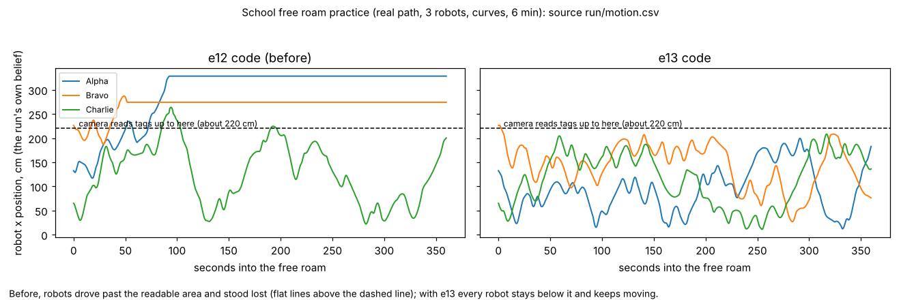
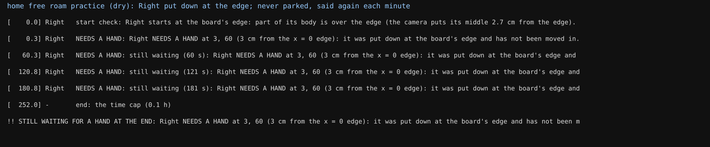
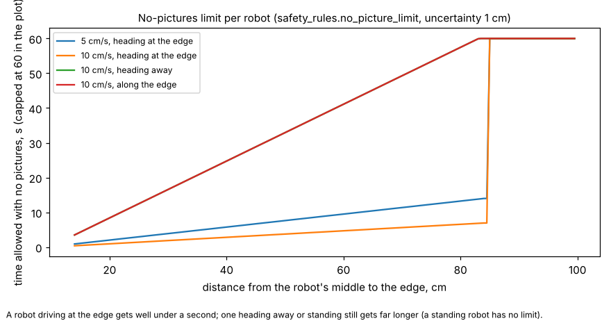
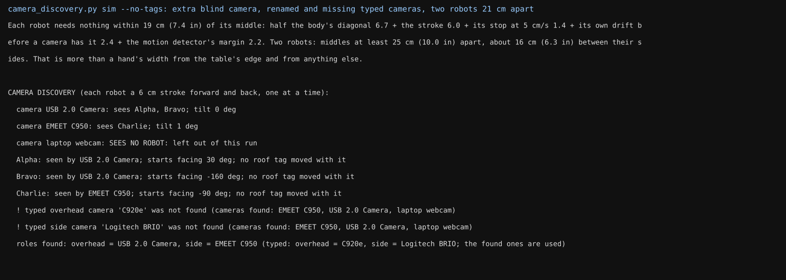
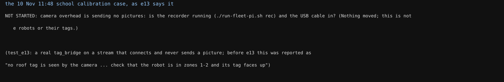
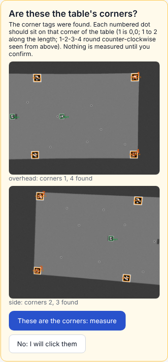
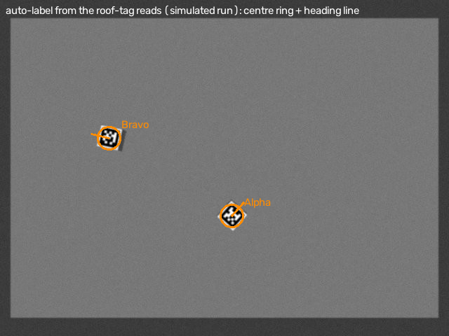

# e13: free roam inside the readable area, never give up, sleep after runs, risk-based no-pictures, camera discovery, the detector's labels, school runs home (10 Nov, simulator and logs only)

## Premise

Nine items from the coordinator (10 Nov), in priority order, plus one added mid-build: the 11:48 school calibration
ran 16 s with the camera sending no pictures and blamed the robot's tag. CLAUDE.md's new rules applied throughout:
thresholds derived from data and risk ("chosen" only with a DOE row), robots never given up on. Nothing here touched a
robot, a Pi, a camera or Tailscale; no RFID data was used.

**Measured** = from the simulator, the real-path practice (`mission_run --practice-real`) or tests, with the file named.
**Claude's reading** = interpretation, marked.

## Data

### 1. School free roam stays inside the readable area (done)

Free roam at a tag site now plans only on ground that is proven AND readable: mission_run hands freeroam.py the run's
readability map (`--readable-map readmap_start.json`: the camera model's seed, earlier runs' reads and stops, e12), and
`ProvenWorkspace.limit_to()` keeps the planner's edge rule off unreadable ground. Ground outside stays known as table
(`field(raw=True)`). A robot found outside (it started there, or drifted) makes a **stray return**: back towards its
last camera fix well inside, reversing along its track when it faces away, else a turn on proven table first, at 5
cm/s, keeping the others' plans. The start check now judges the table's own edge, not the readable limit. Switches:
`MIRLT_ROAM_READABLE=0` (whole table, e12), `MIRLT_STRAY_RETURN=0`.

| Practice (real path, school, 3 robots, 6 min) | Translating (each robot) | Time lost | Time past x 220 cm | Stray returns |
|---|---|---|---|---|
| e12 code, curves (`reh/fr0`) | 26 / 14 / 100 % | 78 / 89 / 1 % | 82 / 93 / 7 % | - |
| **e13, curves** (`reh/fr1`) | **99.9 / 99.4 / 99.9 %** | **0 / 0 / 0 %** | 0 / 0.8 / 0 % | 1 (Bravo started at x 226) |
| **e13, stopturn** (`reh/fr2`) | 79 / 76 / 79 % (stop-turn turns on the spot) | 0 / 0 / 0 % | 0 / 0.7 / 0 % | 1 (the same start) |

Measured (run/motion.csv). The readable area in practice was 30,000 cm2 (the simulated camera's).

Each line is one robot's x position over the run; the dashed line is where the camera stops reading tags.

### 2. Never give up; rejoin (done; real-path rejoin not shown)

e12's park after 60 s is now the switch (`MIRLT_EDGE_PARK=1`), off by default. A robot held at an edge stays in the
run, still and safe; the moment it is held it says **NEEDS A HAND** (event, terminal, `state.json`, `edge_parked.json`
and a red box on Mission Control's status), repeated each minute; its own checks go on (start check every 2 s, the
recovery's retries, the unsure step); once moved in it **rejoins by itself** ("REJOINED ... it waited N s"). An unsure
robot asks only after two of its own re-checks fail. Its battery floor still parks it, so a home run whose other robots
are out ends by battery or the cap, never held open for hours by a timer-free wait (Claude's reading of "can still end
on its own cap or battery rules").

- Fast simulator (test): Center put at the edge, pushed 25 cm in at 120 s: one NEEDS A HAND, one REJOINED, Center then
  moving 30 % of the run, Left / Right 68 / 67 %.
- Real path, home dry run (`reh/hand1`): Right put down at the edge: NEEDS A HAND at 0.3 s, repeated at 60 / 121 / 181 s,
  never parked, "STILL WAITING FOR A HAND AT THE END". **The move-in injected into that run (`simctl move` to the
  simulated robot) did not take effect**: the rejoin is shown in the fast simulator only (cause not traced).

**The calibration never gives up either** (coordinator, from today's school calibration 20261110-121215, AL-EB54 with
tag 4: after "go 63 P11" the tag was lost, the recovery reached its 8 cm bubble, wiggled, held, then "ENDED: the camera
lost the roof tag for over 30 s"). Now a lost tag holds with **no time limit** (standing still, the robot gets no
riskier): NEEDS A HAND at once and each minute (terminal, Mission Control's status, events); the tag bridge's motion
detector now runs in the calibration's bridge (seeded by the tag reads, it keeps following where the tag stops reading)
and a motion sighting while held makes the recovery try again from there; Stop ends it. The coordinator's
`cam_pose_sure` (11-10c, Phase A's None crash) and the other unguarded camera poses (the goto, the arc start, parking,
the heading check, the run's start) wait the same way instead of a 30 s end or a crash. e12's 30 s end:
`MIRLT_CALIB_GIVEUP=1`. Tested with a stand-in eye (held 0.9 s with no end, the motion sighting used, released when the
tag reads); not rehearsed with a lost tag in a full calibration dry run.

**Readability per tag** (tag 2 read at P11 in the 9 Nov tours, tag 4 lost it today): the calibration keeps each tag's
own evidence (`readmap_tag<id>.json` beside the site's map, carried to the next run at half weight); where a tag has 3+
tries at a point, its own evidence decides the tour, and a difference from the site's map is said and logged
(`readability_per_tag`). The site's map is unchanged for every other use.

**A turn that hunts** (the same robot's 11:54 attempt: "turn -90" timed out; the camera saw -98.4 deg; about 40 s of
hunting; legs.csv's bel0_* / bel1_* all 0.00): a timed-out turn now ends as "TURN DID NOT SETTLE: asked -90; the camera
saw it turn X; its own heading (gyro) said Y; ..." and the leg's timeout says what did come back. Claude's reading of the
zeros: they were not FOLLOW rows missing but **no LEG record for that leg at all** (legs.csv writes zeros when no pose
came back; now blanks). The firmware's LEG format matches the parser. One cause that fits: the robot still in FOLLOW
mode after the curve phase (its one `stop` lost on the WiFi), where an idle `turn` is not run as a leg: the curve phase
now resends `stop` until the robot says it finished (up to 5 times), and a timeout counts the FOLLOW rows that arrived
during the leg ("the robot was still FOLLOWING ..."). **Not confirmed**: today's logs were not available here (not in
the releases); the curve phase is off at school, so check that run's screen for "run follow" before 11:54.

### 3. Robots sleep 10 minutes after a run (done)

`idle_after_run.py`: freeroam.py (`run`), mission_run.py, calib_run.py and ladder.py, when started as programs (the
terminal's `./run-fleet-pi.sh freeroam / visit / calib / ladder ...`, and Mission Control's runs too), record their
start and end in `<conf dir>/run_activity.json`; at the end a detached waiter sleeps 10 min (Nick's number), then sends
`sleep <check-in>` to every robot (robot_sleep.py, as Mission Control does) unless a run started or is going. Practice
and dry runs never schedule it. Switch `MIRLT_IDLE_SLEEP_MIN=0`; `python3 tools/fleet/idle_after_run.py status` says
what is planned. Tests only (no robots here).

### 4. No pictures: a limit per robot from its risk (done)

`safety_rules.no_picture_limit`: room = distance to the nearest edge (or unproven / unreadable ground) minus the edge
rule's own clearance (uncertainty now, stop at that speed); closing speed = speed x its heading towards that edge (at
least sin 3 deg, its heading doubt) + the blind error's growth (0.07 cm per cm, measured). Limit = room / closing;
standing still: none. Free roam slows a robot at half its limit and holds it at the limit, released when pictures
return; run_plan's blind watch holds a robot over its limit. Every limit used is logged (`picture_limit.csv`, run_plan's
`picture_limit` rows). The bridges' "no pictures" itself is now derived from each stream's own gaps (3 x its 99th
percentile, at least 0.3 s), not 3 s. Switches `MIRLT_NOPIC_RULE=off`, `MIRLT_FRAME_WATCH_GAP=fixed`.

Each line is how long a robot may go without pictures against its distance to the edge, for one speed and heading.

Fast simulator, a 25 s outage at 60 s (one seed, 2.4 min): 3 holds, 2 watched (standing: no limit), no fall;
middles kept 17.5 cm from the edge (16.5 without the rule).

### 5. Camera discovery inside robot finding (built; on the robots behind a switch, off)

`camera_discovery.py`:

- **Clear space, derived** (not 12 in): half diagonal 6.72 + the stroke 6.0 (the heading check's own length) + its stop
  at 5 cm/s 1.4 + its drift before a camera has it (2.0 + 0.07 x 6 = 2.42, measured 29 Oct) + the motion detector's
  join margin (9 px x cm/px: 2.2 cm at the school camera's 0.24) = **19 cm (7.4 in) round each robot's middle**; two
  robots' middles 25 cm (10.0 in) apart. With no camera model, 21 cm (8.3 in).
- **Every camera**: the recorder's streams (ports 8000-8007) and /dev/video cameras it does not hold.
- **Strokes**: each robot in turn 6 cm forward and back; only one moves, so what moves in a picture is that robot.
- **Coverage map** (`coverage.json`, `coverage.md`): camera -> robots seen, pixel and table positions; per robot and
  camera the start heading (template-matched stroke), roof tag id and its turn on the robot, size in pixels, light
  (picture and near the robot), the camera's tilt (model) or a tilt hint (stroke px vs body px), px per cm, contrast
  over the noise, neighbours too close for the detector, frames used. Blind cameras are left out and said; a camera
  that sends nothing is said as such. Typed names are compared and reported; `MIRLT_CAMERA_NAMES=typed` keeps them.

| Simulator rig (3 robots, 3 cameras: one looking away; typed overhead renamed, typed side missing; two robots 21 cm apart) | With roof tags | Plain roofs |
|---|---|---|
| Coverage | right: blind camera left out, both typed names reported missing | the same |
| Start position error | 0.2-0.7 cm | 0.1-0.7 cm |
| Start heading error | 0.1 deg | 0.3-0.4 deg |
| Tag turn on the robot (truth 0) | -0.6 to 0.1 deg | - |

Measured (test_e13). On the Pi: `python3 tools/fleet/camera_discovery.py run` (asks the clear-space question in the
terminal), or in a mission's robot finding with `MIRLT_CAMERA_DISCOVERY=on` (off until Nick has seen it once).

**Added mid-build: a stalled camera is never blamed on a robot.** The tag bridge writes `frames.json` (new pictures per
camera: a frozen or blank picture does not count; reference tags read). Before any binding (calib_run, the missions'
wiggle-first, real tags runs in mission_run) `camera_feed.check` waits up to 12 s for new pictures, else refuses with
"camera overhead is sending no pictures: is the recorder running (./run-fleet-pi.sh rec) and the USB cable in?". The
binding's "no roof tag is seen" now checks the camera first. Tested with a real tag bridge on a stream that connects
and sends nothing. Switch `MIRLT_FEED_CHECK=0`.

### 6. Runs without roof tags (partly built; a school run without tags does NOT start yet)

Built: corner tags **pre-fill** the corners and the person confirms them on the pictures before Measure fits
(`corner_confirm`, default confirm; `MIRLT_CORNER_CONFIRM=auto` the old way; the camera self-check's unattended refit
keeps the old way); Measure no longer refuses a table with no roof tag when the corners are known; `sources.csv` in
every free roam and run_plan folder (each robot, each second: tags / lock / motion / lights / ml / odometry only); the
simulator's `--sim-plain-roofs`. At home, runs have never used roof tags (lights and motion): unchanged.

**A dim room** (school 12:45: the room lights went out, tag reads became intermittent, the calibration ended): in the
calibration, intermittent reads after a leg no longer end the run (e12's end after 6 holds: `MIRLT_CALIB_GIVEUP=1`);
the robot holds, still and safe, says "the camera reads its roof tag only now and then", and when the bridge's
brightness.csv shows a drop by the bridge's own lighting limit (15 %) it says "the room got darker: the camera's
brightness dropped from A to B (-P %). Turn the lights back on" in the NEEDS A HAND line; the motion detector (now on in
the calibration's bridge) and odometry carry the position meanwhile. Parking after a run's end is the one place that
still gives up (the coordinator's 11-10d "Could not park"), so a run's end is never held open. Tested with a stand-in
brightness file; not rehearsed with the lights dimmed in the simulator.

**Not done: a school run with no roof tags.** Practice (`reh/nt0`, `nt1`: school Visit points, plain roofs): "start-up
failed": run_plan's start finds each robot by its tag or lights, the motion detector cannot see a robot that stands
still, and nothing makes it move first. Seeding the motion tracker from the robots' own poses was tried and **taken
out** (a robot whose own pose is not yet in the camera's frame would be seeded in the wrong place). Claude's reading:
the fix is item 5's stroke as the start's "find" (it gives each robot's position and heading by motion), then the
motion tracker seeded from it; about half a day.

### 7. The detector trained on automatically labelled footage (pipeline built; not trained)

`tools/detector/autolabel.py`: run folders -> labels folders (one per run and camera, `confirmed`, source
`autolabel:tag`): confident reads only (used, sigma <= 1 cm), interpolated to each picture's time, projected through the
run's camera model; a frame with a robot in view but no confident read is left out. `train.py` splits by recording =
by run. `evaluate_stops`: detection rate, false detections, centre error in cm, heading error, ms a frame, against the
held-out runs' stops. The trained model is one more source in the tag bridge (`MIRLT_ML_DETECTOR=auto` and
`~/.config/mirlt/detector/best.onnx`; off by default). How-to: `docs/how-to/train-detector.md`.

Simulated runs (3): labels 0.7 px (median, p95 1.4) from the tag the camera read; 56-60 % of pictures labelled; the
motion detector as a stand-in scored 100 % of robots at the stops, centre 0.5-0.6 cm median. **Training not run**: this
machine cannot install PyTorch (blocked download). Pi time a frame: 10-25 ms, an estimate (Claude's reading).

### 8. School runs to the home Pi (done; not run against the real Pis)

`tools/pi/school_pull.sh` on the home Pi: ssh/rsync from `nick@100.72.183.28`, logs always, the stick's pictures
when mounted; never deletes (a replaced home file kept under `~/school-runs/.replaced/`); files named `*rfid*` never
copied; each finished run (15 min quiet) uploaded once from home with the home Pi's token (`--keep-local`, logs only by
default). One copy at a time (flock). How-to with the Tailscale share, the key, a test copy and the crontab line:
`docs/how-to/school-runs-to-home.md`. Tested with a stand-in ssh on this machine.

### 9. Mission Control audit and redesign ideas (ideas only)

`docs/build-plans/mission-control-redesign.md`: 9 problems with pictures (the run buttons above "Visit points in your
order", the quiz above the buttons, nothing live on what is seen, a broken picture, two parallel paths), three
directions with mockups (A guided steps, B one page top to bottom, C cockpit), the live panel's design.

### Tests

`tools/fleet/tests/test_e13.py`: 30. Full fleet suite, final code: see the end of this report.

## Conclusion

- At school, free roam now stays inside what the camera reads; in practice the robots moved 99 % of the time instead of
  standing lost (measured, simulator).
- A robot at an edge, or a calibration robot whose tag is lost, is never dropped by a timer: it asks for a hand loudly
  and carries on when moved or seen (fast simulator, stand-in tests); the real-path rejoin is not yet shown.
- Robots sleep 10 min after any run; the no-pictures action now follows each robot's risk.
- Camera discovery finds which camera sees which robot, and where, from a 6 cm stroke, with or without roof tags
  (simulator); a stalled camera is now said as a stalled camera.
- A school run with no roof tags still does not start (item 6, open).
- The detector's labels can be made from any run with pictures; training waits for the footage and a machine with
  PyTorch.

## What's next

- Nick: try Free roam at school (the readable-area fix) and watch for "FREE ROAM AREA: only where the camera reads".
- Item 6's start-by-stroke for runs without roof tags (half a day).
- Turn camera discovery on for one real run (`MIRLT_CAMERA_DISCOVERY=on`), then decide.
- Nick's choice of the Mission Control direction.
- The home Pi's setup from the how-to; then the first hourly copy.

## Appendix: switches added (all decided automatically; the old way kept)

`MIRLT_ROAM_READABLE=0`, `MIRLT_STRAY_RETURN=0`, `MIRLT_EDGE_PARK=1`, `MIRLT_CALIB_GIVEUP=1`, `MIRLT_CALIB_MOTION=0`, `MIRLT_IDLE_SLEEP_MIN=0`, `MIRLT_NOPIC_RULE=off`,
`MIRLT_FRAME_WATCH_GAP=fixed`, `MIRLT_FEED_CHECK=0`, `MIRLT_CAMERA_DISCOVERY=on` (new step, off), `MIRLT_CAMERA_NAMES=typed`,
`MIRLT_CORNER_CONFIRM=auto`, `MIRLT_ML_DETECTOR=auto` (new source, off).

## Sweep 1: new tests that may now be needed

- School free roam on the robots: none past x 220 cm; stray returns counted (events).
- A real robot put at the home edge, then moved in by hand: REJOINED within a few seconds; and the real-path
  simulator's move injection traced.
- A real calibration with the tag covered by hand for a minute mid-leg: NEEDS A HAND, then carries on when uncovered;
  and one with the robot carried out of zone 1-2 and back.
- The 11:54 run's screen.txt and raw lines: was the robot still following before "turn -90"?
- Readability per tag: a calibration with tag 2 and tag 4 robots in turn; P11 decided differently and said.
- The 10-minute sleep on the home Pi after `./run-fleet-pi.sh freeroam` (idle_sleep.log), and that a Mission Control
  run started within the 10 min cancels it.
- Unplug the overhead camera for 10 s during a free roam: per-robot limits in picture_limit.csv, holds, release.
- Camera discovery on the school Pi with the overhead camera, a laptop camera plugged in, and two robots 25 cm apart.
- The camera check against a real stalled recorder (stop camrec, start a calibration): the plain refusal.
- The corner confirm card on a real school picture (the dots on the tiles); Measure after confirming.
- Auto-labelling a real school run with frames; then the first training on the laptop.
- The school-to-home copy on the real Pis (Tailscale share, rsync on both).

## Sweep 2: possible inaccuracies in what the work relied on

- **Simulator, not robots**, for every movement result; the readable area is the simulated camera's.
- **Chosen numbers**: NOPIC_HEAD_UNC_DEG 3, NOPIC_SLOW_SHARE 0.5, frame_watch GAP_FACTOR 3 (floor 0.3 s), SEEN_K 3,
  CM_PER_PX_UNKNOWN 0.5, READABLE_MIN_CM2 6,400, camera_feed WAIT_S 12, SCHOOL_QUIET_MIN 15, ML_EVERY 3; NEED_HAND_SAY_S
  60 (display only). DOE rows added where one makes sense (docs/doe-backlog.md).
- The clear space uses the stop distances and blind drift measured on 29 Oct / the e08 logs, and the motion
  detector's 5 px closing from the labelling detector: the live bridge's detector may join blobs differently.
- The stray return assumes unreadable ground next to readable ground is table (the proven workspace's SEEN cells): true
  at school (the camera sees the whole table, it just cannot read tags there).
- The calibration's hold has no time limit: an unattended calibration whose robot is lost waits (awake) until Stop.
- The "still following" explanation of the 11:54 timeout is a hypothesis from the code, not from that run's logs.
- The battery floor as the end of a hand wait drains a waiting robot to 10 % (about 19 % an hour awake, e12).
- The no-pictures limit uses straight-line closing; on a curve the true approach can be faster for a moment.
- Autolabel trusts the tag read's sigma; a wrong but confident read (e12's P15 lock was a lock, not a tag) would be a
  wrong label.
- The Pi's detector speed is an estimate from a 2-core x86 machine.
- school_pull assumes the school repo is at `~/alvik-fleet-capstone` and the stick at `/media/nick/FLEET`.
