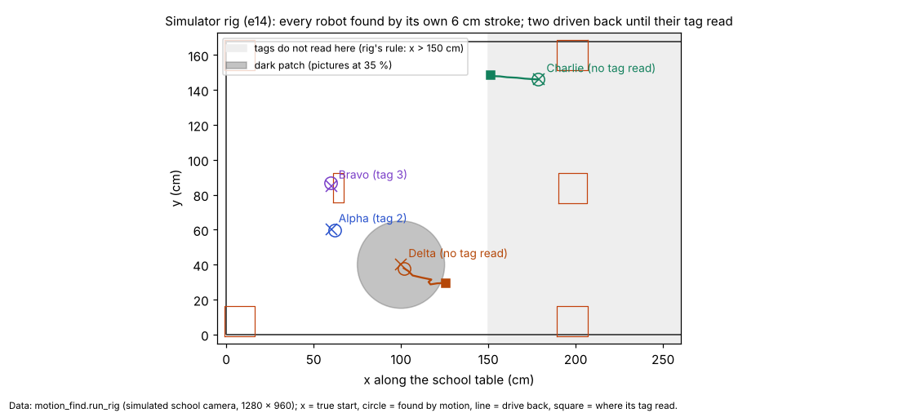
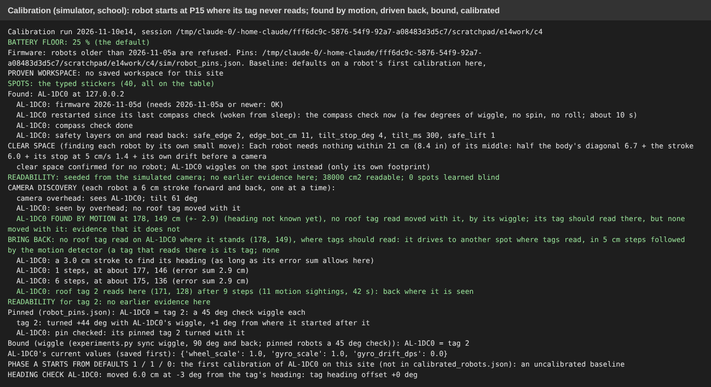
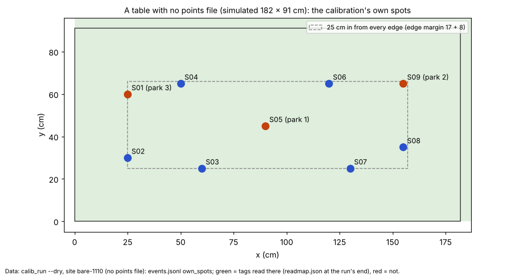
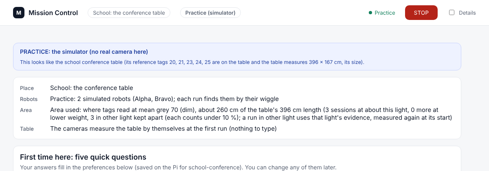
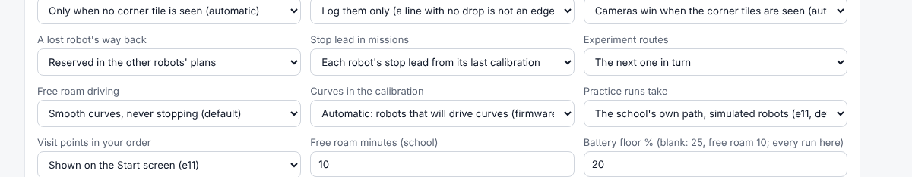
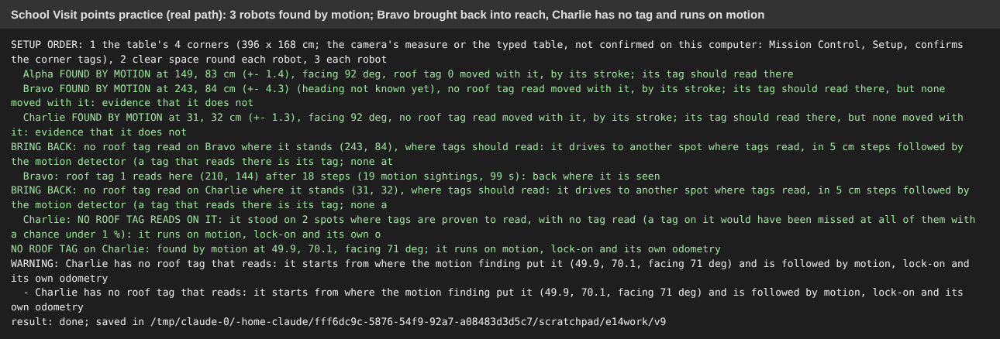
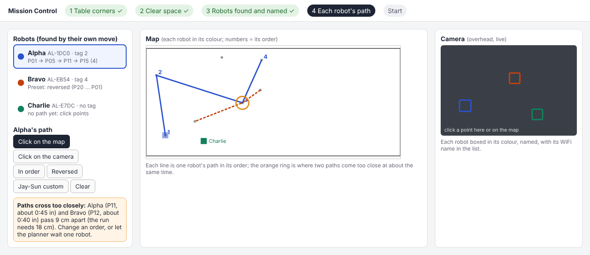
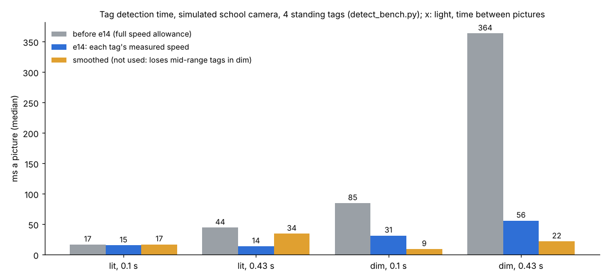
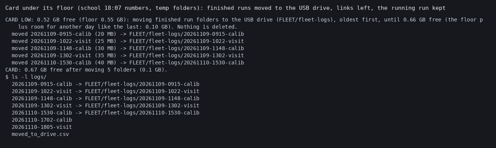
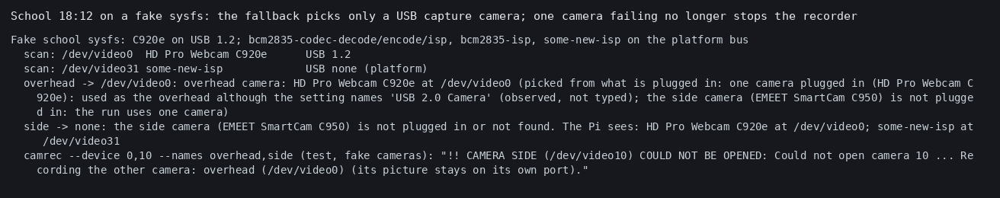

# e14: robots found by motion, calibration on any surface, readability by light and tag, pooled calibration (10 Nov, simulator and logs only)

## Premise

Seven items from the coordinator (10 Nov, from today's school runs with AL-EB54 and tag 4), then three mid-build
additions: pool calibration evidence across runs (Nick 16:40), the setup order for any surface (Nick 16:40; polygon
tables dropped at 16:45), and the school 16:22 bug (parking ended the run when the tour's last point lost the tag).
Nothing here touched a robot, a Pi, a camera or Tailscale. No RFID data. **Measured** = simulator, real-path practice
(`--practice-real`) or tests, the file named. **Claude's reading** = interpretation, marked.

**Nick's question at 15:23** ("Is the calibration built specific to this table?"): yes, until now. From the code:
`calib_run.Site` read the typed sticker points (P01-P20, zones) through `sticker_points.points_cm`, which crashed with
no points file; the park spots (P11, P01, P09), the tours (zones 1-2) and the outlet plates were all the school's. On a
new surface it would not have known what to do. Item 2 fixes this.

## Data

### 1. Every robot found by its own small move, anywhere (done; on by default)

`motion_find.py`, used by the calibration's start, the missions' binding (`wiggle_bind.bind_for_run`, so Visit points,
experiments and school free roam) and the practice runs:

1. **Clear space**: the derived clearance (e13's: 19-21 cm round each robot) is asked on Mission Control's Start
   button (OK: strokes; "not sure": each robot wiggles on the spot, which needs only its own footprint) and in a
   terminal; a robot whose pinned tag shows a stroke would not be clear wiggles anyway.
2. **Every camera** (`camera_discovery.find_cameras`); a camera that sees no robot is left out and said.
3. **One at a time**: a 6 cm stroke forward and back, or a +-30 deg wiggle. The motion gives its position (and from a
   stroke its heading); the roof tag whose reads moved with it is its tag (bound, no wiggle needed). A refused stroke
   is said as the robot's own words.
4. **Bring back**: a robot found where no tag moved with it drives in 5 cm steps, each step itself a motion sighting,
   towards where tags read, under the never-give-up rule (error sum + half the body + stop inside every edge; another
   robot or a keep-out in the way: another target). When the rule blocks it: a find-me wiggle, then NEEDS A HAND; never
   a timer. Once a tag reads near it, the wiggle binding confirms it.
5. **No tag at all**: a robot standing where the EVIDENCE proves tags read (earlier runs, the other robots' tags read
   during the finding), with no read at each such spot, is called tagless once the chance of missing a tag everywhere
   is under 1 % (Laplace read rates); it then runs on motion, lock-on and odometry (item 6).

| Simulator case (rig, `motion_find.run_rig`, school camera drawn at 1280 x 960) | Result (measured) |
|---|---|
| Two robots 25 cm apart (Alpha, Bravo) | each found by its own stroke, its tag bound; 2.2 / 1.9 cm from the truth |
| A robot at P15 whose tag never reads there (Charlie) | found 0.6 cm off; 6 steps, 6 sightings back to where its tag reads; ended 2.4 cm from the truth |
| A robot in a dark patch (pictures at 35 %, no tag reads) | found 2.6 cm off; 10 steps back; ended 0.6 cm off |
| An extra camera looking at the wall | left out ("SEES NO ROBOT") |
| Position error over 30 random spots | median 5.9 px (1.5-2 cm), p95 11.4 px: taken as the sightings' +- (6 px). A heading only from a stroke whose own picture was found again (template match): the changed area's drift pointed 100-130 deg wrong in 3 of 30 |

Each robot's true start (x), where the motion found it (circle), its drive back (line) and where its tag read (square).

**School calibration, robot at P15 with an unreadable tag** (`calib_run --dry --quick --sim-start P15 --sim-gap-at
179.7,150.5,25`, session `c4`): the simulated person did not confirm the clear space (P15 is 17 cm from the edge, the
clearance 21 cm), so it **wiggled**; found at (178, 149) +- 2.9 cm; a 3.0 cm stroke for its heading (as long as its
error sum allowed there); 9 steps, 11 sightings, 42 s; tag 2 read at (171, 128); the pin check bound it; the
calibration ran on and finished (gyro_scale 1.0290). Measured.

Found in rehearsals and fixed: a woken practice robot refused its stroke (edge guard off): the guard is now sent
first and a refusal is said; a robot circled a target in a dim patch 0.5 cm at a time (a reached target is now not
tried again); a robot held beside a parked robot (another target now); a robot WITH a tag was called tagless in a dim
patch the camera model calls readable (now only proven spots count; 3 of 3 reads is 0.8, not certain).

Switches: `MIRLT_CAMERA_DISCOVERY=off` (the wiggle binding alone), `=e13` (e13's separate step).

### 2. Calibration on any surface (done)

`calib_run.spots_mode`: the typed stickers when present AND proven (a points file of stickers, every point on the
table), else **its own spots**: inside the table and the readable area, at least 25 cm from the edges (the margin + 8,
so no point needs the near-edge staging) and from every keep-out it knows, spread out (each the candidate furthest from
those taken), 25 cm or more apart, labelled S01..., the park spots chosen among them (the readable middle first).
Switch `--spots` / `MIRLT_CALIB_SPOTS` / site `calibration.spots` (auto, stickers, own). The school keeps its stickers.

| Dry run | Spots | Result (measured) |
|---|---|---|
| A site with **no points file** (`bare-1110`, 182 x 91 cm) | 9 own spots, park S05 / S09 / S01 | finished: wheel_scale 0.9657, gyro_scale 1.0317 (true 0.97 / 1.03); distance error 2.89 -> 0.34 cm/m |
| The sim's **new room** (`site_detect` new-1110: its points are a grid, not stickers) | 9 own spots | finished the same way; its report first crashed on Jay-Sun's four points (fixed: left out when they are not there) |

The blue and orange dots are the spots the calibration chose on a table with no points file; green is where tags read.

### 3. Readable area by light and tag (done)

`readmap_store.py`: each run's OWN evidence (not its seed or carried-in history) kept as one session with its light
(the bridge's mean grey) and its tag, in `<conf dir>/readmap_store.json`; never overwritten or halved. At a run's start
the map is chosen for the light now (the bridge, or a few pictures from the recorder) and each tag: another light's
sessions fall off as exp(-0.5 (dgrey/8)^2) (grey 70 against 91: 3 %), another tag's at half weight, one session at most
10 tries a cell. The old `readmap.json`, e13's light maps and per-tag maps are carried in once. Free roam stays where
EVERY tag of the run reads at today's light (`readmap_roam.json`). The Start screen's Area line now says what is used:

Measured (test): four lit sessions reading to x 220 cm and one long dim session (tag 4) reading to x 30 cm: the lit map
still reads to x 220 (tag 4 too), the dim map for tag 4 to under 60 cm, and with the light unknown still over 200 cm.
Practice (school Visit points, shared store, d1-d7): sessions kept per light ("2 sessions at about this light ... 3 in
other light kept apart"). Dim calibration (grey 70) with tags unread past x 90 (c7e, then c7g on the final code): in c7e the tour points past x 90 were moved to the end once and then held a robot the simulator could not resolve (stopped by hand), which led to the hold's own motion sightings below; c7g finished (see D/F). Switch
`MIRLT_READMAP_STORE=0`.

### 4. No re-trying a point that just failed (done)

The 4-in-a-row came from `goto`'s aim-again after each recovery. Now a tour point whose tag was lost on the way goes to
the end of the tour once (said, the spot where it was lost added as evidence), and is skipped with its reason the
second time; parking and detours keep the aim-again (it must get back). Missions with "try anyway": the same in
run_plan (`defer_current_point`). e11's skip rules (4 losses, the view limit) are unchanged. Switch
`MIRLT_RETRY_LOST=again`. Tests.

### 5. Battery floor (done)

`engine_checks.battery_floor_used`: `MIRLT_MIN_BATTERY` first (as before), then Mission Control's new Advanced
"Battery floor %", then the site file's `battery_floor`, then the defaults (25, free roam 10); every run reads it (no
tmux needed) and says it: "BATTERY FLOOR: 20 % (Mission Control's Advanced 'Battery floor')". A calibration starting
under 40 % is marked **LOW-BATTERY CALIBRATION** in its report. DOE row added.

### 6. No-tag robots at school (done in practice)

The binding records a tagless robot with its motion position and heading; run_plan starts it there (`--start-pose`),
the tag bridge's motion detector is seeded there (`--seed-motion`, and a "seed" message), and its name gets a tag id no
tag carries. Practice, school Visit points, 3 robots, Charlie with no tag (`--practice-real --sim-tagless Charlie`,
v4): found by its stroke, driven to a second readable spot, called tagless, started at (110.1, 109.5, -81 deg); its
three points P11 / P12 / P13 were reached **1.4 / 0.3 / 0.2 cm** from the simulator's truth (stated +-2.4 cm, motion
only). With the final code and earlier lit evidence in the store (v9): Bravo, found at x 243 beyond the camera's reach
for tags, was driven back 18 steps (19 sightings, 99 s) until tag 1 read; Charlie was called tagless after 2 proven
spots and started at (49.9, 70.1, 71 deg); every point within 0.3 cm of the truth except Charlie's P11, **2.5 cm, just
outside its stated +-2.4** (measured). With no evidence in the store (v7, a fresh site) Charlie could not be called
tagless: the only proven spots were beside the other robots, and it held and asked for a hand, as designed.

**What is still unsafe (Claude's reading):** a tagless robot's heading after its start comes only from its gyro and
its motion's direction of travel; a robot standing still for long in a dim area has no source at all and would be held
by the never-give-up rule rather than lost. School free roam with a tagless robot is not tried (free roam has no start
pose input yet).

### 7. Detector training (not done)

`download.pytorch.org` is refused by this machine's network policy (403). PyPI's torch is a CUDA build (539 MB) that
also needs about 3 GB of nvidia packages, over the disk budget; the download of the wheel alone did not finish in
20 min and was stopped. Nothing left on disk.

### Added mid-build

**A. Calibration evidence pooled across runs** (`calib_pool.py`; Nick 16:40). Every phase-A leg of a robot (WiFi name)
on a site, finished or partial runs, kept as raw quantities (so legs with different values in force pool), weighted by
age (half weight after 7 days) and battery (full from 40 %, logged per leg). A run starts from the pooled values,
drives only what is still uncertain (turns, still period, rolls each skipped when its pooled +- is already as narrow as
one finished run's), and a run that ends early still adds its legs and saves the pooled values once they are that sure.
The "as sure as a finished run" line is DERIVED: phase A's own design through the same least squares at the pool's own
noise. Test (synthetic legs, 30 seeds): three partial runs, each a third of phase A with different values in force,
reach the full run's values (means within its run-to-run spread; spread at most 1.8x, from three short still periods).
Practice (`poolstore2`, simulator true values 0.97 / 1.03 / 0.30): runs 1-3 each stopped by hand at 150 s; run 2
started from the pooled values, run 3 also left out the turns (the pooled gyro already as sure as a finished run's);
run 4 started from 3 runs' pool, drove no turns, fitted **wheel_scale 0.9713, gyro_scale 1.0301** (saved), drift
0.2752 +- 0.021 not yet as sure as a finished run's (+-0.015), kept. Measured. Found: pooling staging and tour legs
widened the wheel's +- 3x (camera-aimed legs): only phase A's legs are pooled. Switch `MIRLT_CALIB_POOL=0`.

**B. The setup order** (Nick 16:40/16:45): every run's start says "SETUP ORDER: 1 the table's 4 corners (... confirmed
/ not), 2 clear space, 3 each robot moves and is found and named"; step 2 is the Start button's question, step 3 item 1.
Step 4 (each robot's path, a crossing warning in space and time) is written into
`docs/build-plans/mission-control-redesign.md` (3c) with a mockup; any number of corners is noted there as a future idea
only (polygon work started and reverted, nothing committed).

**C. School 16:22** (AL-EB54, P16, "ENDED: the roof tag is not read while parking"): the tour had ended, `park()` set
`_ending`, and both the camera wait and the hold ended at once by design (e13: "parking still gives up"). Now parking
holds with the never-give-up hold (find-me wiggles, motion sightings) like any leg (`MIRLT_PARK_GIVEUP=1` e13's end),
and a recovery with no reliable spot yet heads for the nearest spot the readability map (this tag's, today's light) says
reads, instead of "no reliable spot known". Tests (a stand-in eye: parking held, then carried on when the tag read; the old end on its switch). Practice
(`--visit-order P10,P16`, the tag unread near P16 for 60 s, c9): the tag was lost on the way to P16, the recovery
brought it back in 5 s and it parked 0.4 cm from P09; the exact school case (the tag lost DURING parking) is shown by
the test only.

**D. The picture went dark** (Nick at school 17:2x: lights off, the picture black, the run ended and the robot slept;
minutes later the camera had adjusted). `dark_watch.py` in the tag bridge, on every picture: under 35 % of the camera's
own normal brightness (or under grey 12) while pictures still come = "THE PICTURE WENT DARK: the camera is adjusting to
the light" (the dim room's 70 of 91 is NOT dark); back at 60 % steady for 2 s, with how long it took
(`dark_events.csv`: the light drop against the time to adapt, a DOE row). Every run holds every robot: the calibration
sends `stop` and waits (no legs, no recovery drives, no wiggles, no end, no sleep; a heading check cut by the dark is
done again; a run that would end waits for the light first), run_plan pauses every robot, free roam holds every robot;
all carry on by themselves. The idle sleeper does not count dark time (`<conf dir>/camera_dark.json`). Optional:
`camera_exposure.py` nudges the exposure through v4l2-ctl (manual, up to 8x, gain x1.5, then back to auto), **off**
(`MIRLT_EXPOSURE_NUDGE=1`): the simulator has no model of a real camera's exposure, so it cannot show the nudge does no
harm; a board DOE decides. Tests: the watch on a synthetic minute of black (adapt 38.8 s logged), the nudge with a
stubbed v4l2-ctl, the sleeper, the calibration's hold. Simulator (`--sim-blackout 130:60`, c10, measured): the picture went dark 83 s into phase A while a leg was running; the robot held 60 s, "the picture is back after 61 s: carrying on", seen again 0.2 cm from its odometry, the tour ran and it parked 0.2 cm from P09. gyro_scale 1.0314 saved; wheel_scale and drift kept old (their +- wider than a finished run's, since the dark cut legs short): the pooling's rule doing its job.

The calibration's never-give-up hold now also watches its find-me wiggle in every camera's picture (the robot finding's
own analysis), so a robot held where its tag does not read is found by motion and the recovery tried from there
(before, only the bridge's motion tracker, seeded by tag reads, could see it). Dim calibration (c7f, then c7g after F, measured): c7f ended at the pin check (F); c7g: found at (148, 82) where its tag does not read, brought back 18 steps (18 sightings, 41 s), bound by motion, parked 1.5 cm from P09; P14/P17/P12 skipped as unreadable (3 tries, 0 read), P20/P13 moved to the end once then skipped, parked 0.3 cm from P09. gyro_scale 1.0296 saved; wheel and drift kept old. Its before/after check (0.13 to 2.82 cm/m) rests on the few readable points only: not a judgement of the fit (Claude's reading).

**E. School 17:02 (AL-EB54): the "while parking" end outside parking, and wheel_scale 0.73 +- 0.20.** The
`_ending` end hit twice where no parking was going on (the curve phase; Tour C1's first step). Root cause, found in
the code: `stage()` parks the robot at the run's START with `park("stage")`, and `park()` set `_ending = True` and
never cleared it, so from staging on every lost tag counted as "lost while parking" and ended the run (C's fix made
the end's hold never give up, but the flag was still wrong). Now only the run's own end (`park("park")`) sets it, and
it is put back when parking returns. Test: `park("stage")` leaves it False. The wheel_scale: that run's legs are not
on this machine, so this is **Claude's reading**, not measured: the run ended early by that bug, so its rolls were few
and some cut short or driven while the tag was half-read; a fit on a few short, scattered rolls gives exactly a wide
+- (the refusal was right). The pool now treats such a run carefully: each run's legs are weighted by that run's own
scatter (its residual sigma against its own fit; a run over 2x the typical run's gets weight (typical/its)^2), and
legs over 5 sigma from the pooled fit are dropped. Test: two good synthetic runs plus one run at 0.73 with 8 cm
scatter: the pooled wheel_scale stays within 3 se of the good runs' (the bad run's weight under 0.05); the 3-partial
test still passes. Measured (test).

**F. A robot brought back is bound by motion** (rehearsal c7f, found here): a robot found where its tag does not
read was brought back until tag 2 first read at the motion detector's spot, and then the old pin-check wiggle ran at
the dim border, saw the tag stand still and ended the run ("PIN CHECK FAILED"). The first read at the tracked spot,
while that robot alone moved, is the binding evidence now; the note says so.

**G. A slow tag detector in dim light** (school 17:46, a standalone tag bridge, TV light only: 122 -> 421 ms a
picture over a minute; tag 4 standing still got 2.3 fixes a second).
- Logged with every run: `bridge/detect_times.csv` (each picture's ms, windows and whole-picture searches so far, mean
  grey, tags found, the window rule) and `bridge/pi_health.csv` every 5 s (temperature, `vcgencmd get_throttled` flags
  now and since boot, the detection ms); the status line adds "Pi 84 C, NOW throttled". Both are in the "what the
  system knows" panel design (`mission-control-redesign.md`, section 3: a Tag detection row, the Pi row).
- Risk maths: a slow detector is treated like a slow camera. run_plan's "seen" time (was a fixed 0.6 s at six
  places) is now each robot's measured fix interval: at least 0.6 s, else 1.5 x the 90th-percentile gap of its last
  40 fixes (free roam's e13 rule; the percentile so one lost-tag gap does not stretch it); said once as `slow_fixes`.
  At 2.3 fixes a second: 0.65 s. `MIRLT_FIX_GAP_RULE=fixed` the old 0.6 s. Free roam already did this (e13).
- The cause, found in the benchmark (measured, simulator): the tracker's window round each tag allows the robot's
  travel since the last picture at 300 px/s, so slow pictures make every window bigger, each picture slower, and
  the next picture later: a loop. `detect_bench.py` (the bridge's own tracker on the school camera's simulated
  pictures, 4 standing tags; also takes saved real frames with `--frames`): a picture every 0.43 s in dim light took
  **364 ms** (the school's 421), at 0.1 s 85 ms. Speed-ups measured, each against the tracker before e14:

| Speed-up | dim, 0.43 s | lit, 0.43 s | reads | Verdict |
|---|---|---|---|---|
| each window sized by the tag's own measured speed (x3, at least 40 px/s; a miss searched again full size) | 364 -> **56 ms** | 44 -> 14 ms | the same | **on** (`MIRLT_TAG_ROI=max` the old) |
| smoothing each search area in a dim picture | 364 -> 22 ms | - | **loses the mid-range tags** (5, 6: 100 % -> 0) | not used |
| whole-picture search on a half-size picture in the dark (decimate) | - | - | **loses every tag** | not used |
| whole-picture search without its enlargement in the dark | 364 -> 458 ms | - | the same | not used |
| fewer threads (OpenCV on 1) | 364 -> 467 ms | - | the same | not used here (a 2-core machine; the throttled Pi may differ: run detect_bench there) |
| whole-picture search less often for a long-missing tag | 364 -> 363 ms | - | the same | not used (the windows are the cost) |

  A moving robot (stands, then 13 cm/s), 4 seeds x lit/dim: the measured windows read exactly the same pictures as
  the old ones (229 of 320). Centre jitter unchanged (0.126 px dim). **Claude's reading:** the Pi's heat (84 C)
  likely adds to this, but the loop alone reproduces the school's numbers; detect_bench on the school Pi with saved
  frames would split the two.

**H. SIGTERM ended the bridge in a C++ abort** (school 17:46, `timeout 60`). The handler raised KeyboardInterrupt
wherever the main thread was; it landed inside `w.join(timeout=8)` while the native detector threads ran ("terminate
called without an active exception"). Now SIGTERM sets a flag (`orderly_exit.stop_on_signals`); the main loop
leaves through its orderly path, and from the first line of the shutdown SIGTERM and Ctrl+C only set the flag
(`quiet_shutdown`, also in the camera bridge's two shutdowns). Test: a real bridge on a stream of dim pictures, SIGTERM
sent during detection and again eight times while it shuts down: exit 0, its summary, no traceback. With the old
handler (`MIRLT_SIGTERM_RAISE=1`) the same test fails with the school's traceback, KeyboardInterrupt inside
`w.join(timeout=8)` (measured: the test catches it).

**I. The card full, the USB drive empty** (school 18:07: `visit` refused, card 0.52 GB, floor 0.55; FLEET 22.4 GB
free; nothing is ever "uploaded" at school). `diskguard.move_old_runs`: when the card is under its floor and a USB
drive is plugged in, every start-up check (`preflight`) MOVES finished run folders from `logs/` to
`<drive>/fleet-logs/`, oldest first: each is copied, checked (file count and bytes), removed from the card, and a link
left where it was, so the bundle, the readability learning, the pooling and the replay page find it unchanged
(`logs/moved_to_drive.csv` lists them; `moved_from.txt` in each). It stops at the floor plus a DERIVED margin: room
for another day like the last (the median run's size x the runs of the last 24 h). Never moved: a folder written in
the last 30 min (a running run), the session about to start, anything outside `logs/` (code, `~/.config/mirlt`); the
drive keeps its 5 GB floor. `./run-fleet-pi.sh space --move` does it by hand. `MIRLT_MOVE_RUNS=0` the old refusal.
Tests with temp folders (oldest first, links readable, the running run kept, the drive too full: nothing touched).

**J. A codec node taken as the side camera** (school 18:12: `rec` said "overhead /dev/video0, side /dev/video10";
/dev/video10 is bcm2835-codec-decode; camrec could not open it and the whole recorder stopped: no pictures, :8000
refused). On top of the coordinator's 7f041c8 (scan skips bcm2835 / rpi- / pispbe / rp1-cfe / unicam by name):
- (a) the fallback ("a wanted name not found: the first unclaimed camera") now picks only a real camera: one on a USB
  port, and not one the kernel says is no capture device (VIDIOC_QUERYCAP's device_caps: capture, not
  memory-to-memory; asked read-only, non-blocking). `scan` leaves out a node the kernel says is no capture device.
  So an unlisted platform node (a future Pi's ISP with a new name) is never picked either.
- (c) camrec: a camera that cannot be opened, or opens and sends no picture, is left out and said plainly ("!! CAMERA
  SIDE (/dev/video10) COULD NOT BE OPENED: ... Recording the other camera: overhead (/dev/video0)"); the others record,
  each on its own port (the overhead keeps :8000). Only when no camera opens does it stop, naming each.
  `MIRLT_REC_ALL_OR_NONE=1` the old stop for the no-picture case.
- (d) Tests: a fake sysfs with the C920e (USB 1.2, two nodes), four bcm2835 nodes and an unlisted platform node, and
  home's names in force (the school's case): the overhead is the C920e, the side stays unpicked (on the old code it
  was the platform node); the kernel's "no capture" leaves a node out; camrec with /dev/video10 failing records the
  overhead and says so, and with both failing stops naming both.
- (b) **What set a side camera name on the school Pi** (read from the code; the Pi's files are not here, so this is
  Claude's reading): nothing in e12, e13 or e14 writes `cameras.json` or changes `camera_names`. The only writers are
  `camnames.py --set` and `--init` (`--init` writes the site's own names, side "" at school), and site files change
  only through `./run-fleet-pi.sh site <name>` / `school-setup`. `resolve` keeps the side off whenever its name is
  "", so a name was in force. Two ways fit what was seen exactly (the overhead, named "USB 2.0 Camera", resolved to
  the C920e by the same fallback): (1) the site in use was **home** (`~/.config/mirlt/site` missing or saying home:
  `rec` reads it through `sites.py env`, and home's built-in names are "USB 2.0 Camera" and "EMEET SmartCam C950"),
  or (2) a `cameras.json` in the school's folder with home's names (an earlier `--set` or an `--init` run while home
  was in use). Before 7f041c8 the codec nodes were also in `scan`'s list, so the fallback found an "unclaimed
  camera" to give the side. To tell which on the Pi: `python3 tools/fleet/sites.py; cat ~/.config/mirlt/site;
  python3 tools/pi/camnames.py; cat ~/.config/mirlt/sites/school-conference/cameras.json`.
- Found on the way: four tests in `tools/pi/tests/test_launcher.py` fail on main before and after this change (they
  expect the strict names; e06's fallback changed that). Not in the fleet suite; left for a decision.

### Tests

`tools/fleet/tests/test_e14.py`: 41. Two e12/e13 tests pinned to the old ways' switches. Full fleet suite on the final
head: FULL_SUITE.

## Conclusion

- A robot is now found by its own small move anywhere on the table, with or without a tag that reads, and driven back
  to where its tag reads without a hand (simulator and practice); the school's P15 case runs through to a finished
  calibration in the simulator.
- The calibration no longer needs stickers; on a table with no points file it makes its own spots and finishes.
- One dim session can no longer shrink the lit map; the light and the tag choose the map, and the Start screen says so.
- A school Visit run with a tagless robot starts, tracks and finishes in practice, its points within 1.4 cm.
- Partial calibrations now add up instead of starting over.
- The school's "while parking" end (16:22, 17:02) came from staging, not parking; fixed at its root.
- A dark picture is now a camera problem: every run holds and carries on by itself (simulated 60 s blackout).
- A run with wide, scattered legs (17:02's wheel 0.73 +- 0.20) no longer moves the pool much.
- The dim room's slow detection was mostly the tracker's own loop (slow pictures, bigger windows); measured windows
  cut it 364 -> 56 ms a picture in the simulator with the same reads. A SIGTERM no longer aborts the bridge.
- A full card with a USB drive plugged in no longer refuses a run: old runs move to the drive, nothing deleted.
- A codec node is never taken as a camera, and one camera failing no longer stops the recorder for the others.
- Not done: detector training (blocked download); free roam with a tagless robot.

## What's next

- Nick at school: one calibration with AL-EB54 started at P15, Start's clear-space question answered "OK"; watch for
  "FOUND BY MOTION" and "BRING BACK".
- `python3 tools/fleet/calib_pool.py show AL-EB54` on the school Pi after the next calibration (it pools from then on;
  today's earlier partial runs are not in it: their legs.csv could be imported, a small script).
- Nick's choice of the Mission Control direction, then step 4.
- On the school Pi: `python3 tools/fleet/detect_bench.py --frames <saved dim frames>` cool and hot, and one dim
  Visit with `bridge/detect_times.csv` and `pi_health.csv` read (the heat's share of the slow detection).
- Training on the laptop (PyTorch there).

## Appendix: switches (all decided automatically; the old way kept)

`MIRLT_CAMERA_DISCOVERY=off|e13`, `MIRLT_CLEAR_SPACE_OK=1`, `--clear-space`, `--spots` / `MIRLT_CALIB_SPOTS`,
`MIRLT_READMAP_STORE=0`, `MIRLT_RETRY_LOST=again`, `MIRLT_CALIB_POOL=0`, `MIRLT_PARK_GIVEUP=1`, `MIRLT_EXPOSURE_NUDGE=1` (off: the nudge), `MIRLT_TAG_ROI=max`, `MIRLT_FIX_GAP_RULE=fixed`,
`MIRLT_SIGTERM_RAISE=1`, `MIRLT_MOVE_RUNS=0`, `MIRLT_REC_ALL_OR_NONE=1`; Advanced "Battery floor";
simulator: `--sim-blackout T:DUR`, `--sim-dark`, `--sim-extra-camera`, `--sim-light`, `--sim-start X,Y`, `--sim-tagless`, `--readmap-store`.

## Sweep 1: new tests that may now be needed

- On the robots: the finding stroke at the school camera's far end (P15) and the bring-back with the real motion
  picture; its sightings against tag reads where the tag reads (sets MOTION_PX_SIGMA).
- Two robots 25 cm apart at school, and a robot with its tag covered, then uncovered (the tagless verdict).
- The Start button's clear-space question answered "Cancel": every robot wiggles, none strokes.
- A real dim session (lights off) then a lit one: the Start screen's Area line, and the lit map unchanged.
- Calibration on a different real surface (home board) with no stickers: own spots, the fit against a later free roam.
- Pooling on the robots: two calibrations stopped early, then one more; the pooled values against a full run.
- A real calibration with the tour's last point losing its tag: parking holds and returns.
- Battery floor from Mission Control's Advanced reaching a tmux-started calibration.
- The school Pi: `detect_bench.py --frames` on saved dim frames, cool and hot; a dim Visit with the measured windows
  (fixes a second against MIRLT_TAG_ROI=max).
- `./run-fleet-pi.sh space --move` on the school Pi with FLEET plugged in; then `jay-bundle` and the replay page on a
  moved run (through its link), and the same with the stick unplugged (the link dangles: said, not a crash?).
- `rec` on the school Pi after the camera fix: `python3 tools/pi/camnames.py` lists the C920e only.

## Sweep 2: possible inaccuracies in what the work relied on

- **Simulator, not robots**, for every movement result; the motion analysis ran on drawn pictures (tag_cam), not the
  C920e's.
- MOTION_PX_SIGMA (6 px) is measured on drawn pictures only; the e13 rig's steep cameras gave under 2 px.
- **Chosen numbers** (DOE rows added): MIN_STROKE_CM 2, TAGLESS_P 1 %, WIGGLE_DEG 30, OWN_SPOTS_MIN_CM 25, LIGHT_SCALE 8
  grey levels, OTHER_TAG_W 0.5, SESSION_CAP 10, LOW_BATTERY_NOTE_PCT 40, AGE_HALF_DAYS 7, BATTERY_FULL_W_PCT 40.
- The simulated "person" confirms the clear space from the truth; a real person may say yes where a stroke is not clear.
- The tagless verdict trusts the readability evidence's light matching; a tag that reads poorly for its own reasons
  (bent, dirty) at a well-lit proven spot would be called tagless and run on motion (said loudly; its tag still binds it
  later if read).
- The light used at a calibration's start is the bridge's brightness so far (a few seconds); a light change mid-run is
  kept under the run's median.
- Pooling assumes the robot's wheels and gyro do not change between runs beyond the age weighting; a firmware or tyre
  change would need the pool cleared (not automatic).
- The detection benchmark's pictures are drawn (Gaussian noise); a real dim picture's noise is different, so the
  measured windows' gain and the smoothing's harm are simulator results until detect_bench runs on real frames.
- What set the school's side camera name is read from the code, not from the Pi's files.
- Moved runs are found through links; a tool that skips links (os.walk without followlinks) would miss them: the
  bundle, readability learning and replay use glob / isdir, which follow them (checked in the test), others not checked.
- The full-run threshold uses phase A's rolls only (not the tour legs a finished run also fits), so it is a little
  looser than a real finished run.
- run_plan's deferral moves a point's goto and dwell together; a point shared by two robots' lists is deferred per robot.
