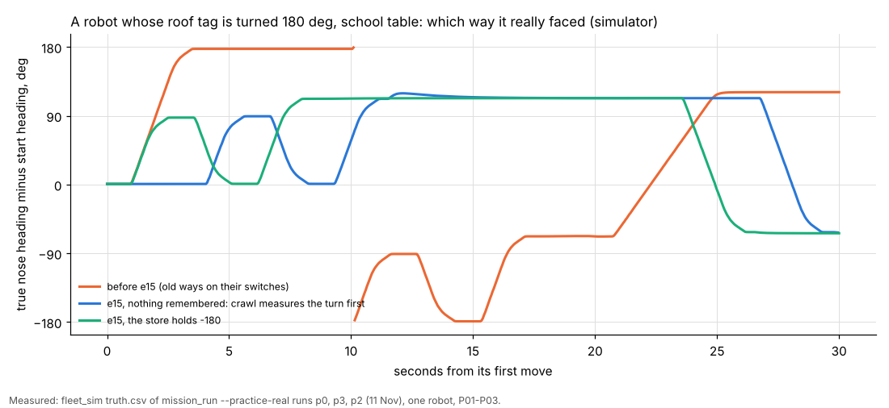
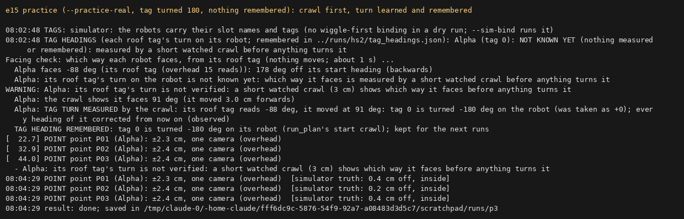

# e15: each roof tag's turn remembered, facing checks on the corrected heading (11 Nov, simulator and logs only)

## Premise

School, 10 Nov 18:54 (run 20261110-185402-visit-robots, code 02375cd). AL-1DC0 ("Alpha") wears roof tag 2 stuck on
turned 180 deg. On 9 Nov the start's heading check found it (-180). On 10 Nov the camera lost the tag during the heading
check, so the run started on the raw tag heading:

1. the start facing check said "faces -99 deg ... 171 deg off (backwards)" and turned the robot;
2. the camera and its own pose disagreed by 18.1 cm (fixes refused);
3. at 2.4 s run_plan re-learned the turn ("corrected by -180 deg from now on");
4. but every later facing check (facing-recheck-N, and the rejoin after each hold) read the raw tag again, said
   "backwards" (158-180 deg off) and turned it, so it curved, disagreed by 11 cm, was held 3 times and the run ended at
   96.7 s.

Nothing here touched a robot, a Pi or a camera. **Measured** = simulator, real-path practice (`--practice-real`) or
tests. **Claude's reading** = interpretation, marked.

## Data

### What the school logs show (measured, `v1854`, read-only)

- Bind bridge (`bind/bridge/fixes.csv`): tag 2 read every 0.13 s at (85.5, 83.7), raw heading -99.8, through the
  wiggles. The last read is at 859.33 s; the heading check's 6 cm `go` started at 859.84 and ended at 861.15. No read
  after that, while pictures kept coming (40 ms each, `bridge.txt`). The binding said "heading check not done ... the
  run's heading watch checks it on its first drives". `binding.json`: `"yaw_off": {}`.
- The run's own bridge, started 12 s later, read the same tag at (86.8, 90.0), 6 cm further on, at once.
- **Claude's reading:** the spot was readable; the binding's bridge lost the tag (on 9 Nov's code, before e14's
  measured-speed windows). Standing longer and reading over a longer window would likely have caught it.
- run_plan's facing checks read the tags file (`tags.json`, no yaw_off), never the turn run_plan had re-learned
  (`b.yaw_fix`). That is the code path behind item 4 above.

### 1. The store (done; on by default)

`tag_heading_store.py`: `<conf dir>/tag_headings.json`, per tag id: the turn (what is added to the tag's camera
heading), the count of measurements in a row that agree, first and last seen, how, which robot, and a log of changes.
Every place that measures a turn writes to it:

| Where it is learned | Records |
|---|---|
| the binding's heading check (wiggle_bind) | measured turns |
| run_plan's heading watch (HEADING RE-LEARNED) | the total turn (the tags file's plus yaw_fix) |
| run_plan's start crawl (new, item 3) | the total turn |
| calib_run's heading check and heading watch (HEADING RE-LEARNED) | the eye's turn |
| free roam's proof drive (start_discovery `tag_off`) | taken from `discovery.json` after the run, on top of the bridge's turn |

A remembered turn is only a starting guess. A new measurement that disagrees by more than 30 deg replaces it ("TAG
HEADING CHANGED ... the evidence wins"). One that agrees adds to the count. `python3 tools/fleet/tag_heading_store.py
show` lists what is remembered. Switch: `MIRLT_TAG_HEADING_MEMORY=0` (or the site's `tags.heading_memory: false`)
keeps it per run only. A dry run keeps its own store per session unless given `--tag-heading-store`.

### 2. Every facing check uses the corrected heading (done)

`facing.corrected_tags`: the tags file's turn plus this run's `yaw_fix`, for every roof-tag facing check: the start,
`facing-recheck-N`, `facing-after-calibration` and `facing-rejoin-<robot>`. All of them go through
`FC.run_plan_check` → `tag_check`, which is the only code path that reads a tag heading for a facing decision.
`tags.json` now carries `yaw_state` per tag: measured / remembered / motion / unknown. Test: the simulator's picture of
a turned tag reads "backwards" raw, and "faces 90" with the run's turn. Switch: `MIRLT_FACING_RAW=1`.

### 3. A failed heading check never leaves the robot on its raw heading (done)

`calib_run.heading_check_patient`, used by the binding and by the calibration:

1. the heading check as before;
2. tag lost: up to 3 retries where the tag reads. Each retry stands longer (enough time for 2 whole-picture searches,
   `FULL_EVERY` pictures at the tag's measured fix interval) and reads over a longer window (6 of its own fixes). Each
   retry doubles both. A robot that stopped where its tag does not read backs out and nudges the other way;
3. then the remembered turn;
4. then the direction of the robot's own finding stroke (e14), as a guess;
5. else "unknown".

In run_plan, a robot whose turn is unknown is measured by the watched crawl (3 cm) **before any straightening move**.
The crawl sets its `yaw_fix`, and the turn is remembered. A remembered or motion turn from which a turn of more than 45
deg would follow is also confirmed by the crawl first. The calibration no longer ends on a lost tag: it measures again.
Switch: `MIRLT_HEADING_CHECK=once`.

### 4. Simulator and practice (measured; 1 robot, school site, P01-P03)

| Run | Setup | Start | Result |
|---|---|---|---|
| p0 | **old ways on their switches**, tag turned 180 | raw "178 deg off (backwards)": turned the wrong way | 26.5 cm disagreement, re-learned at 10.7 s; P01 at 32 s |
| p3 | `--practice-real`, tag 180, **empty store** | "not known yet": crawl → turn -180 learned → remembered | no wrong turn; P01 at 22.7 s; points 0.2-0.4 cm off |
| p2 | `--practice-real`, tag 180, **store holds -180** | "faces 92 deg, 2 deg off" | no crawl, no disagreement, 0 fixes refused |
| p4 | tag **re-mounted straight**, store -180 | remembered turn implies 179 deg: crawl → turn 0 | store "CHANGED -180 → 0" |
| p5 | tag 180, empty store, **robot restarts at 15 s** | crawl learns -180 | rejoin facing check "-156 deg, 0 deg off": not flipped; run done |
| b6 | `--sim-bind`, tag lost 4 s in the heading check | read again after 1.0 s: measured -180 | remembered; start "1 deg off" |
| b7 | `--sim-bind`, tag lost for good, empty store | 3 retries (1 / 2 / 4 s), then unknown | run_plan's crawl learned -180; done |
| b8 | `--sim-bind`, tag lost for good, store -180 | 3 retries, then the remembered -180 | "2 deg off"; done |

Every run's points ended 0.2-0.4 cm from the simulator's truth.

The orange line (the old way) shows the robot first turned a half turn the wrong way. With e15 (blue: nothing
remembered, green: remembered) it only makes the program's opening 90 deg wiggle and then heads for P01.

**Found and fixed during the practice runs:** after the crawl, the camera guard stopped the start once ("disagree by
0.0 cm, fixes refused 16"). Its own pose had dead-reckoned the crawl along the wrong guess. The robot's pose is now set
from the crawl at once, and the guard skips 1 s of pictures taken at the old heading (p3, p5: no stop).

**Not done:** `--practice-real` has no binding step (by e11's design), so in practice the binding's retry is shown only
with `--sim-bind` (b6-b8). Practice starts in the "heading check not done" state.

### Tests

`tools/fleet/tests/test_e15.py`: 16 tests. The store (new, agrees, changed; the switch; free roam's harvest). The
corrected facing on a drawn turned tag. Unverified turns go to the crawl. The patient check: read again; back out and
nudge the other way; remembered; unknown; a wrong memory overridden. The crawl's learning, including a re-mount.
run_plan's re-learn is remembered. mission_run starts from the memory. The binding's states reach `tags.json`.
Full fleet suite on the final code: **878 passed, 9 skipped** in 18.0 min (baseline 862 / 9). Only docs changed after it ran.

## Conclusion

- A tag turned on its robot is now measured once and remembered per site. A later run starts from it and checks it
  again.
- No facing check reads a raw tag heading once the turn is known, whether measured, re-learned or remembered. The
  school's repeated "backwards" turns came from that path and do not happen in the simulator.
- A heading check that loses the tag tries again, then uses the memory. When nothing is known, a 3 cm watched crawl
  measures the turn before anything turns the robot.
- A re-mounted tag is caught by the crawl or the heading check, and the store is corrected.

## What's next

- At school: one Visit run with AL-1DC0 as on 10 Nov. Expect "TAG HEADING REMEMBERED/CONFIRMED" in the binding, or
  "REMEMBERED -180" and "faces ~90". Then `python3 tools/fleet/tag_heading_store.py show` on the Pi.
- The store starts empty on the Pi. The first run measures the turn, or crawls if the heading check fails again.
- The keep-going cap ended 18:54 after 3 holds (`--all-held-max 3`). That is a give-up rule (see the questions).

## Appendix: switches

`MIRLT_TAG_HEADING_MEMORY=0` / site `tags.heading_memory: false` (per run only), `MIRLT_HEADING_CHECK=once` (the check
once, raw heading on a loss), `MIRLT_FACING_RAW=1` (facing checks on the tags file alone); simulator `--sim-hc-loss S`,
`--tag-heading-store DIR`.

## Sweep 1: new tests that may now be needed

- On the robots: AL-1DC0 with tag 2. One run with an empty store, then one with the store filled. Watch the crawl's
  measured turn against the school's 9 Nov heading check.
- The crawl at a table edge, where the forward crawl is refused and it crawls backwards. Not exercised in practice.
- A tag turned 90 deg, where the snap tolerance of 20 deg matters, on the real camera.
- Two robots, where one's crawl happens next to the other.
- The calibration with its heading check losing the tag (the retries and the remembered turn), on the robots.
- Free roam's harvest of `discovery.json` in a real school free roam.
- The binding's retry timings at school in dim light: 2.3 fixes a second gives longer windows.

## Sweep 2: possible inaccuracies in what the work relied on

- **Simulator, not robots**, for every movement result. The tag loss is a simulated gap of all tags, not the real
  tracker's loss.
- Chosen numbers: HC_RETRIES 3, HC_READS_WANTED 6, HC_FULL_SEARCHES 2 (DOE note in the code); SAME_DEG 30 (a
  definition); CRAWL_GUARD_S 1.0; the 45 deg rule for confirming a remembered turn (SIDEWAYS_DEG, a hand-placement
  assumption).
- The cause of the school loss (the bridge's tracker, not the spot) is Claude's reading of two logs.
- A robot whose turn is unknown but whose raw heading needs no straightening is not crawled. Its first drives rely on
  the heading watch, as before. That is a gap when a robot with a 180 tag is also put down backwards.
- The finding stroke's direction is used as a guess, assuming the robot did not turn between the stroke and the
  check. The wiggle returns it, and a quarter turn for room would not.
- The store is per tag id: a tag moved to another robot carries its old turn until the first check disagrees.
- Free roam's turn is recorded only after the run, so a free roam that crashes does not add it.
- The rejoin after a restart showed a 0.0 cm "camera and own pose disagree" reset after its calibration spin (p5).
  The run carried on. Not checked whether the code before e15 does the same. Not chased.
