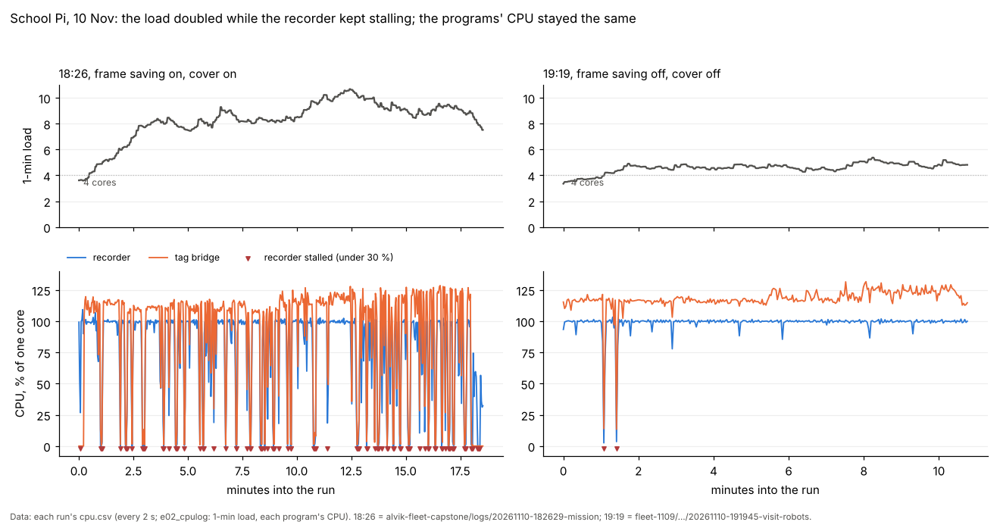
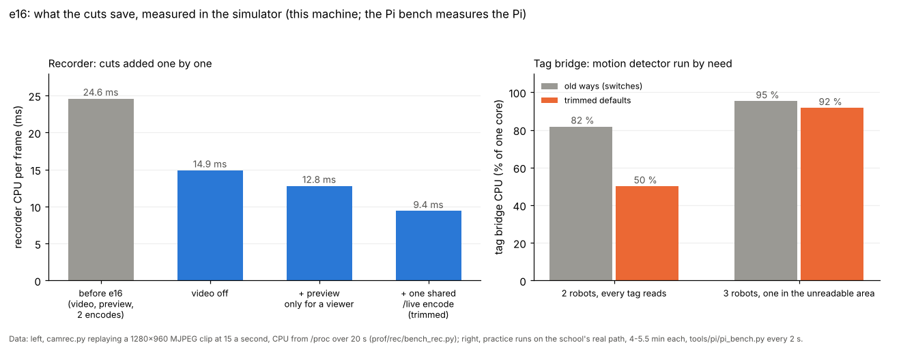
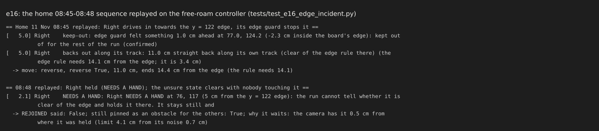

# e16: the Pi audit and trim, the home edge incident, the wheel fit (11 Nov, simulator, tests and logs only)

## Premise

- School target (Nick, 11 Nov): 3 robots and 2 cameras must run smoothly on the school Pi **as it is**. Cooling only if
  it is really needed. Video is not needed ("If it's not useful for executing the program, we can drop it").
- School 10 Nov: today's code ran at a 1-minute load of 8-10, and the clock dipped to 600-900 MHz. 9 Nov's code ran at
  4.5-5. Yet each tracked program used about the same CPU in both runs.
- Home 11 Nov 08:45-08:48 (free roam, commit 4732a48): Right stopped at an edge and stood still. Then the run said it
  "REJOINED ... moved in" one second after NEEDS A HAND, with nobody there. Then Center pushed it off the table.
- AL-EB54's 17:02 wheel fit (0.726 ± 0.20, refused) disagreed with all 126 of its drives that day (0.990).

Nothing here touched a robot or a Pi. **Measured** = school logs, simulator, practice runs on the real path
(`--practice-real`), replays or tests. **Claude's reading** = interpretation, marked. This machine has 2 cores; the Pi
has 4.

## Data

### 1. Where the school Pi's load came from (measured, the 10 Nov logs)

| Run | Code | Frame saving | Load (median) | Cores busy (sum) | Tracked programs | Recorder stalls* | Throttled now |
|---|---|---|---|---|---|---|---|
| 18:26 | 10 Nov | on | **8.5** | 267 % | 248 % | **45** (2-14 s each) | 12 % of samples (600 MHz) |
| 18:54 | 9 Nov | on | **7.5** | 249 % | 233 % | 6 in 97 s | 0 % |
| 19:03 | 9 Nov | off (drive full) | 5.2 | 257 % | 240 % | 7 | 0 % |
| 19:19 | 9 Nov | off (drive full) | 4.6 | 252 % | 244 % | 2 | 0 % |

\*Stall = the recorder under 30 % CPU for a 2 s sample while the run went on; the tag bridge stops with it (no
pictures). Source: each run's `cpu.csv`, `perf.csv` and `mission_summary.json`.

- **The high load is not today's code.** The 18:54 run was 9 Nov's code, and its load was 7.5. CPU in use was the
  same in all four runs (249-267 % of 400 %).
- What changed with the load is the stalls. In a stall, every core goes idle while tasks wait on a device, and Linux
  counts a task waiting on a device in the load, just like one waiting for a core.
- The two runs with frame saving on had the stalls. Frame saving writes 60 s parts to the same USB drive as the 14 GB/h
  video. In the 19:03 and 19:19 runs frame saving had stopped by itself, because the drive was under its floor.
- **The clock dips are two things.** The kernel's clock (freq_mhz) fell to 600-900 MHz only during stalls, when every
  core was idle. The firmware's real clock (arm_mhz) sat at **600 MHz with "throttled now"** (0xe0006) during the
  18:26 run at 84-86 C. That second one is heat (cover on).
- The recorder is pinned to one core (`--cores 1`) and that core was at 100 % in 61-95 % of samples. Every thread
  queued for it also counts in the load.
- Jay-Sun's 21:08-21:57 runs had 176-200 % of CPU that no tracked program used. Each run starts a camera refit in the
  background when it ends (3-13 min, `tagcal_refit/` file times). These runs were 6-7 min apart, so the refits piled up.

Each time the recorder stalled (red marks), the tag bridge stopped too. The run with many stalls carried twice the load
on the same CPU.

**Claude's reading:** the stalls come from writes to a nearly full USB stick: the video, plus frame saving's 60 s
parts. The recorder blocks in its once-a-second `frames.csv` flush (`camrec.py:1161`), which sits in its capture loop.
Not proven: there is no iowait or D-state record from the Pi (`cpu.csv` counts iowait as idle). The bench below
records both.

### 2. Everything a school run starts, and what each does (code review)

| Process / thread | Per picture or tick | Needed to run? | Waste found (file:line) |
|---|---|---|---|
| **Recorder** (`camrec.py`), 1 thread per camera, pinned to 1 core | decode MJPEG; gray copy into shared memory; **video: re-encode every frame** (`camrec.py:1100`, `:139`); **preview: copy + text + JPEG every 2nd frame even with nobody watching** (`:1176`); **/live: grey q95 encode per client per frame** (`:239`, `live_part`) | pictures yes; video no (Nick) | video re-encode; preview with no viewer; the /live encode repeated per client (bridge, frame saver, facing checks, Mission Control); flush in the capture loop (`:1161`) |
| **Tag bridge** (`tag_bridge.py`), 1 worker per camera + reader threads | decode the /live JPEG again (`:896`); tag search (windows); **motion detector on every picture** (`:415`); brightness and frozen-picture checks; CSV rows per picture | yes | **motion detector ~55 % of the bridge's time** (py-spy) even when every tag reads; 100 Hz socket poll (`:919`); encode in recorder + decode here (the shared-memory ring exists, unused by this bridge) |
| **mission_run**: cpu log, frame saver (2 /live readers + part writer), coordinator tail, space and bridge watchers | frame saver keeps pictures at 12/10 a second, writes 60 s `.avi` parts to the USB drive; perf.csv every 2 s | frame saving: for reports, not for running | the second /live reader per camera (now free, see cut 3); bursty 60 s part writes onto the drive the video also uses; `e02_cpulog.find_pid` scans every `/proc/*/cmdline` every 2 s for `cam_bridge.py`, which a tags run never starts (`e02_cpulog.py:264`) |
| **run_plan** | main loop at 100 Hz, ~20 watchers a pass (`run_plan.py:4285`); filter on every RAW row even in blend mode (`:533`, logged only) | yes | busy spells at 100 % for 12-118 s in the 18:26 run, during camera stalls / blind spells, not re-plans (re-planning was 38.6 s of the run's 20 plans). Not reproduced in the simulator |
| **Background refit** (`site_fit.py`, started after each run, `mission_run.py:1956`) | full camera refit, 3-13 min, ~1 core | no (for the next setup) | piled up across runs 6-7 min apart (Jay-Sun, 176-200 % untracked) |
| **Mission Control** | page polling, 1-3 % | yes | none of note |

### 3. Profile in the simulator (measured)

Practice on the real school path, 5.5 min, 1 camera, school site. Source: `tools/pi/pi_bench.py` (`/proc`, every 2 s)
and py-spy.

| | head, old ways (switches) | head, trimmed defaults | 9 Nov code (02375cd) |
|---|---|---|---|
| 3 robots, 40 points (half where tags do not read): tag bridge CPU | 95.3 % | 91.7 % | 96.9 % |
| run_plan (practice) | 9.0 % | 9.6 % | 16.1 % |
| mission_run | 10.2 % | 10.3 % | 12.1 % |
| Real-run programs, sum | 115 % | 112 % | 126 % |
| 1-min load (2 cores) | 1.84 | 1.83 | 2.48 |
| Detection per picture, median (95th pct) | 23.6 (62.7) ms | 23.4 (63.0) ms | - |
| Re-plan time, median | 0.34 s | 0.34 s | - |
| 2 robots, readable points only (4 min): tag bridge CPU, load | 81.8 %, 1.74 | **50.1 %**, 1.22 | - |

- The simulator does **not** reproduce the school's load gap. The 9 Nov code is slightly heavier here. That fits
  section 1: the gap was stalls and heat, not CPU.
- With 2 robots where every tag reads, the trimmed defaults cut the real-run programs from 95 % to 64 % of a core (the load from 1.74 to 1.22), with the same fixes.
- In the 3-robot run Charlie worked in the area where tags don't read, so the motion detector correctly stayed at full
  rate (369 of 3,487 pictures skipped).
- The first plan for 3 robots and 40 points took 13.2 s here. Without `--visit-keep-unreadable` the split left
  Charlie with nothing, and planning **failed after its full 60 s** ("no priority order gave a plan without robots
  meeting").

The recorder replayed a 1280x960 MJPEG clip at 15 a second, with /live readers attached. Source:
`prof/rec/bench_rec.py`, CPU from `/proc` over 20 s.

| Recorder setup | CPU per frame | Saving |
|---|---|---|
| Before e16: video, preview always, one encode per reader, 2 readers | 24.6 ms | - |
| Video off | 14.9 ms | -9.7 ms |
| ... and the preview only for a viewer | 12.8 ms | -2.1 ms |
| ... and one /live encode shared by every reader (**the trimmed default**) | **9.4 ms** | -3.4 ms |
| Trimmed, 1 reader | 9.1 ms | (a 2nd reader now costs 0.3 ms) |

On the left, each bar adds one recorder cut; on the right, the tag bridge's CPU before and after, in a practice where every tag reads and in one where a robot works where tags do not read.

### 4. The ranked cuts

| # | Cut | Measured saving | Risk | Switch (old way) | Done |
|---|---|---|---|---|---|
| 1 | Video off by default (`run-fleet-pi.sh` start_recorder) | recorder -40 % (9.7 of 24.6 ms a frame); 14 GB/h less written to the USB drive (Claude's reading: the stalls' main source) | low: replay clips and training use the saved frames, not the video (`replay_clips.py:20`) | `MIRLT_VIDEO=1`, `rec video`, `full-video` | yes |
| 2 | Preview made only while a browser watches port 8000 | -2.1 ms a frame | low | `MIRLT_REC_PREVIEW=always` | yes |
| 3 | One /live encode per frame, shared by every reader | -3.4 ms a frame per extra reader (bridge + frame saver + facing check + Mission Control) | low: same bytes to every reader | `MIRLT_LIVE_SHARE=0` | yes |
| 4 | Motion detector at full rate only when needed (a robot unread by its tag for 0.6 s, or a seed), else 1 in 4 | its share was ~55 % of the bridge (py-spy); 2 robots where every tag reads: bridge **-39 %** (81.8 → 50.1 %), the same fixes (1,320 a robot); 3-robot practice: -4 % (rightly kept on for an unread robot) | medium: a tag lost while the gate was off gives the motion track up to 3 pictures of lag | `MIRLT_MOTION_RATE=every` | yes |
| 5 | Background refit: nice 19, one at a time | up to ~1-2 cores between back-to-back runs (Jay-Sun's evening) | low: a skipped refit can be started from Mission Control | `MIRLT_REFIT_NICE=0`, `MIRLT_REFIT_ONE=0` | yes |
| 6 | A full drive stops the recording, never the live pictures (flush and writer guarded) | stops one way the tracking stream could die | none | - (a guard) | yes |
| 7 | Tag bridge: socket read with a 50 ms timeout instead of a 100 Hz poll | ~3 % of the bridge (py-spy self time) | low | `MIRLT_BRIDGE_POLL=1` | yes |
| 8 | Frames saved at a lower rate (proposed 4 a second, from 12/10) | 2.8 → ~0.9 GB/h per camera written to the USB drive | Nick decides (section 5) | `MIRLT_FRAMES_HZ` | knob only |
| 9 | Tag bridge reads the recorder's shared-memory ring (no encode, no decode) | the encode (~3 ms) + the bridge's decode per picture | medium: a code path the tag bridge has never used | - | proposed |
| 10 | run_plan loop at 50 Hz; filter off in blend mode | ~ a few % of a core | stop latency +10 ms; the filter log is used for analysis | - | not done |

Claude's reading of the Pi: the recorder used one full core, pinned. With cuts 1-3 it should need about 40 % of that
work (9.4 / 24.6), which frees about half a core and ends the queue on core 1. The tag bridge drops by up to a third
when every tag reads. The Pi bench will measure all of this (section 10).

### 5. The saved frames: what they are for, what they cost, a proposed default

- **What uses them.** Replay clips: `replay_clips.py` cuts its clips from the tracking-rate parts or the event clips.
  Detector training: `autolabel.py` labels the tracking-rate parts. Dr. Sodhi's joint evaluation: the same labelled
  frames.
- **What they cost.** One camera at 12 a second wrote 862 MB in 18.6 min (2.8 GB/h; the 18:26 run). Event clips and
  stills were 93 MB. The CPU cost is now near zero: the frame saver's second /live reader costs 0.3 ms a frame. The
  real cost is the bursts of writing to the USB drive.
- **Proposed default:** 4 a second (`MIRLT_FRAMES_HZ=4`), event clips unchanged. That is 0.9 GB/h a camera. It is enough
  for training: neighbouring frames at 12 a second are near duplicates. Not switched on: this is Nick's call.

### 6. The wheel fit (measured, fixed)

- **The cause.** The 17:02 run's leg "roll 45 back" lost its `started` report over UDP. The code then took the leg's
  END pose as its start, so the robot's own length read 0 cm, against the camera's 44.5 cm. In a scale + coast fit, that
  one point gave 0.726 and 13.5 cm of coast. That reproduces `fit.json` exactly. It was 1 leg in 533 that day.
- **The fix.** Such a leg is marked (`start_missing`) and kept out of the fit and the pool. As a guard, any drive whose
  own count is under half the camera's length is also left out.
- **Result:** the 17:02 legs now give **0.970 ± 0.004 with 0.85 cm coast**. That is 0.988 of a 50 cm drive, matching
  the run's own drives (0.988) and the day's 126 (0.990).
- Tests: `tests/test_e16_wheel_fit.py` (the 17:02 numbers before and after, the lost report, the pool).

### 7. The home incident, 11 Nov 08:45-08:48 (run 20261111-082651-freeroam)

**The sequence (coordinator's log lines):**
1. Right was "unsure near an edge" (its own pose 3.4-6.8 cm from the camera's).
2. It asked 5 times "Is it near the edge?" with nobody there, and was held.
3. Re-aims went off plan (heading -12 vs 6, -57 vs -77).
4. Its own edge guard stopped it (plywood edge, bottom).
5. "NEEDS A HAND at 77, 125" (-3 cm from the y = 122 edge).
6. One second later: "REJOINED ... moved in". Nobody had touched it.
7. "Nothing fits from a spot too near the edge to turn."
8. Center drove into it and pushed it off.

**Why, read from the code (Claude's reading; the run's own logs were not available to this build):**
- **(5→6) The false rejoin.** `need_hand_watch` said REJOINED whenever the reason for holding went away. Here the
  judgement flipped from "unsure" to "sure near the edge" (camera and own pose agreeing within 3 cm). That cleared
  `unsure` with Right still 3 cm over the edge.
- **(2) Asking with nobody there.** The run was started as attended. Nothing stopped asking when no answer came.
- **(7) It stood still.** After an edge stop, the reverse needed a straight track along its present heading
  (`Trail.reverse_ok`). A curve robot's track is curved, so nothing fitted.
- **(8) Why Center made contact.** Every gap used Right's fused position. A robot's doubt was added only while it was
  lost. Right's own-vs-camera gap (3.4-6.8 cm) was in no plan or reflex, so a "kept" 16 cm gap could be 9-12 cm in
  reality, which touches. The hard stop needs a predicted gap under 13.9 cm within 1.2 s, on the same wrong position.
  After the false rejoin, Right was an ordinary idle robot.

**The fixes (all on by default, each with its switch):**

| Item | What now happens | Switch |
|---|---|---|
| 7 | An edge stop (edge guard, line or bottom, tilt) reverses along the robot's **own recorded track**: one straight chord that stays within 2 cm of the track (`observe.track_back_target`). The length is derived: to the first track point that meets the edge rule (its clearance with its error sum and the stop), never picked. It is checked against the others' reservations and the keep-outs. A curved track gives a shorter chord, and it continues from there. Then it re-plans inward. It holds and asks only when the track is unknown or blocked. The same in missions (`run_plan.track_back`, instead of the fixed 10 cm). | `MIRLT_EDGE_BACKOUT=0` |
| 8a | "Moved in" needs evidence: a lift (the robot's `lifted` flag), or the camera seeing it move more than 4·√2 of its own measured noise on 3 fixes in a row while still clear of the edge rule. Otherwise it is FREED ITSELF (its own drive while held, and clear), or still held. | `MIRLT_REJOIN_EVIDENCE=0` |
| 8b | A robot held or stuck at an edge, tilted, held, or rejoined but not yet driven a half-diagonal away, is a **fixed obstacle with its doubt** in every plan (`feasible`), the reflex gap (`need`) and the hard stop. The doubt is at least the distance between its own pose and the camera's. | `MIRLT_PINNED_OBSTACLE=0` |
| 8c | **Contact:** a standing robot whose camera spot moves past its own noise (the same test), or whose accelerometer jolts (8 robust sigmas of its standing noise, at least 0.05 g; RAW `ax`, `ay` already sent by the firmware, so no firmware change), stops every robot near it and they back away. A driving robot whose camera progress is under 0.3 of its wheels' on 2 checks in a row stops and backs off. Each is logged (`contact.csv`, event). | `MIRLT_CONTACT_WATCH=0` |
| 8d | A question unanswered for 30 s means nobody is watching: the run decides by itself from then on (the unsure step and the track backout), until someone answers a later one. | `MIRLT_ASK_UNATTENDED=1` |

Replayed on the controller: the edge stop now backs Right 11.0 cm along its own track, to 14.4 cm from the edge (the
rule needs 14.1). The held robot is not called rejoined when nothing moved it.

**Tests:** `tests/test_e16_edge_incident.py`, 17 tests: the real sequence's steps, each switch's old way, a robot on
the track behind, a hand move, a lift, jitter, the reflex gap, a push, a blocked drive, a jolt, an unanswered
question, the missions back-out, and 6a. The run-2 fastsim (e10) is unchanged with everything on.

**Found and fixed during the build:** the first progress check (0.5, one check) stopped 2 free drives in the run-2
simulation, because the camera lags a starting piece. It is now 0.3 on 2 checks, with the drive's first second left
out; that simulation shows no contact. The first "freed itself" rule credited a hand's move to the robot, because the
start check let the robot drive the moment it was moved in. It now counts only a drive made while the robot was still
held.

### 8. Home, the screen at the end (9a, 9b, the full drive)

- **9a.** The click-to-locate card now uses whatever camera model the site has: the roof-tag fit, else the lights
  tracking's floor calibration (`overhead_floorcal_*`, `side_floorcal_*` through `setup_conf`) at the robot's top
  (3.7 cm). Test: a click at the picture spot of (60, 60) lands within 0.1 cm.
- **9b.** Free roam's uncertainty grew 10 cm/s with the camera fix's age, **even for a robot standing still**. e13b
  had kept a standing robot's fix fresh, but not its doubt. With lights tracking a still robot may get no new fix, so
  2 s without a picture made 20 cm of doubt, and 22 cm from the edge read as "cannot tell". A standing robot's doubt
  now stays at the fix's own (test: 31 cm → 1 cm). Switch: `MIRLT_STAND_UNC=0`.
- **A full drive never stops the live pictures.** The recorder already stopped recording at its floor and kept the live
  pictures. The flush in its capture loop and the writer thread could still raise on a full drive and end the camera's
  loop. Both are guarded now. Frame saving stopping under its floor (5 GB at home) stops only the saving, as before.

### 9. The two e15 suggestions (Claude's suggestions; Nick has not answered)

- **6a.** "Every robot held" never ends a run by itself. It holds them safely, says NEEDS A HAND every minute, and goes
  on as soon as one rejoins. The 3-times cap and the 90 s wait (which ended the school's 18:26 run, "none heard again
  within 90 s") are the switch `MIRLT_HELD_NEVER_END=0`. Ctrl+C or Stop still ends the run.
- **6b.** Every robot whose tag turn is not verified is crawled at the start, even one that needs no straightening.
  Practice, 3 robots: before, none crawled (none needed straightening); now all 3 crawl first. Switch:
  `MIRLT_CRAWL_UNKNOWN=need`.

### 10. The Pi bench (for Nick)

`./run-fleet-pi.sh bench 10` runs two 10-minute profiles, **old** (everything as before e16) and **trimmed**, on the
real camera with simulated robots. Nothing moves: the real camera's tag bridge runs with `--observe`, so it sends
nothing. It logs per process and per thread: CPU, the load, tasks running and waiting on a device (with what they
wait on), iowait, the clock, temperature, throttle flags, detection time per picture and re-plan times. It writes
`report.md` per profile and `compare.md`. A second camera is measured automatically when it is plugged in and its
model is saved. The steps, one command per box, starting with `ssh nick@100.72.183.28`:
`docs/how-to/pi-bench.md`.

The heat tracker now reads runs with `cpu.csv` but no `perf.csv` (pictures a second from `detect_times.csv`, else
"-"). The 10 Nov 18:26-19:19 runs are in `docs/results/heat-tracker.md`.

### Tests

25 new tests (`test_e16_wheel_fit.py` 4, `test_e16_edge_incident.py` 17, `test_e16_home_fixes.py` 4). Three older tests pinned to the old way's switch (the all-held cap, e06's stale-camera doubt). Full fleet suite on the final code (4cc5128): **903 passed, 9 skipped** in 17.7 min (baseline 878 / 9). `tools/pi/tests/test_launcher.py` has 4 failures that happen without e16 too (not touched). Only this line changed after the run.

## Conclusion

- **The school's doubled load was not today's code.** 9 Nov's code ran at load 7.5 too (18:54). In every run the
  load followed recorder stalls (frame saving and video writing to a nearly full USB stick) and, cover on, real
  throttling to 600 MHz. CPU in use was the same throughout.
- **The recorder is now about 60 % cheaper per frame**, and writes no video by default. Frame saving's extra reader
  is free. A full drive cannot stop the pictures.
- **The tag bridge's biggest cost is the motion detector.** It now runs fully only when a tag is not reading.
- **The 17:02 wheel fit was one leg with a lost UDP report.** Fixed and tested; the fit gives 0.988 at 50 cm.
- **The home incident's chain is closed at each link:** it backs out along its own track, a rejoin needs evidence, a
  held robot is kept clear with its doubt, a contact is noticed, and nobody is asked when nobody answers.

## What's next

- **Nick at the school Pi:** `./run-fleet-pi.sh bench 10` (about 22 min, nothing moves), then paste the table. Note
  whether the cover is on and whether camera 2 is plugged in.
- From the bench: if waits on a device (D) stay high with video off, add cut 8 (frames at 4 a second). If the
  recorder is still near its core's limit, do cut 9 (the shared-memory ring).
- Before the 3-robot school run: give the split a rule so no robot gets an empty list (or park that robot out of the
  way). Today that made a 60 s plan failure.
- Home: one free roam with the edge fixes, watching for "backs out along its track", "FREED ITSELF" and any
  "contact" lines.

## Sweep 1: new tests that may now be needed

- On the Pi: the bench (old against trimmed), with the cover on and off, 1 and 2 cameras.
- The track backout on real robots at a table edge, curved track (does the firmware's straight reverse follow a chord
  within 2 cm?).
- The contact watch on real logs: replay raw.csv `ax`/`ay` and camera fixes of runs with and without contacts, to set
  IMPACT_K and PROGRESS_MIN (DOE rows in the code).
- A hand move at home with lights tracking: does the 4·√2·σ test see it within a second?
- The motion detector's 1-in-4 rate: hand-over error when a tag is lost (the tag-loss simulation, 2/4/8).
- 6a on the robots: everyone held, then one heard again; the run should carry on with no restart.
- A 3-robot school practice where the readable area leaves a robot with nothing (the plan failure in section 3).
- A refit skipped while one runs: Mission Control's card shows no "running" line; check "Refit from the last run".

## Sweep 2: possible inaccuracies in what the work relied on

- **Stall cause.** That the stalls come from USB writes is read from timing and code. No iowait or D-state was ever
  logged on the Pi. The bench logs both.
- **The simulator is 2 cores with simulated pictures.** It cannot show USB stalls or heat. Per-frame costs are
  this machine's; the Pi's are slower, and only the ratios carry over.
- **The recorder bench replays a synthetic clip** (95 KB frames, 1280x960) with OpenCV 5 here. The Pi's camera frames
  and OpenCV build differ.
- **Chosen numbers** (each marked in the code, DOE noted where sensible): MOTION_IDLE_EVERY 4, MOVED_IN_K / CONTACT_K
  4 sigmas (statistical, not tuned), IMPACT_K 8 and 0.05 g, PROGRESS_MIN 0.3 with PROGRESS_N 2, ASK_WAIT_S 30 s (a
  human response time, no DOE), frames at 4 a second (proposal only), the 2 cm track tolerance (TRAIL_TOL_CM, e08's).
- **Home incident causes** are read from the coordinator's log lines and the code, not from the run's logs.
- **8b's doubt** uses the distance between its own pose and the camera's. If both are wrong the same way, the bubble
  is too small.
- **The accelerometer jolt test** assumes RAW rows keep coming while a robot stands. Rows from older firmware may not
  carry `lifted`.
- **9b** trusts `standing()`, which uses the robot's own odometry. A robot pushed while its wheels do not turn keeps a
  small doubt; 8c's camera test is what catches that.
- The 126-drive figure (0.990) and the 0.988 come from the 10 Nov school report's pooling, which uses the camera as
  truth.

## Appendix: switches (all decided automatically; the old way behind each)

`MIRLT_VIDEO=1` / `rec video`, `MIRLT_REC_PREVIEW=always`, `MIRLT_LIVE_SHARE=0`, `MIRLT_MOTION_RATE=every`,
`MIRLT_BRIDGE_POLL=1`, `MIRLT_REFIT_NICE=0`, `MIRLT_REFIT_ONE=0`, `MIRLT_FRAMES_HZ=<n>`, `MIRLT_EDGE_BACKOUT=0`,
`MIRLT_REJOIN_EVIDENCE=0`, `MIRLT_PINNED_OBSTACLE=0`, `MIRLT_CONTACT_WATCH=0`, `MIRLT_ASK_UNATTENDED=1`,
`MIRLT_STAND_UNC=0`, `MIRLT_HELD_NEVER_END=0`, `MIRLT_CRAWL_UNKNOWN=need`.
