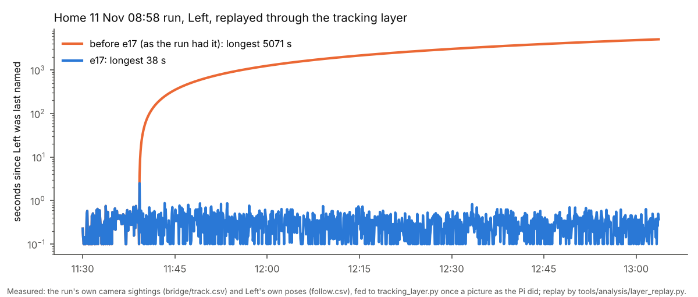
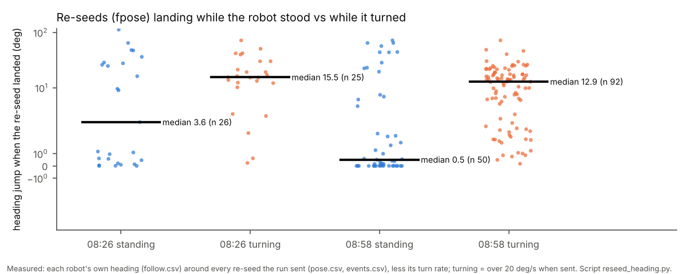
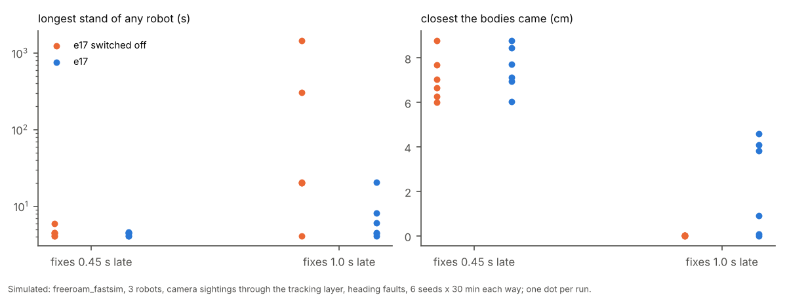
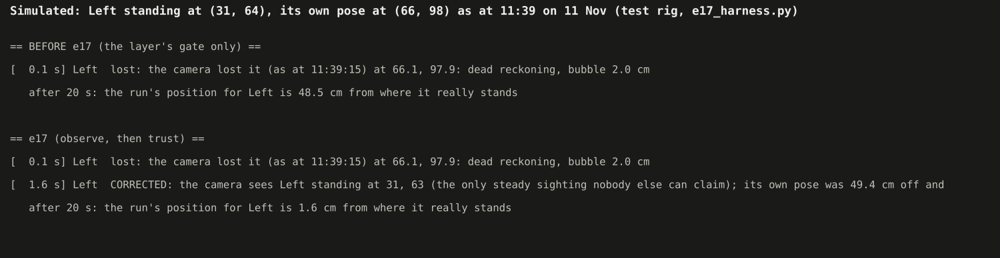
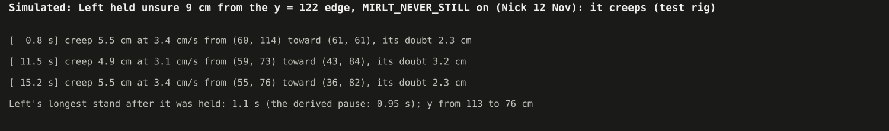
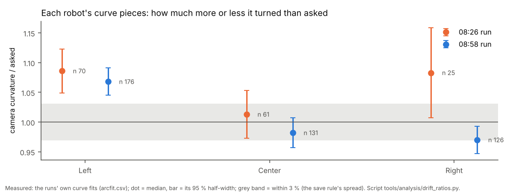

# e17: the tracking layer observes, then trusts (12 Nov, simulator, tests and logs only)

## Premise

- Home, 11 Nov, two free roams on 4732a48 (e14): `docs/results/home-2026-11-11/report.md` (08:26) and
  `report-0858.md` (4 hours).
- The camera bridge saw the held robots standing still, but the run named none of those sightings.
  - Left was held for 84 min, 48 cm from where the camera saw it.
  - The run called robots lost or "unsure near an edge", asked for a hand, and later said a false REJOINED.
- 08:48: Center's heading was 71 deg off, and its reverse went toward Right.
- 11:39: Left drove about 50 cm while fixes arrived about 1 s late.
- Cores 2-3 were at 99 % for the whole 4 hours.
- Nick's 12 Nov answers, added mid-build:
  - **never still** (a new standing rule);
  - frames saved at 4 a second;
  - keep e16's 6b;
  - a robot with no readable points.

Nothing here touched a robot or a Pi. **Measured** means the two runs' logs, the simulator or the tests.
**Claude's reading** means an interpretation, and is marked.

## Data

### 1. Why the run dropped the sightings: two causes, both in the logs

| | 08:26 run | 08:58 run (4 h) |
|---|---|---|
| Own-pose re-seeds the layer recognised, with own poses fed once a picture (as the Pi did) / fed at 10 a second | 14 / 39 | 13 / 56 (the velocity rule finds 56) |
| Longest time the layer named nothing while the bridge saw the robot, replayed as the run had it | Right **27.7 s** (run: 40 s), Center 17 s | Left **5,071 s** (the 84-min hold, reproduced), Right 201 s |
| ... with e17 | Right 0.5 s, Center 6.8 s | Left 5.2 s, Right 7.4 s, Center 2.6 s |
| Fixes e17 named under a different robot than the bridge's own name | 0 | 0 |

Source: `tools/analysis/layer_replay.py --at-pictures` (new) on each run's `bridge/track.csv` and `follow.csv`.

- **Cause 1 (measured): a re-seed read as a drive.**
  - The layer's own-pose re-set rule allowed 5 cm + 30 cm/s × the time since its last sample.
  - At the home Pi's 4-5 pictures a second, that is 11-12 cm. Right's 10.8 cm re-seed (08:35:47) was read as driving 10.8 cm.
  - Its prediction moved 22 cm away from where the camera saw it standing.
  - A standing robot's gate (6 cm + 2 cm × √s) needed about 40 s to reach that far.
  - At 10 samples a second the same rule caught it. That is why the e10 replays (10 a second) never showed this.
- **Cause 2 (measured): the gate's 25 cm ceiling.** Left's 48 cm could never be accepted.
- Fixes in e17:
  - The re-set rule now uses the robot's own velocity (`MIRLT_OWN_RESET_RULE=velocity`; `speed` = before).
  - **Assignment by elimination** (below) does not depend on the prediction at all.



How long since the tracking layer last named Left, on a log scale. Before e17 it climbs for the rest of the run; with e17 it never passes a second or two.

### 2. What fed the drift: re-seeds landing mid-turn (measured)



Each dot is one re-seed (a pose set from the camera). It shows how much the robot's own heading jumped when the re-seed reached it. While turning, the median jump is 13-15 deg; standing, it is 0.5-3.6 deg.

- A re-seed carries the Pi's copy of the robot's heading. That copy is about 0.3 s old when it lands: the landing lag was a median of 0.23-0.34 s.
- **Claude's reading:** this is where Left's 45-62 deg heading error at 11:38:57-11:39:08 came from. Right's at 08:35:47 too: its own heading then said "south" while the camera saw it go west.
- Also found: the re-seed's position was the picture's spot as it was, about 0.5-1 s old. The "projection" was a no-op (`projected(r, self.t, ...)`).
- Now:
  - a re-seed is projected from the picture's time to now;
  - it waits until the robot is not turning (over 8 deg/s; derived: 8 deg/s × 0.3 s is about the camera heading's own 3 deg);
  - it waits at most 3 s (chosen).
  - Switch: `MIRLT_RESEED_TURN=0`.

### 3. What e17 does (each behind a switch, on by default unless said)

| Item | What happens now | Switch (old way) |
|---|---|---|
| 1a | A **steady** sighting (standing 1 s, at least 3 sightings, all within 3 of its source's sigmas) that no accounted robot can claim is that robot, however far from its own pose. Conditions: exactly one robot is unaccounted (lost, unsure, held, needs a hand, or no fix for max(1 s, 3 × its own fix gap)), and that robot's own wheels stood still meanwhile. "Can claim" means the sighting is inside the robot's gate or within CLOSE_CM (16 cm) of it: the anti-swap rule. Merged and contested outlines and close passes stay as they were. The assignment is on **probation**: once its wheels drive 5 cm, the camera must follow at least half as far, or after 10 cm it is revoked and that spot is remembered as "not a robot". | `MIRLT_ELIMINATE=0` |
| 1b | Two or more robots unaccounted, or two candidate sightings: a **wiggle** of the longest-unaccounted robot, only where a turn on the spot is safe at every candidate. The sighting that turns is it: a spin flag, a heading change of 15 deg or more, or scatter over 3 × its standing scatter. Then the other robot follows by elimination. No wiggle possible: nothing is guessed. | (part of 1a) |
| 1c | The gate grows with each robot's **measured** drift: cm of error per cm driven, from its corrections (re-sets, re-seeds, eliminations). An unaccounted robot's gate also covers its 90th-percentile correction. The ceiling is 1.5 × that + 3 sigmas, capped at half the board's shorter side. The e09 numbers stay as the starting guess; the record only widens them. | `MIRLT_GATE_RECORD=0` |
| 1d | A fix named by elimination or a wiggle is a **CORRECTION**: the pose is set from the camera at once, the filter is re-seeded and "lost" is cleared. It is said as "CORRECTED", never "moved in". A robot that needed a hand rejoins on it ("nobody moved Left ..."). A correction over 12 cm also asks for a heading check (2). | `MIRLT_CAMERA_CORRECT=0` |
| 1e | The correction is an `fpose`. The robot's own filter refuses any fix more than about 6 cm from its own pose (firmware `fix_gate` 4 sigmas), so before e17 a far fix never reached it. Re-seeds as in section 2. | `MIRLT_RESEED_TURN=0` |
| 2 | **Late fixes**: while driving, its own pose may be off by up to 2 cm + its measured drift per cm × (cm driven since the newest picture + speed × its own 90th-percentile fix delay). When that could pass its room (the nearest edge less its half diagonal; the nearest robot less both and the reflex gap), it slows to what fits. Under 0.2 of its speed it pauses for a fix, and queues nothing meanwhile. Under never-still, a pause longer than the derived pause goes on at its slowest (at least 2 cm/s). | `MIRLT_LATE_FIX=0` |
| 2 | After an off-plan heading re-set (or a big correction), the next move is a **heading check**: a slow straight crawl the camera measures. Its length is derived from the camera's noise on that robot (√2·σ/√3/tan 2.5 deg, 6-12 cm). Within 5 deg the heading is confirmed; otherwise its heading is set from the camera (standing) and checked again. If a robot is within reach, it waits for room. The unsure step makes no heading-dependent move next to a robot while its heading is in doubt. | `MIRLT_HEADING_CONFIRM=0` |
| 3 | The **core layout** is a setting. A: recorder 0-1, planner + bridge 2-3 (up to 11 Nov). **B, the default: Claude's guess until the bench decides**: recorder 0, planner 1, bridge 2-3. C: unpinned. `./run-fleet-pi.sh bench N layouts` runs all three. The bench now reports pictures handled a second, the picture-to-result delay (new `t_done` column) and watchdog stops. | `MIRLT_CORE_LAYOUT=A` |
| 4 | **ML detector on demand**: a hook in the layer runs a detector only for robots that are unaccounted, unsure or asked for, at most 2 a second each and 4 a second in all. It is OFF: no model exists, and the bridge hook that would run it on a picture is a stub (said at start). | `MIRLT_ML_ON_DEMAND=1` turns it on |
| 6 | Each robot's drive, turn and curve ratios are read from a run's logs (`tools/analysis/drift_ratios.py`), see section 5. The curves' calibration is now saved at **any** run end by the same agreement rule (before: only when a robot parked at its battery floor, and the 4 h run ended on its time cap). | `MIRLT_ARC_SAVE_AT_END=0` |
| Nick 1 | Frames kept at **4 a second** (`doe_loop.frames_rates`; free roam, missions, the DOE loop). | `MIRLT_FRAMES_HZ=12` or `=before` |
| Nick 2 | **Never still** (CLAUDE.md, below). An idle robot standing longer than the derived pause (its fix delay + 0.5 s, about 1 s) creeps. This covers held, unsure, needing a hand, put down at an edge, tilted with no way back, waiting for room, and outside the readable area. A creep goes toward safety and being found: back into the readable area; else to the board's middle; once well clear of the edges, away from the nearest robot. Its step (2-8 cm) and speed (2-5 cm/s) are scaled by 5 / (5 + its doubt). It tries every 45 deg, keeps the reflex gap, and has no edge rule (falls allowed). A lost robot at its blind limit creeps instead of wiggling. A creep since asking counts as freeing itself (no false REJOINED). Questions are still asked, but never stop it. | `MIRLT_NEVER_STILL=0` |
| Nick 3 | e16's 6b (crawl every unverified tag turn) stays the default: checked, unchanged. | `MIRLT_CRAWL_UNKNOWN=need` |
| Nick 4 | **Claude's reading of Nick's answer:** a robot whose split left it no readable point gets one goal, the nearest readable point nobody else has. It goes where the camera can find it and rejoins the plan from there (missions' split). | `MIRLT_EMPTY_TO_READABLE=0` |

The new standing rule went into CLAUDE.md as **"Never still (Nick, 2026-11-12)"**, quoting Nick.

### 4. Simulator (measured)

The fast simulator ran:

- 3 robots;
- camera sightings through the tracking layer, which can swap names;
- edge physics and heading faults;
- 6 seeds × 30 min, fixes 0.45 s or 1.0 s late.

Each run is e17 against every e17 switch off. Source: `freeroam_fastsim.Sim(..., camera="detections")`, script in this build's scratch folder (`run1.py`, numbers below).

| 6 runs each | Fixes 0.45 s late: e17 off | e17 | Fixes 1.0 s late: e17 off | e17 |
|---|---|---|---|---|
| Runs where bodies touched (contacts) | 0 | 0 | 2 (2 contacts) | 1 (1) |
| Closest the bodies came, median of runs (cm) | 6.9 | 7.4 | **0.01** | **2.4** |
| Runs with a robot off the board (edge physics) | 0 | 0 | 4 | 2 |
| Name swaps | 0 | 0 | 4 | **0** |
| Longest stand of any robot, median (max) of runs (s) | 4.5 (6.0) | 4.5 (4.6) | 20.3 (**1,459**) | 5.3 (20.5, a hung robot) |
| NEEDS A HAND / REJOINED | 0 / 0 | 0 / 0 | 15 / 4 | 1 / 0 |
| Moving, median share of the time | 71.6 % | 71.4 % | 65.9 % | 71.0 % |
| e17 at work (sum of 6 runs) | - | 19 creeps, 10 late-fix slows / pauses | - | 130 creeps, 2,342 late-fix slows / pauses, 165 re-seeds held to the turn's end, 1 elimination (confirmed), 1 heading check |

- With fixes on time, e17 changes nothing that matters, which is what it should do.
- With fixes 1 s late (the 4 h run's delay), e17 removes the minute-long stands and the swaps, and keeps the
  bodies apart in 4 of 6 runs.
- e17 still touched once (seed 3, as e17-off did). Two runs went off an edge, which Nick allows while experimenting.
- **Found by the self-review and fixed before these numbers:** the first e17 batch held robots in a late-fix pause
  for up to 37 s (median stand 17.8 s), against never-still. The pause now goes on at its slowest after the derived
  pause, and is released when the drive it slowed ends. The release costs some closeness: median closest 3.4 → 2.4 cm.
- The batch ran on the code before one label-only fix: a creep since asking counts as freeing itself.
- Data: `docs/results/e17-nov12/stress/` (run1.py and one JSON per run).



Each dot is one 30-minute simulated run. With fixes a second late and e17 switched off, robots stand for minutes and the bodies touch; with e17 they keep moving and keep their gap.

Rig tests (`tools/fleet/tests/e17_harness.py`: robots standing or moving as told, the lights seen, fixes 0.45 s late, the firmware's fix gate modelled):

- A standing robot whose own pose is 10, 20, 30 or 48 cm off is CORRECTED within 1.6 s, with no NEEDS A HAND, no REJOINED, and no fix refused by its filter. The old way never takes 20-48 cm.
- Left's 11:39 case (lost, own pose 48 cm off near the edge) is corrected in 1.6 s.
- Two robots unaccounted, each one's own pose near the other's real spot: a wiggle names one, elimination names the other, and there is no swap.
- A doubtful heading 20 cm from another robot waits for room; the bodies never come closer than 15.9 cm.



The same moment simulated before and after e17: before, the run still has Left 48 cm off after 20 s; with e17 it is corrected 1.6 s after it stood still.



A robot held unsure 9 cm from an edge, under the never-still rule: it keeps creeping toward the middle and never stands much longer than its one-second pause.

### 5. Wheel, turn and curve ratios (item 6, measured)

| Robot | Curve ratio (camera / asked), 08:26 | 08:58 (n) | Consistent (95 % half-width < 0.03, n ≥ 15, runs agree) |
|---|---|---|---|
| Left | 1.086 ± 0.037 | **1.068 ± 0.023** (176) | yes in the 4 h run; runs agree |
| Center | 1.013 ± 0.040 | 0.982 ± 0.025 (131) | yes in the 4 h run; runs agree |
| Right | 1.083 ± 0.076 | 0.970 ± 0.023 (126) | the runs disagree (08:26 had only 25) |

Curve length ratios are 0.97-1.01 for all three. Straight drives between two stands: 1-7 a robot, too few. Turns between two such drives: 0-2. Neither can be judged: in curves mode almost every move is a curve.



How much more or less each robot's curves turned than asked. Left turns 7 % more than asked in both runs. Center and Right sit within the save rule's 3 %, and Right's two runs disagree.

- Left was already running `arc_k_scale` 1.0736 (`param.csv`) and still turns 6.8 % more.
- **Claude's reading:** the 4 h run had the evidence to correct it, but never saved it, because the run ended on its time cap. Now saved at any end, by the existing agreement rule. Nothing else is applied: the drive and turn ratios are too few to be consistent.

### Tests

- `tools/fleet/tests/test_e17_tracking_trust.py`: 31 tests (the cases above, each switch's old way, the 08:26 replay excerpt in `tests/data/e17_home_0826_right_hold/`).
- Two e13 tests and one e10 test are pinned to the old switches.
- Full fleet suite on the final code (2f506af): **934 passed, 9 skipped** in 17.4 min (baseline 903 / 9; +31 new).
- `tools/pi/tests`: 133 passed. The same 4 `test_launcher.py` failures as before e17 (not touched).
- `tools/analysis/tests`: 16 passed.

## Conclusion

1. **The 84-minute hold was the tracking layer, as the 11 Nov reports read it, plus a second cause found here.** The
   re-set rule could not see a re-seed at the Pi's picture rate, so the layer's prediction walked away from a robot
   standing in plain view. Replayed with e17, every robot in both runs is named within about 7 s, and none under the
   wrong name.
2. **Re-seeds created the heading errors** behind 08:48 and 11:39 (13-15 deg median jump when one landed mid-turn).
   They now wait for the turn to end and are projected to now.
3. **Corrections now reach the robot** (an fpose; the firmware refuses any fix about 6 cm off) and are said as
   CORRECTED, never as a person's move.
4. In the simulator with fixes a second late, e17 removes the swaps and the minute-long stands, and keeps the bodies
   apart in 4 of 6 runs where e17-off touched or came within 0.02 cm in all 6 (section 4). The never-still rule holds
   held robots to about a one-second pause (rig), and the longest stands to 4-8 s except a robot hung at an edge.
5. Cores: B is a guess until the bench measures it.

## What's next

- **Nick, home Pi:** switch it to this code (steps below), then one free roam. Look for:
  - "CORRECTED" lines;
  - "creeps" lines;
  - no NEEDS A HAND lasting minutes;
  - "late fixes" lines.
  Upload the folder as before.
- **Nick, either Pi:** `./run-fleet-pi.sh bench 10 layouts` (about 35 min, nothing moves) to decide the core layout.
  At home, one short free roam per layout is the better test (the bench's real bridge is the roof-tag one).
- Then a decision on `MIRLT_CORE_LAYOUT`'s default from the bench.

### Switching the home Pi to this code

On the laptop, open **PowerShell** (Windows) or **Terminal** (Mac). Type each box, press Enter, wait for the `$`.

```
ssh st1maxfini@100.122.222.75
```

Type the Pi's password if it asks. You should see a line ending in `$`.

```
cd ~/alvik-fleet-capstone
```

```
git checkout main
```

You should see `Switched to branch 'main'` (or `Already on 'main'`). It was pinned to 4732a48 until now.

```
git pull
```

You should see `Fast-forward` and a list of files.

```
git log --oneline -1
```

You should see a line starting with the e17 commit given in the chat (its message starts with "e17").

To go back to the old pin at any time: `git checkout 4732a48`.

## Sweep 1: new tests that may now be needed

- A real free roam with a robot's own pose deliberately wrong (`fpose` sent 30 cm off while it stands). The camera
  correction should land within seconds.
- The elimination on a real board with a person's hand or an object standing in the picture (probation, revocation).
- A hung robot whose wheels spin. In the 4 h replay, Right at 11:25 had a correct elimination revoked because its
  wheels drove 20 cm and its body did not (its tilt flag could tell the two apart: not built).
- The wiggle's "turned" evidence on the real lights bridge. The home bridge sends no spin flag and the lights spot
  hardly moves when a robot turns on its spot (real wiggles in the 4 h run: scatter 0.3-0.5 cm). Two robots
  unaccounted at home may never be resolved by a wiggle; a short there-and-back drive may be needed instead.
- The bench: layouts A/B/C on both Pis; watchdog stops per hour from a real run per layout.
- Never still on missions (run_plan): not built; school Visit and Calibrate still hold.
- Creeps with a doubtful heading next to a robot (the creep keeps the reflex gap on a heading it does not trust).

## Sweep 2: possible inaccuracies

- **Chosen numbers.** For each: whether a DOE should set it.
  - STEADY_S 1 s, STEADY_N 3, STEADY_K 3 sigmas: DOE yes, on bridge-track replays (time to name against wrong eliminations).
  - ELIM_FOLLOW 0.5 and the 10 cm revoke distance: DOE yes, with hung-robot logs.
  - WIG_SD_K 3, WIG_SD_ABS 0.6 cm, WIG_TH_DEG 15: DOE yes, on real wiggles.
  - REC_N 20, REC_S 15 min, REC_MIN 5, REC_K 1.5: DOE yes.
  - UNACC_MIN_S 1 s: DOE no; it is a floor under the measured fix gap.
  - RESEED_WAIT_MAX_S 3 s: DOE no.
  - LATE_SLOW_MIN 0.2: DOE yes (pauses per hour against closest approach).
  - LATE_REC_MIN 3: DOE no.
  - HD_CONFIRM_DEG 5, HD_CONFIRM_MAX_CM 12: DOE yes.
  - CREEP_MAX_CM 8, CREEP_MIN_CM 2, CREEP_UNC0_CM 5: DOE yes (time to be found against falls per hour).
  - ML 2 and 4 a second: DOE once a model exists.
  - Core layout B: the bench decides.
- **Derived numbers:**
  - the re-seed's 8 deg/s;
  - the pause (fix delay + 0.5 s);
  - the crawl length;
  - the gate's ceiling and drift rate;
  - the late-fix room.
- The replays feed own poses interpolated at each picture's time with no lag. The real run fed the controller's own
  history, which the run itself had shifted at each re-seed. The replay reproduces the run's drops (Right 27.7 s
  against 40 s; Left's 84 min) but not each second of them.
- The "bridge name" used to check the replays is the bridge's own tracker. It can be wrong too; it is a check, not
  the truth.
- The fast simulator's camera, wheel-slip and hang models are chosen (e04-e10). The rig's robots drive exactly as
  told. The firmware gate is modelled as 4 sigmas with var 1 cm² and sigma 1.5.
- The landing lag (0.23-0.34 s) and the heading-jump measure come from FOLLOW records (10 a second) and their
  arrival times, not the robot's own clock.
- Drift ratios: curves only, because stop-turn drives were too few. The camera's calibration error is inside each
  ratio.
- Never-still's target "the board's middle" assumes the camera sees the middle best (true at home and at school;
  not checked for a new site).

## Questions for Nick

**Substantive**

1. Two robots unaccounted at home: the lights camera cannot see a robot turn on its spot. May such a robot make a
   short there-and-back straight drive (2-4 cm, slow) to show which sighting it is? That drive is heading-dependent;
   falls are allowed, contacts are not.
2. Never still for missions and calibration (run_plan) too, or free roam only for now? School Visit tours are
   Jay-Sun's experiments; creeping would change his runs.
3. A creep with its heading in doubt, next to another robot: should it go anyway (never still), or wait for room as
   the heading check does now?
4. Core layout B as the default before the bench: OK, or keep A until measured?

**Other**

5. Nick 4 (no readable points): read as "go to the nearest readable point nobody has". Is that what you meant?
6. Left already runs a saved curve correction and still turns 7 % more. Save the new one at the end of the next run
   (now automatic if the evidence agrees), or keep it as it is?
