# e18: one Safety group, never still everywhere, and blind drives the measured odometry record allows (12 Nov)

## Premise

Nick's seven decisions of 12 Nov, built on e17 (3f37317):

1. Two or more robots unaccounted, and the wiggle cannot tell their sightings apart: one robot at a time makes a short,
   slow **out-and-back** (2-4 cm) so the camera sees which sighting moved.
2. **Never still becomes the default everywhere** (missions, calibration, School Visit tours, not only free roam), and
   every safety switch goes into **one Safety group**, decided automatically, the old ways kept behind switches.
3. **Heading in doubt beside another robot:** the neighbour camera-confirmed: wait for room (or creep away when that is
   safe); the neighbour not known: creep cautiously away from where it was last believed to be.
4. **Lost robots first:** a robot with no readable points goes to the nearest readable point nobody uses; the others
   move out of its way.
5. **Blind drive allowance:** a per-robot trust model of its own calibrated odometry, measured from its own record,
   decides when and how far it may drive where the camera cannot see, and checks itself when the robot is seen again.
6. **Save every calibration correction at every run ending.**
7. **Core layout B** stays the default (docs only).

Added mid-build by the coordinator, from the logs-only replay of all 10 home runs
(`docs/results/replay-all-nov12/report.md`): (a) a wrong elimination on 5 Nov 14:55; (b) a robot named all along but
held 86 s at 31 cm from its own pose on 11 Nov 08:26; (c) build the blind allowance on blind-stretch measurements, as one
fleet record, curves per session; (d) standing re-seeds that jump the heading. And: **do not change Left's saved
`arc_k_scale` (1.0736)**; Nick has not decided.

Nothing here touched a robot or a Pi. **Measured** = the simulator, the test rig or the tests. **Claude's reading** =
an interpretation, marked.

## Data

### What e18 does (each behind a switch in the Safety group, on by default)

| # | What happens now | Switch (old way) |
|---|---|---|
| 1 | After a wiggle that showed nothing (or that is not safe), the layer asks **one** unaccounted robot for a straight out-and-back. Its length comes from the candidates' measured camera noise (4 sigmas over 3 pictures, 2-4 cm). Its speed comes from the picture rate (3 pictures on the outer half, 2-5 cm/s). It is made only where no body can touch at **any** candidate spot. The sighting that went out and came back is that robot (a correction); the other follows by elimination. | `MIRLT_OUTBACK_ID=0` |
| 2 | **One Safety group**: `tools/fleet/safety_group.py` holds 49 switches with their automatic defaults. The safety code reads them only through it (a test checks). How-to: `docs/how-to/safety-group.md`. Mission Control: Run > More > Safety, every switch on `auto`; a saved change goes to the Pi's `safety.json` and every run there. Every run says the group at its start and writes it into its meta. | each switch's own |
| 2 | **Never still in missions**: a held robot that still hears creeps 2-8 cm at 2-5 cm/s every derived pause. It goes toward where the camera last read it, else the board's middle, staying within 8 cm of where it was held. Its held outline is grown by those 8 cm, so the others' plans stay valid. **Calibration**: a robot held for a lost tag wiggles every derived pause (no longer doubling to a minute) and creeps 2-4 cm toward readable ground between wiggles. | `MIRLT_NEVER_STILL=0` (one switch for all) |
| 3 | Heading in doubt, a robot within a creep's reach: if the camera has the neighbour, it **waits for room**, or creeps straight away when even its worst heading cannot close the gap. If the camera does not have it, it creeps **cautiously**: half the step, 2 cm/s, away from where the neighbour was last believed to be. | `MIRLT_DOUBT_NEIGHBOUR=0` |
| 4 | Free roam: a lost, strayed or needs-a-hand robot outranks everyone in the reflex. It heads for the nearest readable point nobody stands on. A standing robot in its way is asked to **make room** (a sideways step out of its corridor). Missions: a robot sent to a readable point has the right of way in the plan (`priority_first`). A robot standing in a lost robot's recovery path steps aside. | `MIRLT_LOST_PRIORITY=0` |
| 5 | **Odometry trust** (`tools/fleet/odo_trust.py`), below. | `MIRLT_BLIND_ALLOW=0` |
| 6 | **Every correction saved at any end**: the time cap, all out, Stop / Ctrl+C / SIGTERM or an error (main's `finally`). Curves use arc_save's rule. Straight drives (`wheel_scale`, camera over the wheels' own count) use the same agreement rule, only when the value in use was read back. The odometry records are saved too, with a checkpoint every minute (a crash loses at most a minute). Missions save their records at any end too. | `MIRLT_SAVE_CAL_AT_END=0` |
| 7 | Core layout B: the docs and the code say "Nick chose B on 12 Nov, pending the bench". | `MIRLT_CORE_LAYOUT` |
| a | The elimination counts robots in an unresolved close pass as unaccounted, and refuses a spot that lies within 6 cm of any robot's **own** pose (unless that robot is the one being named). | `MIRLT_ELIM_PAIR_GUARD=0` |
| b | A standing robot the layer keeps naming, whose own pose is beyond its firmware's 6 cm fix gate for 1 s (3 fixes, offset steady within 3 camera sigmas, nobody else's pose or position on that spot), gets its pose from the camera (`fpose`, a CORRECTED event), as after an elimination. Never within 3 s of any fpose (found by the stress re-run). | `MIRLT_FAR_NAMED_CORRECT=0` |
| c | The trust model (item 5) is one **fleet record**: every robot's samples pooled, updated live; a robot gets its own record only when its samples differ from the rest (Mann-Whitney, p < 0.01). Curve samples count only in the run they were measured in. Prior: the replay's blind stretches. | `MIRLT_TRUST_FLEET=0` |
| d | A re-seed of a standing robot sends its **own** heading unless the camera's is better: a roof tag (2 deg) against its own doubt, 2 deg + 1.6 deg per 90 deg turned since its heading was last set. A lights outline never overwrites it. | `MIRLT_RESEED_HEADING_KEEP=0` |
| - | Curve scales measured in a run are logged and **not saved** on the robot, at parking and at every end (Left's 1.0736 stays). | `MIRLT_CURVE_SCALE_SAVE=1` saves them (e17) |

### The trust model (item 5)

- **Evidence, live, for each robot:** every 10 cm of its own travel a *shadow* starts at the camera's spot, with its own
  heading. The shadow drives on the robot's wheels and yaw rate alone (RAW rows; else its own pose's steps). At 10, 20
  and 40 cm it is compared with the camera, which gives one sample: cm driven, degrees turned on the spot and on curves,
  and the error. This is the 29 Oct leave-camera-out measurement, made for each robot as it drives.
- **Model:** the 95th-percentile error after a blind stretch is base + cm-rate × distance + heading doubt × the distance
  after each turn. It comes from a quantile regression on the **fleet's** pooled samples (item c), or a robot's own when
  they differ. The starting guess, until there are 20 samples, is the replay's blind stretches: 2.3 cm + 0.28 cm per cm
  (the 90th percentile slope, cautious on purpose) and 0.04 deg per deg turned (3.6 per 90). Each turn term keeps that
  floor until there are 20 samples with that kind of turning. (First e18 version: 2 cm + 0.07 cm per cm, the 29 Oct
  straight legs.)
  <sub>A 95th percentile: 95 of 100 errors are under it. A quantile regression fits that line directly, instead of the
  mean.</sub>
- **Its own check:** every 5th sample is held out, and every blind stretch that ends with the camera seeing the robot
  again is compared with what was predicted. The scale `k_cal` is the 95th percentile of found / predicted. It only
  ever widens the model, never narrows it.
- **Allowance:** a blind leg is allowed when, at every point from where it leaves the camera's ground, the predicted
  error + half the body + the stop keeps the board's edge, and the predicted error + the other robot's doubt + both
  bodies + the reflex gap keeps them apart. The leg must also end where the camera reads (the way back). Otherwise it is
  refused, or (an excursion) shortened to the deepest depth that passes.
- **Who uses it:**
  - A lost robot's bubble: **only on a planned blind leg**. An unplanned loss keeps e13-e17's fixed numbers, with the
    record's prediction logged beside it and checked (`MIRLT_BLIND_BUBBLE=fixed`). Found by the first stress re-run:
    with the record's bubble on every loss, a robot with 1 s late fixes stood 1311 s in one 30-minute run (seed 6); with
    `MIRLT_BLIND_ALLOW=0` the same seed matched e17. Claude's choice; `MIRLT_BLIND_BUBBLE=record` is the other way.
  - Free roam's moves and curves through unreadable ground: only when the end, or the loop disc, is readable.
  - `blind_excursion` (out, turn round, back).
  - Missions:
    - its error while blind;
    - a point the camera does not read stays on the list when an out-and-back from readable ground is allowed;
    - the check when the robot is seen again.

### 1. Two robots unaccounted (simulated, 30 random trials per cell)

The home lights camera: no spin flag, the spot at the middle, so a turn is invisible. Robots 15-35 cm apart, own poses
20-50 cm off, camera noise 0.2-0.8 cm. Source: `docs/results/e18-nov12/outback/` (batch.py, trials.jsonl).

| | Held: e18 | Held: out-and-back off | Held, never still: e18 | Held, never still: out-and-back off |
|---|---|---|---|---|
| Both told apart within 45 s | **24 of 30** | 0 of 30 | **25 of 30** | 7 of 30 |
| Median time to name both | 8.6 s | - | 12.6 s | 31.4 s |
| Trials with a robot named on the other's spot | 2 | 1 | 8 | 12 |
| Trials where the bodies touched (middles under 13.4 cm), before / after both were named | 0 / 4 | 0 / 0 | 3 / 2 | 11 / 1 |

Re-run on the final code (with the replay's four items); the first run, before them, gave 23 / 0 / 25 / 4 of 30.

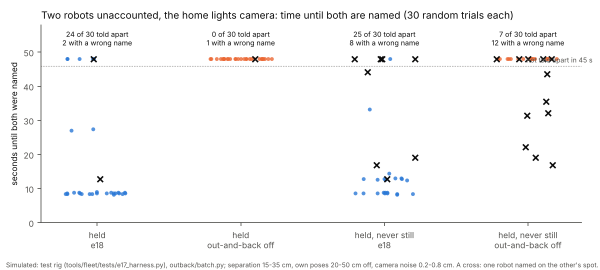

Each dot is one trial: how long until the run had named both robots. With the out-and-back most trials are settled in
about 9-13 s; with wiggles alone almost none are.

- "Out-and-back off" is the e18 code with `MIRLT_OUTBACK_ID=0`. It is not e17's code: it already has e18's fixes below.
- **Found by this batch, and fixed before these numbers:**
  - (a) A wiggle's fix used the mean over its whole watch. A lost robot that went on after its wiggle was set back to
    where it had wiggled; the correction was revoked, and later a wrong elimination followed. Now the fix is its last
    sightings, and it stands while the layer watches.
  - (b) The gate of a standing unaccounted robot grew with time (2 cm × √s). After about 40 s it took the other
    robot's sighting. Now no time growth while two or more robots are flagged unaccounted. (The first version froze it
    with one flagged too; the full suite caught that e09's close-pass test then never settled the pass, because the
    standing robot never got its sighting back. Narrowed, and the batches re-run.)
  - (c) Two unaccounted robots crept toward the middle together. The camera saw both spots follow both own poses alike,
    and the reacquire took the wrong one. Now one unaccounted robot creeps at a time, and none creeps while an identity
    move is watched.
  - (d) An unaccounted robot's gate was widened to its usual correction even with two unaccounted. Now that happens
    only when it is the only one.
  - (e) An out-and-back was eased to a stop by the blind rule from its (wrong) own pose.
  - (f) The out-and-back's "the other stayed" test was too strict for the noise.
- **Still wrong (Claude's reading):**
  - the remaining wrong names start when one robot's own pose lies within about 7 cm of the other's real spot. The
    ordinary gate binds it there at the start, before either is flagged unaccounted;
  - under never still, a third robot roaming near the pair adds more.
  These are e09-e17 matching rules, not the out-and-back. Sweep 1.
- **Not explained yet:** in 6 trials (4 held, 2 never still), after both were named correctly, the two robots (released 15-25 cm
  apart) came within 2-5 cm (middles) through a repeated "reflex hard stop, new piece away" loop. The rig has no bodies,
  so they passed through each other. Sweep 1.

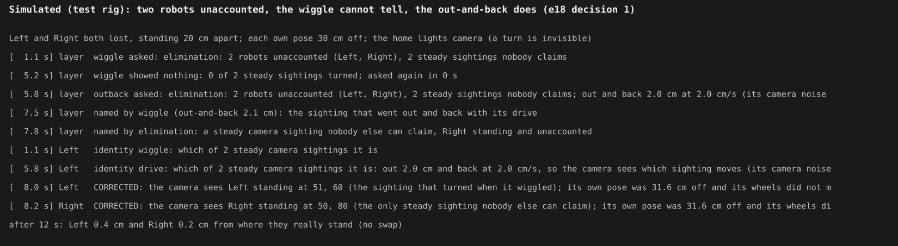

The run as it reads it: the wiggle shows nothing, Left drives 2 cm out and back, the layer names it, and Right follows
by elimination.

### 2. Blind excursions through a dark patch (simulated)

Each trial: a 30 × 35 cm dark patch; 150 s of roaming to build the robot's record; then 5 excursions to random points
in the patch. 3 records × 6 seeds. Source: `docs/results/e18-nov12/blind/`.

| Record (rig odometry error) | Full | Shortened | Refused | Its model's 40 cm error (median) | Checks inside its prediction | Inside the fixed 2 + 0.07 cm/cm |
|---|---|---|---|---|---|---|
| good (wheel 0.3 %, gyro 0) | 26 | 0 | 4 | 2.4 cm | 23 of 24 | 24 of 24 |
| typical (wheel 2 %, gyro 1.2 %) | 16 | 14 | 0 | 14.8 cm | 18 of 18 | **15 of 18** |
| poor (wheel 5 %, gyro 3 %) | 5 | 9 | 16 | 20.8 cm | 11 of 11 | 11 of 11 |

- The model's own check: **52 of 53** blind checks were inside the prediction (98 %). Held-out samples: **874 of 926**
  (94.4 %, against the 95 % it is fitted to). Re-run on the final code (fleet record, the replay's prior): the same
  allowances and checks as the first run, because Left's record comes from 150 s of its own roaming (well past the prior)
  and the other two robots stand, so the pooled record is Left's samples alone. The batch does not test pooling; the
  tests do (Data 6).
- The fixed 29 Oct numbers (e17's) were exceeded 3 times. All 3 were the typical robot, whose own heading had drifted
  4-25 deg.
- Refusals:
  - the good robot's 4: it was asked while standing inside the dark patch (it must start where the camera has it);
  - the poor robot's: mostly asked from 7 cm off the board's edge, where its 20 cm predicted error cannot keep the
    margin.
- **Claude's reading:** the typical robot's model is conservative (median predicted 7.4 cm against 2.4 found). Its
  record includes stretches where its own heading was 10-25 deg off from the rig's course re-sets (problem chart below).
  A robot whose heading is re-set often is, in fact, worse blind.

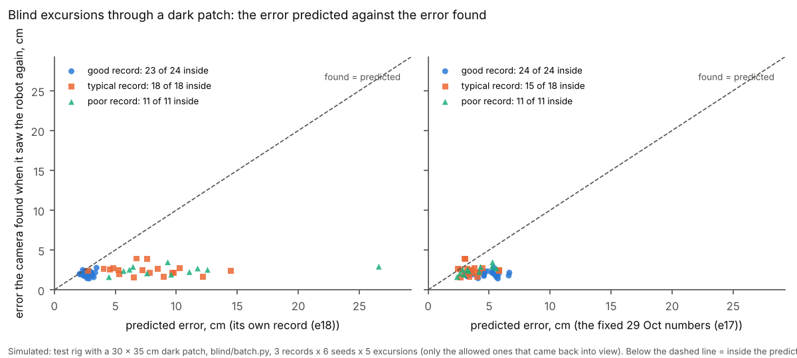

Each dot is one excursion that came back into view: the error the camera then found against the error predicted
beforehand. Left, each robot's own record; right, the fixed numbers. Dots above the dashed line are surprises: one on the
left, three on the right.

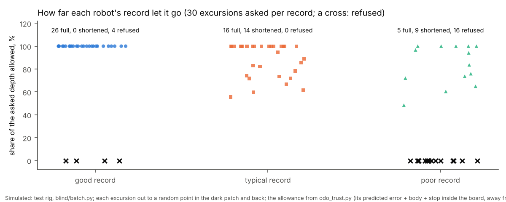

How much of each asked excursion the robot's record allowed: the good record goes all the way, the typical one is
often shortened, the poor one is mostly refused.

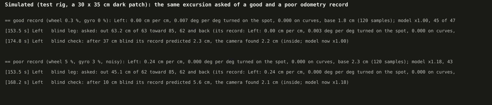

The same request (out 62-63 cm toward a point inside the patch, then back) from two records: the good robot goes the
whole way; the poor one is shortened to 45 cm, which stops it before the dark.

### 3. Never still, doubt, lost first, saving (rig and tests)

- **Missions** (run_plan's coordinator, held robot heard):
  - 8 creeps in 30 s, one every 4 s (each about 2.6 s of driving, then the 1.1 s derived pause);
  - always within 8 cm of where it was held;
  - its held outline grown to 14.5 cm net.
  `MIRLT_NEVER_STILL=0`: no creep.

  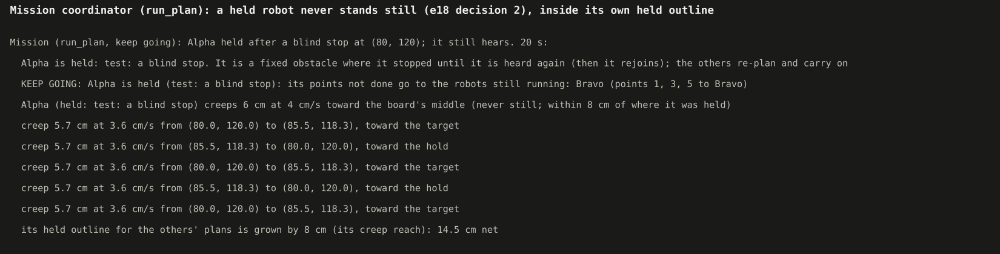

  A held robot in a mission keeps moving between where it was held and its target, never further than 8 cm.

- **Heading in doubt:**
  - the neighbour 16 cm away and seen: Left waits for room, and the middles never come closer than 16 cm;
  - 24 cm away: it creeps straight away;
  - the neighbour on a dark patch: 2.7-2.9 cm creeps at 2 cm/s, away from where it was last believed to be.

  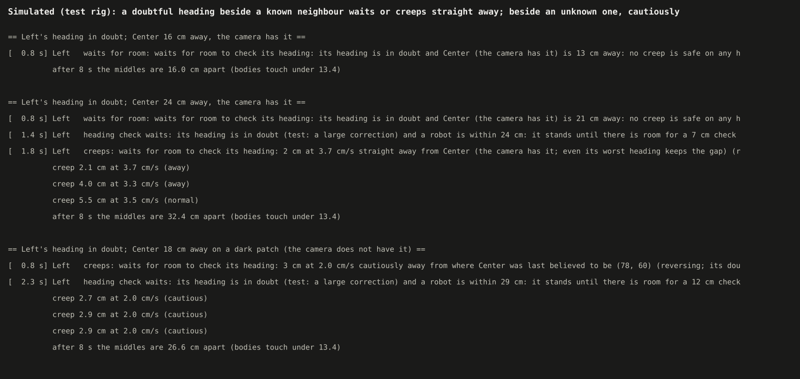

  The three cases side by side, as the run logs them.

- **Lost first:** a robot outside the readable area outranks the others. Center, standing on its way back, makes room
  twice, and Left comes back in.

  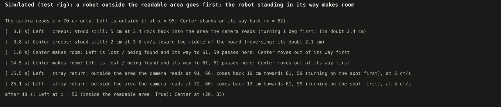

  Center steps out of the lost robot's way; the lost robot drives back into the area the camera reads.

- **Saving:**
  - a correction that agrees is saved (`set wheel_scale ...`, `save`);
  - one whose value in use was not heard is said and not saved;
  - free roam calls the save from main's `finally`;
  - run_plan saves its records in its `finally` (tests).

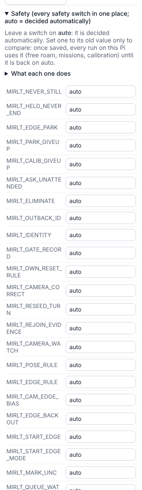

Mission Control's Run screen, More > Safety: every safety switch in one box, all on `auto`.

### 4. A problem the rig showed (measured in the rig, Claude's reading on the robots)

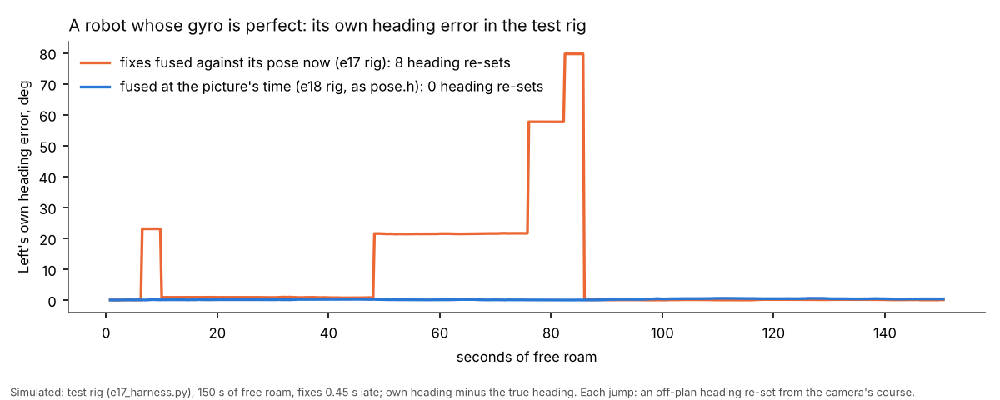

A robot with a perfect gyro, in the test rig. With fixes fused against its pose now (the e17 rig), the off-plan
heading re-sets from the camera's course left it 22-80 deg off. Fused at the picture's time (as the firmware's pose.h),
no re-sets happened in this run.

- The rig now fuses at the picture's time (`fuse_then`, used by e18's tests; the e17 tests keep the old way).
- With a dark patch the e18 rig still showed re-sets of 22-58 deg after 112 s. The course check reads a chord over
  1.5 s on curving pieces.
- **Claude's reading:** the real runs' 45-62 deg heading errors (e17) may have this second source too. Sweep 1.

### 5. The e17 simulator comparison re-run (6 seeds × 30 min, fixes 0.45 / 1.0 s late)

| 6 runs each | 0.45 s late: e17 | e18 | 1.0 s late: e17 | e18 |
|---|---|---|---|---|
| Runs with contacts | 0 | 0 | 1 | 1 |
| Closest the bodies came, median (cm) | 7.4 | 7.4 | 2.4 | 2.4 |
| Runs with a robot off the board | 0 | 0 | 2 | 2 |
| Name swaps | 0 | 0 | 0 | 0 |
| Longest stand, median (max) (s) | 4.5 (4.6) | 4.5 (4.6) | 5.3 (20.5) | 6.1 (20.5) |

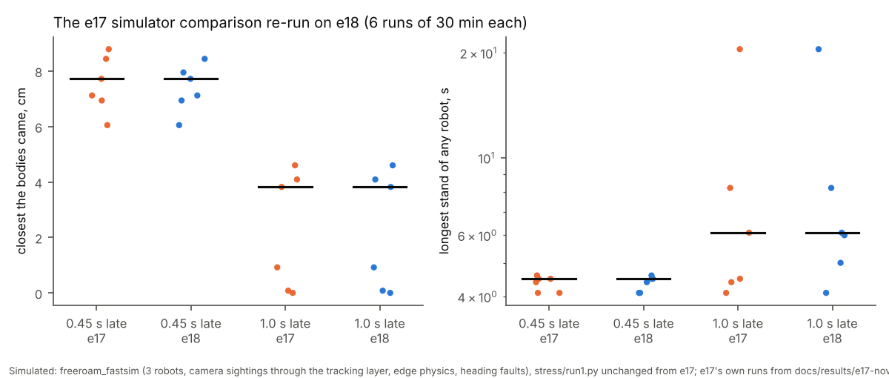

Each dot is one 30-minute simulated run; the lines are medians. e18 matches e17 run for run except two stands at 1 s late fixes (6.0 and 6.1 s against 4.5 and 4.6; not traced). Seed 6's 20.5 s stand and seeds 3, 4's close approaches are e17's own.

Source: `docs/results/e18-nov12/stress/` (run1.py unchanged; one JSON per run).

### 6. Tag-free (rebased onto it)

e18 is rebased onto main with the tag-free build (5cc1640, f7c46c0, 0a50829) and detector-v1. The one conflict
(freeroam.py's state.json) keeps both: tag-free's summary and e18's trust, excursions and saved corrections.
- **Tag-free naming and the out-and-back:** tag-free feeds the same tracking layer, so its unclear cases reach the same
  wiggle, then out-and-back. For a robot **half over an edge** the out-and-back is refused: it needs half the body + its
  length to the edge at every candidate spot, in any direction, and a robot half over an edge has none. Nothing is
  guessed then (it stands, "identity drive: no 2 cm out-and-back is safe"). An inward-only out-and-back would need its
  own rule; a question for Nick.

### 7. The replay's four items (rig and layer, each on and off)

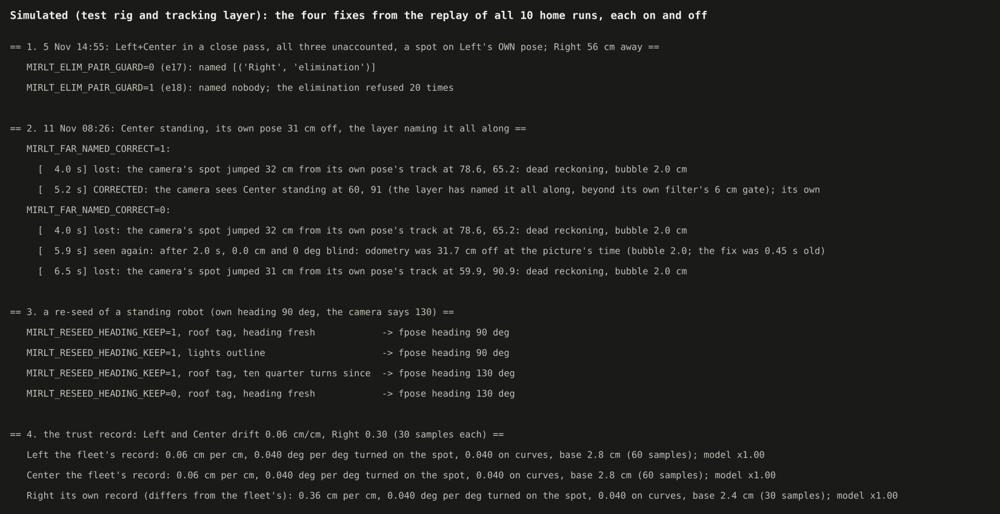

Each fix with its switch on and off. The first is the 5 Nov 14:55 scene rebuilt in the tracking layer; the others are
the test rig.

- **(a) The 14:55 scene** (Left+Center in a close pass, all three unaccounted, a steady spot 0.1 cm from Left's own pose,
  Right standing 56 cm away): the old way names Right there by elimination; the guard names nobody (20 refusals logged
  "elimination refused"). The robots are then left to the wiggle, out-and-back and creep rules.
- **(b) Named far:** Center standing, its own pose moved 31 cm: CORRECTED 1.2 s after its first lost line ("the layer
  has named it all along, beyond its own filter's 6 cm gate"); its own pose ends 1 cm from the truth. **Claude's
  reading:** in the rig the e17 path also comes back (lost, then seen again within 2 s), but it keeps losing it again;
  the rig does not reproduce the real 86 s hold, whose cause was the robot's filter refusing every fix. The test shows the
  new path fires and the switch turns it off.
- **(c) Fleet record:** two robots drifting 0.06 cm/cm share one record; a third drifting 0.30 is split off onto its
  own (0.36 cm/cm fitted) after 30 samples. A robot with no samples yet uses the fleet's record, not the prior. Last
  run's curve samples do not count in this one.
- **(d) Heading kept:** a fresh own heading (90) beats a roof tag's 130 and every lights outline; after ten quarter turns
  without a heading set, the roof tag's wins. Switch off: the camera's heading as in e17.
- **Left's `arc_k_scale`:** not touched. Curve scales are now logged with "NOT saved (curve scales are held until Nick
  decides)", so no run can change it either.

### Tests

- `tools/fleet/tests/test_e18_safety_blind.py`: 33 tests (7 for the replay's items), covering:
  - the group (one place, automatic, the file, Mission Control, layout B);
  - the out-and-back (resolved, no swap; length from noise; too close: nothing guessed; switch);
  - never still in missions and calibration;
  - doubt (known waits, room creeps away, unknown cautious, switch);
  - lost first (room made, a free readable point, mission right of way);
  - trust (prior, own record, turns, self-check, store);
  - excursion good vs poor;
  - fixed numbers behind the switch;
  - a mission's blind leg;
  - saving at every end;
  - the replay: the 14:55 scene (old names Right, new refuses), named far (fires, needs a steady offset and nobody on
    the spot, switch), heading kept (fresh / outline / ten turns / switch), the fleet record and its split, curves per
    session, curve scales held.
- `test_curves.py`'s arc-save test now checks the hold by default and the e17 save with `MIRLT_CURVE_SCALE_SAVE=1`.
- `test_e13.py`'s blind-rule comparison is pinned to e13's fixed blind numbers (`blind_allow=False`); it compares
  those numbers.
- The e17 harness gained odometry errors, RAW rows, dark patches, a workspace, no-spin lights and fusing at the
  picture's time. All of these are off by default, and e17's 31 tests pass unchanged.
- Full fleet suite on the final code, rebased onto tag-free (its `test_tagfree.py` included): **983 passed, 10 skipped, 0 failed** (e17's baseline: 934 passed, 9 skipped). Before the rebase, under heavy load, one run had a load-only failure in `test_ref_tags.py` (passes alone). An earlier full run caught two real ones, fixed: `test_curves.py` (the curve-save hold) and e09's close-pass wiggle test (the gate freeze, Data 1 (b)).
- `tools/pi/tests`: 133 passed, 4 failed, the same 4 `test_launcher.py` failures as before e18 (pre-existing).

## Conclusion

1. **The out-and-back resolves what the wiggle cannot.** With the home lights camera:
   - held robots were told apart in 24 of 30 trials (median 8.6 s), against 0 of 30 with wiggles alone;
   - wrong names stayed rare when held (2 trials), from an older matching rule, not from the drive;
   - under never still: 25 of 30 against 7 of 30. But 8 trials still had a wrong name (12 without it), and the
     bodies touched before naming in 3 (11 without the out-and-back). Never still and identification are the weak pair
     (Sweep 1).
2. **Never still is now the default everywhere**, in one switch: free roam, missions (inside the held outline),
   calibration holds. Every safety switch is in one table, one how-to and one Mission Control box.
3. **A robot's own record now decides blind drives.** The model's predictions held 52 of 53 times. It tightens for poor
   records (a typical robot shortened in 14 of 30, a poor one refused in 16 of 30) and loosens for good ones (full depth
   26 of 26 when asked from seen ground). The fixed e17 numbers were exceeded 3 times by the robot whose heading drifts.
4. Making never-still and identification work together needed four guards. **Claude's reading:** two or more
   unaccounted robots creeping at once fooled every motion-based check (e17's included).
5. **The replay's four items are in, each behind its switch** (Data 7). The 5 Nov 14:55 wrong elimination is refused;
   a robot named far is corrected (not within 3 s of a re-seed); standing re-seeds keep their own heading unless the
   roof tag's is better; the blind allowance stands on one fleet record with curves per session. Left's `arc_k_scale`
   was not changed, and no run will change any curve scale until Nick decides. These are tested on rebuilt scenes, not
   on the real logs (Sweep 1). **Claude's reading.**
6. The e17 comparison: **no worse than e17** at either delay (contacts, closest approach, off-board, swaps the same; the median longest stand 6.1 s against 5.3 s at 1 s late). Two problems the re-run found on the way, both fixed: the record-based bubble on every loss (a 1311 s stand: now `MIRLT_BLIND_BUBBLE=fixed`), and the named-far correction firing 0.1 s after a re-seed on offsets measured before it (seed 2: a robot left 0.8 cm over the edge for about 70 s; now no named-far correction within 3 s of any fpose, and seed 2 matches e17).

## What's next

- **Nick, home Pi:** switch to this code (steps below), then one free roam. Look for:
  - "identity drive" and "CORRECTED (the sighting that went out and came back)";
  - "odometry trust" lines at the start;
  - "blind check" lines (predicted against found);
  - at the end, "Odometry trust records saved" and "calibration saved / NOT saved" (curve scales always say NOT saved
    now);
  - from the replay's items: "elimination refused", "CORRECTED (the layer has named it all along ...)".
  Upload the folder as before.
- **Nick, a mission or Visit practice:** a held robot should creep (lines "creeps ... never still") and rejoin as before.
- Then: the bench for core layouts (unchanged from e17).
- **Nick to decide:** Left's `arc_k_scale` 1.0736 (reset to 1.0 or keep), and whether curve scales should be saved
  again (`MIRLT_CURVE_SCALE_SAVE=1`) once the session shift is understood.
- Re-run `replay-all-nov12` on this code (Sweep 1).

### Switching the home Pi to this code

On the laptop, open **PowerShell** (Windows) or **Terminal** (Mac). Type each box, press Enter, wait for the `$`.

```
ssh st1maxfini@100.122.222.75
```

Type the Pi's password if it asks. You should see a line ending in `$`.

```
cd ~/alvik-fleet-capstone
```

```
git pull
```

You should see `Fast-forward` and a list of files.

```
git log --oneline -1
```

You should see the e18 commit given in the chat (its message starts with "e18").

```
python3 tools/fleet/safety_group.py show
```

The last line should say "Safety group: every switch on its automatic default (49 switches ...)".

To go back to e17 at any time: `git checkout 3f37317` (and `git checkout main` to return).

## Appendix A: chosen and derived numbers (e18)

| Number | Where | Kind | DOE? |
|---|---|---|---|
| OB_K 4 sigmas, OB_N 3 pictures | tracking_layer | statistical / as STEADY_N | no |
| OB_FAR_SHARE 0.75 | tracking_layer | measured in the rig | yes, on real out-and-backs |
| OB_MIN/MAX 2-4 cm | tracking_layer | Nick's | no |
| OB_V 2-5 cm/s, from the picture gap | tracking_layer | derived (limits not chosen) | no |
| OB_SLACK_S 4 s | tracking_layer | chosen (a watch time-out) | no |
| OB_SD_FLOOR 0.3 cm | tracking_layer | chosen | no |
| OB_GAP_CM 0.5 | freeroam_core | chosen (a guard) | no |
| CAUTIOUS_SHARE 0.5 | freeroam_core | chosen | yes, with CREEP_MAX_CM |
| ROOM_CLEAR_CM 2 | freeroam_core | chosen | no |
| EXC_MIN_CM 3 | freeroam_core | chosen | no |
| RATIO_MIN_CM 10 | freeroam_core | chosen | no (the agreement rule decides) |
| CHECKPOINT_S 60 | freeroam_core | chosen | no |
| CREEP_REACH_CM 8 (missions) | run_plan | chosen | yes, with CREEP_MAX_CM |
| PRIOR 2.3 cm + 0.28 cm/cm, 0.04 deg/deg | odo_trust | measured (the replay); taking the 90th percentile slope is Claude's choice | no (the fleet's samples replace it) |
| DIFFER_P 0.01 (a robot leaves the fleet record) | odo_trust | chosen | no |
| FIX_GATE_CM 6 | freeroam_core | the firmware's gate (pose.h), not chosen | no |
| named far: 1 s, 3 fixes, steady within 3 camera sigmas | freeroam_core | chosen (as STEADY in the layer) | no |
| HEAD_SD 2 deg + 1.6 deg per 90 deg turned; a roof tag 2 deg | freeroam_core | measured (the replay's 505 turn checks; the tags' heading noise) | no |
| OWN_ON_SPOT_CM 6 (elimination guard) | tracking_layer | the fix gate | no |
| PRIOR_N 5, PRIOR_UNTIL 20 | odo_trust | chosen weights | no (the check guards it) |
| ANCHOR 10 cm; stretches 10/20/40 cm | odo_trust | chosen | no |
| FIT_Q 0.95, K_MIN 1 | odo_trust | the coverage asked / Claude's choice | no |
| HOLDOUT_EVERY 5 | odo_trust | chosen | no |

## Appendix B: files

- New:
  - `tools/fleet/safety_group.py`
  - `tools/fleet/odo_trust.py`
  - `tools/fleet/tests/test_e18_safety_blind.py`
  - `docs/how-to/safety-group.md`
  - `docs/results/e18-nov12/` (batches, charts, pictures scripts, data)
- Changed:
  - `freeroam_core.py` (items 1, 3-6, the guards)
  - `tracking_layer.py` (1, the gate rules)
  - `run_plan.py` (2, 4-6)
  - `calib_run.py` (2)
  - `mission_run.py` (4)
  - `freeroam.py` (5, 6, the group)
  - `safety_rules.py` (the group)
  - `mission_control.py` / `.html` (the Safety box)
  - `fastsim_sources.py`
  - `run-fleet-pi.sh` (switches into tmux sessions)
  - `tools/pi/core_layout.py`, `docs/how-to/pi-bench.md` (7)
  - `CLAUDE.md` (the Safety group rule)
  - `tests/e17_harness.py`, `tests/test_e13.py`, `tests/test_school_engine.py`
- From the replay (added mid-build): `tracking_layer.py` (a), `freeroam_core.py` (b, d, curve saves), `odo_trust.py` (c),
  `safety_group.py` (5 switches), `docs/results/e18-nov12/replay_fixes_picture.py`

## Sweep 1: new tests that may now be needed

- A real out-and-back at home, two robots held side by side, with the lights camera. Its far-end share (OB_FAR_SHARE
  0.75) and the noise there are rig numbers.
- The remaining wrong names: two unaccounted robots, one's own pose within about 7 cm of the other's real spot. A rule
  that suspends ordinary gate matching for a robot whose own pose is suspect needs its own design (it would slow
  recovery after a camera dropout).
- After two robots are named 15-25 cm apart, the "reflex hard stop, new piece away" loop that brought them within
  2-5 cm in the rig: a real two-robot release test, and a look at the escape-curve choice when starting inside each
  other's reservation.
- The course re-set (queue watch) heading errors of 22-58 deg on curving pieces: replay the real 11 Nov runs' re-sets
  against the camera course.
- A real blind excursion: a dark card on the board, one good and one poor robot, predicted vs found (the model's real
  calibration).
- Missions' held creeps on fleet_sim through run_plan (`--dry-run`) end to end: only the coordinator was tested.
- The calibration hold's creep on the school table: only the code path was tested.
- `wheel_scale` saved from free roam: a run with stop-turn drives and RAW, to see the ratio's spread on real robots.
- Turn-ratio saving (`gyro_scale`) is not built: it needs camera headings (tags) at both ends of a turn.
- The replay's items against the real logs: re-run `replay-all-nov12` on this code (5 Nov 14:55 should show the
  refusal; 11 Nov 08:26 a CORRECTED within about a second instead of an 86 s hold; standing re-seeds' heading jumps).
  Only rebuilt scenes were tested here.
- The named-far correction beside the elimination guard: a robot named far whose spot is near another robot's own pose
  is left alone by both rules (by design); the identity rules must resolve it.
- The fleet record's split on real data: three robots with similar drift should stay pooled (the replay says they do).

## Sweep 2: possible inaccuracies

- **The rig is not the robots.**
  - Its odometry errors are a constant scale plus Gaussian noise.
  - Its lights spot is 0 or 1 cm ahead.
  - It has no bodies (robots pass through each other: "touched" means middles under 13.4 cm).
  - Fixes are fused with a 0.35 gain and a 4-sigma gate (as the firmware is modelled).
- The blind batch's records come from roaming in stop-turn mode. In curves mode a robot's record has few spot turns,
  and its curve term stays near the prior.
- The trust model's lateral term uses small angles; it is capped at the distance driven.
- The model's base is 2.45 × the standing scatter. A lights spot that moves with the heading (1 cm ahead) is not in it;
  the check corrects it afterwards.
- The identity batch's "out-and-back off" column is e18 code with one switch off, not e17's code (e17's code lacks the
  rig's no-spin camera).
- "Wrong name" is judged when the robot is named (more than 5 cm from the truth then). Later losses are not counted.
- The trust prior uses the replay's 90th percentile slope (0.28 cm/cm, from mostly curved stretches, the camera's noise
  inside every ratio) as a 95th percentile line: cautious early in a run, until the fleet's own samples replace it.
- Turn heading doubt (`turn_since_head`) is reset only by a re-seed that sets the heading; other heading sets (the
  confirm crawl, corrections) do not reset it, so the camera's heading wins a little sooner than it need. Errs toward
  e17.
- Left's `arc_k_scale` 1.0736 stays on the robot and is still in use. Holding curve saves means a real session's curve
  measurements are logged only.
- **Chosen numbers:** Appendix A, each with whether a DOE should set it.
- **Derived numbers:**
  - the out-and-back's length and speed;
  - the never-still pause (its fix interval + 0.5 s);
  - the safe creep length beside a neighbour (its gap less both doubts and the reflex gap).
