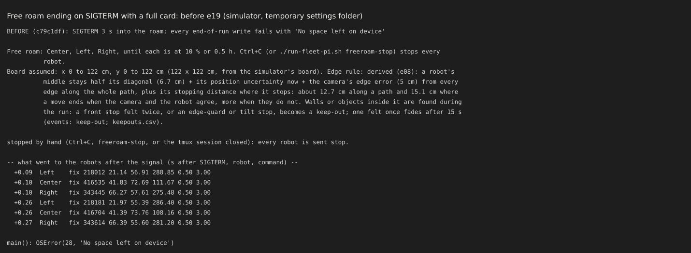
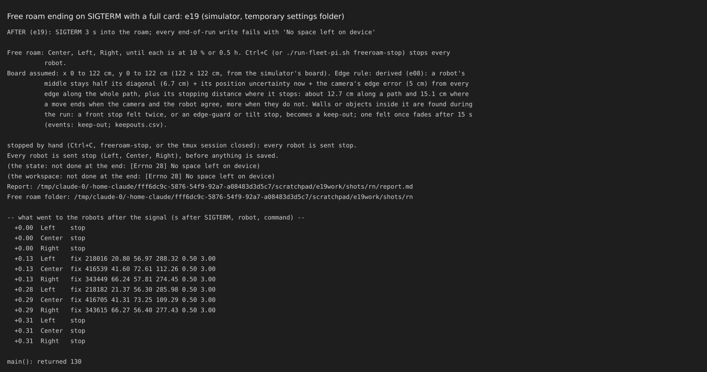
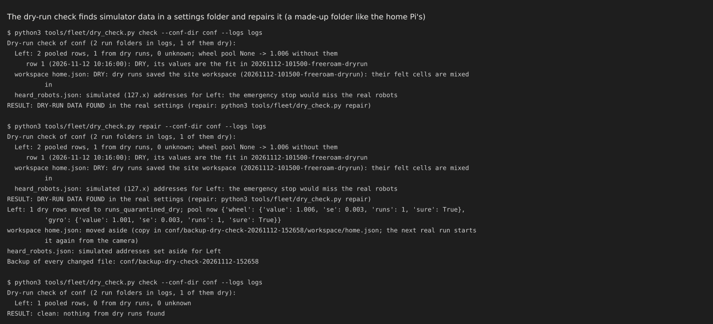
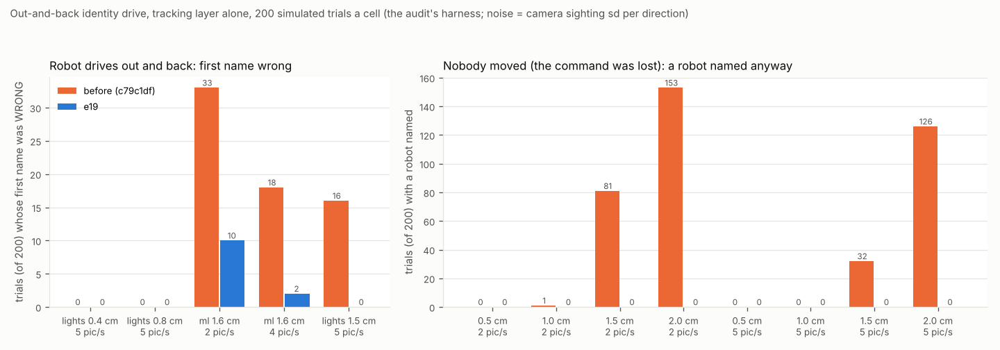
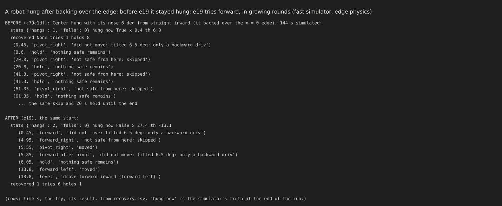
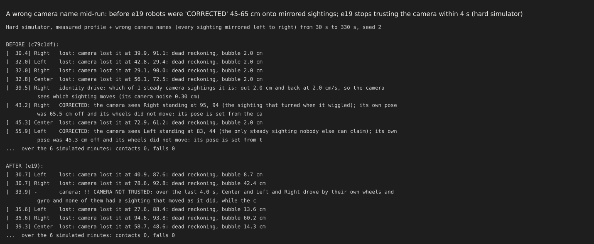
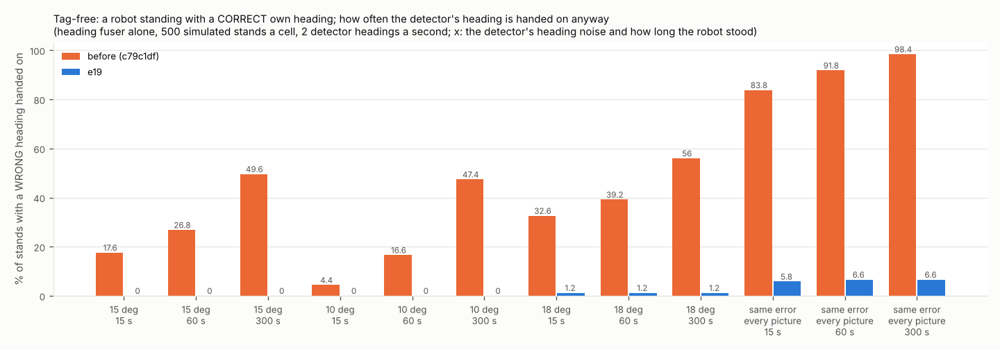
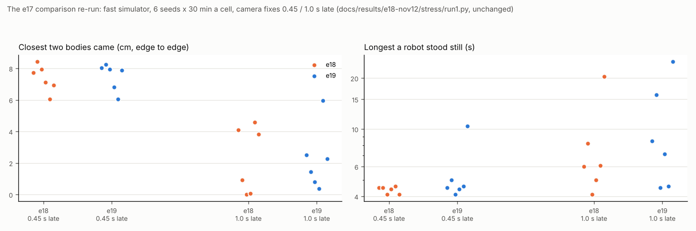

# e19: the Fable audit's fixes, safety first (12 Nov)

## Premise

- Input: the independent audit of 12 Nov (`docs/audits/2026-11-12-fable-audit.md`, 6 H findings, 10 M, 1 L), the
  hard-simulator report, e18's report, the tag-free and detector-v1 reports, and Nick's decisions of 12 Nov 12:58.
- Order: safety first (items 1-7), then identity, tag-free heading, curves, the camera dropout, the side camera, the
  medium findings and the hard simulator's fairness. Each fix is its own commit with a test that fails on the code
  before it (main at c79c1df), except where noted.
- Nothing here touched a robot, a Pi or a camera. Simulator, test rig and saved logs only; every dry run ran with a
  temporary HOME and its own network (`unshare -rn`).
- **Measured** = the simulator, the rig, the layer or the logs. **Claude's reading** = an interpretation, marked; the
  team has discussed none of it.

## Data

### Every audit finding

| # | Finding | Status | Evidence (test in `tools/fleet/tests/test_e19_audit_fixes.py` unless said) |
|---|---|---|---|
| H1 | Free roam can end without `stop` | **fixed** | `stop` goes to every robot first at every ending, each save in its own `try`. SIGTERM with a full disk: before, no `stop` at all; now all three within 0.00 s. Missions: SIGTERM handled. Calibration: `stop` first on an unexpected error too. Works with Mission Control's new STOP path (SIGINT, then SIGTERM 0.3 s later). |
| H2 | Dry runs write the real calibration and workspace | **fixed** | A dry free roam leaves `~/.config/mirlt` byte for byte unchanged (it writes `~/.config/mirlt-dry`). Found here too: dry runs put `127.0.0.x` into `heard_robots.json`, the emergency stop's list. `dry_check.py` finds and repairs (backup first, nothing deleted), and runs at every real start. |
| H3 | Out-and-back names the wrong robot at detector noise | **fixed** (5 % left at the harshest cell) | Chart below. First name wrong at 1.6 cm, 2 pictures a second: 33 to 10 of 200. Lost command: named 32-153 of 200 to 0. |
| H4 | Falls from wrong corrections, then a reverse | **fixed** in the simulator cases tried | No correction past the robot's stated doubt without motion proof. No reverse toward an edge on an unconfirmed pose or while stuck. e19's own re-run found one more fall path (a back-out along a track a re-seed had shifted); it is fixed (commit 3b). |
| H5 | A hung robot holds the creep token | **fixed** | The token stands only while its holder's creep is under way; a stuck robot never holds or takes it. |
| H6 | A hung robot is never freed | **fixed** (simulator); firmware not needed | It tries the opposite of what tilted it first, and forward when its nose points inward (tilt stop raised for that step, as the pivot already did). Rounds grow, one derived pause apart. Failures are forgotten per round. Before, a backed-over robot stayed hung all 144 s; now it is free in 14 s. |
| 7 | Two `wheel_scale` savers; noise saved | **fixed** | One owner (the pool on the Pi, absolute values). A correction inside its own 95 % error bar is never saved. `corr_now` is now the value read back. |
| 8 | Safety box takes free text; direct reads | **fixed** | "Auto" is auto; "Fixed" is fixed; anything else is refused and said. Classic page: drop-downs. Six direct reads in `run_plan`, `calib_run` and `frame_watch` now go through the group. The bypass test now covers every file. |
| 9 | Tag-free hands on a wrong heading | **fixed** | Wrong hand-on in 15 s, 15 deg noise: 17.6 % to 0 %. The same error in every picture: 84-98 % to 6 %. The 45 deg cap is now a risk limit. Chart below. |
| 10 | A wrong camera mid-run is never concluded | **partly** | The whole-camera watch concludes it within about 4 s on seeds 1-3, and on seed 8 after 72 s. Its re-trust needs motion; after a long distrust, robots whose doubt has grown may stay untrusted (degrade, not stop). |
| 11 | A restart re-establishes nothing | **fixed** | Pose sent after the follow run restarts; heading check asked. The hard simulator's restart regression now passes (it was xfail). The 20-restart cap is gone. |
| 12 | Trust fit inside the 50 ms loop | **fixed** | Refits run in a worker thread for the runners' records; the loop returns the last fit in under 20 ms (test). Not timed on a Pi. |
| 13 | Blind error understated | **(a) fixed, (b) not** | (a) Every loss now uses the same model: the fleet record, started from calibration-run data (Nick). (b) The 10-40 cm fit is still used for 125 cm: not changed. |
| 14 | Camera names fall back to a guess | **fixed** | The side camera is never taken as the overhead by its name. Three of the four red `test_launcher.py` tests pass again with their old refusals restored. The fourth (two same-name cameras) was changed: see below. |
| 15 | Missions: held creep with no doubt in its gap | **not** | Not touched. |
| 16 | A close pass ends in a guess at home | **not** | Not touched. The out-and-back is still not used on this path. |
| 17 | L items | **partly** | `run_plan` SIGTERM fixed (H1). `school_pull.sh` was already fixed on main (a387362). The duplicated trust samples and the detector's picture time were not touched. |
| - | e18's text-only tests | **fixed** | Three were made behavioural: saving at every end (now a dry run), calibration creep (calls `hold_creep`), and e13's blind-rule and give-up defaults. Mission right of way still reads a line of text. |
| - | Hard simulator: hang model | **fixed** | A drive either way that works the wheel still on the board frees a hung robot (`MIRLT_SIM_HANG_MODEL=e08` is the old model). |
| - | Hard simulator: the lost-spell timeline artefact | **re-examined, not the cause** | See "Hard simulator fairness". |
| - | Hard simulator: 2x watchdog stops | **not** | Not traced. |

### The switches e19 adds (Safety group, every one decided automatically)

`MIRLT_HANG_RECOVERY` (grow / e08), `MIRLT_MOTION_PROOF`, `MIRLT_TRUST_PRIOR` (calibration / replay),
`MIRLT_BLIND_BUBBLE` (default changed to record), `MIRLT_WHOLE_CAMERA_WATCH`, `MIRLT_OUTBACK_SOUND`,
`MIRLT_OUTBACK_INWARD`, `MIRLT_ID_PAUSE`, `MIRLT_TAGFREE_HAND` (risk / e18), `MIRLT_WHEEL_OWNER` (pool / e18),
`MIRLT_CURVE_LIVE`, `MIRLT_CURVE_FLASH_RESET`. Outside the group: `MIRLT_DRY_CONF_DIR`,
`MIRLT_SIDE_OFFSET_LEARN`, `MIRLT_SIM_HANG_MODEL`. Each old way is one switch away.

### 1. Stop first (H1)



Before e19: SIGTERM with a full card. The state write failed first, and nothing went to the robots.



e19, the same case: `stop` goes to all three at once, the failed writes are said, and the later steps still run. The
`fix` lines after it are camera positions, not moves.

### 2. Dry runs and the real settings (H2)



The check on a made-up folder like the home Pi's. It finds the dry run's calibration row (by its matching fit), the
workspace and the emergency-stop address, then repairs them with a backup and checks again: clean.

### 3. Identity (H3 + Nick)



Each pair of bars is one noise level and picture rate, 200 simulated trials. Orange is the code before e19, blue is
e19. Left: trials whose first name was wrong while a robot really drove. Right: trials that named a robot when nobody
moved.

- The out-and-back is now as long as the measured noise needs. At detector noise that is about 7 cm. It is refused
  where there is no room for that length.
- "Moved" is now judged by the median of each candidate's sightings at the time the robot's own wheels say it was out.
  A robot whose own track did not move names nobody.
- **Named right, counted both ways** (the e18 identity batch rerun: 30 trials, two robots unaccounted, 45 s each,
  `docs/results/e19-nov12/identity/`):

| | Both named | Both named right | Trials with a wrong name | Names given: right / wrong |
|---|---|---|---|---|
| Home lights, held: before | 24 | 23 | 2 | 46 / 3 |
| Home lights, held: e19 | 19 | 19 | 0 | 42 / 0 |
| Home lights, never still: before | 25 | 21 | 8 | 44 / 11 |
| Home lights, never still: e19 | 20 | 17 | 5 | 40 / 7 |
| Detector noise (1.4-1.8 cm, 2 pictures a second), held: before | 10 | 6 | 5 | 12 / 9 |
| Detector, held: e19 | 10 | 9 | 3 | 21 / 3 |
| Detector, never still: before | 16 | 9 | 12 | 18 / 19 |
| Detector, never still: e19 | 10 | 9 | 6 | 21 / 7 |

- e18's "24 / 25 of 30" counted robots named, not named right. Counted right, that was 23 and 21.
- e19 names fewer within 45 s in the lights cells (19-20 against 24-25). It gives far fewer wrong names. A name now
  needs motion proof when it is past the robot's doubt.
- A robot near or half over an edge now gets an inward-only out-and-back (Nick: yes).
- `MIRLT_ID_PAUSE` is on by default and waits for Nick's answer. An unnamed robot pauses its creeps for a derived few
  seconds (about 5.5 s) only while it is being identified. Then never still resumes.

### 4. Corrections, hangs and falls (H4, H5, H6)



The same backed-over start in the fast simulator. Before e19 it held for 20 s at a time and skipped its one try for
ever. e19 drives forward-left after one pivot and is level at 13.8 s.

- **Stated doubt** is the robot's 95 % doubt: its lost bubble, or its fused doubt, and never less than its record's
  prediction for the distance driven since it last agreed with the camera. The motion-proof limit is
  √(doubt² + (2 × camera σ)²).
- **Trust prior from calibration-run data** (Nick): 2.0 cm + 0.07 cm per cm. That is dead reckoning on the calibrated
  scales against both cameras, 22,000 stretches on 29 Oct. It was 2.3 + 0.28. The same model is now used for every
  loss of the camera.

### 5. A wrong or bumped camera (audit 10, 14)



The hard simulator with every sighting mirrored from 30 s. Before e19, two robots were "CORRECTED" 45 and 65 cm onto
mirrored sightings. e19 says CAMERA NOT TRUSTED at 33.9 s.

- The evidence is motion. Robots that drove by their own wheels and gyro have no sighting that moved the same way. Two
  such robots need one mirror or turn that explains both; three need nothing more. A single robot whose own pose is
  off still moves the right way, so it never trips the watch.
- While the camera is not trusted, the run asks for short test drives (7 cm out and back). It trusts the camera again
  on motion, or when every robot finds its sighting within its own doubt.
- Hard simulator, wrong names, 6 min (contacts / falls): seeds 1, 2, 3 and 8 gave 0 / 0 on the final code. On seed 8
  the watch concluded late (72 s).

### 6. Tag-free heading (audit 9 + Nick)



Each pair is one detector noise and stand length, 500 simulated stands, with the robot's own heading right. Orange is
before e19, blue is e19: how often a wrong heading was handed on.

- A heading is handed on only past √(26² + own95²). 26 deg is the detector's measured 95 % error. own95 is twice e18's
  head_sd (2 deg + 1.6 deg per 90 deg turned).
- The old 45 deg cap is now asin(room / 20 cm). Room is the clearance to an edge or a neighbour, less the position
  doubt. Past that limit the heading check (the crawl) is asked.
- What is left: 6 % when the detector is wrong by the same amount in every picture and that amount is past 26 deg (its
  own 5 % tail), in open ground.

### 7. Curves and wheel_scale (audit 7 + Nick)

- Left's `arc_k_scale` 1.0736 is reset to 1.0 at the next real start, and said (`MIRLT_CURVE_FLASH_RESET`).
- Each fitted curve piece joins this session's fleet record. The median is set live (never saved) once it is sure and
  past its own half-width. A robot gets its own value only when its pieces differ.
  <sub>Mann-Whitney U: ranks every piece of this robot against every piece of the others; p is the chance of a
  difference this large if they were one population. Under 0.01, the robot is treated as different.</sub>
- `wheel_scale` / `gyro_scale` have one owner. The end of a run adds its measurement to the pool. The start saves the
  pool's value only when it is sure and differs from the value in use by more than 1.96 standard errors. Old rows carry
  no value-in-use; they are read as relative to 1.0.

### 8. Camera dropout (item 11): partly

- A poor record means slow creeping, not standing. Creep length and speed scale with doubt (unchanged), and a robot
  stands only where no direction keeps the edge.
- e18's 22-minute stand (the record bubble with the 0.28 prior) does not occur in the e17-comparison re-run below
  (longest stand 25 s).
- **Not fixed:** the hard simulator's missing-camera case still stands 740 s. Another robot's widened record blocks the
  creeps (section 11).

### 9. Side camera floor height (item 12)

- **It cannot be proven from these logs.** The Pi's 3-D side calibration stayed on the Pi. The run's own side model is
  a homography fitted from the pictures, which already absorbs the height.
- What the logs do show: the 11 Nov 08:58 bridge measured the side camera at (-2.8, -1.3) cm from the overhead, over
  221,240 paired sightings.
- tagfree now measures the same thing live and removes it. Every tenth detector call also runs the side camera where
  the overhead found robots, and uses the median offset once 20 pairs exist.
- **To replace the 2 cm itself:** the Pi's side calibration (`~/.config/mirlt`, its camera model), plus 10 minutes of a
  run with the detector logging which camera each detection came from. Then fit the height that best lines the side
  detections up with the overhead's, across the side camera's depth.

### 10. The e17 comparison re-run (6 seeds × 30 min, fixes 0.45 / 1.0 s late)

| 6 runs each | 0.45 s late: e18 | e19 | 1.0 s late: e18 | e19 |
|---|---|---|---|---|
| Runs with contacts | 0 | 0 | 1 | 0 |
| Runs with a robot off the board | 0 | 0 | 2 | 0 |
| Closest the bodies came, median (cm) | 7.7 | 7.9 | 3.8 | 2.3 |
| Name swaps | 0 | 0 | 0 | 0 |
| Longest stand, max (s) | 4.6 | 10.4 | 20.5 | 25.1 |



Each dot is one 30-minute simulated run (orange e18, blue e19). With fixes 1 s late e19 had no contact and nothing off
the board where e18 had one contact and two robots off. Bodies came closer (median 2.3 cm against 3.8; seed 4: 0.37 cm,
a warning under the new counting), and the longest stand grew to 25 s (seed 6) against e18's 20.5 s.

- **Claude's reading:** the closer passes and the longer stands are the price of refusing reverses and far
  corrections without proof; neither is traced yet (Sweep 1).
- The first e19 re-run (before commit 3b) had a fall on seed 1 at 1 s late: the case that found the back-out path. It is
  kept as a test.

Source: `docs/results/e19-nov12/stress/` (the unchanged e18 script `run1.py`; one JSON per run).

### 11. Hard simulator fairness and long checks

- **The lost-spell "timeline artefact".** The replayed timeline is now rebuilt per bridge picture, with arrivals that
  never overtake (`realism_measure.picture_timeline`). The measured profile is regenerated.
  - Measured: the old timeline had the bridge's own picture rate (1.96 a second on average; 1.6 is the median of 10 s
    windows).
  - It had only 4 out-of-order arrivals beyond 11 ms. The audit's 2,750 were rounding.
  - The real run had 150-200 arrival gaps longer than the lost threshold per robot-hour too.
  - So the 15-20× lost spells are **not** the timeline (Claude's reading). Their cause is still open: on the real run
    the robots stood far more, and a standing robot keeps its fix.
- Watchdog stops at 2×: not traced.
- Counting: only contact fails the long checks; bodies under 1 cm is now a WARNING.

**The hard simulator's long checks on e19** (`python3 tools/fleet/tests/long_hardsim.py`, 4 seeds × 0.5 h per profile
plus the four single-fault cases; output in `docs/results/e19-nov12/hardsim-long/`). On e18 6 of 15 checks failed.

| Check | e18 (hard-simulator report) | e19 |
|---|---|---|
| Realism: fix delay, quiet spells, pictures | pass | pass (0.55 s against 0.59; 379 against 371 an hour; 1.4 against 1.6) |
| Measured: contact / off the board / swaps | pass / pass / pass | pass / pass / pass |
| Measured: bodies under 1 cm | FAIL | WARNING (0.39 and 0.87 cm in 2 of 4 runs, no contact) |
| Measured: no free stand over 60 s | pass | **FAIL** (one run: 198.8 s) |
| Measured: edge hangs at most 120 s a run | FAIL (267 s) | pass (0-5 s) |
| Harsh: contact in at most a quarter of runs | pass | pass (0 of 4) |
| Harsh: no free stand over 120 s | pass | **FAIL** (one run: Left 354 s) |
| Case skew seed 2 (the 311 s stand) | FAIL | **pass (5.7 s)** |
| Case missing camera seed 1 | FAIL (133 s) | **FAIL (740 s, worse)** |
| Case wrong names seed 2: no fall | FAIL | **FAIL (1 fall)** |
| Case restart seed 1 (21 min hung) | FAIL | **pass (0 s)** |

- **What the remaining stands are (measured, one traced).** In the missing-camera case Center stood 740 s, idle and
  "lost" in the middle of the board. Every creep it tried was refused by another robot's reservation, and that robot's
  doubt was 40-60 cm. Its record had been widened (×7) by checks made against a missing or mirrored camera, and e19
  uses the record for every loss (`MIRLT_BLIND_BUBBLE=record`).
- **Tried and not kept** (measured, same seeds):
  - Back to `fixed` for unplanned losses (its numbers are now the same 2.0 + 0.07): the missing-camera stand fell to
    241 s, but measured seed 3 then had a **contact and a fall**, and harsh seed 2 a fall.
  - Forgetting a "stuck" verdict after three pauses: no change.
  - Safety was ranked over standing, so e19 keeps `record`.
- **Claude's reading:** the record's self-check (`k_cal`, it only ever widens) should not learn from a check whose
  camera is not trusted or not confirmed. That is the next fix for these stands (Sweep 1).

### Tests

- Fleet suite on the final code (d72e0ca, in a separate worktree, while other jobs shared the 2 cores): **1054 passed, 10 skipped, 1 xpassed, 0 failed** (30.8 min). The xpass is the hard simulator's wrong-camera test, seed 8; it is left as `xfail(strict=False)` because on an earlier e19 commit it failed (late detection, one fall). An earlier full run (374cbc3) had one failure, the coordinator's `test_risk_fixes` one, fixed in the code since.
- `tools/pi/tests` + `tools/analysis/tests`: **153 passed** (the 4 old `test_launcher.py` failures fixed: 3 refusals
  restored, 1 test changed; see below).
- `test_e19_audit_fixes.py`: 37 test functions (38 cases), each failing on c79c1df except where its docstring says otherwise.
- **Changed tests, and why:**
  - `test_launcher.py::test_two_cameras_with_the_same_name_need_a_port` now expects a pick. The first camera is taken,
    the reason said ("add the port"), and the whole-camera watch checks it during the run. This follows "degrade, not
    stop".
  - Tests that encode e17 / e18 behaviour now pin their switch: e17's fast elimination (`MOTION_PROOF`), e18's end
    saver (`WHEEL_OWNER=e18`), e13's click test (`BLIND_BUBBLE=fixed`), tag-free's e18 hand-on rule.
  - Prior numbers now follow the constants; the tag-free rig test compares with the truth.
  - Coordinator's report: `test_risk_fixes.py::test_stopall_reaches_robots_heard_on_the_wifi` was broken by 2/14 (it
    refused every 127.x address, and the test stands a robot on 127.0.0.1). **Fixed in the code:** a loopback address
    now never *replaces* a real one, and a dry run writes its own copy of the list.

## Conclusion

1. All six H findings are fixed in the code and tested in the simulator. The e17-comparison re-run had no fall and no
   contact. The hard simulator's long checks went from 6 failures (e18) to 4, plus a warning; the skew stand and the
   21-minute restart hang are gone. **Still failing:** two free stands (199 s, 354 s), the missing-camera stand (740 s,
   worse than e18), and one fall with a wrong camera name. **H6 and the camera watch are proven only in the
   simulator.** The hang model and the wrong-name model are Claude's.
2. **Corrections now need evidence in proportion to their size** (Claude's reading of the root cause the audit named).
   This also caught a fall path the audit did not list: a back-out along a track that a re-seed had shifted.
3. Identity is now sound at detector noise in the layer, but slower. Fewer pairs are named within 45 s at home: e19
   waits for motion proof instead of guessing.
4. The hard simulator's lost-spell excess is **not** the timeline artefact the audit named. The cause is open.
5. The side-camera height cannot be measured from what is uploaded. Its effect is now measured live.

## What's next

- **Nick, home Pi:** the steps below. Pull e19, run the dry-run check, then one free roam. Look for "SETTINGS CHECK",
  "curve scales reset" (Left), "curves live", "correction held" / "identity drive ... motion proof", "reverse refused",
  and "Every robot is sent stop ... before anything is saved".
- Then the Pi bench (the trust refit's time, and core layout B).
- Trace the hard simulator's lost-spell and watchdog excess (Sweep 1).

### Steps for Nick: update the home Pi and check the settings for dry-run data

On the laptop, open **PowerShell** (Windows) or **Terminal** (Mac). Type each box, press Enter, and wait for the `$`.

```
ssh st1maxfini@100.122.222.75
```

Type the Pi's password if it asks. You should see a line ending in `$`.

```
cd ~/alvik-fleet-capstone
```

```
git pull
```

You should see `Fast-forward` and a list of files.

```
git log --oneline -1
```

You should see a line with "e19" in it.

```
python3 tools/fleet/dry_check.py check
```

You should see "Dry-run check of /home/st1maxfini/.config/mirlt ...", one line per robot, and a RESULT line:
- `RESULT: clean: nothing from dry runs found`: nothing more to do.
- `RESULT: DRY-RUN DATA FOUND ...`: type the next box. Every file it changes is copied first into a backup folder,
  which it names. Nothing is deleted.

```
python3 tools/fleet/dry_check.py repair
```

You should see "moved to runs_quarantined_dry" for each robot it fixed, and "Backup of every changed file: ...".

```
python3 tools/fleet/dry_check.py check
```

The RESULT line should now say `clean`.

- Rows marked "unknown" are rows written before e19 that no run folder matches. They are left in and said, never
  guessed. Send Claude the output if any appear.
- A real free roam also runs this check by itself at its start and repairs what it finds, said between lines of `!!`.

```
python3 tools/fleet/safety_group.py show
```

The last line should say "Safety group: every switch on its automatic default (60 switches ...)".

To go back to the code before e19: `git checkout c79c1df` (and `git checkout main` to return).

## Appendix A: chosen and derived numbers (e19)

| Number | Where | Kind | DOE? |
|---|---|---|---|
| STUCK_N 2 moves | freeroam_core | chosen | no (only who may take the token) |
| RECOVER_GROW 0.5, GROW_MAX 3 | safety_rules | chosen | **yes**, with the bench of one wheel over a drop |
| FORWARD_IN_DEG 60 | safety_rules | chosen | no (the room check decides the rest) |
| PROOF_K 2 sigmas | freeroam_core | statistical | no |
| Motion-proof limit √(doubt² + (2σ)²) | freeroam_core, layer | derived | no |
| TRUST prior 2.0 + 0.07 cm/cm | odo_trust | measured (29 Oct, calibrated scales) | no (the fleet's samples replace it) |
| WHOLE_MOVE_CM 3 | tracking_layer | derived (3 sigmas of 1 cm) | no |
| WHOLE_WIN_S 4, MIN_PICS 8, MIN_MOT 4 | tracking_layer | chosen | **yes**, wrong-name / bumped faults against the real logs |
| WHOLE_TRANSFORM_DEG 20, TURN_DEG 20 | tracking_layer | chosen | **yes**, with the above |
| WHOLE_MEM_S 12 | tracking_layer | chosen | no |
| Camera test drive 7 cm at 3 cm/s | freeroam_core | derived (2 × WHOLE_MOVE_CM + 1) / chosen speed | no |
| OB length: noise-derived, OB_MAX_SOUND 12 cm | tracking_layer | derived / chosen bound | no / no |
| ID pause STEADY_S + 1.6 × WIGGLE_S + delay + 0.5 | freeroam_core | derived | no |
| DET95 26 deg | tagfree | measured (detector-v1) | no |
| HAND_HORIZON_CM 20 | tagfree | chosen | **yes**, the detector on real standing robots |
| CURVE_OWN_P 0.01 | freeroam_core | chosen | no |
| Save threshold 1.96 SE | start_discovery | statistical | no |
| SIDE_CAL_EVERY 10, SIDE_CAL_N 20, SIDE_PAIR_CM 10 | tagfree | chosen | no |
| BOOT_POSE_AFTER_S 1 | freeroam_core | chosen | no |
| WINDOW_PAD_S 120 (dry check) | dry_check | chosen | no |

## Appendix B: files

- New:
  - `tools/fleet/dry_check.py`
  - `tools/fleet/tests/test_e19_audit_fixes.py`, `tools/fleet/tests/e19_end_harness.py`
  - `docs/results/e19-nov12/` (identity, tagfree, stress, charts)
- Changed:
  - `freeroam.py`, `freeroam_core.py`, `tracking_layer.py`, `tagfree.py`, `odo_trust.py`, `safety_group.py`,
    `safety_rules.py`, `observe.py`
  - `start_discovery.py`, `proven_workspace.py`, `run_plan.py`, `calib_run.py`, `frame_watch.py`, `stop_all.py`,
    `alvik_console.py`, `mission_control.html`
  - `freeroam_fastsim.py`, `fastsim_realism.py`, `fastsim_sources.py`
  - `tools/pi/camnames.py`, `tools/analysis/realism_measure.py`, `sim_profiles/measured-home-2026-11-11-0858.json`
  - tests: e13, e17, e18, e10 phase C, tag-free, hard simulator, launcher, long_hardsim

## Sweep 1: new tests that may now be needed

- A real free roam ended by Mission Control's STOP and by the time cap: the order of "stop" against "saved" in the
  terminal.
- The dry-run check on the real home Pi (unknown rows?).
- A real out-and-back at detector noise (7 cm needs room): how often it is refused for room.
- The whole-camera watch on the real 11 Nov logs (replay): false alarms. And a real bumped camera.
- A real robot backed over an edge, nose inward: does the raised tilt stop (9 deg at most) let a forward drive start?
  The 25 Oct hang read 9.7-10.2 deg, so the cap may refuse it.
- `MIRLT_ID_PAUSE` on and off on the home table with two robots held side by side.
- The trust refit's worker on the Pi bench (time and load).
- Two real runs in a row: the pooled `wheel_scale` and its save (or not) at the second start.
- The live curve estimate on a real session: how many pieces until it is set, and whether Left differs.
- The hard simulator: why lost spells are 15-20× the real rate, and the 2× watchdog stops.
- The wrong-name case on more seeds, with re-trust after long distrust.

## Sweep 2: possible inaccuracies

- **The simulator is not the robots.**
  - The hang model is now symmetric (Claude's model: the e08 reverse rule mirrored). The wrong-names and restart
    models are Claude's (as the hard-simulator report said).
  - Every H6 and camera-watch result rests on them.
- **The layer and fuser alone** (H3 and finding 9 charts) use Gaussian noise. The "same error in every picture" case is
  a model of a standing robot (a 13.3 deg bias plus 5 deg), not measured.
- **Old pool rows carry no value-in-use** and are read as relative to 1.0. A row measured on a robot whose
  `wheel_scale` was not 1.0 is mis-scaled until newer rows outweigh it.
- **The trust prior's turn terms** stay at 0.04 deg per deg (the replay's 90th percentile). Only the distance terms
  come from calibration data.
- **The stated doubt** (the motion-proof limit) mixes a 95 % bubble with the fused uncertainty, which is not exactly a
  95 % bound.
- **The dry check** judges untagged rows by matching fits and time windows. A real run whose folder is gone can make a
  row "unknown". A dry run whose folder is gone and whose time overlaps nothing is missed.
- **The side offset** is a translation. A real height error grows with distance from the camera, so the median
  offset is an average over where the robots drove.
- **Chosen, not derived:** Appendix A, each with whether a DOE should set it.
- **e18's identity batch and the e17 comparison** are the e18 scripts, unchanged. Their own inaccuracies (rig bodies,
  Gaussian noise) carry over.
