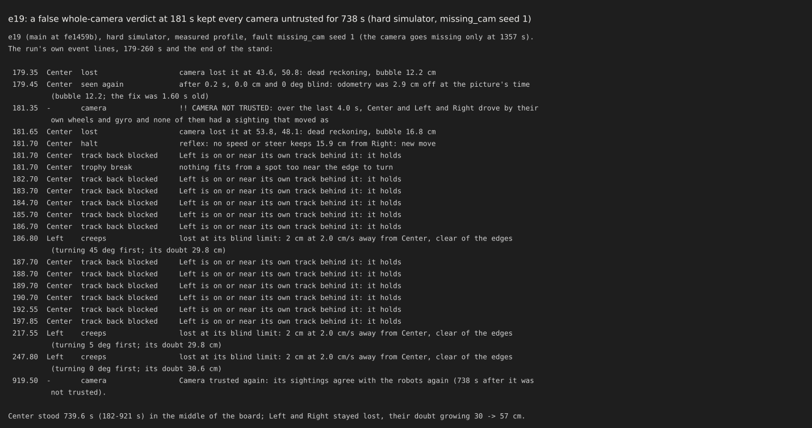
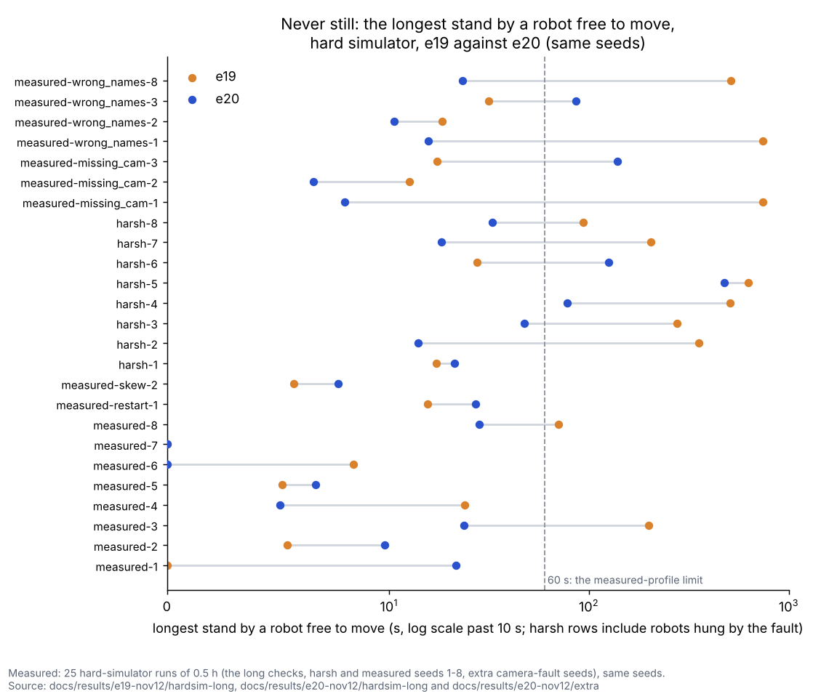
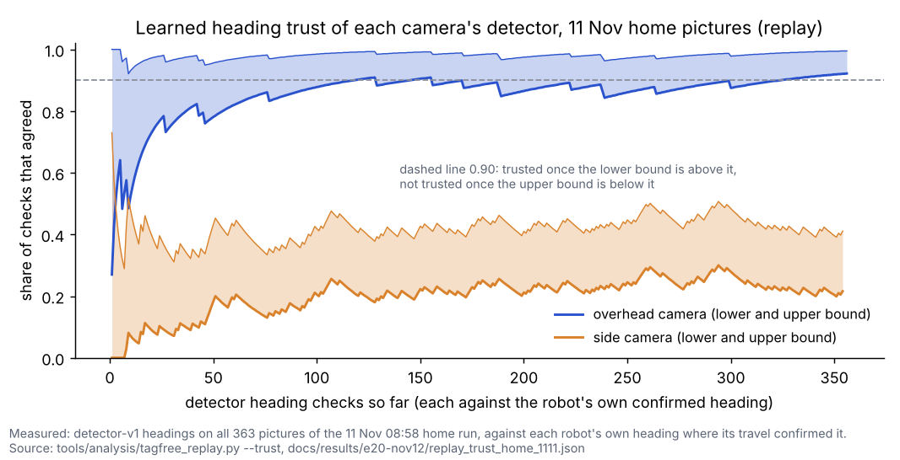
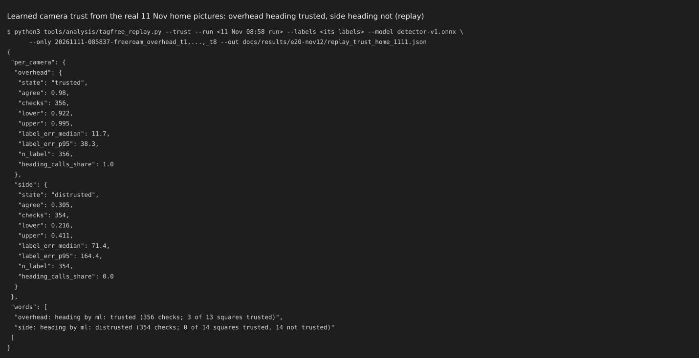
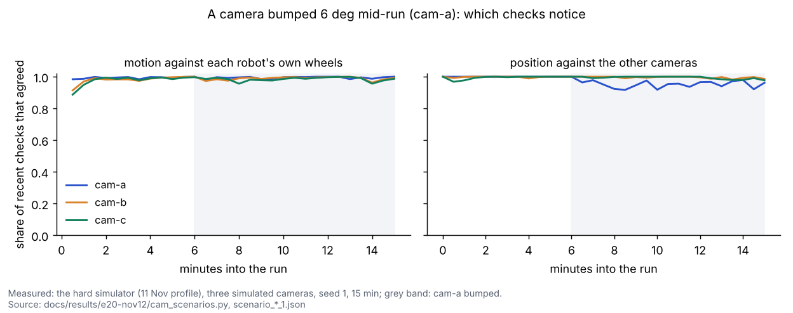
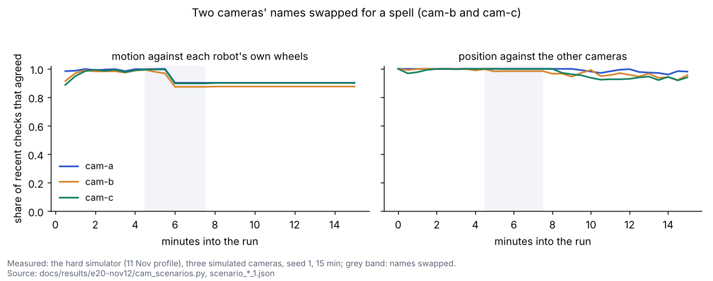
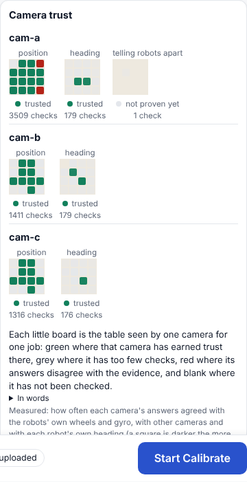

# e20: learned camera trust (12 Nov)

## Premise

- Nick's goal (12 Nov): "any camera could be at any angle and the system will work out which is best for what
  purpose."
- Before e20, the code knew cameras by name. The overhead camera gave heading and the side camera position only, set
  by hand. e19's whole-camera watch gave one verdict for every camera at once. Its open problem was free robots
  standing 199-740 s in the hard simulator.
- Built here:
  1. each camera learns a trust score per job, per square of the board and per lighting;
  2. heading from motion on every camera;
  3. detector calls routed by trust;
  4. the odometry record weighted by camera trust;
  5. a Camera trust card in Mission Control.
- Nothing here touched a robot, a Pi or a camera. Simulator, saved pictures and logs only, with a temporary HOME for
  every dry run.
- **Measured** = the simulator, the replay or the tests. **Claude's reading** = an interpretation. It is marked, and
  the team has discussed none of it.

## Data

### 1. What was built (each behind a switch, decided automatically)

| Piece | What it does | Switch (default / old way) |
|---|---|---|
| Camera trust (`tools/fleet/camera_trust.py`) | Every sighting names its camera (`cam_bridge:<camera>`, the detector's camera). Each camera gets a score per method, job (position, heading, identity), 30 cm board square and lighting key. The score counts the checks that agreed, with old checks fading (half-life 40 checks). A camera is **trusted** when the lower bound of its agreement reaches 0.90 and **distrusted** when the upper bound is below it; in between it is **unproven**. A new camera starts unproven. A square with few checks leans on the camera's whole-board score. Scores are saved per site with the number of checks behind them. | `MIRLT_CAMERA_TRUST` learn / e19 |
| The checks (independent evidence) | Position: each camera's displacement of a robot against the robot's own wheels and gyro over the same picture times. Position frame: cameras that saw the same robot in one picture; a camera loses this score only when two or more other cameras agree with each other against it. The whole picture: a robot that drove and a sighting of this camera that moved the same way. Heading: against the robot's own gyro heading. Identity: roof tags, out-and-backs, revoked eliminations and swaps. | |
| Refusal | A sighting from a camera distrusted for position at that square is not used. It is still checked, so the camera can earn trust back. e19's whole-camera verdict still stands for a camera-wide fault. It also counts as evidence against each camera, and a wrong-way sighting lying on another robot no longer counts toward it. | |
| Heading from motion (`MotionHeading`) | While a robot drives straight on its own command (forward or reverse, so front and back are known), each camera's line of sightings gives a heading. Its precision is √2 × that camera's noise across the line ÷ the distance driven (1.6 cm over 10 cm is about 13°). The noise across the line is learned per camera and per travel direction. It feeds three things: evidence for the camera's heading trust; a heading sent with the robot's next fix; and settling a heading in doubt with no crawl. | `MIRLT_MOTION_HEADING` 1 / 0 |
| Odometry record (`odo_trust`) | Each sample and each check (k_cal) is weighted by the trust of the camera that made it: its lower bound, 0 where it is distrusted, 0 for a new camera. The fit and k_cal are weighted. All weights 1 is exactly e19. | `MIRLT_ODO_LEARN_TRUST` trust / e19 |
| Detector routing (`tagfree`) | Each on-demand call runs the camera most likely to answer that question (position, heading or identity) at that robot's square, by Thompson sampling. A second camera runs only where the first found nothing near the robot. A detector heading is used only from a camera trusted for heading there. Calls are counted per camera (`det_calls_by_cam` in `pi_monitor.csv`). | `MIRLT_DETECTOR_ROUTE` trust / e19 |
| Close pair standing apart | Two robots that passed close and then both stand beyond the close-pass distance count as parted, so who is who is checked. | `MIRLT_PAIR_STAND_PART` 1 / 0 |
| Mission Control | A **Camera trust** card on the map page (`/api/camera_trust`). | |

<sub>Thompson sampling: for each camera, draw an agreement share at random from what its checks allow (a Beta
distribution over agreed and disagreed checks), and run the camera with the highest draw. A camera is tried as often as
the evidence leaves it a chance of being best. A Wilson bound is the lowest (or highest) agreement share still likely
(one-sided 95 %) given the checks so far.</sub>

### 2. e19's open problem: what the 740 s stand really was (measured)



e19, hard simulator, missing-camera seed 1. The camera goes missing only at 1357 s. At 181 s the whole-camera watch
concluded "CAMERA NOT TRUSTED" while three robots drove within 16 cm of each other. That verdict was false, and every
camera stayed untrusted for 738 s.

- e19 read the cause as the odometry record widened (×7) by a missing or mirrored camera. **The trace says
  otherwise.** In that run k_cal stayed between 1.0 and 2.5.
  - Every fix was refused after the false verdict.
  - Left and Right drifted lost (doubt 30 to 57 cm). Their camera test drives were refused for room.
  - Center was blocked by their reservations.
- The record fix Nick agreed (weight by camera trust) is built and does help (section 3: with it off, harsh seeds 5
  and 6 had 1 and 2 falls). The stand itself was the false verdict.
- Fixed by:
  - not counting a wrong-way sighting that lies on another robot (it may be that robot's own);
  - per-camera recovery that needs no test drive.
- Found on the way:
  - the record starved: no sample for the first 90 s while cameras were unproven, then a few slips set its 95th
    percentile. Fixed by weighting, not cutting;
  - stale shadows reached 58 cm. Fixed;
  - an e09 deadlock: two lost robots stood 17 cm apart for 105 s, neither taking a fix (the pair rule above).

### 3. The hard simulator's long checks: e19 against e20 (measured)

`python3 tools/fleet/tests/long_hardsim.py`: 4 seeds × 0.5 h per profile plus the four single-fault cases. Same seeds
as e19. Output in `docs/results/e20-nov12/hardsim-long/`.

| Check | e19 | e20 |
|---|---|---|
| Realism (delay, quiet spells, pictures) | pass | pass |
| Measured: contact / off the board / swaps | pass | pass |
| Measured: bodies under 1 cm | WARNING (0.39, 0.87) | WARNING (0.24 cm in 1 of 4) |
| **Measured: no free stand over 60 s** | **FAIL** (198.8 s) | **pass** (21.6, 9.8, 23.7, 5.1 s) |
| Measured: edge hangs ≤ 120 s a run | pass | pass |
| Harsh: contact in at most a quarter of runs | pass (0 of 4) | pass (0 of 4) |
| **Harsh: no free stand over 120 s** | **FAIL** (354 s) | **pass** |
| Case skew seed 2 | pass (5.7 s) | pass (7.7 s) |
| **Case missing camera seed 1** | **FAIL (740 s)** | **pass (8.0 s)** |
| **Case wrong names seed 2: no fall** | **FAIL (1 fall)** | **pass (0)** |
| Case restart seed 1 | pass | pass |
| **Checks failed** | **4** | **0** (1 warning) |



Each row is one long-check run: the longest stand by a robot free to move, e19 in orange and e20 in blue. The 740 s,
354 s and 199 s stands are gone, and no e20 run passes the 60 s line.

**Beyond the long checks (measured): 25 runs of 0.5 h, the same seeds on e19 and e20.** These are harsh seeds 1-8,
measured seeds 1-8, missing camera seeds 1-3, wrong names seeds 1, 2, 3 and 8, restart and skew. The output is in
`docs/results/e20-nov12/extra/`. The long checks test 12 of these 25.

| 25 runs | e19 | e20 |
|---|---|---|
| Runs with a free stand over 60 s (harsh rows include robots hung by the fault) | 11 | 5 |
| Falls | 3 (harsh 8 ×2, wrong names 2) | 3 (harsh 2, harsh 6, wrong names 8) |
| **Runs with body contact** | **0** | **2** (harsh 6; wrong names 3, 0.3 s) |
| Name swaps | 1 | 3 (missing camera 3 ×2, wrong names 3) |
| Heading crawls asked (all runs) | 53 | 44 |

- **What e20 does not achieve (measured):** "no new falls or contacts" is not met run by run. The falls are 3 against 3,
  on different runs. Two runs gained a contact, and swaps rose from 1 to 3.
- **Claude's reading:** the harsh and wrong-name runs are chaotic, so any change of trajectory moves single falls. But
  the two contacts and the swaps are new, and they come with camera faults. The traced fall cases (harsh 2 and 6)
  were edge-hang recoveries on a pose a few cm off (the harsh profile's 5 cm calibration error), not refusals by
  camera trust.
- **Switch by switch** (harsh seeds 5 and 6):
  - the weighted odometry record prevents falls: with it off, 1 and 2 falls;
  - heading from motion changes nothing in harsh runs;
  - the standing-pair rule causes seed 6's contact.
  - Over measured seeds 1-8 the pair rule is needed: off, stands of 925 s and 190 s and a fall; on, none over 28 s.
    It stays on.


### 4. Learned trust on the real 11 Nov home pictures (replay, measured)

`tools/analysis/tagfree_replay.py --trust` puts all 363 pictures of the 08:58 run through each camera's detector. A
camera's heading is checked against the robot's own heading wherever the run had confirmed that heading by its travel.
No camera is named in the rules.

| Camera | Checks | Agreed | Learned state | Labels' heading error, median | Heading calls routed to it |
|---|---|---|---|---|---|
| overhead | 356 | 98 % | **trusted** | 11.7° | 100 % |
| side | 354 | 31 % | **not trusted** | 71.4° | 0 % |
| held-out block only (11:11-12:54): overhead / side | 53 / 53 | 100 % / 26 % | trusted / not trusted | 12.0° / 77.4° | |



The side camera's band falls below the dashed line within about 5 checks and stays far below it. The overhead's lower
bound is 0.8-0.9 from about 30 checks on, and passes the line near check 320. It agrees in 98 %, and the few
disagreements keep the bound just under 0.90 for a long time. This matches what was known: overhead heading good, side
heading poor. Earning full trust takes a whole run of pictures this sparse (Sweep 2).



- Position trust is not learned in this replay. The pictures are minutes apart, so there is no motion to check. With
  two cameras there is no consensus either way.

### 5. The simulator breaks the camera guesses (measured, hard simulator, 15 min, three cameras)

`docs/results/e20-nov12/cam_scenarios.py`. Three simulated cameras:

- **cam-a**: steep above, 0.4 cm.
- **cam-b**: a low angle, its noise ×3 along its depth, and a dark patch only it has.
- **cam-c**: a third camera at a strange angle, ×2.5 along 45°, offset 0.5 cm.
- Detector: cam-a's heading good (15°), cam-b's heading anywhere (as the real side camera), cam-c's 40°.

| 15 min, seed 1 | cam-a (steep above) | cam-b (low angle, dark patch) | cam-c (third, strange angle) |
|---|---|---|---|
| Position, learned | trusted (3,864 checks) | trusted (1,452) | trusted (1,409) |
| Its noise across its line of travel, learned per direction (cm) | 0.38-0.44, the same every way | **1.42 across x, 0.68 across y** (its depth, set ×3) | **1.41 at 135°, 0.80 at 45°** (set ×2.5 along 45°) |
| Heading from motion | trusted (224 checks) | trusted (223) | trusted (228) |
| Detector heading | unproven (7 checks) | **not trusted** | too few calls |
| Detector pictures routed to it | 52 | 35 | 19 |
| **cam-a bumped 6° at 6 min** | 2 of 16 squares not trusted for position and frame (away from the middle), whole-board frame unproven | frame trusted, 0 squares blamed | frame trusted, 0 squares blamed |
| **cam-b and cam-c names swapped 4.5-7.5 min** | position unproven (90 %) | position unproven, 1 square not trusted | position unproven |



cam-a bumped at 6 min (grey). Left: its motion still agrees with the robots' own wheels, because a 6° turn barely
changes a displacement. Right: where it puts the robots, against the other two cameras, drops after the bump while
the other two stay near 1.



cam-b and cam-c swapped by name for 4.5-7.5 min (grey). Every camera's agreement drops at the swap, and then the
lines go flat. After the e19 whole-camera verdict at 5.8 min, no robot moved enough to give any camera new evidence.

- **What works (measured):**
  - Each camera earns its trust from checks, and nothing says which is "overhead".
  - A steep or strange angle is learned as noise per travel direction, the right way round.
  - A detector heading that is right only by chance (cam-b) is not trusted.
  - A bumped camera is distrusted where the bump shows, and the other cameras are not blamed.
  - Heading from motion is earned on all three cameras.
- **What does not (measured): the swap scenario stands 526 s.** After the verdict, every camera's fixes were refused,
  cam-a's too. One robot had been corrected onto a swapped camera's sighting (116 cm off). Another hung half over an
  edge out of view. The verdict's release needs every robot seen within its doubt, and that never came. The same
  scenario with `MIRLT_CAMERA_TRUST=e19` stands 5.8 s at most.
  - **Claude's reading:** the verdict should refuse only the cameras it implicates, and a trusted camera's agreement
    should be able to release it. Tried here with an edge exception: no effect, reverted. Not fixed (What's next).
- The dark patch only cam-b has lowers its detection there (30 %). It does not make its answers wrong, so cam-b stays
  trusted there, with fewer checks. A patch that gives wrong positions would be distrusted per square, as the bump is.


### 6. Heading from motion and crawls (measured)

- Heading from motion ran on every camera's every straight stretch. In the three-camera scenario that was 925
  stretches in 15 min. Its heading trust was earned on all three cameras (about 225 checks each).
- A heading in doubt was settled by a motion heading without a crawl 0 times in the three scenarios. This was not
  counted in the 25 runs.
- The crawls fell from 53 to 44 over the 25 runs (measured).
- "Heading confirmed by motion" happened 18 times in the 15-minute scenario: a never-still creep whose stretch agreed
  with the gyro resets its heading doubt.
- **Claude's reading:** that reset is probably where most of the saving comes from. The counts are small, and the
  saving is not yet shown on the real board.
- A trusted camera's motion heading is sent with the robot's next fix and its σ (`fix ... th sigma_th`), so the
  firmware fuses it.


### 7. Detector routing and the Pi monitor

- Each on-demand call ran one camera, chosen per question and square. A second camera ran only where the first
  found nothing near the robot.
  - Replay: heading questions went 100 % to the overhead.
  - Three-camera scenario: 52 / 35 / 19 pictures for cam-a / cam-b / cam-c. Position questions are spread; the poorer
    cameras are still tried.
- e18/e19's caps are unchanged: 2 calls a second a robot, 4 in all, the 25 % core share, the 80 ms budget.
- `pi_monitor.csv` gains `det_calls_by_cam` as its last column ("overhead=12;side=3"). The other columns are not moved.


### 8. Mission Control: the Camera trust card



The card beside the map. It shows, per camera, a little board for each job, coloured by the camera's state in each
square. The fill is darker the more checks a square rests on, and hovering a square gives its numbers. Below it are the
detector calls per camera and the same in words. In this picture cam-a was bumped mid-run: red on the right of its
position board.

- It reads the run's `camera_trust.json` (written every minute and at the end), else the site's saved scores.
- Checked at 600 px wide: no sideways scroll.

### Tests

- **Fleet suite** (`tools/fleet/tests`, final code, 29 min on the shared 2 cores): **1077 passed, 10 skipped,
  1 xfailed, 0 failed.** The e19 baseline was 1054 passed, 10 skipped, 1 xpassed.
  - The xfail is `test_hard_simulator.py::test_wrong_camera_name_mid_run_no_contact` (seed 8). e19 left it
    `xfail(strict=False)` because it passed on some of its commits. It fails on e20, consistent with the wrong-names
    seed 8 fall in section 3.
  - Output: `docs/results/e20-nov12/fleet_suite.txt`.
- **`tools/pi/tests` + `tools/analysis/tests`: 153 passed** (the e19 baseline).
- **New: `tools/fleet/tests/test_e20_camera_trust.py`, 22 test functions (23 cases):**
  - scores: a new camera unproven, trust earned in about 25 checks, a bump distrusted within 25, trust earned back
    after 2,000 disagreeing checks;
  - squares and light; per-site save;
  - bridge camera names;
  - heading-from-motion precision, reverse drives, per-direction noise;
  - Thompson routing; the detector source routing and counting calls per camera; detector heading used only when
    trusted;
  - the weighted quantile equal to e19's with weights 1; zero-weight fixes and checks;
  - refusal by square; relative-motion checks (good and flipped);
  - the whole-camera verdict for a mirror; the neighbour rule;
  - teaching weights; the standing pair, on and off;
  - the three-camera bump scenario (8 min); Mission Control's endpoint and page; the Pi monitor's column.
- **No test was changed.** None failed alone or in the suite.
- **The hard simulator's long checks:** section 3 (all 15 checks pass). Each was run on the final code, after
  the container restart.
- **A dry free roam through the real runner** (temporary HOME, no network): the book starts at a new site, is saved in
  the dry run's own settings folder (`~/.config/mirlt-dry/camera_trust/home.json`, never the real one), and
  `camera_trust.json` and `state.json` carry it. The dry simulator's fixes name no camera, so no checks ran there.


## Conclusion

1. **Every camera now earns its trust per job, square and lighting from checks against independent evidence. No camera
   is named in the rules (measured).**
   - The real 11 Nov pictures give the known answer from the run's own evidence: overhead heading trusted (98 %),
     side heading not (31 %).
   - In the simulator a steep or strange angle is learned as direction-dependent noise.
   - A bumped camera is distrusted where it is wrong, and the others are not blamed.
   - A distrusted camera can earn trust back: after 2,000 disagreeing checks, in under 400 agreeing ones (test).
2. **e19's open problem is closed in the long checks:** 4 failures to 0 (measured).
   - The 740 s "missing camera" stand was a false whole-camera verdict, not the widened record (measured trace).
   - It no longer happens, and the record is now weighted by camera trust, as Nick asked.
   - Over 25 runs, stands over 60 s fell from 11 runs to 5.
3. **Not achieved (measured):**
   - "No new falls or contacts" holds in aggregate for falls (3 against 3), not run by run.
   - Two runs gained a contact, and name swaps rose from 1 to 3, all with camera faults.
   - The camera-swap scenario has a 526 s stand that e19's layer does not have: the whole-camera verdict refuses the
     good camera too and is never released.
4. **Heading from motion** works on every camera with a measured precision. It is a heading source, and crawls fell
   53 to 44. That it settles doubts without a crawl is built and tested, but rare in the simulator.
5. **Claude's reading:** what is left is all at the join with e19's whole-camera verdict, which is still one verdict for
   every camera. Making it per camera, refusing only the cameras it implicates, is the next fix.


## What's next

1. **Nick, home Pi:** the steps below, then one free roam from Mission Control. Look for:
   - "Camera trust (e20)" at the start;
   - the Camera trust card filling in;
   - "Camera trust saved" at the end, and `camera_trust.json` in the run folder;
   - whether the overhead becomes trusted for position everywhere it sees, and the side camera for position where it
     sees but never for detector heading.
2. **The next build (Claude's proposal):** the whole-camera verdict per camera.
   - It refuses only the cameras it implicates (no hits in the window), and is released by a trusted camera's agreement.
   - Then trace the two contacts and the swaps (Sweep 1).
3. Name the cameras in the dry simulator (`tools/sim/fleet_sim.py`), so a dry run exercises the checks.
4. The bridge sending each camera's sighting separately (not fused into "both"), so per-camera trust has per-camera
   evidence at home.


### Steps for Nick: update the home Pi

On the laptop, open **PowerShell** (Windows) or **Terminal** (Mac). Type each box, press Enter, and wait for the `$`.

```
ssh st1maxfini@100.122.222.75
```

Type the Pi's password if it asks. You should see a line ending in `$`.

```
cd ~/alvik-fleet-capstone
```

```
git pull
```

You should see `Fast-forward` and a list of files, among them `tools/fleet/camera_trust.py`.

```
git log --oneline -1
```

You should see a line with "e20" in it.

```
python3 tools/fleet/safety_group.py show
```

The last line should say "Safety group: every switch on its automatic default (65 switches ...)".

```
./run-fleet-pi.sh mc-stop
```

```
./run-fleet-pi.sh mc
```

Then, in the browser on the laptop, open `http://100.122.222.75:8095`. Under Pi health on the right there is a new card,
**Camera trust**. Before the first e20 run it says "No checks yet at this site".

After one free roam (from Mission Control as usual), look for these:

- the run's first lines: "Camera trust (e20): a new site: every camera starts unproven ...";
- the card fills in: a little board per camera and job, mostly green for the overhead's position after a few minutes;
- "Camera trust saved (...)" at the end;
- in the run folder: `camera_trust.json`, and the last column of `pi_monitor.csv`, `det_calls_by_cam`.

To go back to the code before e20: `git checkout fe1459b` (and `git checkout main` to return). To switch off one part,
use the Safety box in Mission Control: Settings > Safety, the `MIRLT_CAMERA_TRUST`, `MIRLT_ODO_LEARN_TRUST`,
`MIRLT_DETECTOR_ROUTE`, `MIRLT_MOTION_HEADING` or `MIRLT_PAIR_STAND_PART` line, "old way".

## Appendix A: chosen and derived numbers (e20)

| Number | Where | Kind | DOE? |
|---|---|---|---|
| R_STAR 0.90 (the agreement a camera must show) | camera_trust | derived: k_cal is a 95th percentile, so at most 5 % of its checks may be gross; twice that margin | no |
| Wilson bounds at one-sided 95 % (z 1.645) | camera_trust | statistical | no |
| AGREE_K 3.035 (2-D 99 %), HEAD_K 2.576 (1-D 99 %) | camera_trust, tracking_layer | statistical | no |
| HALF_LIFE 40 checks | camera_trust | **chosen** | **yes**: how fast a bumped camera is distrusted against false distrust, on real logs once cameras are named in them |
| AREA_CM 30 cm squares | camera_trust | **chosen** | no (pooling covers sparse squares) |
| POOL_N 5 checks (a square leans on its camera's whole-board score) | camera_trust | **chosen** | no |
| NOISE0_K 2 (a camera with no measured noise counts as twice its method's) | camera_trust.MotionHeading | **chosen** | no (replaced after 3 stretches) |
| NOISE_MIN 3 stretches, SEG_MIN_PTS 3 sightings, 4 direction bins of 45° | camera_trust.MotionHeading | **chosen** | no |
| Motion-heading precision √2 σ / L | camera_trust.MotionHeading | derived (two ends of the stretch) | no |
| A stretch gives a heading only past 3 σ of travel | camera_trust.MotionHeading | derived (3 sigmas) | no |
| Motion-heading "tight band": HEAD_K × √(σ² + HEAD_SD0²) | freeroam_core | derived (its own heading as sure as it ever is) | no |
| A heading judges a camera only while head_sd ≤ HD_CONFIRM_DEG (5°) | freeroam_core, tagfree | derived from e17's (chosen) crawl limit | no (with HD_CONFIRM_DEG) |
| A motion heading settles a doubt when σ ≤ HD_CONFIRM_DEG / 2 | freeroam_core | derived (the crawl's own design precision) | no |
| MH_FRESH_S 30 s | freeroam_core | **chosen** | no (the turns since already bound it) |
| Relative check waits for √2 × AGREE_K × σ of travel | tracking_layer | derived | no |
| A sighting's sigma never below its method's | tracking_layer | definition (the across-line scatter misses timing along the line) | no |
| Teaching weight = the camera's lower bound (0 when new or distrusted) | camera_trust | Claude's reading of "weighted by trust" | no |
| The record's prior until the samples weigh 20 | odo_trust | e18's PRIOR_UNTIL, now by weight | no |
| Close pair parted when both stand ≥ PARKED_STILL_S (2 s) beyond CLOSE_CM | tracking_layer | existing chosen numbers reused | yes, with CLOSE_CM (e09's DOE) |
| Wrong-way sighting "on a neighbour": within CLOSE_CM | tracking_layer | existing chosen number reused | no |
| SAVE_KEEP_DAYS 60 | camera_trust | **chosen** | no |
| Simulator cameras: noise, angles, shares, dark patch ×0.3, bump 6° | cam_scenarios, fastsim_realism | **chosen** stresses | no (stresses, not estimates) |

## Appendix B: files

- New:
  - `tools/fleet/camera_trust.py` (TrustBook, MotionHeading)
  - `tools/fleet/tests/test_e20_camera_trust.py` (22 test functions, 23 cases)
  - `docs/results/e20-nov12/`: `cam_scenarios.py`, `charts.py`, `replay_trust_home_1111.json`, the scenarios'
    JSON, `hardsim-long/` and `extra/` (one JSON per run)
- Changed:
  - `tools/fleet/tracking_layer.py` (sightings name their camera; the checks; refusal; the frame consensus; the
    whole-camera verdict's neighbour rule; the standing pair)
  - `tools/fleet/freeroam_core.py` (on_fix `cam=`, learn_weight, motion_heading, mh_settles, mh_for_fix)
  - `tools/fleet/odo_trust.py` (weighted samples and checks)
  - `tools/fleet/freeroam.py` (the site's book: load, hooks, save, `camera_trust.json`, `state.json`)
  - `tools/fleet/tagfree.py` (routing, heading only from trusted cameras, SimDetector `ml_cams`)
  - `tools/fleet/fastsim_realism.py`, `tools/fleet/fastsim_sources.py` (cameras named, `cams=`, `cam_swap=`)
  - `tools/fleet/safety_group.py`, `docs/how-to/safety-group.md` (five switches; the table was also behind e19)
  - `tools/fleet/mission_control.py`, `tools/fleet/mission_control_table.html` (the card)
  - `tools/pi/pi_monitor.py` (`det_calls_by_cam`, appended)
  - `tools/analysis/tagfree_replay.py` (`--trust`)

## Sweep 1: new tests that may now be needed

- **A real free roam at home with e20.** Do the scores look like the replay (overhead trusted for heading, side not)?
  How long until each camera is trusted for position at each square? Watch `camera_trust.json` and the card.
- **A real bumped camera:** nudge the side camera by hand mid-run. Is its frame score lost where it should be? With
  two cameras there is no consensus (section 5), so the e19 verdict alone has to catch it.
- **A real name swap** in a short dry run: the two cameras' names swapped in the bridge's settings.
- **The bridge's "both" label:** the home bridge fuses overhead and side into one sighting when both see the robot.
  The per-camera checks then see "both" as one camera. A test with the bridge sending each camera's sighting
  separately would show whether per-camera trust gains from it.
- The dry simulator (`tools/sim/fleet_sim.py`) sends fixes with no camera name. A dry run therefore exercises the
  book's start and save only, not its checks. Name its cameras.
- The Pi bench: the book's cost per picture (the checks run inside the layer's feed) and `det_calls_by_cam` with the
  real detector.
- Heading from motion on the real board: how often a never-still creep settles a heading in doubt (crawls saved).
- **Harsh seeds 2 and 6 (the falls)**, and harsh seed 6's contact with the standing-pair rule: traced only as far as an
  edge-hang recovery on a pose a few cm off (section 3).
- The wrong-names case on more seeds: seed 3 has a short contact, and seed 8 two name swaps (section 3).
- Thompson routing on the Pi: is the second camera tried often enough to keep its heading score current? Count from
  `det_calls_by_cam`.

## Sweep 2: possible inaccuracies

- **The simulator is not the cameras.**
  - The three-camera scenarios (steep, strange angle, dark patch, bump, swap) are Claude's models.
  - The swap model is now two different transforms. The first version mirrored both the same way, and two wrong cameras
    then outvoted the good one.
  - The hard simulator's measured profile has "both" for 88 % of sightings, so most per-camera evidence there is one
    camera's.
- **The replay's check and its truth share a source.** The check reference is the robot's own heading where its travel
  confirmed it, and so is the label's heading. The replay shows the scoring rule reaches the known verdict from the
  run's own evidence. It is not an independent accuracy measurement. The detector was also trained on blocks t1-t5.
  The held-out t7-t8 alone gives the same verdict (53 checks a camera).
- **The relative-motion check uses the robots' own poses,** which the firmware pulls toward accepted fixes (35 % a
  fix). A camera's own fixes therefore make its check a little easier to pass. The proxy is as e18's shadows'.
- **Slips are blamed on the camera.** A wheel that turns while the body stands shows as a disagreement. With one camera
  label (home's "both") this cannot be told from a camera fault. With R_STAR at 0.90 it costs trust only in squares
  where slips are frequent.
- **A 6° bump is only caught where it moves a sighting past the cameras' noise:** away from the middle. The middle
  squares stay trusted, which is right for them. With two cameras alone, a bump has no consensus to show it.
- **Teaching weight = the lower bound** is Claude's reading of Nick's "must not learn from a camera that isn't trusted
  for that job and area". A strict cut at "trusted" starved the record (section 2) and is not offered as a switch value.
- **The harsh profile is chaotic.** One seed's fall or contact moves with any change of trajectory (sections 3 and
  the 25-run table). 8 seeds per profile are indications, not estimates.
- **Chosen, not derived:** Appendix A, each with whether a DOE should set it.

