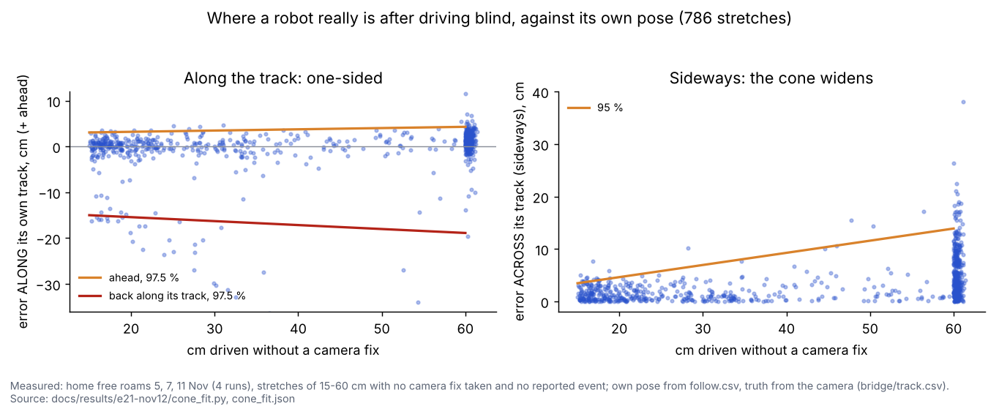
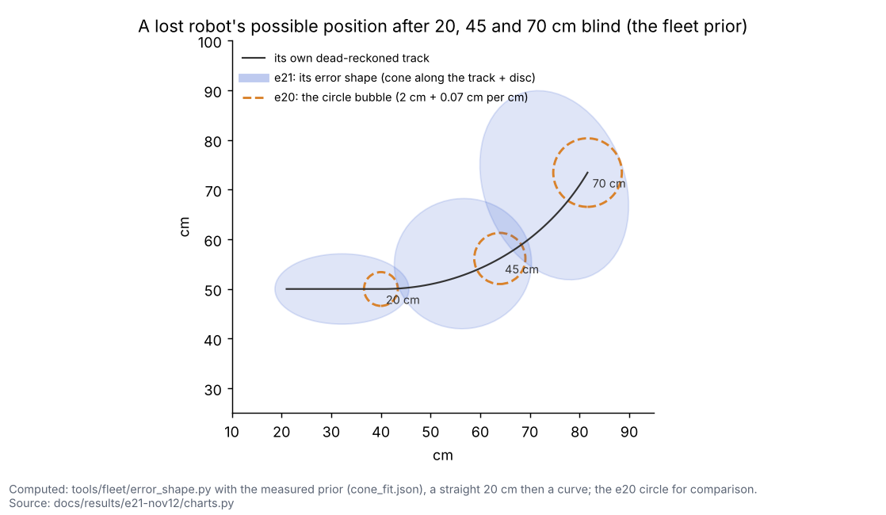
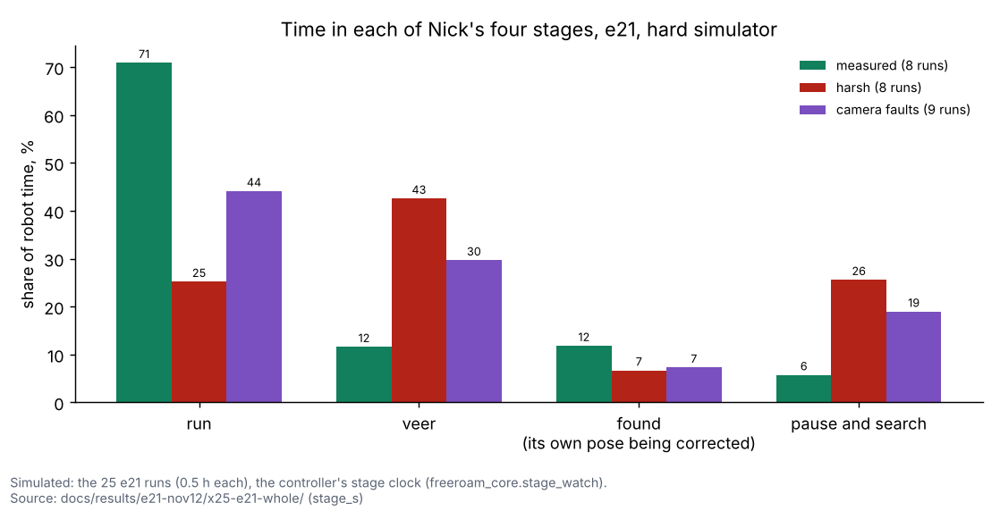
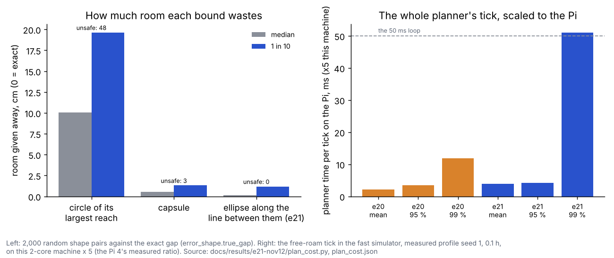
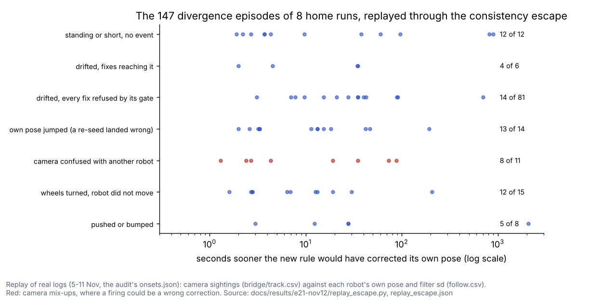
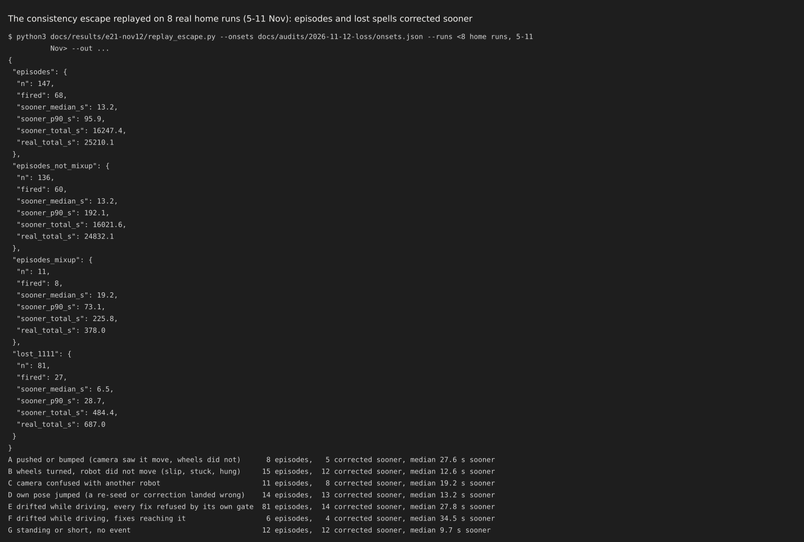
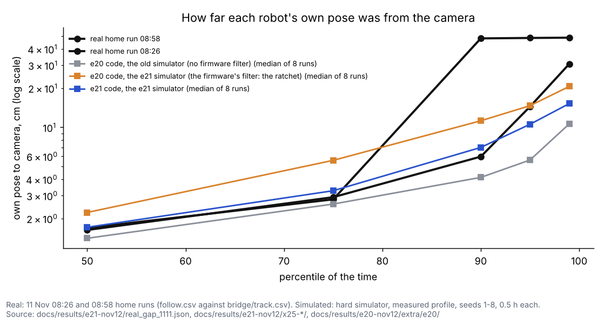
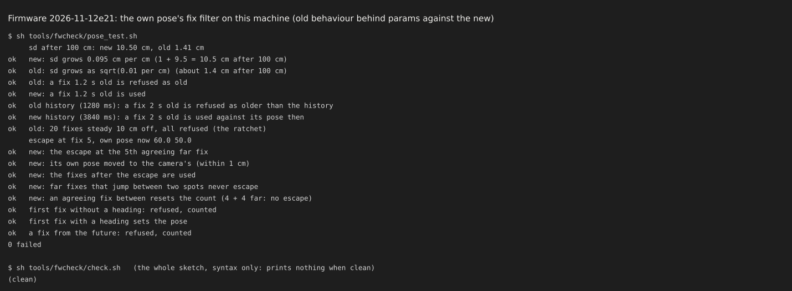
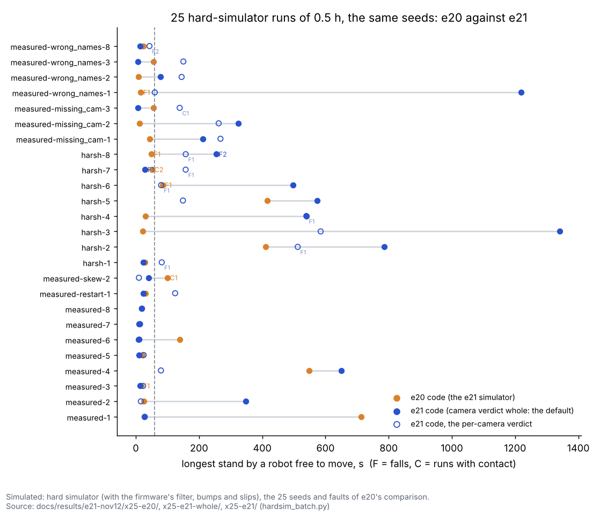
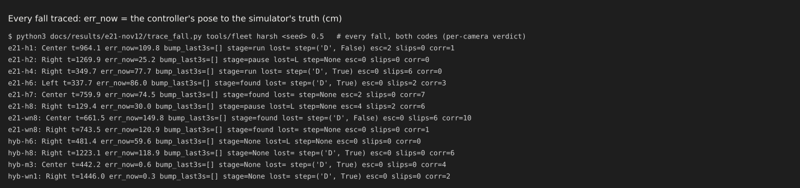

# e21: one error shape per robot and Nick's four stages (12 Nov)

## Premise

- Input: the error and loss audit of 12 Nov (`docs/audits/2026-11-12-error-and-loss-audit.md`), e19's and e20's
  reports, and Nick's decisions of 12 Nov:
  1. one error shape per robot (a cone along its own track), replacing the audit's seven radii;
  2. his four stages, explicitly: run, veer, found, pause and search;
  3. no overlapping shapes, planned ahead, without overloading the Pi;
  4. break the ratchet on the Pi;
  5. a simulator that shows the ratchet;
  6. the firmware's filter (code and tests only);
  7. e20's open items.
- Nothing here touched a robot, a Pi or a camera. Simulator, replays of saved logs, and tests only. Every simulator run
  had a temporary HOME.
- **Measured** = the simulator, the replay or the tests. **Claude's reading** = an interpretation. It is marked, and the
  team has discussed none of it.

## Data

### 1. The shape, measured (Nick's cone)



Each dot is one stretch a robot drove with no camera fix taken: on the left its error along its own track, on the right
sideways. The lines are the 95 % bounds the shape uses.

`docs/results/e21-nov12/cone_fit.py` is Nick's `cone.py` (the coordinator's scratch script), copied with its folders as
arguments. It found the same 865 stretches in 4 home runs, and it adds the fits.

| Measured (786 stretches with no reported event) | 15-30 cm | 30-45 cm | 45-60 cm |
|---|---|---|---|
| Sideways, typical / 1 in 10 | 1.4 / 3.9 | 1.0 / 4.8 | 3.9 / 11.9 |
| Along, typical / 1 in 10 | 1.1 / 9.1 | 1.6 / 6.8 | 1.6 / 3.7 |

- **Sideways** grows with distance: 0.23 cm per cm at 95 %.
- **Along the track the error is one-sided (measured, new here).**
  - Ahead of its own pose it is at most 2.7 cm + 0.027 cm per cm (97.5 %).
  - **Behind** it, it reaches 18.9 cm (97.5 %); in short stretches, the whole stretch.
  - Stuck or slipping wheels leave the robot back along its own track. Of 770 stretches, 55 were more than 5 cm short,
    and 7 more than 5 cm long.
- So the shape reaches back along its own track (never further back than where that track began) and only a little
  forward.



A lost robot's possible position after 20, 45 and 70 cm with no camera fix, by the fleet's measured prior. The blue shape
(e21) is longer back along its track and wider sideways than e20's orange circle.

### 2. What was built (each behind a Safety group switch, decided automatically)

| Piece | What it does | Switch (default / old way) |
|---|---|---|
| **One error shape** (`tools/fleet/error_shape.py`) | Per robot: a disc (the error seen when it was last anchored: the camera's 95 % noise plus its own pose's disagreement with the camera, plus each reported event since) and an ellipse along and across the chord of its own track since then (ahead, back, sideways as in section 1; a heading in doubt widens it). It **grows** with every cm and degree driven and every event. It **shrinks only** when a fix is accepted. The along and sideways terms are fitted (95 %) from each robot's odometry record and the fleet's (`odo_trust` samples now carry their error along and across their own chord), the measured cone as the prior. Plans, the edge rule, the blind stop, reacquire, corrections' limits, missions and Mission Control read it. | `MIRLT_ERROR_SHAPE` cone / circle (e20) |
| The error seen, as a segment | When the camera loses it, its own pose and the camera's last spot disagree by a known vector; one of the two is right. The shape holds that as a segment toward the camera's spot (its reach in a direction n is max(0, g·n)), not a disc of that radius. | (with the shape) |
| Events | Front stop, "felt a robot", "did not move", hazard, re-seed, merge (close pass), restart widen the disc at once, by each one's measured jump (the gap 2-3 s after it less the gap before, 95th percentile: 2.9-9.9 cm). Several add in quadrature. | (with the shape) |
| **The four stages** | Run; **veer**; **found**; **pause and search** (section 3). | `MIRLT_STAGES` four / e20 |
| No creep without the edge rule | The never-still creep may no longer leave a robot's shape closer to an edge than it was. At the blind limit, the veer step or the search moves it. | `MIRLT_LOST_CREEP` 0 / 1 |
| **No overlapping shapes** | Every reservation of a lost robot carries its shape grown along the planned path. Two shapes are kept apart along the line between them (section 4). | `MIRLT_SHAPE_PLAN` ellipse / circle |
| **The ratchet broken (Pi)** | The consistency escape (section 5). | `MIRLT_CONSISTENT_ESCAPE` 1 / 0 |
| Two headings | "Inward by both" checks the camera's spot with the camera's heading (or a fresh motion heading), its own pose with its own; unknown: not agreed. | `MIRLT_INWARD_TWO_HEADINGS` 1 / 0 |
| Firmware settings | Robots on firmware 2026-11-12e21 get their filter's settings from the measured record at the start (`set pose_sd_per_cm`, `fix_max_age_ms`, `fix_escape_n`). | `MIRLT_FW_FILTER_PARAMS` derived / off |
| Per-camera verdict | e19's whole-camera watch runs for each named camera's sightings on its own; only the implicated camera is refused. **Built, but not the default:** it made falls worse in the 25 runs (section 9). | `MIRLT_CAMERA_VERDICT` whole (default) / per_camera |
| Bridge per camera | When both cameras see a robot and agree, each camera's sighting is sent on its own. | `MIRLT_BRIDGE_PER_CAMERA` 1 / 0 |
| **Slips (Nick, 21:38)** | A move its own wheels, accelerometer, line sensors and the camera say did not move is a slip. It does not count against the camera's trust in that square (the layer's slip windows). Its own pose is corrected from the camera at once. A 30 cm square with 3 slips is logged (`slips.csv`) and said as a surface feature, never a reason to distrust the camera. | `MIRLT_SLIP_TAG` 1 / 0 |
| **Reverse rule (Nick, 21:38)** | e19's "no reverse toward an edge on an unconfirmed pose" is now its own switch, so the long checks can decide it (section 9). | `MIRLT_UNCONF_REVERSE` 1 (kept on: its "off" long checks were worse) / 0 |
| **Camera names in the logs (Nick, 21:38)** | Every fix's camera in `camera_track.csv` (`cam`, `src` appended) and `pose.csv` (`cam`); the bridge's `track.csv` gains `cams` (each camera's own sighting when both saw it). The DOE on how fast a bumped camera loses trust can then be run from real logs. | (always) |

### 3. Nick's four stages

| Stage | What the robot does (free roam) | Missions |
|---|---|---|
| **Run** | As before, while its shape, body and stop fit along the whole path. | As before. |
| **Veer** | Its shape would reach an edge within the next moves (its growth over the menu's middle piece length, 27.5 cm, is more than its room). Every menu piece is scored by the room it leaves at its end, **as expected**: the chance the cameras find it there (e20's trust map) × the room with a fresh fix, plus the rest × the room with its shape grown. The best feasible piece is taken. Turning away also swings the cone's long axis away. | **New (Claude's design):** when its shape would reach an edge within the next moves, it does not wait for the limit. It turns back early along e11's recovery line to where the camera last read it, when that line is clear of the others (the lane's own check). That is the only veer a fixed lane allows. |
| **Found** | A fix was accepted after a veer or a pause; it stays "found" while its own pose still disagrees with the camera or its heading is being confirmed. | As before. |
| **Pause and search** | Only when **no move gains room**. Straight moves on 12 headings (after a turn on the spot where it may turn) of 2, 4, 8, 16 cm and 1.5 and 2 times its shape's back reach (only past that is a gain certain, because its wheels may be slipping), each scored like the veer (found there or not) and never worse if it is not found. With its heading unknown none gains (measured in a test). Then it turns on the spot, 90° at a time, while its shape keeps half a body from every edge (a turn never moves the shape). The cameras and the detector look within its shape (the tracking layer's gate and on-demand detector, `set_focus`). A robot holds still **only if it must**: its middle within the camera's close-pass distance of the searched shape's reach toward it, and only for one search window. After one full turn and two fix delays, a person is asked; it keeps turning. Found, or a move that gains room again: it ends. | Halt and hold as before. |



The share of robot time in each stage over the 25 e21 runs (the final defaults), by group. In the measured runs the
robots run 71 % of the time and pause 6 %; with every fault on (harsh) they veer or pause most of the time.

### 4. No overlapping shapes: the cost



Left: how much room each way of keeping two shapes apart gives away against the exact gap, and how often it would have
let them overlap ("unsafe"). Right: the whole planner's time per 50 ms tick, scaled to the Pi. e21's ellipse bound is
nearly exact; its tick is a little slower on average, but 1 tick in 100 would overrun on the Pi.

- **The bound** (`docs/results/e21-nov12/plan_cost.py`, 1,856 random pairs of shapes against `error_shape.true_gap`):
  - a circle of each shape's largest reach around its own pose wastes 10 cm (median; 1 in 10: 20 cm) and is still
    unsafe in 48 pairs, because a shape is not centred on its own pose (the seen-error segment, the one-sided along term);
  - a capsule: 0.6 cm wasted, 3 unsafe;
  - **the ellipse along the line between them (built): 0.2 cm wasted, 0 unsafe.** It is the cheapest bound that is
    accurate enough, so nothing cheaper was kept.
- **The cost** (this machine × 5 for the Pi 4, as earlier reports):
  - one clearance check with shapes: 97 µs against 36 µs without (× 2.7), about 0.5 ms on the Pi;
  - the planner's tick (fast simulator, measured seed 1, 0.1 h, 6,715 ticks): mean 3.9 ms on the Pi (e20: 2.2),
    95th percentile 4.2 ms (e20: 3.5), 8 % of the 50 ms loop;
  - **but the 99th percentile is 51 ms on the Pi (e20: 12 ms)**: about 1 tick in 100 would overrun the loop. The long
    ticks are the pause test (`gain_move`: 12 headings × 6 lengths, each with the shape's growth) and the veer's menu
    scoring. **Not fixed here** (what's next 3).
  - Fine print: a percentile is the value that share of the ticks stays under; the 99th is the slowest 1 in 100.

### 5. The ratchet broken on the Pi (and the heading)

- **The rule** (`freeroam_core.consistent_escape`):
  - The camera's sightings of a robot agree with each other: each lies within the camera's noise of their mean
    (3.0 sigmas × √2), and the offset from its own pose is steady.
  - They do not agree with its own pose: beyond its filter's gate (4 of its own stated sds, at least 3 cm; the FOLLOW
    row's `pos_sd_cm`).
  - They come in more sightings than the noise can explain: each lands that far by chance with probability
    exp(-d²/2σ²), and together under 1 in 1000.
  - No other robot (own pose or camera spot) is near that spot.
  - The camera is **trusted** for position there (e20's book). An unproven one leaves it to e19's motion proof.
  - A **driving** robot: only beyond 12 cm, after taking off what the fix delay's measured spread explains along its
    track. Smaller offsets are e08's re-seed's.
  - On e21 firmware, its own refusals of far fixes must have grown meanwhile.
  - Then its own pose is wrong. The camera's position is sent (fpose).
  - The guards after "agree with each other" were added by this build's own review (Appendix C). Without them, the hard
    simulator showed about 100 escapes a run on driving robots' timing and one onto a mirrored camera.
- **The heading** then comes from its next short move as the camera sees it:
  - e17's heading crawl, or e20's motion heading;
  - an error over 90° is a flip, and its heading is set from the camera.
  - Until then the heading counts as unknown, after any correction beyond 12 cm: the shape widens, and "inward by both"
    is never guessed.
- **e18b's standing re-seed that keeps its own heading** (audit C6): checked. In the 11 Nov 08:58 case it would keep the
  wrong 14°. With e21, a correction that large marks the heading unknown. The re-seed rule still keeps the position-only
  update, but nothing then trusts that heading until the camera has seen it move.
- **The real runs, replayed** (`docs/results/e21-nov12/replay_escape.py`). Every camera sighting of 8 home runs (5-11 Nov)
  went through the rule, with each robot's own pose and its filter's real sd from `follow.csv`:

| Replayed (measured) | Corrected sooner | How much sooner: median / 1 in 10 |
|---|---|---|
| The audit's 147 divergence episodes | **68** | 13.2 s / 96 s |
| ... of which camera mix-ups (11) | 8 | 19.2 s / 73 s |
| The 81 "lost" spells of the two 11 Nov runs | **27** (687 s lost in all; 484 s would have been saved) | 6.5 s / 29 s |



Each dot is one divergence episode the rule would have ended sooner, by how many seconds. Red: camera mix-ups, where an
early correction may be onto the wrong robot.



- By cause:
  - pushed or bumped: 5 of 8;
  - wheels turned but the robot did not move: 12 of 15;
  - own pose jumped: 13 of 14;
  - standing: 12 of 12;
  - drifted while every fix was refused (5 Nov): only 14 of 81, because their offset grows as they drive.
- **Claude's reading: the 8 of 11 camera mix-ups are a real risk.** The replay cannot apply the camera-trust guard
  (these logs name no camera) nor the layer's naming. A mix-up whose sighting stays steady and away from the other robot
  would be corrected onto the wrong robot. In the live code such a correction also needs a camera trusted for position
  there, and it stays "unconfirmed" (no reverse toward an edge) until its own move confirms it (e19).

### 6. The simulator shows the ratchet

- The simulated robot (`freeroam_fastsim.fuse_fw`) now runs the firmware's own filter. It refuses fixes older than
  1000 ms, older than its 1.28 s history, or beyond 4 sds and 3 cm, with its variance growing 0.01 cm² per cm. Its
  refusals are counted by reason.
- `MIRLT_SIM_FW_FILTER=e21` runs the e21 firmware instead; `blend` runs the old 35 % blend.
- Two hard-simulator faults are new, both in harsh:
  - **bumps**: the body moves 3-10 cm and its wheels do not;
  - **slips**: 2-6 s of stuck wheels.



How far each robot's own pose was from the camera's spot, at each percentile of the time: two real home runs (black)
against the simulator. The old simulator (grey) stays below the real runs; with the firmware's filter (orange) e20's
code shows the ratchet; e21's code (blue) brings it back near the 08:26 run.

- **Before e21 the simulator now shows the ratchet** (measured profile, seeds 1-8, the median run):
  - the old simulator with e20's code: own pose to camera 1.4 / 4.1 / 10.6 cm at the 50th / 90th / 99th percentile,
    below both real runs everywhere (real 08:26: 1.6 / 6.0 / 30.7; 08:58: 1.7 / 48.1 / 48.8);
  - the e21 simulator (the firmware's filter) with e20's code: 2.2 / 11.2 / 20.6 cm. The gap grows and stays, as the
    real runs' does. It does not reach 08:58's 48 cm plateau (one robot standing for minutes on a refused pose; 8 seeds
    of 0.5 h hold no such case).
- **e21 fixes most of it:** 1.7 / 7.0 / 15.2 cm, near the real 08:26 run.
- **Claude's reading:** the simulator's ratchet is milder than 08:58's. The replay of the real runs (section 5) is the
  better evidence that the escape ends it.

### 7. Firmware 2026-11-12e21 (code and tests; nobody flashed)



`tools/fwcheck/pose_test.sh` compiles `pose.h`'s filter on this machine and runs 15 checks, old behaviour against new.

| Setting (params.h) | e21 | Old behaviour (set it back) | From |
|---|---|---|---|
| `pose_sd_per_cm` | 0.095: its sd grows linearly | 0 (`pose_q_cm` 0.01 cm² per cm) | the cone's sideways 0.232 cm/cm (95 %) ÷ 2.45; the Pi sends each robot's own |
| `fix_max_age_ms` | 1500 | 1000 | 11 Nov 08:58: p90 1.14 s, p95 1.39 s (the audit); the Pi sends this run's measured 99th percentile + 0.2 s |
| `pose_hist_ms` (history 96 × 40 ms) | 3840 | 1280 | the delays' 90th percentile reached 1.8-2.9 s in some minutes (camera.csv, 4 runs) |
| `fix_escape_n` | 5 | 0 (the ratchet) | the Pi sends the count the noise needs (as section 5) |
| Refusals | counted by reason, FOLLOW's last five columns (`rej_old, rej_far, rej_hist, rej_future, escapes`) | - | |

- `FW_VERSION` is "2026-11-12e21". The Pi works with both firmwares:
  - it reads the new columns only when they are there;
  - it sends the settings only to e21 firmware;
  - its own consistency escape works for both.
- The dry simulator's twin (`tools/sim/fw_follow.py`) mirrors it. `tools/fwcheck/check.sh` (the whole sketch) is clean.
- Same sketch on every robot, home and school: a staged rollout.

### 8. e20's open items

- **Per-camera verdict** (`tracking_layer._whole_watch_cams`): each named camera keeps its own window and verdict.
  **Not the default:** in the 25 runs it let robots drive on wrongly named sightings (8 falls against 3; section 9).
  - The implicated camera's sightings are left out before assignment, so another camera's sighting of that robot is used.
  - Test: a mirrored camera beside a good one: only the mirror refused, all three robots still fixed.
  - Unnamed sightings (the home bridge's single label) are one camera, exactly as e19.
- **The bridge per camera** (`cam_bridge`, `e02_twocam`): when both cameras see a robot and agree, each camera's sighting
  is sent with its own camera name, noise and picture time. Not run here on real cameras; the hard simulator still sends
  the measured "both" share (Sweep 1).
- **e20's weighted odometry record learning**: kept as it was.
- **Harsh seed 6's contact (e20) and the standing-pair rule (Nick, 21:38):** on the e21 simulator, harsh seed 6 has no
  contact with either code (the rule on). With the rule off under e21's rules (`MIRLT_PAIR_STAND_PART=0`, the same 25
  runs, the per-camera verdict): **10 falls against 8, contact in 2 runs against 1, stands over 60 s in 19 runs against
  15** (measured seed 3: a 979 s stand and a fall; measured seeds 1-8: 1 fall against 0). The 17 cm deadlock shape
  still happens without it. **The rule stays on by default** (still behind its switch).

### 9. Acceptance: the hard simulator, e20 against e21 on the same seeds

- All of these run on the **e21 simulator** (firmware filter, bumps, slips). "e20" is e20's controller code with the e21
  simulator copied in (`--code`). e20's own report ran on the old simulator, so its numbers are not comparable with these.
- The robots' firmware in every run is the one on them now (`MIRLT_SIM_FW_FILTER=firmware`).

**The long checks** (`tools/fleet/tests/long_hardsim.py`: 4 seeds × 0.5 h per profile plus four single-fault cases;
`docs/results/e21-nov12/hardsim-long/`). The first three columns ran with the per-camera verdict (the default then);
the last with the final defaults:

| Check | e20 code | e21, per-camera | e21, reverse rule off | **e21 final** |
|---|---|---|---|---|
| Measured 1-4: contact / off the board / swaps | 0 / **1** / 0 | 0 / 0 / 0 | 0 / 0 / 0 | 0 / 0 / 0 |
| Measured: closest bodies (warning under 1 cm) | 0.12 cm | 0.9 cm | 0.27 cm | 3.1 cm |
| Measured: longest stand by a robot free to move, per seed (pass: under 60 s) | **713**, 25, 15, **549** | 28, 16, 23, **80** | **166**, **576**, 23, 18 | 27, **348**, 14, **650** |
| Harsh 1-4: runs with contact | 0 | 0 | 1 | 0 |
| Harsh: stands over 120 s (s) | none | **246**, **125** | **210**, **125** | 12, longest **1,342** |
| Skew seed 2: longest stand (pass: under 60 s) | **100** | 10 | 6 | 41 |
| Missing camera seed 1: longest stand (pass: under 60 s) | 44 | **268** | **244** | **211** |
| Wrong names seed 2: off the board | 0 | 0 | **2** | 0 |
| Checks failed | 3 | 3 | 4 | 3 (all stands) |

- **With the final defaults every safety check passes** (no contact, nobody off the board, no swap, closest bodies
  3.1 cm); the three failures are all stands.

- **The reverse rule (Nick, 21:38):** with it off, the long checks differ (2 robots off the board with wrong names, a
  harsh contact, measured stands of 166 and 576 s). **It stays on by default**, behind `MIRLT_UNCONF_REVERSE`.
- The e21 missing-camera stand (268 s) and the harsh ones are pauses near an edge: no move gains room, the turn on the
  spot is not allowed, a person is asked and nobody answers in the simulator (traced: harsh seed 3, Center, 246 s; its
  own pose was right but the camera had named another robot as it, and the truth was 11 cm from the edge, so standing
  was the safe answer).

**The 25-run comparison** (the 25 seeds and faults of e20's; 0.5 h each; `docs/results/e21-nov12/x25-*/`):

| 25 runs | e20 code | e21, per-camera verdict | **e21 final (whole verdict)** | e21, pair rule off |
|---|---|---|---|---|
| Falls (measured / harsh / camera faults) | **4** (1 / 2 / 1) | 8 (0 / 6 / 2) | **3** (0 / 3 / 0) | 10 (1 / 6 / 3) |
| Runs with body contact | 2 | 1 | **0** | 2 |
| Name swaps | 3 | 9 | 4 | 4 |
| Runs with a stand over 60 s by a robot free to move | 7 | 15 | 12 | 19 |
| Longest such stand | 713 s | 585 s | 1,342 s | 1,002 s |
| Lost spells per robot-hour (median run) | 45 | 133 | 55 | 97 |
| Lost spells' 90th percentile length (median run) | 3.9 s | 2.0 s | 1.7 s | 1.7 s |
| Time in run / veer / found / pause | - | 58 / 11 / 26 / 5 % | 47 / 28 / 9 / 17 % | 56 / 16 / 22 / 6 % |

Fine print: "lost" is the controller's own flag (no camera fix accepted); e21's shape flags a jump of the camera's spot
as a short lost spell, so e21 counts more spells but shorter ones.



Each row is one run: the longest stand by a robot free to move, e20 in orange and e21 in blue. F and C mark falls and
contacts.

- **"No new falls or contacts against e20": met in total with the final defaults, not run by run.**
  - In total: 3 falls against 4, no run with contact against 2.
  - Run by run, two harsh runs gained a fall: harsh 7 (0 → 1) and harsh 8 (1 → 2). Three runs lost one (measured 3,
    harsh 6, wrong names 1).
- **Not met: stands.** 12 runs have a stand over 60 s against e20's 7, the longest 1,342 s (harsh 3) and 1,220 s
  (wrong names 1). Most are e21's pause with nobody to answer (Q1), or the whole-camera verdict standing everyone while
  a camera is distrusted (e20's open problem, which the per-camera verdict was built to fix).
- **The per-camera verdict (built for e20's open item) made falls worse**, so it is not the default:
  - traced (`trace_fall.py`, all 11 falls of both arms): 7 of e21's 8 falls with the per-camera verdict came with the
    robot's own pose 30-150 cm from the truth (6 in "run" or "found", 1 lost): the camera had named another robot as
    it (inferred from the gap; harsh 4 traced in full), and it drove off an edge it did not think it was near. The 8th: a simulated bump pushed a robot standing
    3 cm from the edge over it (the bump model does not check the edge; sweep 2). e20's 4: two the same naming kind,
    two reverses at the edge on a right pose (e19's hang mechanism);
  - switch by switch on the 9 runs with falls: slips off 5 falls; the escape off 8; **the whole verdict 3**;
    no naming by elimination while a camera is distrusted 8 (`docs/results/e21-nov12/ablation/`);
  - **Claude's reading:** with the per-camera verdict the robots keep driving on the remaining sightings, and in the
    wrong-names fault those are wrongly named too; the whole verdict makes them stand instead. Standing is safe, so the
    whole verdict is the default; the per-camera verdict is one switch away (`MIRLT_CAMERA_VERDICT=per_camera`).
- **The measured profile (no faults)** is better with e21: no falls (e20: 1); stands over 60 s in 2 runs (e20: 3),
  but measured 4 still stands 650 s (whole verdict) against 80 s (per-camera).
- **Lost spells' length** fell (90th percentile 3.9 → 1.7 s); their number rose with the per-camera verdict.



Every fall of both codes, traced: `err_now` is how far the controller's pose was from the robot's true spot when it fell.
Most of e21's were 30-150 cm off; e20 also had two such falls, and two on a right pose while reversing at an edge.

### Tests

- Fleet suite, `python3 -m pytest tools/fleet/tests` (e20's baseline: 1,077 passed, 10 skipped, 1 xfailed):
  **1,111 passed, 10 skipped, 1 xfailed, 1 xpassed** (31.6 min; `docs/results/e21-nov12/fleet_suite.txt`).
  The xpassed one is e19's open case (`test_hard_simulator::test_wrong_camera_name_mid_run_no_contact`, seed 8 with a
  mirrored camera): it now passes (also alone). The xfailed one is the new 14-minute bumped-camera case below. In an
  earlier run while the simulator batches loaded the machine, three Mission Control stop tests timed out; alone and in
  this run they pass.
- Pi and analysis suites, `python3 -m pytest tools/pi/tests tools/analysis/tests`: **153 passed**.
- `tools/fleet/tests/test_e21_error_shape.py`: 34 tests, all pass. `tools/fwcheck/pose_test.sh`: 15 checks ok.
- Changed: `test_e20_camera_trust.py`'s bumped-camera check (the bumped camera's edge squares are left "unproven"
  within 8 min, because e21's robots visit the edges less; e20 saw "distrusted"). Its 14-minute run is an **open
  problem** kept as an expected failure: e21's code has a contact (per-camera) or a fall (whole); e20's has neither.

## Conclusion

- **Built:** one error shape per robot that every part reads; Nick's four stages; shapes kept apart with the ellipse
  bound (exact to 0.2 cm, no overlap in 1,856 pairs); the consistency escape and heading-flip catch on the Pi; the
  firmware filter 2026-11-12e21 (code and host tests); per-camera verdicts and per-camera bridge sightings; slips
  tagged; camera names in the logs. Each behind a Safety group switch with its old way kept.
- **The ratchet:** replayed on the real runs, the escape ends 68 of the 147 divergence episodes sooner (median 13 s) and
  27 of the 81 lost spells (484 of 687 s). The simulator now shows the ratchet with e20's code and much less with e21's.
- **Safety, measured in the hard simulator:** with the final defaults, no new falls or contacts against e20 in total
  (3 against 4 falls, 0 against 2 contact runs), but **not run by run** (harsh 7 and 8 each gained a fall), and **more
  long stands** (12 runs against 7).
- **The per-camera verdict and Nick's two "off" tests:** the per-camera verdict made falls worse (8), so the whole verdict
  stays the default. The standing-pair rule off and the reverse rule off were both worse; both stay on.
- **Not achieved:** robots never still (pauses with nobody to answer, and the whole verdict's stands); the planner's
  slowest 1 % of ticks would overrun on the Pi; the 14-minute bumped-camera scenario.

## What's next

1. **Wrong names are now the main cause of falls** (7 of 8 traced with the per-camera verdict, 2 of 4 with e20).
   Trace one such run (harsh 4) to where the name went wrong, and test an identity guard: a robot whose own motion
   disagrees with its named sightings over a move stops trusting that name (e19's motion proof, per robot).
2. **The pause with nobody to answer** (Q1): decide what it does after a derived wait.
3. **The planner's slow ticks:** cap `gain_move`'s grid per tick (spread over ticks) and measure the 99th percentile
   again; then time it on the Pi itself.
4. **The 14-minute bumped-camera scenario** (open, xfail) and the bump model's missing edge check.
5. **A home free roam with e21** (no reflash), and the replay of its logs with the live guards.

### Steps for Nick: update the home Pi

Nothing here needs a reflash. The firmware is code only (Nick: staged rollout, later).

On the laptop, open **PowerShell**. Type each box, press Enter, and wait for the `$`.

```
ssh st1maxfini@100.122.222.75
```

Type the Pi's password if it asks. You should see a line ending in `$`.

```
cd ~/alvik-fleet-capstone
```

```
git pull
```

You should see `Fast-forward` and a list of files, among them `tools/fleet/error_shape.py`.

```
git log --oneline -1
```

You should see a line with "e21" in it.

```
python3 tools/fleet/safety_group.py show
```

The last line should say "Safety group: every switch on its automatic default (76 switches ...)".

```
./run-fleet-pi.sh mc-stop
```

```
./run-fleet-pi.sh mc
```

Then, in the browser on the laptop, open `http://100.122.222.75:8095`. After one free roam (from Mission Control as
usual), look for:

- under each robot on the map page: "Error shape: ... cm ahead, ... back along its track, ... sideways · stage: run";
- in the run's events: "veers", "search", "consistent sightings", "heading flipped";
- in the run folder: `stages.csv`, `escapes.csv` and `searches.csv`.

To go back to the code before e21: `git checkout 1672868` (and `git checkout main` to return). To switch off one part,
use Mission Control's Safety box: the `MIRLT_ERROR_SHAPE`, `MIRLT_STAGES`, `MIRLT_CONSISTENT_ESCAPE` or
`MIRLT_BRIDGE_PER_CAMERA` line, "old way". (`MIRLT_CAMERA_VERDICT`'s "old way" turns the per-camera verdict on.)

## Questions for Nick

**Substantive**

1. **A pause with nobody to answer.** Your design ends a search by asking a person. In the simulator nobody answers, so
   such a robot stands until the camera finds it (section 9: the stands over 60 s). Keep it so (the honest answer when
   no move gains room), or after a derived time with no answer, allow a creep that keeps the edge rule with its shape?
2. **The escape and camera mix-ups.** Replayed on the real runs, it ends 68 of 147 divergences sooner (median 13 s),
   but it would also have fired in 8 of the 11 camera mix-ups, where the correction may go onto the wrong robot. As
   built it now fires only from a camera trusted for position there (e20's book; added after the hard simulator showed
   an escape onto a mirrored camera). At home the bridge's single "both" label is one camera, so it will fire only once
   that label has earned trust. Keep that guard, or also require that no other robot's own pose was within the
   close-pass distance in the last minute (fewer escapes, fewer mix-ups)?
3. **The firmware's own escape.** On the robot it cannot check identity as the Pi does. Ship 2026-11-12e21 with
   `fix_escape_n` 5 (the robot escapes the ratchet by itself), or 0 (the Pi's escape only) until the first home runs?
4. **The shape's back reach.** The measured prior lets a lost robot be up to 19 cm back along its own track (stuck
   wheels), so lost robots veer earlier than e20's circle let them. Keep it until each robot's own record (its
   shadows' along-track errors) replaces it, or start from the fleet's straight drives (smaller)?
5. **The camera verdict: falls or stands.** The per-camera verdict (your e20 item) let robots keep driving on wrongly
   named sightings: 8 falls in 25 runs. The whole verdict: 3 falls (e20: 4) but more long stands. I made "whole" the
   default. Agree, or should a camera fault rather slow every robot to a crawl inside its own shape (neither standing
   nor driving on)?
6. **Missions' veer.** In a fixed lane I read "veer" as: turn back early, along the recovery line, to where the camera
   last read it. Is that what you meant, or should a mission robot also leave its lane (re-plan its visit order) when
   its shape nears an edge?

**Other**

1. Firmware rollout: one home robot first (as the audit proposed), then the rest, school too?
2. Mission Control shows the shape from `state.json`, written once a minute. Live (every second) is a small change. Want
   it?
3. The hard simulator's bumps and slips are chosen stresses (6 an hour each). Should the measured profile get them at the
   measured rates once the e21 firmware reports its refusals by reason?

## Appendix A: chosen and derived numbers (e21)

| Number | Where | Kind | DOE? |
|---|---|---|---|
| The shape's 95 % (sideways, events) and 97.5 % each side (along) | error_shape | statistical (the 95 % odo_trust uses) | no |
| Prior: ahead 2.65 + 0.027 cm/cm, back 18.9 cm (never past its track's start), sideways 0.232 cm/cm | error_shape, cone_fit.json | measured (786 stretches) | no; replaced by each robot's record |
| Event jumps: did not move 7.0, felt a robot 8.1, front stop 8.1, hazard 9.9, merge 4.8, re-seed 2.9 cm | error_shape | measured (95th percentiles, 8 runs) | no |
| Restart: the largest event jump (9.9 cm) | error_shape | **chosen** (no restart in the logs) | no; measure on the first runs with e19's restart handling |
| Events add in quadrature | error_shape | **Claude's reading** (independent 95 % errors) | no |
| VEER_AHEAD_CM 27.5 cm | freeroam_core | derived (the menu's middle piece length) | no |
| GAIN_L_CM 2, 4, 8, 16 cm; 12 headings | freeroam_core | **chosen** (a grid: any gaining move is found) | no |
| GAIN_EPS_CM 0.5 cm | freeroam_core | reused (e10's INWARD_GAIN_CM) | no |
| Search turn 90° at a time; search window one full turn + 2 fix delays | freeroam_core | 90° **chosen**; the window derived | no |
| Robots that must hold: within its shape + the layer's close-pass distance | freeroam_core | derived (CLOSE_CM: e09's DOE number) | with CLOSE_CM |
| ESCAPE_ALPHA 1 in 1000 | freeroam_core | statistical | no |
| ESCAPE_MIN_N 3 sightings | freeroam_core | reused (the layer's steadiness count) | no |
| Escape window: last 24 sightings within 4 s | freeroam_core | **chosen** | yes: against the replay's mix-ups, with the real cameras named per camera |
| Heading unknown after a correction beyond 12 cm | freeroam_core | reused (REACQUIRE_MAX_CM, e17's heading check) | no |
| Firmware pose_sd_per_cm 0.095, fix_max_age_ms 1500, pose_hist_ms 3840, fix_escape_n 5 | params.h | derived defaults; the Pi sends each robot's own | no |
| Simulator bumps 6 / robot-hour, 3-10 cm; slips 6 / robot-hour, 2-6 s | fastsim_realism | **chosen** stresses | no (stresses, not estimates) |
| The Pi 4 is 5× slower than the build machine | plan_cost | measured (earlier reports) | no |
| SLIP_SPOT_N 3 slips in a 30 cm square = a surface feature | freeroam_core | **chosen** | yes: with the rate of real slips per square once slips.csv has a few runs |
| The pause test's long moves: 1.5 and 2 × the shape's back reach | freeroam_core | derived (past the back reach a gain is certain) | no |
| The camera verdict's default (whole) | safety_group | measured (25 runs: 3 falls against 8) | yes: a DOE over faults and seeds, with stands and falls both scored |

## Appendix B: files

- New:
  - `tools/fleet/error_shape.py`
  - `tools/fleet/tests/test_e21_error_shape.py` (34 tests)
  - `tools/fwcheck/pose_test.sh`, `tools/fwcheck/pose_test.cpp`
  - `docs/results/e21-nov12/`: `cone_fit.py` / `.json`, `replay_escape.py` / `.json`, `real_gap_1111.json`,
    `plan_cost.py` / `.json`, `charts.py`, `x25_table.py`, `trace_fall.py`, `trace_stand.py`, `trace_onset.py`,
    `hardsim-long/` (e20, e21, e21-norev), `x25-e20/`, `x25-e21/` (per-camera verdict), `x25-e21-whole/` (the final
    defaults), `x25-e21-nopair/`, `ablation/` (slips off, escape off, no elimination while distrusted), `fleet_suite.txt`,
    `pi_analysis_suite.txt`
- Changed:
  - `tools/fleet/freeroam_core.py`, `safety_group.py`, `safety_rules.py`, `odo_trust.py`, `tracking_layer.py`,
    `run_plan.py`, `freeroam.py`, `cam_bridge.py`, `live_view.py`, `mission_control_table.html`, `hardsim_batch.py`,
    `freeroam_fastsim.py`, `fastsim_realism.py`, `fastsim_sources.py`
  - `tools/experiment/e02_twocam.py`, `tools/sim/fw_follow.py`
  - `firmware/home_lab/pose.h`, `params.h`, `follow.h`, `home_lab.ino`
  - `docs/how-to/safety-group.md`
  - Tests: the firmware-version checks accept "2026-11-*" (`test_school_engine`, `test_one_system`,
    `test_save_wiggle_multi`, `test_freeroam`, `test_low_battery_fixes`, `test_curves`). Tests of an old behaviour now
    pin its switch to the old way, each with a comment saying why (`test_e18_safety_blind`, `test_freeroam`,
    `test_e13`, `test_e17`, `test_e19`, `test_e10`): the old features still work behind their switches.

## Appendix C: Claude's review of this build, and what was done about it

After the first build, the A/B runs (harsh seeds 1-6, 0.15 h; measured 1-4, 0.25 h) and traces of the worst stands
were read against the decisions. What was found, and what was done:

| Found | Done |
|---|---|
| A symmetric along-track term (95 % of the size, 11.5 cm) made every lost robot's shape 11.5 cm long both ways. The data said the error is one-sided. | Re-fitted per side (97.5 % each): back along its track up to 18.9 cm (never past where the track began), ahead 2.7 cm. The prior and the record fit both changed. |
| Repeated edge stops added 8 cm each, end to end (116 front stops in one harsh run). | Events add in quadrature (Claude's reading of independent errors). |
| Lost robots with no feasible menu piece but not yet at the blind limit stood ("nothing fits from a stand"). | They take the veer step (a straight move that gains room) or the search. |
| A crash: a new heading check replaced one whose crawl was still running. | The running check is kept; a check without its start restarts. |
| A shape 31 cm wide 3 s after a re-seed (missing camera, seed 1): the pose-fuse widening still carried the gap the re-seed had settled. | The error seen at a loss is its own pose against the camera's last fix after the last fpose. |
| The heading was "unknown" after every correction over 6 cm, and robots near an edge could never confirm it (no room for the crawl): long pauses. | Unknown only beyond 12 cm (where e17 already asks a heading check); any heading the camera confirms by its own driving clears it. |
| A search could not turn where the old turn rule (a circle of its whole doubt) refused. | A turn on the spot is allowed while its shape keeps half a body from every edge: turning never moves the shape. |
| The replay counted mix-ups wrongly (the wrong category letter), and did not check the other robots' own poses. | Fixed; the numbers in section 5 are after both. |
| The escape fired about 100 times a run on driving robots: a steady offset along the track was the fix's delay, not a wrong pose. | A driving robot escapes only beyond 12 cm after taking off what the delay's spread explains; on e21 firmware its far refusals must have grown. |
| Two robots each waiting with a heading in doubt for room from the other stood 221-670 s. | `doubt_deadlock`: the lower-priority one gives way and plans with the edge rule and its doubt. |
| The search held nearby robots too widely and too long. | Only robots within the close-pass distance of the shape's reach toward them, and only for one search window. |
| The escape moved a robot onto a mirrored camera's spot (2 falls, wrong names seed 2). | It needs a camera trusted for position there; rerun: 0 falls. |
| `fused_pose` crashed on a negative variance (a math domain error). | `max(0, ...)` inside both square roots. |
| The pause test found no gaining move for slipping robots (2-16 cm cannot beat a 19 cm back reach). | Longer moves of 1.5 and 2 × the back reach, checked against the edge rule. |
| **After the acceptance runs:** the per-camera verdict had 8 falls in 25 runs against e20's 4. | Traced all falls; switch-by-switch runs; the whole verdict is the default (3 falls). |
| `test_e20_camera_trust`'s bumped camera reached only "unproven" in 8 min (passes in the whole suite by test order, fails alone). | Found by running it alone; the check now asks for a square the good cameras trust and the bumped one does not; the 14-minute run is an open xfail. |
| The planner's slowest 1 % of ticks would overrun the Pi's 50 ms loop. | Measured, not fixed (what's next 3). |

What was **not** fixed, and why (each in the questions or the sweeps):

- **Stands by design.** A pause and search asks a person; the simulator has none, so such a robot waits for the camera
  (Q1).
- **Camera mix-ups and the escape** (section 5): 8 of 11 would fire on the real logs, which name no camera (Q2).
- **Mission veer is not simulated.** The free-roam hard simulator does not run missions (Sweep 1).
- **Mission Control's line was not screenshotted on a live page.** The endpoint and the reader are tested (Sweep 1).
- **Wrong names driving robots off the edge** (section 9): traced, not fixed (what's next 1).

## Sweep 1: new tests that may now be needed

- **A real home free roam with e21** (no reflash): stages.csv, escapes.csv, searches.csv; how often a search ends with a
  person; whether "heading flipped" ever fires.
- **The escape on real mix-ups:** run the replay again on the first e21 run, with the live guards (camera trust, the
  layer's naming).
- **The bridge per camera on the real cameras:** does each camera earn its own position trust at home? Does a per-camera
  sighting change the tracking layer's naming in close passes?
- **Firmware 2026-11-12e21 on one robot:** the refusal reasons (how many "old" now; the audit read 17 %), the escapes,
  and its sd against the camera.
- **Missions' veer** in the dry simulator (`tools/sim/fleet_sim.py` with a blind patch), and on the school board.
- **Mission Control's shape line** on a live page (Playwright), at 600 px too.
- **The measured profile with bumps and slips** at measured rates; the harsh profile is chaotic (8 seeds are indications).
- **A test that the per-camera verdict releases a camera** once its own motion agrees again.
- **A wrong-names test with the robot's truth:** a run where the camera names another robot as it, checking that it
  stops before an edge it does not know it is near (the cause of 7 of 8 traced falls).
- **The planner's 99th-percentile tick on the Pi itself.**
- **The 14-minute bumped-camera scenario** (`test_three_cameras_bumped_14_min_open`, xfail now).

## Sweep 2: possible inaccuracies

- **The cone is measured on the robots' own filters** (stretches with no fix taken), and that selects stretches where
  fixes were refused: the ratchet's own episodes. The along-track tail (stuck wheels) may be over-represented. The
  per-robot record (odo_trust shadows, which start from camera spots) replaces it after weight 20.
- **The event jumps** are gaps 2-3 s after an event less the gap before, on the bridge's labels, so they include
  label errors.
- **"Corrected sooner" in the replay** is the first firing against when the run really ended the episode. It does not
  know what the robot would have done next, and it takes the bridge's labels as truth. The camera's noise is taken as
  1 cm (the audit's own assumption).
- **The simulator's firmware filter** is the firmware's rules, not the firmware's code. The host test checks the code;
  the twin and the fast simulator are kept by hand to match.
- **e20 here is e20's controller on the e21 simulator.** e20's own published numbers were on the old simulator; they
  are not comparable with section 9.
- **The CPU cost** was measured on this 2-core machine while other runs shared it, then scaled by 5 for the Pi.
- **Chosen, not derived:** Appendix A, each with whether a DOE should set it.
- **The simulated bump does not check the edge:** a bump can leave a middle past the edge, counted as a fall only when
  the robot next moves (one of e21's falls).
- **25 runs are few for falls:** the harsh and wrong-name runs are chaotic, so one change moves single falls between
  seeds. The totals (3, 4, 8) are indications, not rates.
- **The fall causes** are read from the simulator's truth against the controller's pose at the fall and the minute
  before (`trace_fall.py`); "wrongly named" is inferred from a 30-150 cm gap with no lost flag.
- **The real 11 Nov runs predate e17-e20** (the audit's caveat): the replay shows what the rule would have done on those
  logs, not on today's code.
