# e22: no standing, no waiting for a person (13 Nov)

## Premise

- Input: Nick's 13 Nov 07:03 brief ("there should always be a way it can move away from the edge, find itself and resume
  running"), e21's report and its open items, the 08:14 home run (no robot found: they were deep-asleep), Nick's 08:28
  notes on Mission Control, and his ~10:00 field report (two standing robots boxed the third into a corner).
- Goals: robots never wait for a person; no wrong-robot sightings; the escape guarded; the robots' own escape off
  (firmware code only); the back reach refitted from real runs; the Pi's controller fast enough; the live error shape in
  Mission Control; the simulator's bumps at the measured rate; weekly-summary charts; a weekend checklist.
- Nothing here touched a robot, a Pi or a camera. Simulator, saved logs and tests only. Nothing was flashed.
- **Measured** = the simulator, the logs or the tests. **Claude's reading** = an interpretation; it is marked, and the
  team has discussed none of it.

## Data

### 1. The acceptance runs: 25 hard-simulator runs, the same seeds and faults as e21

<small>The hard simulator's truth: a **fall** is a robot's middle over the board's edge; **contact** is two bodies
touching; a **stand** is a robot free to move whose body neither moves nor turns (robots hung at an edge are counted
apart); a **wait** is a tick a robot spent held for a person (NEEDS A HAND, a click, a question). e20 and e21 are their
own code run on the e22 simulator (measured bumps), so all three meet the same bumps.</small>

| 25 runs, 0.5 h each | e20 | e21 | **e22** (final defaults) | Acceptance |
|---|---|---|---|---|
| Waits for a person (robot-ticks) | 1,046 | 570 | **0** | 0: **met** |
| Runs with a stand over 60 s | 12 | 16 | **10** | fewer than e20's 7 (e20 on its own simulator): **missed** (10). Against e20 on this simulator (12): fewer |
| Longest stand | 713 s | 1,220 s | **1,274 s** (wrong names 1) | - |
| Falls (total) | 5 | 4 | **1** | - |
| Seeds with more falls than e20 | - | 2 | **1** (skew 2: 1 against 0) | none: **missed by one seed** |
| Runs with body contact | 2 | 1 | **0** | none beyond e20: **met** |
| Name swaps | 3 | 2 | 1 | - |
| Long checks (12 of these runs) | - | - | **13 of 15 pass** | all: **missed** (section 7) |
| Fleet suite / Pi + analysis suite | - | - | **1,151 passed** (10 skipped, 2 xpassed) / **153 passed** | pass: **met** |

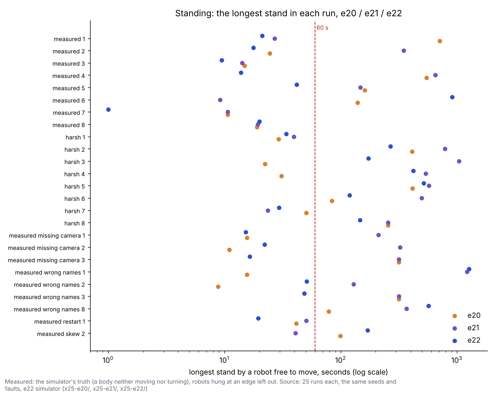

The longest stand in each run: e22 (blue) is under the 60 s line in 15 of 25 runs, e20 in 13 and e21 in 9.

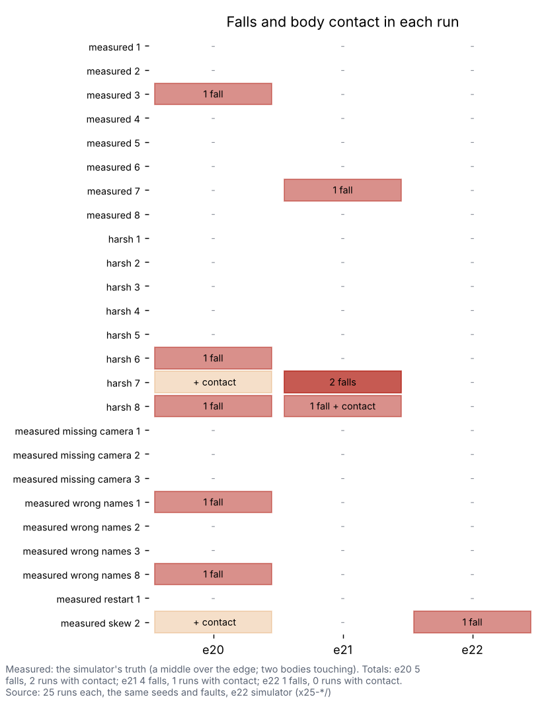

Falls and contacts by run: e22 has one fall (skew 2) and no contact; e20 had five falls and two contacts on the same
seeds.

### 2. Where the robots' time goes (Nick's four stages)

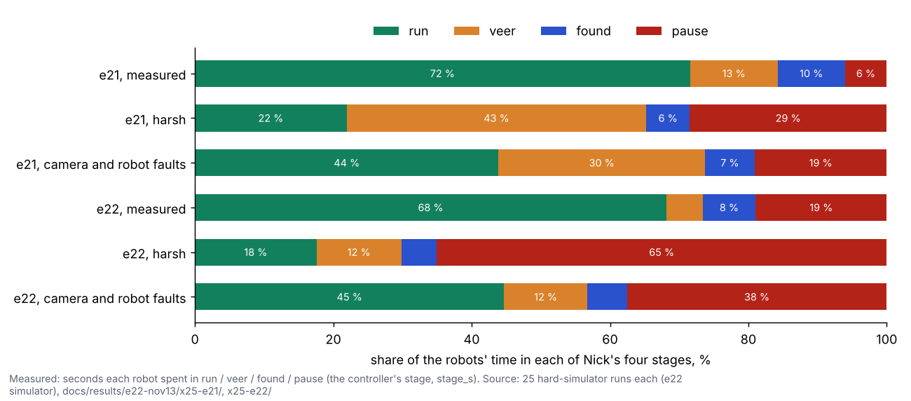

e22's robots spend less time veering and more in "pause and search" than e21's, most of all on the harsh profile.

- **Claude's reading:** "pause" is where the ladder works (section 3). Its rungs are mostly turns on the spot (6,032 of
  6,176 rungs), so a robot in pause is not standing by the truth's measure, but it is not getting anywhere either. The
  standing-time win is partly this.

### 3. What was built (each behind a Safety group switch, decided automatically; the old way kept)

| Piece | What it does | Switch (default / old way) |
|---|---|---|
| **The self-rescue ladder** | A robot that has stood idle longer than the camera needs to answer its last move (2 fix delays + the time to be called lost, measured per robot; a robot being identified: the identity pause) takes the next rung, for ever: **a** its heading unknown: out and back along its heading only as far as its shape has room every way (the camera sees it move: heading and name); **b** a straight move that gains room for its shape; **c** none gains: one that keeps its room toward ground where the cameras find robots best (learned in the run: e20's trust map × the share of half-seconds a robot there had a fix accepted); **a2** none: a short out-and-back whose out end keeps its room, so the camera sees it move; **d** none fits: a turn on the spot (90°, or a 20° wiggle where its corners could swing over an edge). Then again after the dwell. | `MIRLT_SELF_RESCUE` ladder / ask |
| The ladder's clock | It restarts only when the robot's own pose really moved (3 cm, or a turn of half the wiggle), so moves planned and then refused every second no longer keep it standing (missing camera 1: 304 s before, 15 s after). | `MIRLT_RESCUE_STILL` pose / idle |
| Nothing waits for a person | Questions, NEEDS A HAND and click requests are notes (`notes.csv`, the events' "note"); nothing holds for an answer. | (with the ladder) |
| **Found in this build:** shape-checked moves run at the blind limit | At the blind limit, `watch()` eased every move except a wiggle or an identity drive to a stop the moment it began. **So e21's veer steps and search turns never ran** ("a dropped piece started", every few seconds, harsh 2). Moves planned against the shape itself now run. | (with the ladder) |
| A lost robot is no longer held "unsure" | The edge judgement stops while a robot is lost, so "unsure" never cleared and its hold took every tick before the lost robot's own stages (harsh 3: 1,342 s). | (with the ladder) |
| **The identity guard** | A correction, re-seed, "seen again", escape or waiting re-seed that would move a pose beyond the camera's noise needs the sighting to be the robot's: (1) inside its own error shape and **no other robot's**, and not on another robot's own track in the last second (another robot's own pose can be the wrong one); (2) its joined-up sightings **moved as its own wheels and gyro did**, or stood as it stood; (3) if it has not moved since its last fix, **where that fix put it**. Standing more than 12 cm away needs a camera trusted there; outside its own shape needs a moving signature that agrees and a camera not distrusted there. | `MIRLT_ID_GUARD` 1 / 0 |
| Escape guards | e21's trusted-camera guard kept; the identity guard added. | (with the guard) |
| No reverse while its own frame is off | The robot drives in its own frame: while its own pose and the camera disagree beyond its own filter's gate, a reverse toward an edge is refused (traced: two measured-profile falls). | (with the guard) |
| Slip re-seeds | Only from a picture taken during the move that did not move, and not projected by wheel travel that never happened (traced: 12-24 cm wrong re-seeds). | (with the guard) |
| **Firmware `fix_escape_n`** | 0 by default (`params.h`, FW_VERSION 2026-11-13e22); the Pi sends 0 too. Not flashed. | `MIRLT_FW_ESCAPE` pi / robot |
| **The back reach** | The measured 18.9 cm stays the prior; it is refitted from each robot's own record (its odometry-trust samples carry their along-track error) every 5 new samples, saved between runs. At every real run's end `shape_fit.json` and a line say each robot's back reach against the prior. | (always) |
| **The Pi's speed** | Steering (the reflex, adjustments, the queue watch, heartbeats) runs every tick; a robot's plan runs if it is the tick's first, or if the time used plus planning's measured 95th percentile fits in the 50 ms loop less steering's slowest 1 in 100 ticks, else next tick (first then). The menu search resumes next tick where the time ran out. Far-apart reservations are not compared sample by sample (a box test). A paused robot's "no move gains room" is kept until something changes. The shape fit is read once a tick and refitted off the loop; scipy is imported at load (its first import inside a tick took 0.37 s here). | `MIRLT_PLAN_BUDGET` derived / every_tick |
| The Pi timing bench | `./run-fleet-pi.sh timing`: the hard simulator's robots, the real controller, every tick timed on the Pi. | - |
| **Live error shape** | `shape_live.json` every second; Mission Control's map draws each robot's shape (an ellipse along its own track), asked every second. | - |
| **Missions' veer** | The early turn-back line is checked with the robot's shape grown along it (never worse toward an edge) and kept clear of the others' shapes. | (with the cone shape) |
| **Simulator: measured bumps** | Every profile: 1.66 bumps a robot-hour (the real runs' "felt a robot" events: 28 in 16.9 robot-hours), sized by their measured jumps (median 1.8 cm, 1 in 10 over 8.1 cm), from their own random stream; a bump checks the edge at once. Slips were already at the measured rate. | `MIRLT_SIM_MEASURED_BUMPS` 1 / 0 (simulator) |
| **Waking sleeping robots** (coordinator, 08:14 run) | Every run start (free roam, missions, visit points; calibration already did) that does not hear a robot keeps sending `wake`, sends it to each robot the moment its check-in is heard, waits one whole check-in interval plus its 20 s awake window, and says "asleep, waking (next check-in in ~N s)". A woken robot restarted, so it gets its compass check where it stands (no spin, no roll) before it joins. `sleep_when_done` is unchanged. | `MIRLT_WAKE_AT_START` 1 / 0 |
| **Mission Control's status** (Nick, 08:28) | A status line at the top, always: what runs (or nothing), since when, each robot found / asleep / not heard, what it waits for. A Restart Mission Control button always there (off while a run from this page is going). A free roam started from the terminal shown live, read-only (robots, rings, shapes, tracks); STOP also sends Ctrl+C to its tmux session. Needs-a-hand requests of an earlier run are no longer shown. | - |
| **Boxed in (Nick ~10:00)** | Section 6. A robot with no move that gains room asks every robot in its way out to step aside; held robots make room and take the ladder. **Off by default** (contacts in the 25 runs). | `MIRLT_BOX_ASK` **0** / 1 |

### 4. The Pi's speed

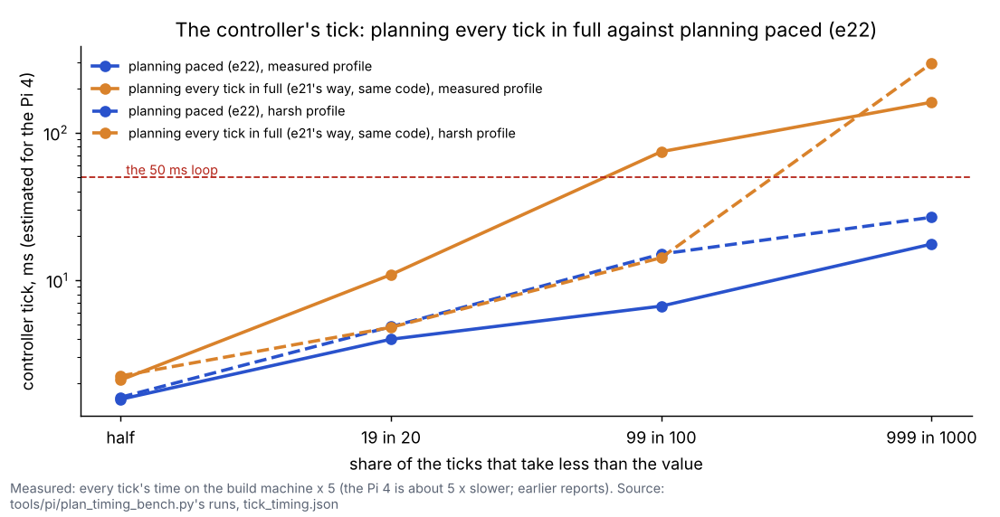

The controller's tick, estimated for the Pi 4 (the build machine's CPU time × 5, the earlier reports' factor): with
planning paced, the slowest tick in 100 stays far inside the 50 ms loop.

<small>"Slowest 1 in 100" is the 99th percentile: 99 of 100 ticks took less.</small>

| Tick, Pi estimate | measured profile: slowest 1 in 100 / 1 in 1,000 | harsh profile |
|---|---|---|
| Planning every tick in full (e21's way) | 74 ms / 161 ms | 14 ms / 295 ms |
| **Planning paced (e22)** | **6.7 ms / 17.5 ms** | **15.0 ms / 26.7 ms** |

- Profiled hot spots (`slow_ticks.py`): the edge rule (34 % of slow-tick time), building reservations (22 %) and the
  shape's reach (10 %). The edge rule's non-shape branch was vectorised, far-apart reservations are no longer compared
  sample by sample, and scipy is imported when the module loads (its first import inside a tick took 0.37 s).
- The real number comes from the Pi itself: `./run-fleet-pi.sh timing` (checklist step 2).

### 5. Mission Control: the live error shape, the status line, the Restart button, terminal runs

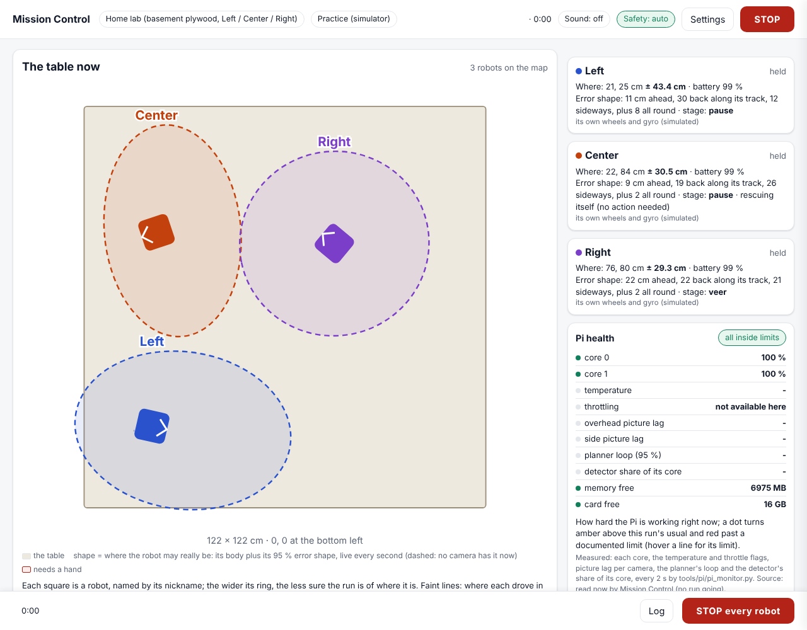

The map page draws each robot's error shape (an ellipse along its own track), refreshed every second (simulator data).

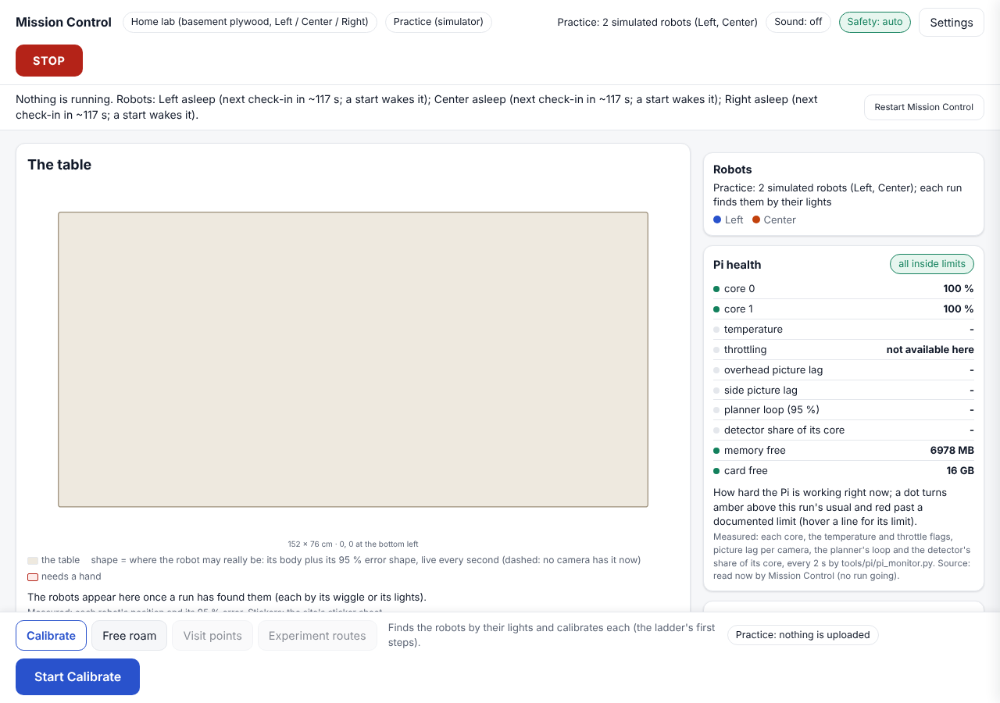

With nothing running, the status line says so and gives each robot's state; the Restart button is always there.

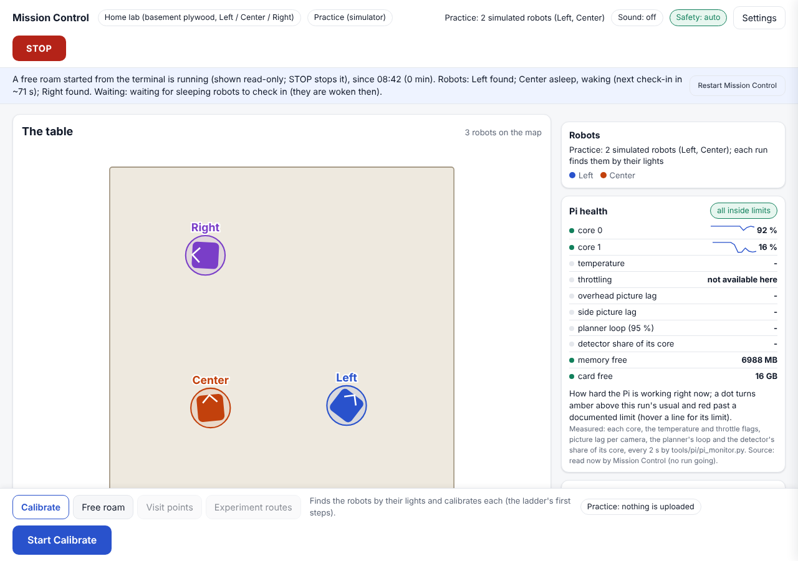

A free roam started from the terminal is shown read-only, here waiting for a sleeping robot: "Center asleep, waking
(next check-in in ~71 s)".

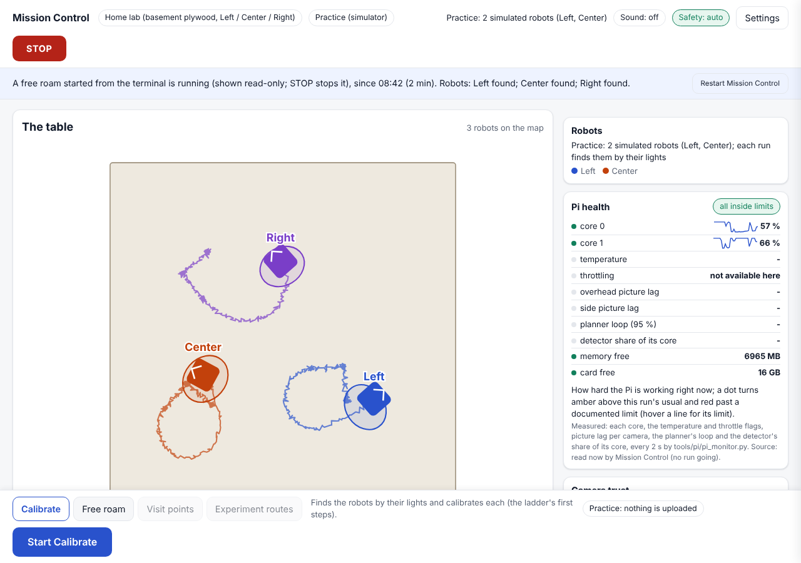

Two minutes later the woken robot drives with the others; shapes and tracks are live, and STOP stops the terminal run.

- **The 08:14 run (deep sleep):** every run start (free roam, missions, visit points) now wakes sleeping robots itself.
  The wait is derived from the check-in interval the robots were put to sleep with (one interval, plus the 20 s awake
  window, plus 10 s to boot). A woken robot has restarted, so it gets its compass check where it stands before it joins.
  `sleep_when_done` is unchanged. Simulator test: `test_a_dry_free_roam_wakes_a_sleeping_robot_and_runs_it`.
- **Nick 08:28:** the status line (what runs, since when, each robot found / asleep / not heard, what it waits for), a
  stale NEEDS A HAND box cleared, the Restart Mission Control button (refused while a run from this page is going), and a
  terminal free roam shown live and read-only with STOP (which also sends Ctrl+C to its tmux session). All three were
  possible; none needed a change on the Pi beyond `git pull`.

### 6. Nick's ~10:00 report: boxed into a corner (MIRLT_BOX_ASK)

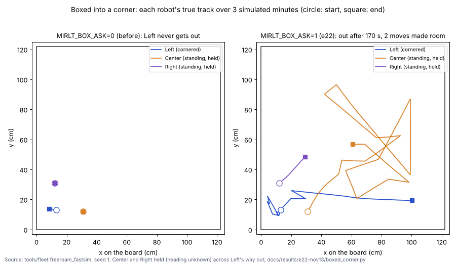

The simulator case. Left is in a corner and Center and Right stand across its way out. With the old way (left) nobody
moves for 3 minutes. With MIRLT_BOX_ASK on (right), the standing robots are asked out of the way, and Left gets out
after 170 s. That is slow: it got out after 54 s before side steps were made forward only, and before they stopped
ignoring the boxed robot's body.

**Which causes the simulator reproduces (measured, e21 code and e22 code):**

| Coordinator's cause | Reproduced? |
|---|---|
| 1. `ask_room()` names one blocker, and only for a recovering robot | **Yes.** A cornered robot that is not lost asks nobody: `room_asked` 0 for the whole run on e21's code. |
| 2. The creep token leaves held / stuck robots out of `able` | **Not the cause here.** The token only orders creeps of *unaccounted* robots, and nobody in the case was unaccounted. |
| 3. `make_room_step()` gives up after 30 s or fails its plan checks | **Not reached on e21** (nobody was asked). With the fix on it mattered: a side step that failed kept the helper from its own steps (fixed). |
| **A fourth, found here:** a held robot skips everything in the tick (an early `continue`) | **Yes.** Held robots never made room and never took the ladder. On e22's code (ladder on) Left still never got out. |

**What was built:** a robot with no move that gains room picks its straight way out (every 30°, 3 body widths long,
fewest robots in it). It asks **every** robot in that way, nearest first, to step aside, held or not, and asks again
at each ladder rung until the way is open. Held robots make room and take the ladder. Side steps for a boxed robot are
forward only (the front sensor watches), and never ignore the boxed robot's body. Tests:
`test_a_robot_boxed_into_a_corner_by_two_standing_robots_gets_out_without_a_person` (on) and
`test_the_boxed_corner_reproduced_with_the_old_way` (off).

**Why it is OFF by default (measured):** in the same 25 runs with it on, the falls went from 1 to 5, and 2 runs had
body contact (a lost robot making room on a wrong pose; a held robot's ladder turn). Runs over 60 s went from 10 to 8.
That fails "no contacts beyond e20", so `MIRLT_BOX_ASK` stays 0 until the next build (What's next, item 1).

### 7. The long checks and the open scenarios

The long checks re-checked on 12 of the 25 runs (`docs/results/e22-nov13/long-checks/checks.txt`): 13 of 15 pass.

- **Fail:** measured seed 2 has robots hung at an edge for 340 s in all (limit 120 s). They are tilted with a wheel
  over, and their hang recovery owns them (the ladder leaves tilted robots alone).
- **Fail:** skew seed 2 has a stand of 170 s. This seed also has e22's only fall.
- e21's open scenario `test_three_cameras_bumped_14_min_open` (xfail) **now passes** (XPASS). It is kept as xfail until
  it has passed on another seed. e19's `test_wrong_camera_name_mid_run_no_contact` also passes now (XPASS).

### 8. The camera verdict (MIRLT_CAMERA_VERDICT)

| Same final code, 25 runs | whole (default) | per_camera |
|---|---|---|
| Falls | **1** | 3 |
| Runs with contact | 0 | 0 |
| Name swaps | 1 | 5 |
| Runs with a stand over 60 s | 10 | **7** |

Per-camera still raises falls (3 against 1) and swaps, so **whole stays the default**, as the brief's rule says.
Per-camera stands less.

### 9. The ratchet, before and after

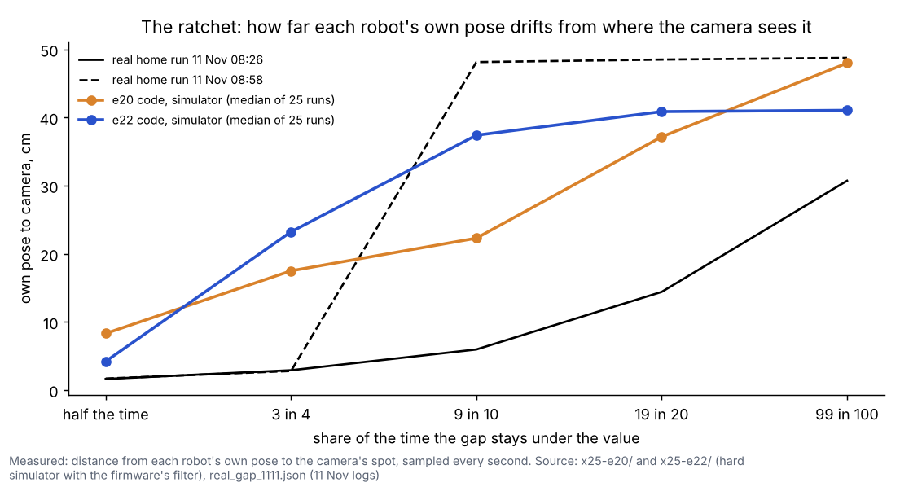

How far each robot's own pose drifts from the camera's spot. e22 keeps it closer than e20 half the time (4.2 cm against
8.3 cm) and at 99 in 100 (41 cm against 48 cm), but it is further off in between (37 cm against 22 cm at 9 in 10).

- **Claude's reading:** this is the identity guard's cost. A robot standing far from its own pose is not corrected
  from a camera that is not trusted there until its own move proves the sighting. Lost robots wait for that move.

### 10. Error shapes on the map (weekly summary)

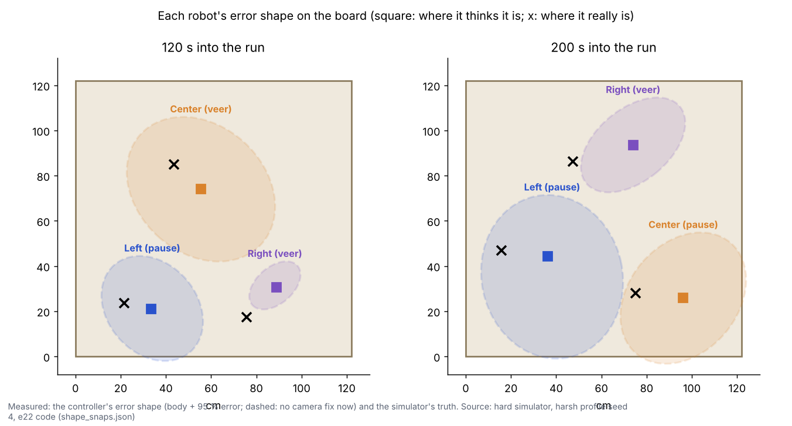

Each robot's error shape at two moments of a hard-simulator run: where it thinks it is, where it really is, and its
stage.

## Conclusion

- **Met (measured):** no robot waits for a person (0 against e20's 1,046 robot-ticks). Falls are down to 1 in 25 runs
  (e20: 5, e21: 4). No body contact (e20: 2 runs). Both suites pass. Mission Control shows the live shapes, the status
  line, the Restart button and terminal runs. Every run start wakes sleeping robots.
- **Missed (measured):**
  - 10 runs still have a stand over 60 s (target: fewer than 7). This beats e20 (12) and e21 (16) on the same
    simulator.
  - One seed (skew 2) has a fall that e20's code does not have there.
  - 2 of 15 long checks fail.
- **Nick's corner case:** it is fixed in the simulator but switched off, because in the 25 runs it brought contacts.
- **Claude's reading:** the remaining long stands have one shape. Robots are lost with large shapes (all three at once
  in the wrong-name runs), the identity guard refuses their sightings as ambiguous or as "standing far, camera not
  trusted", and no move proves safe with shapes that size, so the ladder can only turn them on the spot. Appendix B traces
  one.

## What's next

1. **The boxed-in corner, on by default (Nick's 10:00 report).** The code and the simulator case are in e22 behind
   `MIRLT_BOX_ASK` (off). Next: only robots whose pose is confirmed (not lost, not held with a heading unknown) make
   room; a held robot's ladder turns only where its whole body circle is clear of every other body. Then re-run the
   25 runs.
2. **The all-lost deadlock (wrong names 1, 1,274 s):** when every robot is lost, shape exclusivity makes every sighting
   ambiguous. Assign the sightings of one picture jointly (each to the nearest own pose, when the assignment is clear by
   a body width), instead of one by one.
3. **Hung at an edge, measured seed 2 (340 s):** the hang recovery's rounds against the ladder's rules. The ladder
   leaves tilted robots alone.
4. **The Pi bench result** from the weekend (checklist step 2): if the slowest 1 in 100 ticks on the Pi is over 25 ms,
   the plan budget's share is the next thing to look at.
5. The weekend's real free roam: `rescue.csv`, `identity.csv` and `notes.csv` against the footage.

## Questions for Nick

**Substantive**

1. The identity guard keeps a far sighting of a *standing* robot from correcting it when that camera is not trusted
   there, until the robot's own move proves it. That costs lost time (section 9) but removed e21's wrong-robot falls.
   Is that the trade you want, or should a long-standing robot be corrected sooner?
2. Nick's corner case: is it acceptable for a robot whose heading is not known (held "heading") to be moved out of
   another's way, or should only robots with a known heading make room?
3. The ladder's last rung is a turn on the spot, and in the hard runs it is most of the rungs. Should a robot that has
   turned on the spot for a while (how long?) instead accept a short drive whose safety it cannot prove from its shape
   alone, when the camera last saw it far from every edge?
4. The weekend tilt test: is one wheel lifted by a folded cloth (about 1 cm) mid-board the right size, or do you want the
   wheel fully off the board's surface?

**Other**

5. The checklist's timing bench takes 5-8 minutes on the Pi with nothing moving. Is that fine before the run, or should
   it run after?
6. Mission Control's Restart button: off while a run from that page is going. Should it also be off while a terminal run
   is going (now it is allowed: the terminal run keeps running)?

## Weekend home-run checklist (Nick)

Nothing here needs a reflash. The firmware change (`fix_escape_n` 0) is code only, for the first flash later.

### 1. Update the Pi

On the laptop, open **PowerShell**. Type each box, press Enter, and wait for the line to finish.

```
ssh st1maxfini@100.122.222.75
```

Type the Pi's password if it asks. You should see a line ending in `$`.

```
cd ~/alvik-fleet-capstone
```

```
git pull
```

You should see `Fast-forward` and a list of files, among them `tools/fleet/wake_robots.py`.

```
git log --oneline -1
```

You should see a line with "e22" in it.

```
python3 tools/fleet/safety_group.py show | tail -1
```

You should see "Safety group: every switch on its automatic default (82 switches ...)".

```
./run-fleet-pi.sh mc-stop
```

```
./run-fleet-pi.sh mc
```

In the laptop's browser, open `http://100.122.222.75:8095`. You should see a **status line** under the top bar (for
example "Nothing is running. Robots: Left asleep (next check-in in ~240 s; a start wakes it) ...") and a **Restart
Mission Control** button at its right.

### 2. The Pi timing bench (no robots needed, nothing moves)

Still in PowerShell, logged in to the Pi:

```
./run-fleet-pi.sh timing
```

It takes about 5-8 minutes. You should see four cases, each with a line "slowest 1 in 100 ticks: ... ms of the 50 ms
loop", then:

`RESULT: e22's slowest 1 in 100 ticks: ... ms (the loop is 50 ms): FITS`

Copy that RESULT line into the chat. The file is in `logs/timing/` (it goes up with the next run's upload).

### 3. A home free roam

Start it from Mission Control as usual (or from PowerShell: `./run-fleet-pi.sh freeroam`; the table page now shows it
too, read-only, with STOP). Look for:

- the robots asleep at the start: the status line and each robot's card say "asleep, waking (next check-in in ~N s)";
  the run waits for them (up to one check-in interval) and gives each woken robot its compass check where it stands;
- on the map, each robot's **error shape** (an ellipse along its own track) changing every second;
- no "NEEDS A HAND": a robot that would have asked now says "rescuing itself (no action needed)";
- after the run, in its folder: `notes.csv`, `rescue.csv`, `identity.csv`, `shape_fit.json`, `wake.json`.

### 4. The hung-robot tilt test (Nick beside it)

During the free roam, when one robot is **in the middle of the board, never near the real edge**: slide something
about 1 cm thick (a folded cloth) under **one side** of it, so one wheel is lifted. Then take your hand away.

You should see: the robot's tilt stop, then its hang recovery (the opposite of what tilted it first, forward tries), and
within about a minute it drives on. Take the object away afterwards. No reflash is needed.

### 5. A deliberate power cycle (Nick beside it)

During the free roam, press one robot's power button off, count 10 seconds, and switch it on again.

You should see in the events: "silent", then "heard again", "pose after restart", and a heading check (a short crawl
the camera measures); it then rejoins while the others carry on. If it does not rejoin within about two minutes, note
the time and tell me.

### 6. When the session ends

Start uploading the footage straight away, so it transfers while we look at the results. (The run's logs upload by
themselves when a Mission Control run ends.)

## Appendix A: chosen and derived numbers (e22)

| Number | Where | Kind | DOE? |
|---|---|---|---|
| The ladder's dwell: 2 fix delays (90th percentile) + the time to be called lost; a robot being identified: the identity pause | freeroam_core `rescue_dwell` | derived (measured per robot) | no |
| The ladder's out-and-back: 2 × 3 camera sigmas + 1 cm (at least 3 cm) | `rescue_ob_cm` | derived (camera_test_step's rule) | no |
| The ladder's straight moves: 2, 4, 8, 16 cm and 1.5 / 2 × the back reach | `gain_move` (e21) | e21's grid | no |
| Its wiggle where corners could swing over: 20° | `RESCUE_WIGGLE_DEG` | reused (the find-me wiggle) | no |
| Learned coverage squares: 30 cm; an unvisited square counts as an even chance | `COV_CELL_CM` | reused (the trust map's) / Laplace's rule | no |
| Motion signature window 4 s, "it moved" 3 cm | `ID_WIN_S`, `ID_MOVE_CM` | reused (the whole-camera watch, chosen in e19) | **yes**, with the tolerance, on real two-robot logs |
| Motion signature tolerance: 35 % of the distance | `ID_TOL_SHARE` | reused (chosen in e19) | **yes** (same DOE) |
| Another robot's track: 1 s | `ID_TRACK_S` | **chosen** | **yes** (same DOE: real close passes) |
| A standing jump needs a trusted camera beyond 12 cm | `REACQUIRE_MAX_CM` | reused | no |
| Joined-up sightings needed: 3 | `ID_MIN_N` | reused (the layer's steadiness count) | no |
| Planning's budget: the 50 ms loop less steering's slowest 1 in 100 ticks; a plan's cost: its 95th percentile | `plan_budget_s`, `plan_slot` | derived (measured on the machine that runs it) | no |
| The spatial cull: 60 cm | `CULL_CM` | a bound over every caller's need (17.4 cm), not a tuning number | no |
| Live shapes every 1 s; stale after 5 s; a terminal run "going" when its files changed in 15 s | freeroam / live_view | Nick's "every second" / display | no |
| Wake: the check-in interval + the 20 s awake window + 10 s for its boot | `wake_robots` | interval and window from the firmware; the 10 s boot **chosen** | no (it only lengthens a wait) |
| Simulator bumps: 1.66 a robot-hour, sized by the measured jumps | `fastsim_realism` | measured (16.9 robot-hours) | no |
| Firmware `fix_escape_n` 0 | `params.h` | Nick's decision | no |
| The Pi is 5 × slower than the build machine | the timing chart | measured (earlier reports) | no: the Pi bench replaces it |
| The ladder's clock: a move is 3 cm, or a turn of half the wiggle (10°) | `ID_MOVE_CM`, `RESCUE_TURN_DEG` | reused (the whole watch's move; the wiggle) | no |
| A boxed robot's way out: 3 body widths long, every 30° | `BOX_CORRIDOR_N` | **chosen** | no (any length that clears a body works; longer asks more robots) |

## Appendix B: how to reproduce

Run these on the build machine from the repo root (simulator only).

```
python3 tools/fleet/hardsim_batch.py --profile measured --seeds 1-8 --hours 0.5 --jobs 2 --out logs/x25-e22
python3 tools/fleet/hardsim_batch.py --profile harsh --seeds 1-8 --hours 0.5 --jobs 2 --out logs/x25-e22
python3 docs/results/e22-nov13/accept.py docs/results/e22-nov13/x25-e20 docs/results/e22-nov13/x25-e22
python3 docs/results/e22-nov13/charts.py
python3 docs/results/e22-nov13/boxed_corner.py
MIRLT_PLAN_SLOWDOWN=0 python3 docs/results/e22-nov13/trace_stand.py tools/fleet measured 1 0.5 wrong_names
```

- **Faults:** the batch runs `--faults missing_cam --seeds 1-3`, `--faults wrong_names --seeds 1,2,3,8`, `--faults
  restart --seeds 1` and `--faults skew --seeds 2`.
- **The other code:** e20's and e21's code is run with `--code <its tools/fleet>`.
- **The camera verdict:** with `MIRLT_CAMERA_VERDICT=per_camera`.
- **The corner fix on:** with `MIRLT_BOX_ASK=1`.
- **Result folders:** `docs/results/e22-nov13/x25-e20`, `x25-e21`, `x25-e22`, `x25-e22-per_camera` and
  `x25-e22-box_ask_on`.

**One long stand traced (wrong names seed 1):**

- Left stood 490 s mid-board (55, 44), with its own pose within 0.6 cm of the truth.
- All three robots were lost, and their shapes had grown to 80 cm.
- Right stood 15 cm in front of Left, so every forward step was stopped by Left's front sensor.
- Every turn was refused as "no room to turn" (the others' shapes).
- The camera's sightings were refused as ambiguous (inside another robot's shape) 132 times in 130 s.
- A narrower exemption (a sighting on its own pose, the other a body away) was tried and did not change the stand, so it
  was taken out.

## Appendix C: Claude's review of this build, and what was done about it

After each batch the worst stands and every fall were traced (`trace_stand.py`, `trace_fall.py`: each robot's state
every 10 s while it stood, every pose set from outside with the truth error it left, and each fall's last events).

| Found | Done |
|---|---|
| e21's veer steps and search turns never ran: at the blind limit `watch()` eased every move but a wiggle or an identity drive to a stop as it began. e21's "pause" robots stood. | Moves planned against the shape itself run (`SHAPE_CHECKED_KINDS`); a test. |
| A robot unsure at an edge that then got lost stayed "unsure" for ever (the edge judgement stops while lost); its hold took every tick (harsh 3: 1,342 s). | Lost clears "unsure". |
| The whole-camera verdict's deadlock: the camera distrusted, every robot standing, so no motion could ever clear it (harsh 3: no fix reached any robot for 22 min). | The ladder moves robots (out-and-backs give the watch its motion evidence). |
| The ladder's first stillness timer was reset by its own pose's jitter (fixes nudge it): the ladder never fired (wrong names 1: 43 s dwell, 241 s stand). | Idle time with no move, not pose change; one identity pause, not two. |
| The idle-time timer in turn was restarted by moves planned and then refused every 1.5 s (missing camera 1: a reverse toward the edge refused for 300 s, the robot unsure 8 cm from an edge with its own pose 14 cm off). | The timer restarts only when its own pose moved 3 cm or turned half a wiggle (`MIRLT_RESCUE_STILL`); a test that fails on the old rule. |
| Held robots skipped the ladder entirely (the tick's held branch returns early): a robot held with its heading unknown stood for the whole run. Found with Nick's 10:00 report. | A held robot makes room when asked and takes the ladder's rungs (`MIRLT_BOX_ASK`). |
| The first make-room for a boxed robot ignored that robot's body (e18's rule for lost robots, whose believed spot may be far off): two contacts in the 25 runs, a make-room reverse into the boxed robot's turn. | A boxed robot's body is never ignored; the 25 runs re-run. |
| The plan pacing read this machine's clock in every simulator scenario test, so a busy machine changed their outcome (a camera-trust scenario failed once under load). | The pace is per controller; the simulator sets it to 0 unless `MIRLT_PLAN_SLOWDOWN` is set. |
| A step called outside a tick (tests, tools) crashed on the tick clock. | No tick running: nothing deferred. |
| The guard's first version asked a camera "trusted" for standing jumps even where no camera book exists. | No book: e19's rules. |
| Slip re-seeds were projected by the wheels' travel during the slip (which never happened) and used fixes from before the move. | Only a picture taken during the slip, as it is. |
| The plan budget made simulator seeds unrepeatable (this machine's clock decided deferrals). | The simulator never defers (`MIRLT_PLAN_SLOWDOWN` 0 there); the bench measures the pacing. |
| scipy was imported inside a tick on the first refit (0.37 s here). | Imported when the module loads; refits off the loop. |
| A re-seed waiting for a turn to end landed later on another robot's spot (93 cm wrong). | Checked again when it lands. |
| Shape exclusivity alone let a sighting of a robot whose own pose was wrong through (its shape was elsewhere). | Another robot's own track in the last second also makes it ambiguous. |
| The per-camera verdict still had twice the falls of the whole verdict on the 12 harsh and wrong-name runs (8 against 4) with the guard. | The whole verdict stays the default (Q2). |
| Two measured-profile falls: reverses with the robot's own pose 16-34 cm from the camera's while the guard held the correction back (the robot drives in its own frame). | No reverse toward an edge while its own pose and the camera disagree beyond its filter's gate; both falls gone on a re-run. |
| The guard keeps a robot whose own pose is far off (the ratchet) uncorrected while it stands, unless the camera is trusted there. | The ladder's out-and-back gives it the motion that proves its sighting (a2). A cost: those robots stay lost longer (Sweep 2). |
| A woken robot restarted ("not calibrated since power-on") and was left out of the free roam (found by the new simulator test). | Its compass check where it stands, then it joins. |
| Every dry free roam or mission with a robot left out on purpose would have waited 10 minutes for a check-in. | In a dry run only robots the simulator was told are asleep are waited for. |
| The status line called robots "asleep" that the run had already found. | Found = heard in this run (wake.json) or posing in the last 10 s. |

What was **not** fixed (each in the questions or the sweeps): the long stands of all-lost robots (What's next 2); robots hung at an edge on measured seed 2 (What's next 3); the fall on skew seed 2 (not traced in this build); Nick's corner case on by default (What's next 1).

## Sweep 1: new tests that may now be needed

- **The boxed-in corner with `MIRLT_BOX_ASK=1` in the 25 runs** after What's next 1, and a variant with the cornered robot lost and with three robots in a line along an edge.
- **The boxed-corner test passes with little margin** (out after 170 s of a 180 s run): more seeds and a longer run.
- **The ladder's clock on real logs:** how often a robot's own pose moves less than 3 cm over a minute while its moves are refused.

- **A real home free roam with e22** (no reflash): how often each ladder rung runs (`rescue.csv`), whether any robot
  still stands over a minute, and the notes that replaced the questions (`notes.csv`).
- **The identity guard on real logs:** `identity.csv`'s refusals against the camera's truth in the footage: how many
  were real wrong-robot sightings, how many delayed a true correction.
- **The wake at a start** on the real robots after `sleep_when_done`: the time from the start to every robot following,
  and whether the compass check after a wake is enough (no spin, no roll: the stored scales) or the first drives show a
  heading error.
- **A free roam started from the terminal** with Mission Control open: the read-only map, and STOP stopping it.
- **The Pi timing bench on the Pi itself** (the checklist): the slowest 1 in 100 ticks.
- **The hung-robot tilt test and the power cycle** (the checklist), with the footage.
- **The per-camera verdict on the real two cameras** (the bridge per camera, e21): the whole verdict stays the default
  on the simulator's evidence only.
- **Missions' veer** in the dry simulator with a blind patch: the shape check of the turn-back line was tested on its
  own, not in a mission run.
- **The measured profile at a longer run** (2 h, 8 seeds): the 25 runs hold 0.5 h each, so stands that need more time
  to build up are under-sampled.
- **The bump model's edge check** against a real push at an edge (a robot pushed while hung there): the simulator now
  counts such a push as a fall at once.

## Sweep 2: possible inaccuracies

- **The acceptance runs are chaotic:** one change moves single falls between seeds (e21's report showed the same). 25
  runs give indications, not rates; the totals and the per-run rule are read with that in mind.
- **e20 and e21 here are their own code on the e22 simulator** (measured bumps). e21's published numbers were on the
  e21 simulator; the harsh seeds of e21's code moved little between the two (3 falls either way).
- **The measured bump rate** counts "felt a robot" events (the accelerometer's jolt from a touch): a push too gentle to
  jolt it is missed, and a jolt with no push counts. Its sizes are the jumps of those events, which include the
  bridge's label errors (e21's caveat).
- **The Pi timing** is the build machine's CPU time × 5 (the earlier reports' factor), with planning paced as if 5×
  slower; the comparison "every tick in full" is the e22 code with the pacing off, not e21's code, and the two runs
  follow different paths (each makes its own decisions). The Pi bench replaces it.
- **The ladder's dwell** (2 fix delays + the time to be called lost) is derived; its parts are measured per robot.
- **The identity guard's numbers:** the motion window (4 s) and its 35 % tolerance are the whole-camera watch's
  (both chosen in e19), the track window (1 s) is chosen, "standing far" is the 12 cm the far rules already used.
- **Robots that stay lost longer:** the guard refuses a standing robot's far sighting from a camera not trusted there
  until its own move proves it. Lost spells may be longer than e21's (the "lost" measures in Appendix D).
- **The coverage learned in a run** starts every run from nothing (an unvisited square counts as an even chance).
- **The compass check after a wake** assumes the robot's saved gyro and wheel scales are right (they are kept at
  power-off since firmware 2026-11-05a).
- **The wake wait** assumes the check-in interval the robots were put to sleep with (recorded when `sleep N` is sent
  from Mission Control or the idle timer; a `sleep` typed by hand is not recorded, so the site's 10 minutes is used).
- **The stand measure counts a turn on the spot as not standing.** The ladder's last rung is a turn, so part of the improvement in stands is robots turning where they are (section 2).
- **e22's Pi + analysis suite failed one test once** (`test_camrec_no_stall`, a thread-timing test) while two simulator batches were running on the same 2 CPUs; it passed alone and in the final full run.
- **Chosen, not derived:** Appendix A, each with whether a DOE should set it.
