# e23: fixes for Jay-Sun's school runs of 16 and 18 Nov (19 Nov)

Built on `f4acc77`, simulator and logs only. Nothing was run on robots, Pis or cameras. Nick approved "fix every cause"
on 19 Nov 11:59. Built in two sittings (the second finished the acceptance runs and fixed what they found).

**Revised the same day after an independent audit (fix pass e23c).** Section 3 (acceptance) is replaced by what is
reproducible; section 5 lists what the audit found, what was fixed and what stays open; the Pi update steps changed
(Mission Control is closed before the pull). The first acceptance table is kept in Appendix D.

## Premise

The analysis of Jay-Sun's 25 school runs (`docs/results/school-2026-11-18/report.md`) found eight causes, A to H, for
the two-robot Visit points runs that did not complete. This build fixes each one, with a test that fails on the code
before it and passes after, and checks the whole in the simulator on 20 + 20 and 4 + 4 point lists against the code
before it. Those runs found four more faults (I to L below); they are fixed here too.

## Data

### 1. What was fixed

Each fix keeps its old way behind a Safety group switch (decided automatically; `docs/how-to/safety-group.md`).

| Cause | What changed | Switch (old way) | Test in `tools/fleet/tests/test_e23_school_fixes.py` |
|---|---|---|---|
| A. Stop before the robots are named never finished | A robot known only by a slot name is settled by the first `stop` that went out with the log port read. Stop pressed again joins the running watch. A new Start ends the watch and waits for port 5005. | `MIRLT_STOP_UNNAMED=wait` | `test_a_stop_before_the_robots_are_named_ends_after_one_answered_stop`, `test_stop_during_start_up_then_start_again_real_school_site`, `test_a_new_start_ends_the_watch_and_the_log_port_is_free` |
| B. Start hung opening cameras | Only USB cameras that no program holds are opened, each in a child process with a time limit; "LOOKING FOR CAMERAS" and what was found or skipped is printed. | `MIRLT_CAMERA_PROBE=e13` | `test_a_camera_that_blocks_on_open_does_not_hang_the_start`, `test_only_usb_cameras_nobody_holds_are_opened` |
| C. Crash when a robot rejoins mid-planning, shown as "done" | The plan made without the robot is dropped and made again with it. Any exception in the run gives the result "crashed: ...". | none (a crash has no old way worth keeping) | `test_a_robot_that_rejoins_while_a_plan_without_it_is_made_does_not_crash`, `test_a_crash_in_the_run_is_reported_as_crashed_never_done` |
| D. Slow re-plans and false "did not move" | The step is judged from where it started; a step whose own pose ended at its target is done; the camera votes only with a picture newer than the step's end. Fixed-order lists are planned a few points ahead where that fits the re-plan's budget: a re-plan's time is taken as a fixed part plus a part per point, fitted to the run's own re-plans; where the fixed part alone is over the budget, the whole list is planned as before. No improvement try after an over-budget plan. | `MIRLT_MOVE_CHECK=e22`, `MIRLT_PLAN_AHEAD=all`, `MIRLT_IMPROVE_SKIP_OVER=0` | `test_the_real_false_verdicts_of_18_nov_are_now_moved_and_the_true_ones_stay`, `test_a_replan_of_a_long_fixed_order_list_plans_a_few_points_and_loses_none`, `test_points_ahead_come_from_the_measured_planning_cost` |
| E1. Naming used camera 1 only | The binding's tag bridge and motion finding use every camera the run uses. | `MIRLT_BIND_CAMS=one` | `test_the_bindings_bridge_reads_every_camera_the_run_uses` |
| E2. Unseen points kept silently | One loud WARNING line in the run log and a red box in Mission Control (on the map page too, since the practice screenshot showed it only on the old page). | `MIRLT_VISIT_UNSEEN=quiet` | `test_visit_points_outside_every_camera_are_warned_about_loudly` |
| E3. Points credited that were not reached | A stop counts only when the robot's best position is within the point's tolerance; otherwise "NOT REACHED" with the distance. A fix too old for the robot is carried forward by its own motion. The end of a leg inside the edge rule's room is driven at 5 cm/s. | `MIRLT_POINT_CREDIT=always`, `MIRLT_OLD_FIX=send`, `MIRLT_EDGE_SLOW_END=0` | `test_a_stop_far_from_its_point_is_not_credited`, `test_a_fix_too_old_for_the_robot_is_carried_forward_not_refused`, `test_a_leg_that_ends_inside_the_edge_rules_room_is_finished_slowly` |
| F. Robots asleep; card full | The wait follows the site's check-in (school: 60 min) and says so, with how to wake a robot now. The card-full refusal lists the exact steps. | `MIRLT_WAKE_WAIT=fixed` | `test_the_wait_for_sleeping_robots_follows_the_sites_check_in`, `test_the_card_full_refusal_says_exactly_how_to_free_space` |
| G. Site file pins swapped | `AL-E7DC` tag 3, `AL-EB54` tag 4; old values kept in a note. A pin the wiggle contradicts is logged ("PIN DISAGREES") and the wiggle wins. | none | `test_the_schools_typed_pins_match_what_the_robots_say`, `test_a_pin_that_the_wiggle_contradicts_is_logged_and_the_wiggle_wins` |
| H. Pi load with two cameras | Measured from the logs (section 4). No camera or core setting was changed. | – | – |
| I. A robot standing at a point was sent on the "veer" turn-back when pictures stalled (found in acceptance; 6 of the 36 veers in the 18 Nov logs) | A robot standing in its dwell that has not moved since the camera lost it stays. Its stops still apply, and the veer stage applies again once it drives on unseen. | `MIRLT_VEER_AT_POINT=recover` | `test_a_robot_standing_in_its_dwell_is_not_sent_on_the_veer_turn_back` |
| J. "Point moved to the end of its list" while the robot stood at it shifted the whole list by one (found in acceptance) | A point is moved only while the robot is on its way to it. | none (a list error) | `test_a_point_is_not_moved_to_the_end_of_the_list_while_the_robot_dwells_at_it` |
| K. A stop was judged against the pause step's place, not the point's (found in acceptance) | The stop is judged against the point's own place from the map's lists. | part of `MIRLT_POINT_CREDIT` | `test_a_dwell_finished_away_from_the_point_is_judged_against_the_point_not_the_pause_step` |
| L. A run ended "done" while points handed to a finished robot waited for a re-plan (found in acceptance) | The run is not over while such a re-plan is due. | none | `test_the_run_is_not_done_while_handed_over_points_wait_for_a_replan_that_is_due` |

Of the 37 new tests, 35 fail on `f4acc77`; the other two pin behaviour that was kept (a held log port is still
waited for; the old watch behind its switch). The list is in `docs/results/e23-school-fixes/old_code_tests.txt`.

Limits of these fixes (from the audit, section 5):

- **Not fixed, open: the plate contact of run 14** (18 Nov 16:11: Bravo's heading 18° off what was commanded, its camera position inside the zone 4 outlet plate's rectangle for 4 s). Nothing in e23 addresses it.
- **I covers dwell veers only:** 6 of the 36 real veers of 18 Nov. One of those six had already moved 5.07 cm (the limit is 2 cm) and would still veer. The other 30 are a moving robot's (question 1).
- **D's plan-ahead usually falls back to the whole list in the stand-in:** the fitted fixed part of a re-plan was 2.4 to 3.7 s against a 2.0 s budget, so most re-plans planned every point, as before e23 (question 4).
- **`MIRLT_STOP_UNNAMED=wait` is not the whole way before e23:** a new Start still ends the watch and a second Stop still joins the running watch; those two have no switch.

### 2. The move check on the real verdicts

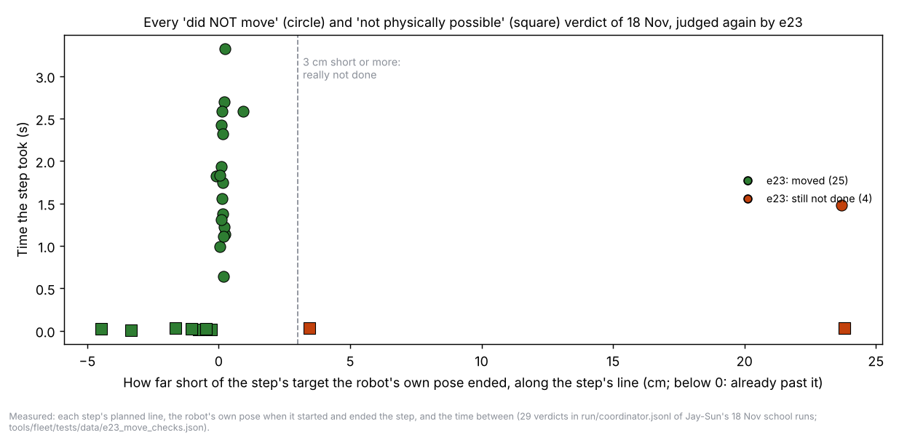

Each mark is one verdict the school runs logged; green ones are now taken as moved, and the four red ones, where the robot's own pose ended 3 cm or more short of the step's target, still fail.

- The logs hold 19 "did NOT move" and 10 "not physically possible" verdicts.
- In 25 of them the robot's own pose ended at the step's target (within 2.5 cm along the step's line). e23 takes all 25 as moved.
- The 4 that stay failed: three are Bravo at the zone 4 outlet plate (16:11, 24 cm short), one is a step reported done in 0.03 s with 3.4 cm still to go (18:06).
- Seven of the 10 "not physically possible" verdicts were steps the robot had already passed when they were sent (0.3 to 4.5 cm beyond the target), so the robot reported them done in 0.02 s.

### 3. Acceptance in the simulator

**The same seed does not give the same run.** A run's outcome depends on wall-clock timing: how long each re-plan really takes on this machine, and where a picture stall lands against a robot's step. A seed fixes the simulator's dice, not the run. The audit showed it (seed 5 on the same code: 38 of 40 with 5 re-plans, where this report first said 34 of 40 with 47), and this pass shows it again (seed 6, 4 + 4, twice on the same code: 7 and 8 of 8). So the numbers below are ranges over runs on the final code, and the first table, one run per case, is in Appendix D.

All runs are the school Pi stand-in: both simulated cameras freeze for 1.5 s every 20 s and the next picture arrives that old; every re-plan takes 6 times as long as on this machine; one clock for cameras and Pi; camera 2 on. One run at a time. "Truly reached" is measured from the simulator's true robot positions during each recorded stop (`acc_table.py`). A 20 + 20 run still going after 19 min of wall clock (3.6 times its planned 316 s) is ended by the runner and counted as not finished.

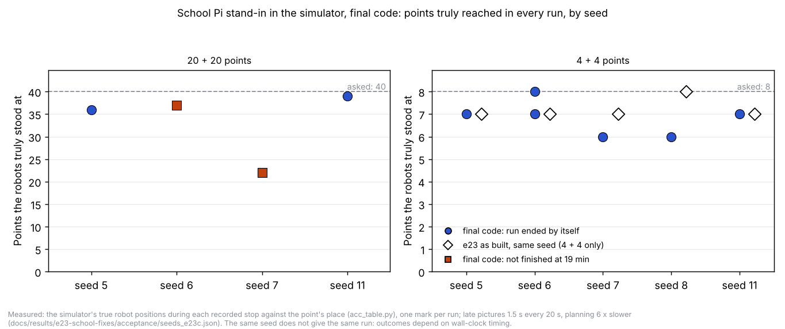

Each blue dot or red square is one simulator run on the final code: how many of the asked points the robots truly stood at (red squares had not finished at 19 min); the diamonds are e23 as built on the same seed.

| List | Seed | How it ended | Truly reached / asked | False credits | Run time (s; planned) | Re-plans (median s) | Turn-backs (veers) | Robots held or out | Points dropped | Closest two bodies (cm) | Closest body to an open edge (cm) | Closest middle to a keep-out (cm) |
|---|---|---|---|---|---|---|---|---|---|---|---|---|
| 20 + 20 | 5 | done | 36 / 40 | 0 | 851 (316) | 36 (4.16) | 15 | 20 | 2 | 9.0 | 6.7 | 11.7 |
| 20 + 20 | 6 | **not finished** at 19 min | 37 / 40 | 0 | 1089 (316) | 23 (8.09) | 9 | 13 | 4 | 14.4 | 7.2 | 11.9 |
| 20 + 20 | 7 | **not finished** at 19 min | 22 / 40 | 0 | 1089 (316) | 68 (10.6) | 34 | 28 | 16 | 10.3 | 3.7 | 10.2 |
| 20 + 20 | 11 | done | 39 / 40 | 0 | 511 (316) | 5 (3.01) | 4 | 2 | 0 | 10.7 | 6.6 | 12.1 |
| **20 + 20, range of 4 runs** | | 2 of 4 finished | **22 to 39** / 40 | 0 | 511 to 1089 | 5 to 68 | 4 to 34 | 2 to 28 | | 9.0 to 14.4 | 3.7 to 7.2 | 10.2 to 12.1 |
| 4 + 4 | 5 | done | 7 / 8 | 0 | 144 (87) | 13 (2.76) | 6 | 6 | 0 | 36.3 | 7.1 | 11.9 |
| 4 + 4 | 6 | done | 7 / 8 | 0 | 125 (87) | 11 (2.25) | 3 | 4 | 1 | 75.0 | 6.7 | 12.7 |
| 4 + 4 | 6 (run 2) | done | 8 / 8 | 0 | 155 (87) | 13 (3.0) | 7 | 6 | 0 | 74.8 | 6.7 | 12.1 |
| 4 + 4 | 7 | done | 6 / 8 | 0 | 144 (87) | 13 (2.74) | 5 | 6 | 1 | 36.2 | 7.4 | 11.9 |
| 4 + 4 | 8 | done | 6 / 8 | 0 | 128 (87) | 9 (2.84) | 4 | 4 | 1 | 76.0 | 11.2 | 12.1 |
| 4 + 4 | 11 | done | 7 / 8 | 0 | 135 (87) | 11 (2.99) | 5 | 5 | 1 | 75.2 | 6.5 | 12.0 |
| **4 + 4, range of 6 runs** | | 6 of 6 finished | **6 to 8** / 8 | 0 | 125 to 155 | 9 to 13 | 3 to 7 | 4 to 6 | | 36.2 to 76.0 | 6.5 to 11.2 | 11.9 to 12.7 |

- **20 + 20: 22 to 39 of 40 truly reached in 4 runs.** Two finished by themselves (511 s and 851 s against 316 s planned); two had not finished at 19 min (37 of 40 and 22 of 40 by then).
- **4 + 4: 6 to 8 of 8 in 6 runs,** all finished, in 125 to 155 s against 87 s planned.
- **No false credit, no crash, no contact and no robot over an edge in the 10 runs.** The two bodies came within 9.0 cm of each other at the closest (plans are refused under 8 cm); a body came within 3.7 cm of an open edge once (seed 7).
- **Old pictures:** every one that arrived too old was carried forward; none had to be left (`old_fix_not_carried` 0 in the 10 runs).
- **Where points were lost:**
  - dropped as "no room to turn there" after being handed to the other robot (0 to 11 a run);
  - a stop 10 to 21 cm from its point, refused (6 stops: P24 three times, P01, P30, P03). All were refused for their distance; none for a wide ±;
  - once, a re-plan gave a robot a 0.1 s "at point P27" pause where it stood, 100 cm from P27; the stop was refused and the point never visited (seed 5; not traced).
- **Open, pre-dating e23: the thrash.** The audit saw it on seed 11 (33 of 40 when capped at 25 min, 56 re-plans). In this pass seed 11 ran clean (39 of 40, 5 re-plans) and seed 7 thrashed: 22 of 40 at 19 min, 68 re-plans, 34 turn-backs, 16 points dropped. What the audit traced: a held robot that is standing still is restarted on every picture stall, and points that lie inside a held robot's 180 cm long obstacle outline are dropped for good although the robot rejoins seconds later. The same code is in `f4acc77`.
- **Why runs differ so much:** the stand-in's stall (1.6 s at 10 cm/s, about 16 cm driven unseen) ends right at the veer stage's limit. At the first stall of seed 5 the turn-back fired 0.07 s before the returned pictures were used; on e23 as built, same seed, the pictures were used first and no turn-back happened. Each turn-back brings a re-plan and usually more turn-backs.
- **After the runner's Ctrl+C on seed 7** the robots were stopped and the end mark written, but the program had not exited 90 s later and the runner ended it. Not traced.

**The fix pass against e23 as built, 4 + 4, same seeds, one run each:**

| Code, 4 + 4 on the stand-in | Runs | Truly reached / 8 | False credits | Run time (s; planned 87) | Re-plans | Turn-backs (veers) | A turn-back at the first stall of a moving robot |
|---|---|---|---|---|---|---|---|
| e23 as built (`b202ea5`) | 5 | 7 to 8 | 0 | 80 to 120 | 3 to 10 | 1 to 5 | 1 of 5 |
| the fix pass (final code) | 6 | 6 to 8 | 0 | 125 to 155 | 9 to 13 | 3 to 7 | 5 of 6 |
| the fix pass with `MIRLT_OLD_FIX_JUMPS=count` and `MIRLT_REACH_TOL=e23` | 5 | 6 to 8 | 0 | 88 to 399 | 2 to 29 | 1 to 13 | 2 of 5 |

The fix pass looks worse here: more turn-backs and re-plans, longer runs, and 6 of 8 twice. **I could not show whether that is the fix pass or chance.** What the logs say: a run goes well or badly from one moment, the first picture stall while a robot drives (about 48 s in). A turn-back there is followed by one at nearly every later stall. It fired in 5 of 6 fix-pass runs, 2 of 5 with the two switches set back, and 1 of 5 on e23 as built. At that moment none of the fix pass's changed code has yet acted in the plan: the turn-back fires before the returned picture is handled, and the time from pictures returning to their use is the same on both codes (median 0.03 s against 0.05 s, 39 and 24 stalls). That points to chance, and 16 runs cannot settle it: the first test in Sweep 1. If it turns out to be the fix pass, `MIRLT_OLD_FIX_JUMPS=count` is the old way.

**The code before e23** was not run again in this pass. It crashed in both of its 20 + 20 runs (this build's and the audit's: `KeyError: 'Bravo'` after 60 and 62 s, 6 of 40, said "done"). On 4 + 4 it gave 7 of 8 with 1 false credit in this build's run and 5 of 8 with 2 false credits in the audit's.

Not run again: the restart case, the case with nothing made to go wrong, and the Stop case (Appendix D). Not covered by any run: causes B, E1, F and G (tests only).

### 4. The Pi with two cameras (cause H)

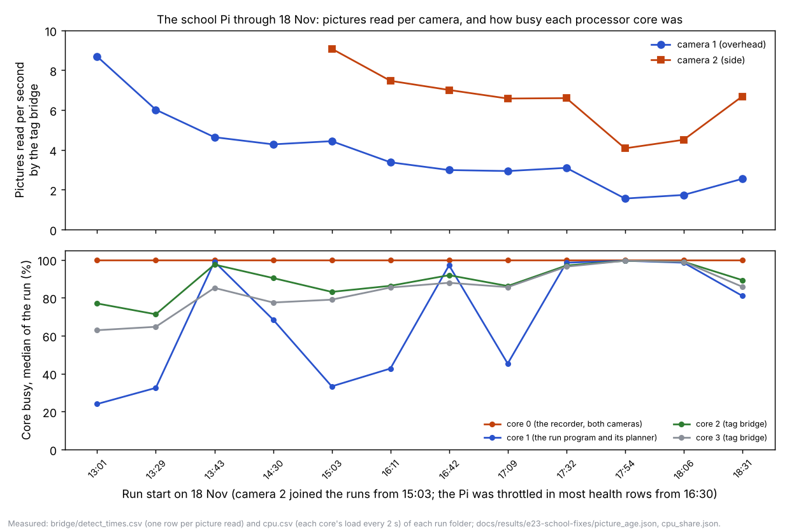

Camera 1's pictures per second fell through the day while core 0, which runs the recorder for both cameras, stood at 100 % in every run, including the cool one-camera runs.

Measured from the run folders (`picture_age.py`, `cpu_share.py`, `drain_lag.py`, `open_times.py` in `docs/results/e23-school-fixes`):

- **Recorder:** core 0 was at 100 % (median) in all 12 runs with a `cpu.csv`, from 13:01 on, at 75 °C and before any throttling. The recorder used 92 to 98 % of that one core with one camera and with two.
- **Tag bridge:** camera 1 was read 8.7 times a second at 13:01, 4.3 to 6.0 with two robots and one camera, 2.9 to 4.4 after camera 2 joined, and 1.6 to 2.6 in the last three runs. Camera 2 was read 4.1 to 9.1 times a second.
- **Picture age when read:** median 0.15 to 0.27 s with one camera, 0.29 to 0.40 s for camera 1 with two. Pictures older than 1 s: none before 16:00, 4 to 6 % for camera 1 in the last three runs.
- **Run program:** it handled each robot report within 0.01 s (median) in every run, 0.5 s at worst. It was not the slow part.
- **Planner:** `run_plan` used 23 to 40 % of core 1 in most runs and 80 to 93 % in the two runs that re-planned most (17:54, 18:06).
- **Throttling:** the processor clock's median was 1726 to 1775 MHz in the throttled runs against 1800 MHz, about 4 % slower.

What a fan would fix: the 4 % clock loss and the "throttled" flags. What it would not fix: core 0 at 100 % for the recorder, the bridge reading camera 1 two to three times less often than camera 2, and slow planning (fixed here by D).

This reading is my own, from timing in the logs; nothing was measured on the Pi for this build.

### 5. The independent audit, and the fix pass (e23c)

An independent audit on 19 Nov reran the tests and the acceptance runs and read the code against the raw school logs.

**What it confirmed:** 35 of the 37 e23 tests fail on `f4acc77`; the fleet suite (1199 passed); the simulator suite's same two failures before and after; the 29 move-check cases regenerated from the raw logs equal the committed ones; the site's pins match the raw bindings; the Stop case (1 `stop` against 101); the old code's crash on the stand-in; nothing under `tools/rfid` changed. With the old veer rule switched back on, e23 met "rejoined while a plan without it was being made" 5 times in one run without a crash.

**What it found, and where each stands now:**

| # | Finding | The audit's evidence | Now |
|---|---|---|---|
| 1 | A Stop that no robot answered was said as "Stopped: every robot confirmed" | `stop_noanswer.py`: one `stop`, no answer, "confirmed" | **Fixed.** The `stop` is sent 3 times, 3 s apart, then the page says it was sent and no robot answered. Never "confirmed". Old way: `MIRLT_STOP_NO_ANSWER=first` |
| 2 | An old picture was carried forward by the robot's pose change, corrections included | A standing robot corrected by 5 cm: the picture moved 5 cm. Four old pictures in a row: 3 cm behind ended 3.0 cm ahead, 8 cm behind ended 6.7 cm ahead | **Fixed.** Carried by what the robot drove only; each correction since the picture is taken out. Same cases: the standing robot's picture is not moved, and the bursts end 0.04 and 0.10 cm short of the truth. Old way: `MIRLT_OLD_FIX_JUMPS=count` |
| 3 | The stop tolerance grew with misses, and more doubt made a stop easier to credit | Real 16:11 run: 6.0 to 25.5 cm after four refused P29 stops. P01 (5.6 cm off, ±10.9 cm) and P03 (7.0 cm off, ±9.9 cm) credited | **Fixed.** Learned from reached stops only, the stop's ± counted against it, bounded. All four P29 stops, P01 and P03 are refused; the tolerance stays between 5.5 and 8.3 cm. Old way: `MIRLT_REACH_TOL=e23` |
| 4 | `MIRLT_WAKE_WAIT`'s description said the opposite of the code; one missing robot froze Start for up to 60.5 min | `wake_test.py`; `calib_run.discover` | **Fixed.** Description corrected. With some robots answering, the rest are waited for 3 min, then the run starts and names who is missing. Old way: `MIRLT_WAKE_PARTIAL=wait` |
| 5 | A second Stop changed the watcher's robot list while the watcher read it | Code reading | **Fixed.** One lock for the watcher, the page and a second Stop |
| 6 | Chosen numbers not marked | Code reading | **Fixed.** Marked `[chosen]` in the code; Appendix A |
| 7 | The acceptance numbers are not reproducible | Seed 5 again on the same code: 38 of 40 with 5 re-plans, against the reported 34 of 40 with 47 | **Reported.** Section 3 gives ranges over seeds |
| 8 | Seed 11 thrashes | Not done at the 25 min cap: 33 of 40, 56 re-plans, 19 holds; five points dropped for good | **Open.** Pre-dates e23 (same code in `f4acc77`); section 3 |
| 9 | The run-14 plate contact is not addressed | School report, run 14 | **Open.** Listed in section 1 |
| 10 | The veer fix covers dwell veers only | 6 of 36; one of the six moved 5.07 cm | **Open.** Question 1 |
| 11 | Plan-ahead falls back to the whole list in the stand-in | Fitted fixed part 2.4 to 3.7 s over a 2.0 s budget | **Open.** Question 4 |
| 12 | The update steps pulled while Mission Control was running | Rehearsal in a scratch clone | **Fixed.** `mc-stop` comes first; a check of the site file was added |
| 13 | `MIRLT_STOP_UNNAMED=wait` is not fully the old way | Code reading | **Documented** (section 1, the Safety group) |

Each fix has a test that fails on e23 as built (`b202ea5`): 17 tests in `tools/fleet/tests/test_e23c_audit_fixes.py`, 17 fail there.

On finding 3: taken literally, "distance plus the stop's ± within 5.5 cm" would refuse 94 of the 131 real stops, because a normal stop's ± is 3.3 cm (median). So a stop now counts when its best position is within 5.5 cm of the point **and** its position plus its ± is within 12.6 cm; both numbers are the measured scatter of the 131 school stops. Replayed on those stops, 17 are refused (e23 as built: 11), and none 8.8 cm or more off is credited.

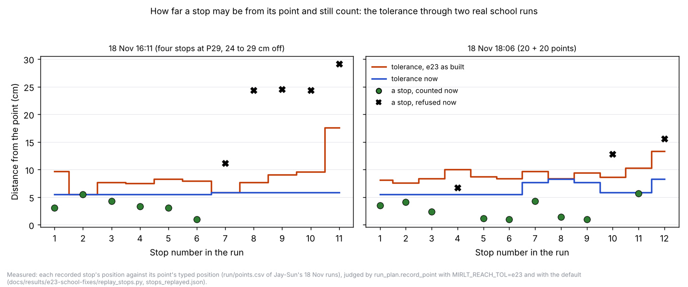

Each mark is one recorded stop's distance from its point; the red line is how far e23 as built would have let a stop be at that moment, the blue line what the fixed code allows.

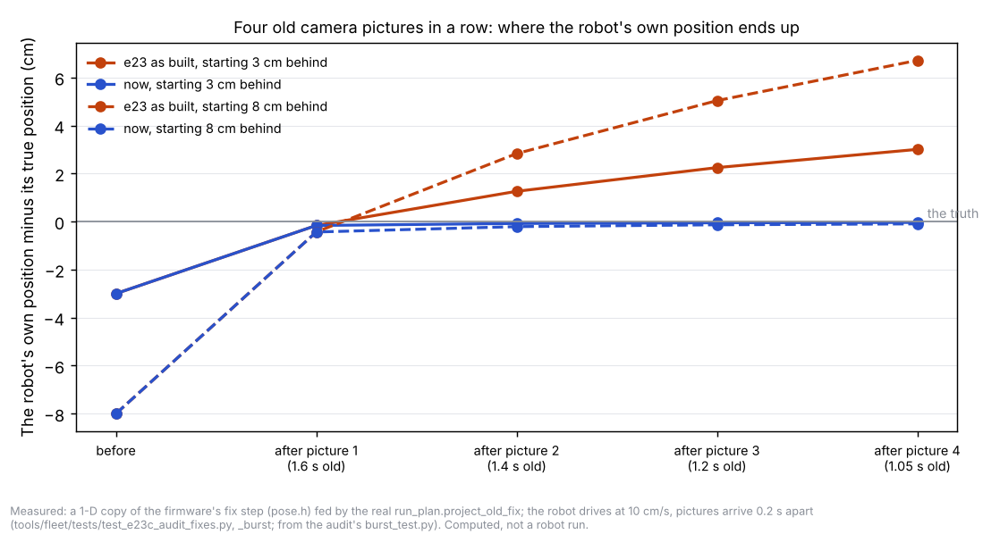

Each line follows the robot's own position error through four old pictures: e23 as built (red) drove it past the truth, the fixed code (blue) stops at it. This is computed with a copy of the firmware's fix step, not measured on a robot.

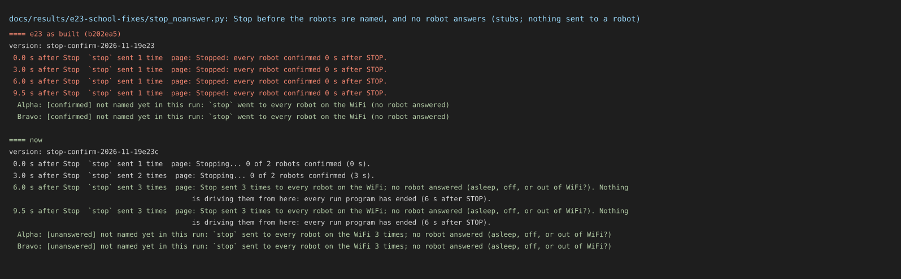

The same Stop on e23 as built and on the fixed code, with no robot answering: the words the page shows at each moment.

## Conclusion

These are my own conclusions from the tests and the simulator runs; nothing here was run on the robots.

1. **The crash and the Stop storm that ended the 20-point runs at school are fixed.** The code before e23 crashed in both of its 20 + 20 runs on the stand-in, the way school runs 21 and 25 did. No e23 run has crashed: this build's, the audit's, or the 10 on the final code, which met "rejoined while a plan without it was being made" 15 times. The Stop watcher sends 1 `stop` where it sent 101.
2. **The audit found six faults in e23 as first built; each is fixed with a test that fails before the fix** (section 5). The two that mattered most for honest results: a Stop nobody answered was said as "confirmed", and the stop tolerance grew as stops missed.
3. **Stops are counted honestly on the final code:** no false credit in 10 runs, and on the 131 real stops nothing 8.8 cm or more from its point is credited.
4. **e23 is not a complete 20 + 20 run under late pictures:** 22 to 39 of 40, and two runs of four not finished in 3.6 times the planned time. A thrash that pre-dates e23 is open, and so is the veer stage for a moving robot, which starts it.
5. **One run per case proved nothing either way,** in this report's first version. Ranges over 4 to 6 runs are what the simulator supports today, and they are wide.
6. **Still worth putting on the school Pi,** with the open items known: the crash, the Stop storm, the camera hang (tests only) and the false credits are what stopped Jay-Sun's runs. One thing to watch there: in the 4 + 4 comparison the fix pass had more turn-backs than e23 as built, and I could not show whether that is chance (section 3).

## What's next

1. Update the school Pi (steps below) and repeat a 20 + 20 run with Jay-Sun in the room. That run is the acceptance that counts.
2. Decide questions 1 to 3 and 6 to 8 below; they are the next build (the veer stage under picture stalls; a not-reached point tried again; what "done" says; how far off a stop may be; a robot missing at the start).
3. Trace why a standing robot's position doubt was 14 and 62 cm when pictures stalled, and whether late pictures are being learned as odometry error (logs of the stand-in run; no robot needed).
4. Run the first test in Sweep 1 (does the fix pass cause more turn-backs?) before or right after the Pi update (question 8).
5. Trace the thrash (section 3): a held, standing robot restarted on every picture stall, and points dropped for good because they lay inside a held robot's obstacle outline. It pre-dates e23 and needs no robot.
6. The plate contact of run 14 (section 1): find why Bravo's heading was 18° off and its path crossed the zone 4 plate. Logs only to begin with.
7. Repeat the acceptance cases over 10 or more seeds each, the code before e23 on the same seeds; 4 or 5 runs per case is a range, not a rate.
8. A designed experiment on the simulator, at the Pi's measured planning cost, for how many points to plan ahead (question 4).
9. Run the Pi timing bench with two cameras and each core layout (`./run-fleet-pi.sh bench`), to decide whether the recorder should get a second core when camera 2 is on.
10. Calibrate AL-1DC0's wheels at school. On the leg to P33 its own distance count read 15 to 20 % short against camera 2 over the last 50 cm (inferred from `follow.csv` against `bridge/fixes.csv`; the cause is not known).

## School Pi: update steps (Nick)

**1.** On the laptop, click the **Tailscale** icon near the clock and switch the account to **joincapstonedb**.

**2.** Open **PowerShell** on the laptop. Every box below is typed in that PowerShell window: type the one line, press Enter, and wait for the line to finish before the next box.

```
ssh nick@100.72.183.28
```

Type the Pi's password if it asks. You should see a line ending in `$`.

**3.** In the same PowerShell window:

```
cd ~/alvik-fleet-capstone
```

You should see the `$` line again, now with `alvik-fleet-capstone` in it.

**4.** Close Mission Control before anything is changed, so nothing is running on the Pi while its files change. In the same PowerShell window:

```
./run-fleet-pi.sh mc-stop
```

You should see `Mission Control is closing (a run of its own stops first).` and, about 3 seconds later, the `$` line again. If you see `Mission Control is not running in tmux session mc` instead, that is fine: it was already closed.

**5.** In the same PowerShell window:

```
git status --short
```

You should see either nothing, or the one line ` M tools/fleet/sites/school-conference.json` (camera 2 was switched on in that file on this Pi). If you see nothing, skip steps 6, 8, 9 and 10 (do step 7, then go on from step 11). If you see any other line, stop here and send me that screen.

**6.** In the same PowerShell window:

```
git stash
```

You should see a line starting with `Saved working directory and index state`.

**7.** In the same PowerShell window:

```
git pull
```

You should see `Fast-forward` and a list of files, among them `tools/fleet/tests/test_e23c_audit_fixes.py`. If it says `error` or `fatal`, stop here and send me that screen.

**8.** In the same PowerShell window:

```
git stash pop
```

You should see `Auto-merging tools/fleet/sites/school-conference.json` and, near the end, a line starting with `Dropped`. You should not see the word `CONFLICT`.

**9.** Check that the site file came back whole. In the same PowerShell window:

```
grep -c '<<<<<<<\|>>>>>>>' tools/fleet/sites/school-conference.json
```

You should see `0`.

**10.** In the same PowerShell window:

```
python3 -c "import json; json.load(open('tools/fleet/sites/school-conference.json')); print('site file OK')"
```

You should see `site file OK`.

If step 8 showed `CONFLICT`, or step 9 showed a number other than `0`, or step 10 showed an error instead of `site file OK`: the Pi's own change and the update touched the same lines. Do not start a run. Put the update's own copy of the file back with the one box below (still the same PowerShell window), then send me the screen and carry on from step 11. The Pi's own copy is not lost: `git stash` keeps it until I merge it. Until then camera 2 is off on this Pi (the update's copy says so), so a run uses camera 1 only.

```
git checkout HEAD -- tools/fleet/sites/school-conference.json
```

You should see the `$` line again and nothing else. Steps 9 and 10 typed again now give `0` and `site file OK`.

**11.** In the same PowerShell window:

```
git log --oneline -1
```

You should see one line with `e23c` in it.

**12.** In the same PowerShell window:

```
python3 tools/fleet/safety_group.py show | tail -1
```

You should see `Safety group: every switch on its automatic default (99 switches; tools/fleet/safety_group.py show)`.

**13.** In the same PowerShell window:

```
./run-fleet-pi.sh space --move
```

You should see finished run folders listed as moved to the USB drive and the card's free space after (it was 0.81 GB on 18 Nov; a run needs 0.55 GB).

**14.** In the same PowerShell window:

```
./run-fleet-pi.sh mc
```

You should see a line with `:8095` in it. The address in front of it may be the Pi's address on the school network; use the one in step 15.

**15.** In the laptop's browser (still on the **joincapstonedb** Tailscale account), open `http://100.72.183.28:8095/table`. You should see Mission Control with the table's map. When a run starts, its log (the **Log** button) now shows a line `LOOKING FOR CAMERAS: ...` followed by `CAMERAS FOUND (...)`.

No firmware changed in this build: nothing to flash.

## Until the Pi is updated (Jay-Sun)

- After pressing Stop while a run is still starting, restart Mission Control before the next run.
- If nothing new appears within 30 s of Start, press Stop, restart Mission Control, and start again.
- Keep lists to 5 points or fewer per robot.
- Place both robots in camera 1's half at Start, and keep camera 2 on.
- "Done" may be wrong on this version: check the list of stops against the list asked.
- Wake the robots by hand (power button off and on) before Start if they have been idle for more than 10 minutes.

## Questions for Nick

Substantive:

1. **The veer turn-back on picture stalls.** At school on 18 Nov the veer stage fired 36 times; in the stand-in run it fired 32 times, each a 10 to 15 cm drive back and a re-plan. I changed one case only: a robot standing at a point now stays (switch `MIRLT_VEER_AT_POINT`). That changes a stage you approved on 13 Nov, so: is it right? And for a moving robot, should it (a) stay as it is, (b) turn back only when its error shape no longer clears the edge at its present speed, instead of looking 27.5 cm ahead, or (c) slow down first and turn back only if pictures stay away?
2. **A point said "NOT REACHED" is not tried again.** Should the robot go back to it straight away, go back to it at the end of its list (as a point whose tag was lost on the way is), or leave it?
3. **What should a run say when points were not reached?** It now says "done" and lists them. An alternative is "ended: 34 of 40 points reached".
4. **Points planned ahead.** Where a re-plan's fixed part is over its budget, e23 plans the whole list (as before e23). Planning 2 points each made a re-plan about half as long in the stand-in (17.6 s against 36 to 47 s), but in the first sitting's restart run it came with 6 points lost, with other faults still present then. A designed experiment (1 / 2 / 3 / all, at the Pi's planning cost, 10 seeds) would settle it; it is on the list unless you would rather choose.
5. **Camera 2 in the repo's site file is still off**, yet the 18 Nov runs used it from 15:03, so the school Pi's copy of that file must differ from the repo's (I have not seen the Pi's copy). That is why the update steps set the file aside and restore it. Should the repo's school site say camera 2 is on?

6. **How far from a point may a stop be and still count as that point?** After the audit a stop counts when its best position is within 5.5 cm and position plus its own ± is within 12.6 cm, both measured from the 131 school stops, and a run's own reached stops may widen them by half at most (my choice). On the real stops this refuses 17 of 131, six of them stops e23 credited: 5.3 to 7.0 cm off, four of the six with a ± of 7 to 11 cm. The right number depends on what the points are for (for Jay-Sun's RFID labels the stop's recorded position is used, not the point's). Is 5.5 cm right, and should a stop with a wide ± count?
7. **A robot missing at the start.** After the audit a start no longer waits the whole check-in (60 min at school) for one robot when another has answered: it waits 3 min, starts with the robots that answered and says which did not. The robot that did not answer is not driven and not named in that run; I did not check whether the others plan round its roof tag if it stands on the table. Starting without it after 3 min is what the code did before e23. Is that right, or should the run keep waking it and bring it in when it answers, or refuse to start while a roof tag is seen that no robot answers for?

8. **The fix pass and turn-backs.** In the 4 + 4 comparison (section 3) the fix pass had more turn-backs than e23 as built, and I could not show whether that is chance. The update steps put the fix pass on the Pi with its defaults. The alternative is to run the 20-run test first (Sweep 1, about 2 hours of machine time, no robot), or to update now and set `MIRLT_OLD_FIX_JUMPS=count` in Mission Control's Safety box until it is run. Which?

Other:

9. The stand-in's stall pattern (both cameras, 1.5 s every 20 s) and its 6 times slower planning are my choices from the 18 Nov numbers. The Pi's real re-plans were about 3 times slower still. Is that stand-in close enough, or should it be set from the per-picture timing in `bridge/detect_times.csv`?
10. The Stop case could not be shown through Mission Control in practice mode, because the simulated robots answer as Alpha and Bravo. Worth adding simulated robots that answer under WiFi names?

11. When no robot answers a Stop pressed before the robots are named, the `stop` is now sent 3 times over 6 s and the page then says none answered. Enough, or should it keep sending until someone presses "carry on" (as it does for robots the run has named)?

## Appendix A: chosen and derived numbers

| Number | Value | Where it comes from | Should a designed experiment set it? |
|---|---|---|---|
| Camera-open time limit | 3 x the longest open on record: 4.8 s | 153 opens in the 25 run logs (median 0.64 s, 95th percentile 0.95 s, longest 1.59 s); each Pi's own opens raise the record | The factor 3 is **[chosen]**. No: a hung open never returns |
| Child start allowance | 20 s | **[chosen]**: time for a child Python to load OpenCV before its open is timed | No |
| "At its target" | 1 cm + 2.45 x the robot's own stated position sd | The firmware's arrival window and the robot's own FOLLOW row | No (definitions) |
| Late move check kept | 5 s | **[chosen]** bookkeeping: after that the blind rules have the robot | No |
| Planning cost before the first measurement | 0.4 s fixed + 0.36 s per point | School Pi: the medians for 4 + 4 points (3.3 s) and 20 + 20 points (14.8 s) give (14.8 - 3.3) / 32 per point and the rest fixed | No (a measurement; scaled by the run's first re-plans, fitted from its third) |
| "Fixed part over the budget: plan the whole list" | a rule, no number | **[chosen]**: fewer points cannot bring such a re-plan under its budget, and each extra re-plan pays the fixed part again | **Yes**, with the row below |
| Points planned ahead, at least | 2 per robot | **[chosen]**: the point it drives to and the next | **Yes**: 1 / 2 / 3 against standing time and points reached, simulator at the Pi's planning cost |
| Points planned ahead, at most | 60 per robot ("the whole list") | **[chosen]**: more points than any list so far | No |
| "Has not moved" for a robot standing at a point | 2 cm of its own driving since the camera lost it | The existing interrupted-dwell limit (`DWELL_STILL_CM`, Nick's "about 2 cm") | No |
| Re-plan spacing past the re-plan cap | 5 s | Existing **[chosen]** guard; a run now waits it out when handed-over points depend on it | No |
| Reach tolerance of a stop | 2.9 cm + the stop's own ± | Measured drive-end errors (`TRACK_P95_CM` 1.7 across, stop 2.4 along) | No |
| Oldest fix a robot takes | its own `fix_max_age_ms`, else 1.0 s | Firmware default before e21 | No |
| Pi-to-robot message time | 0.07 s | 99th percentile of 8,476 pose rows of the 18:06 run | No (a measurement) |
| Slow-end room | derived clearance at the tour's speed + speed x the oldest fix the robot takes: 20.5 cm at 10 cm/s, 25.8 cm at 15 cm/s | `safety_rules.slow_end_room_cm` | The 1 s term follows the firmware. A designed experiment on speed near an edge is worth running (report of 18 Nov) |
| Slow-end speed | 5 cm/s | The slowest speed the stopping distance was measured at | Yes, with the room above |
| Simulator: planning slowed | 6 x | **[chosen]**; it gave re-plans of 2.5 to 11 s against the Pi's 10 to 19 s | No (a simulator condition; question 9) |
| Simulator: late pictures | 1.5 s stall every 20 s, both cameras | **[chosen]** from 18 Nov: stalls of about 1.5 s, 4 to 6 % of camera 1's pictures older than 1 s in the last three runs | Better measured than tested: set it from `bridge/detect_times.csv` |
| Acceptance ruler for "truly reached" | the larger of 2.9 cm + the stop's own ± and 5.5 cm | The tolerance e23 derives for a stop (drive-end errors; the school's measured stop scatter) | No |
| Acceptance: "standing" | true speed under 0.5 cm/s | **[chosen]**: well under the slowest drive (4 cm/s) | No |

Added or corrected by the audit's fix pass (e23c). The "Reach tolerance of a stop" row above describes e23 as built (`MIRLT_REACH_TOL=e23`); the rows below replace it.

| Number | Value | Where it comes from | Should a designed experiment set it? |
|---|---|---|---|
| Stop tolerance, distance (`MISS_SEED_CM`) | 5.5 cm at school | Measured: median 2.82 cm + 3 scaled MADs (0.61 cm) of how far the 131 recorded stops stood from their points. Never under where drives end (2.9 cm) | No (a measurement) |
| Stop tolerance, distance + the stop's ± (`MISS_PM_SEED_CM`) | 12.6 cm at school | Measured: median 6.58 cm + 3 scaled MADs (1.35 cm) of (distance + ±) over the same 131 stops | No (a measurement) |
| The adaptive part: the run's own stops (`MISS_OWN_N`) | from 5 reached stops on | **[chosen]**. From its 5th reached stop a run uses its own reached stops' median + 3 scaled MADs in place of the school's, for both tolerances. Stops that were refused are never used. The result is kept between the measured value and `REACH_TOL_CAP` times it | No: bookkeeping. With the bounds it changed no verdict on the 131 stops when set to 3, 5 or 8 |
| Widest the run's own stops may make a tolerance (`REACH_TOL_CAP`) | 1.5 x the measured value: 8.3 cm and 18.8 cm | **[chosen]**. 1.5 and 2.0 refuse the same 17 of the 131 stops | No: it follows from what the points are for (question 6) |
| `stop` sent when no robot answers (`UNNAMED_TRIES`) | 3 times, 3 s apart | **[chosen]** from data: one try is three copies and a 1 s listen; the worst packet loss on record is 1 in 10 (27 Oct), so an awake robot is missed in 3 tries about 1 time in 1000 | No: an extra `stop` is harmless; a sleeping robot answers no number of tries |
| Wait for the rest once one robot has answered | 3 min | The start's usual wait before e23 (the `wake_min` asked for): an existing **[chosen]** number | No: an awake robot answers within seconds; a sleeping one needs its whole check-in |
| A hole in a robot's pose reports (`POSE_HOLE_S`) | 1.0 s | **[chosen]**: 9 rows lost in a row (rows come every 0.11 s, median of the 18 Nov runs) | No: a longer hole only means an old picture is not carried forward |
| Late move check: "the camera agrees" (`LATE_MOVED_SHARE`) | half the step's length | **[chosen]** (the half the e22 move check used) | Not yet: it words a log line only. If a late "did not move" is ever acted on: 0.3 / 0.5 / 0.7 against false alarms |
| Late move check kept (`LATE_CHECK_KEEP_S`) | 5 s | **[chosen]** bookkeeping (the row "Late move check kept" above) | No |
| Shortest fast part of a slowed leg (`SLOW_SPLIT_MIN_CM`) | 5 cm | **[chosen]**: the plan's shortest sensible drive | No: bookkeeping |
| Re-plans the cost fit looks back over (`PLAN_COST_KEEP_N`) | the newest 20 | **[chosen]**, so the fit follows a Pi that slows as it heats | **Yes**, with the points planned ahead: 10 / 20 / all against how well the next re-plan's time is predicted |
| Re-plans needed before a line is fitted (`PLAN_FIT_MIN_N`) | 3 | **[chosen]**: the smallest number that can disagree with a line | No |
| ... and how different in size they must be (`PLAN_FIT_MIN_SPREAD`) | 2 points | **[chosen]**, else the slope is fitted to noise | **Yes**, with `PLAN_COST_KEEP_N` |

## Appendix B: how to reproduce

```
cd tools/fleet && HOME=$(mktemp -d) python3 -m pytest -q -p no:cacheprovider tests/test_e23_school_fixes.py
python3 docs/results/e23-school-fixes/seed_runs.py . /tmp/e23acc new-school20:5:late=20,1.5:slow=6:skew=0 \
    new-school4:6:late=20,1.5:slow=6:skew=0:pts=4 new-rejoin:4:restart=Bravo@120:slow=6:skew=0 new-plain:1:skew=0
python3 docs/results/e23-school-fixes/acc_table.py /tmp/acc.json /tmp/acc.md /tmp/e23acc/new-school20 /tmp/e23acc/new-school4
python3 docs/results/e23-school-fixes/stop_case.py .
python3 docs/results/e23-school-fixes/mc_shots.py . docs/screenshots/2026-11-19 /tmp/e23mc
python3 -I docs/results/e23-school-fixes/picture_age.py <the 25 run folders>
```

The audit's fix pass (e23c):

```
cd tools/fleet && HOME=$(mktemp -d) python3 -m pytest -q -p no:cacheprovider tests/test_e23c_audit_fixes.py
python3 -I docs/results/e23-school-fixes/replay_stops.py <the 25 run folders> . /tmp/stops_replayed.json
python3 docs/results/e23-school-fixes/stop_noanswer.py .
for s in 5 6 11 7 8; do python3 docs/results/e23-school-fixes/seed_runs.py . /tmp/acc school4-s$s:$s:late=20,1.5:slow=6:skew=0:pts=4:wall=600; done
for s in 5 6 11 7; do python3 docs/results/e23-school-fixes/seed_runs.py . /tmp/acc school20-s$s:$s:late=20,1.5:slow=6:skew=0:wall=1140; done
for s in 5 6 11 7 8; do python3 docs/results/e23-school-fixes/seed_runs.py <a clone at b202ea5> /tmp/acc b202school4-s$s:$s:late=20,1.5:slow=6:skew=0:pts=4:wall=600; done
for s in 5 6 11 7 8; do python3 docs/results/e23-school-fixes/seed_runs.py . /tmp/acc swschool4-s$s:$s:late=20,1.5:slow=6:skew=0:pts=4:wall=600:env=MIRLT_OLD_FIX_JUMPS=count,MIRLT_REACH_TOL=e23; done
python3 docs/results/e23-school-fixes/seeds_table.py /tmp/acc /tmp/seeds.json /tmp/seeds.md
python3 docs/results/e23-school-fixes/charts_e23c.py . docs/screenshots/2026-11-19 <a clone at b202ea5> docs/results/e23-school-fixes/acceptance/seeds_e23c.json
```

The same commands do not give the same numbers again: a run's outcome depends on wall-clock timing (section 3). Every run's numbers are in `docs/results/e23-school-fixes/acceptance/seeds_e23c.json`; the run folders themselves are not in the repo. The second run of seed 6 (4 + 4) was made one commit earlier, before the scripts' version notes were added.

`seed_runs.py` switches camera 2 on for the run (`run_two_cameras.py`), as it was at school on 18 Nov; the repo's site
file still says `cameras.side.use false`. Run one case at a time: two at once share the simulator's ports.

The runs of the code before e23 used a copy of `f4acc77` with two additions that are not part of it: the simulator's
late pictures (`tools/sim/tag_cam.py` and the `--sim-late` option copied in) and the planner slowed from outside (a
wrapper that waits 5 times the planning time after each re-plan). The numbers behind the table are in
`docs/results/e23-school-fixes/acceptance/` (`acceptance.json`, `acceptance.md`, `stop_case.jsonl`); the run folders
themselves are not in the repo. The e23 runs were made at commit `56567c4`; the code after it (`006354b`) adds only the map page's warning box and a guard for a test set-up, neither of which a run uses.

## Appendix C: Claude's review of this build

1. **The acceptance runs changed the build.** The first runs of e23 were worse than the code before it in one case (34 of 40 against 40 of 40 with a restart and slow planning) and ended one run "done" with 25 points not visited. Four faults came out of that (I to L) and the points-ahead rule was changed. The table above is from the code after those fixes; it is one run per case.
2. **One seed per case.** Nothing here is a rate. The 34 of 40 could be 30 or 38 on another seed.
3. **I changed an approved safety stage without asking** (a robot standing at a point is not sent on the veer turn-back). It is behind a switch and its stops are untouched, but it is my call, not Nick's: question 1.
4. **Three misses are known and not fixed:** a not-reached point is never tried again; a moving robot near an edge is still turned back on every picture stall; and a standing robot's position doubt read 14 and 62 cm at the moment pictures stalled, which I did not trace. In that run each robot's odometry record had a turn-on-the-spot term 4 to 12 times larger than in the run with nothing wrong (0.21 and 0.59 against 0.05), so late pictures may be being read as odometry error; that is a lead, not a finding. I stopped there because the first two need a decision (questions 1 and 2) and the third needs its own look.
5. **The stand-in is my construction.** It reproduced the 18 Nov crash, which is some evidence it is like the Pi; its planning is still about 3 times faster than the Pi's was.
6. **Causes B, E1, F and G are covered by tests only,** with stand-ins for the cameras and the robots. The camera-open hang in particular has never been seen to pass on the Pi.
7. **The new "not over while handed-over points wait" rule can lengthen a run:** if that re-plan can never be made, the run now goes on to its time limit instead of ending early.
8. **The crash screenshot is staged** (a finished run's summary rewritten), and the first practice screenshot showed that the red warning box was missing from the map page; it was added and the picture retaken.
9. **Tests:** the full fleet suite (`tools/fleet/tests`) on the final code: 1199 passed, 10 skipped, 2 passed that were expected to fail. Its first run today had 4 failures with one cause (the new standing-at-point check met a test set-up with no plan); fixed and run again in full. Pi suite: 137 passed. Analysis suite: 16 passed. Simulator suite: 122 passed, 2 failed (`tools/sim/tests/test_follow.py`, the two tests on late and old fixes); they fail the same way on `f4acc77` and were left alone.

### Review of the audit's fix pass (e23c)

1. **The audit found six faults my own review above missed** (section 5, findings 1 to 6), and showed that the acceptance table was written as if one run per case could be compared. Items 1 and 2 above undersold that: the numbers were not only "not a rate", they did not repeat.
2. **Finding 3 was not fixed the way it was first put to me** ("distance plus ± within the tolerance"): on the real stops that refuses 94 of 131. I gave the ± its own measured tolerance instead (section 5). That is my design, not the audit's or Nick's: question 6.
3. **Finding 4 changed what a start does** (it goes ahead after 3 min without a robot that has not answered). It restores what the code did before e23 for that case and is behind `MIRLT_WAKE_PARTIAL`, but it is a behaviour change: question 7.
4. **The old-picture fix estimates** each correction from the pose rows, because the robot does not report it. Where every step since the picture holds a correction, the picture is not carried at all (the robot refuses it as old), which is the fault e23 set out to fix, in that one case. In the 10 acceptance runs on the final code that did not happen once.
5. **Open and untouched, by instruction:** the veer stage for a moving robot, trying a not-reached point again, what "done" says, how many points to plan ahead, camera 2 in the repo's site file.
6. **Tests on the final code:** fleet suite 1216 passed, 10 skipped, 2 passed that were expected to fail (the 1199 of before plus the 17 new); Pi suite 137 passed; analysis suite 16 passed; simulator suite 122 passed, 2 failed (the same two tests in `tools/sim/tests/test_follow.py` as on `f4acc77`). The 17 new tests all fail on e23 as built (`b202ea5`).

## Appendix D: the first acceptance table (one run per case, as first reported)

This is section 3 as first written, kept for the record. **Its numbers are single runs and are not reproducible:** the
audit's rerun of the same seed on the same code gave a different run (section 3). The audit reran the two rows of the
code before e23: 20 + 20 crashed the same way (`KeyError: 'Bravo'` at 62 s, 6 of 40, said "done"); 4 + 4 gave 5 of 8
truly reached, 7 credited, 2 false credits, 23 re-plans in 143 s, against the 7 of 8, 1 false credit, 4 re-plans in
85 s below. The restart case, the case with nothing made to go wrong and the Mission Control pictures were not run
again. The picture of Stop pressed twice shows practice mode, where the simulated robots stop with the simulator; it
is not the case of finding 1 in section 5.

One simulator run per row, the same seed for both codes, run one at a time. "Truly reached" is measured from the
simulator's true robot positions during each recorded stop, not from what the run credited itself (`acc_table.py`).

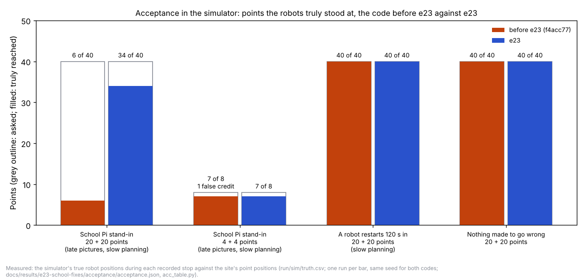

Each pair of bars is one test case run on the code before e23 (red) and on e23 (blue); the outline is the number of points asked and the filling is how many the robots truly stood at.

| Case | Code | How it ended | Truly reached / asked | False credits | Crashed | Run time (s) | Standing outside stops (s, both robots) | Re-plans (median s) | Closest two bodies (cm) | Closest body to an open edge (cm) | Closest robot middle to a keep-out (cm) |
|---|---|---|---|---|---|---|---|---|---|---|---|
| School Pi stand-in, 20 + 20 | before | said "done" at 60 s | 6 / 40 | 0 | **yes**: `KeyError: 'Bravo'` in `finish_replan` | 60 | 71 | 1 (5.3) | 73.8 | 11.1 | 12.8 |
| | e23 | done | **34 / 40** | 0 | no | 791 (planned 316) | 926 | 47 (4.5) | 9.4 | 6.7 | 8.8 |
| School Pi stand-in, 4 + 4 | before | done | 7 / 8 (said 8) | 1 (P24, 10.4 cm off) | no | 85 | 100 | 4 (2.9) | 75.9 | 6.6 | 12.6 |
| | e23 | done | 7 / 8 (said 7) | 0 | no | 98 | 119 | 5 (3.3) | 76.3 | 6.6 | 12.6 |
| A robot restarts 120 s in, 20 + 20, slow planning | before | done | 40 / 40 | 0 | no | 597 | 738 | 5 (6.6) | 21.6 | 6.8 | 12.0 |
| | e23 | done | 40 / 40 | 0 | no | 644 | 828 | 13 (2.8) | 21.4 | 6.7 | 11.8 |
| Nothing made to go wrong, 20 + 20 | before | done | 40 / 40 | 0 | no | 302 | 178 | 0 | 61.0 | 8.7 | 10.1 |
| | e23 | done | 40 / 40 | 0 | no | 309 | 178 | 0 | 60.8 | 8.7 | 10.1 |
| Stop pressed before the robots are named (stop watcher alone, 5 min) | before | never finished | – | – | – | – | – | – | – | – | – |
| | e23 | finished at once | – | – | – | – | – | – | – | – | – |

- **School Pi stand-in:** both simulated cameras freeze for 1.5 s every 20 s and the next picture arrives that old; every re-plan takes 6 times as long as on this machine; one clock for cameras and Pi; camera 2 on.
- **Stop case:** the watcher sent 101 `stop` messages in 5 minutes on the code before e23 and was still sending; e23 sent 1 and finished.
- **The 18 Nov crash, reproduced and passed:** the code before e23 crashed on the stand-in exactly as school runs 21 and 25 did, and said "done". e23 met the same moment 9 times in its run ("rejoined while a plan made without it was being worked out") without a crash.
- **No robot touched another or hung over an edge in any run** (simulator's own check), and no robot's middle came nearer than 8.8 cm to a keep-out (a body reaches at most 6.7 cm from its middle).

Where e23 missed:

1. **20 + 20 on the stand-in is not complete: 34 of 40, in 2.5 times the planned time.** Not reached, each said so by the run and none tried again:
   - P24 and P11: the veer turn-back began as the robot arrived, and its stop was made 12 and 15 cm from the point.
   - P04 and P26: the robot stood at the point and the new rule kept the veer stage off it, but the edge rule's own stop then sent it 10 cm inward. Its position doubt read 13.8 cm (Alpha) and 61.9 cm (Bravo) although neither had moved. Why the doubt was that large for a standing robot was not traced.
   - P12: its drive ended 7.6 cm from the point by the camera.
   - P15: skipped ("no room to turn there") after it was handed to the other robot.
2. **The veer stage still fires on every picture stall for a moving robot near an edge:** 32 turn-backs in that run, each followed by a re-plan (47 re-plans). The two bodies came within 9.4 cm of each other (plans are refused under 8 cm).
3. **The restart case got slower, not better:** 644 s against 597 s, 13 re-plans against 5, 90 s more standing. Both reached 40 of 40.
4. **4 + 4 on the stand-in:** the same 7 of 8 truly reached; e23 says 7 and names the missed point, the code before said 8. e23 took 13 s longer.
5. **e23 still says "done" when points were not reached** (it lists them underneath).

Not covered by these runs: causes B, E1, F and G (tests only), and the Stop case inside Mission Control with robots answering under their WiFi names (practice mode's simulated robots answer as Alpha and Bravo; the practice Stop during start-up and second Start worked, screenshots below).

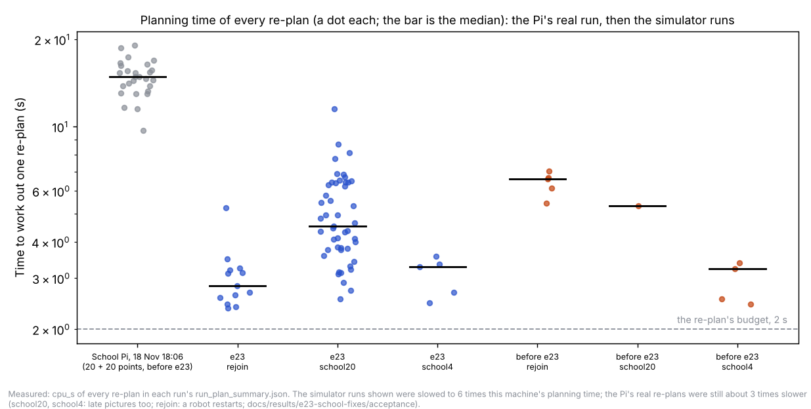

Each dot is the time one re-plan took; the simulator's slowed re-plans (2.5 to 11 s) are still about a third of the school Pi's on 18 Nov (10 to 19 s), so the stand-in is milder than the Pi on planning.

Mission Control in practice mode (school site, camera 1 only as in the repo's site file):

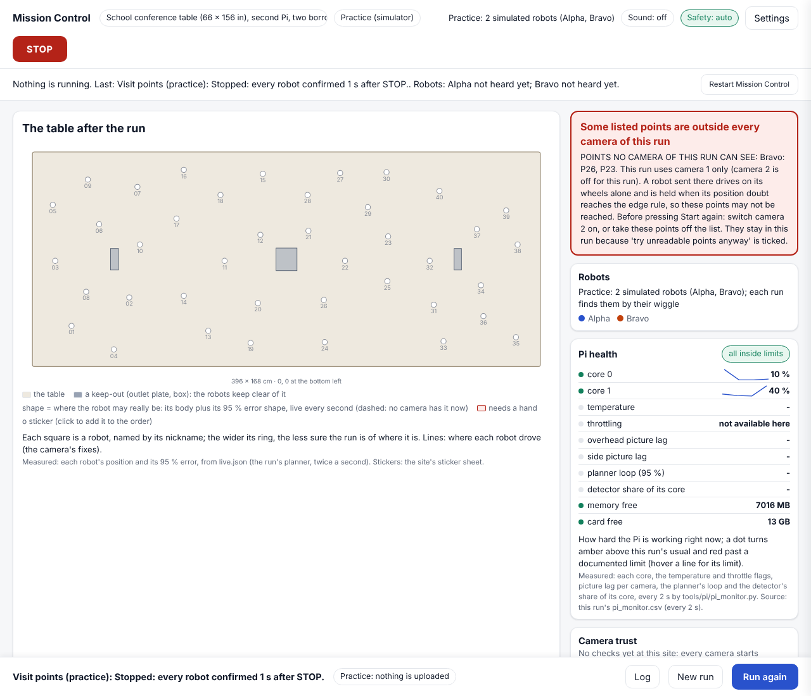

Stop pressed twice 7 s after Start, before the robots were named: 2.5 s later the page says every robot confirmed and nothing is running.

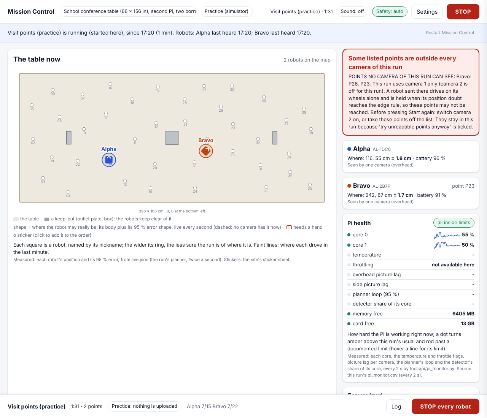

Start pressed again 3 s after that: the second run is going, and the red box names Bravo's two points that camera 1 cannot see.

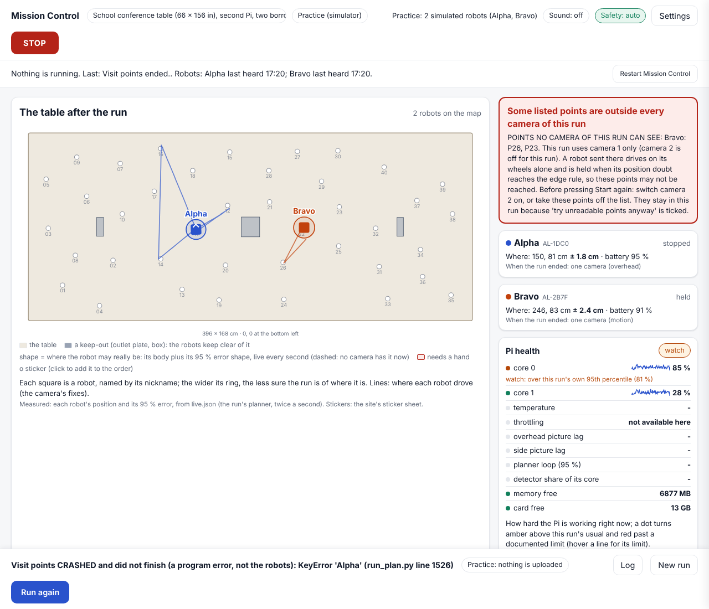

What the page says for a crash: this is the finished practice run with its summary rewritten to the words of the 18 Nov crash, not a real crash.

## Sweep 1: new tests that may now be needed

0. **First:** does the fix pass cause more turn-backs than e23 as built (section 3)? Only the first 60 s of a 4 + 4 run are needed: 20 runs each of e23 as built, the final code, and the final code with `MIRLT_OLD_FIX_JUMPS=count`, counting runs with a turn-back at the first stall of a moving robot. About 2 min a run, no robot.
1. Each acceptance case over 10 or more seeds, both codes, so reached points and run time become rates.
2. A real two-robot 20 + 20 run at school after the Pi update, at 10 cm/s (the school report's test 9).
3. Simulator: a recovery that begins as the robot arrives at a point; once a not-reached point is tried again, that it is reached.
4. A robot that ends its dwell while still unseen: the veer stage must apply again as it drives on (tested standing and moving, not the change-over).
5. Handed-over points whose re-plan can never be made: the run ends at its time limit and says which points were left.
6. Mission Control, in a browser test: the red warning box shows on `/` and `/table` (checked today by screenshot and by a text test only).
7. Stop before naming through Mission Control with simulated robots that answer under WiFi names.
8. The camera-open time limit on the real Pi with camera 2 plugged in (stubs only so far).
9. The stand-in at the Pi's real planning cost (about 3 times slower than today's).
10. The Pi bench with two cameras: fix gap and picture age per core layout (from the school report).

11. Old pictures carried by the drive alone, checked on a robot: the Pi estimates each correction from the pose rows (the robot does not report its size). A firmware line reporting each fix's correction would replace the estimate; until then, a real run's `old_fix_carried` rows (`corrections_removed`, `doubt_cm`) against the camera.
12. A start with one robot asleep, in the simulator (one simulated robot that never answers): the run starts after 3 min with the other and says so. Tested with a stub of the log port only.
13. Mission Control, in a browser test: the "Stop sent 3 times ... no robot answered" words on the page (tested on the watcher only).
14. The stop tolerance at a site other than school: the two seeds are the school's 131 stops; a home run's first reached stops should be compared with them.
15. The acceptance cases on the code before e23 over the same seeds (it was run once per case by the build and once by the audit).

## Sweep 2: possible inaccuracies

1. **Simulator stand-in** (stall 1.5 s every 20 s on both cameras together, planning 6 times slower): chosen from the 18 Nov summaries, not fitted to per-picture timing. A designed experiment is not the tool; measuring `bridge/detect_times.csv` is.
2. **One run per case, one seed.** Differences of a few points or a few per cent in time are within what another seed could give.
3. **"6 of 36 veers took a robot out of its dwell"** counts veers logged while a point's pause step had started and not ended; the robot may still have been settling in some.
4. **Planning cost seed (0.4 s + 0.36 s a point)** comes from two medians of one afternoon on a hot Pi. Each run refits its own; the first two or three re-plans of a run use the scaled seed.
5. **Points planned ahead (at least 2) and the whole-list rule** are chosen. A designed experiment should set them (question 4).
6. **The simulated robots** do not have AL-1DC0's 15 to 20 % short distance count or the real table's slip; the edge and plate distances above are the simulator's.
7. **The old-code runs** needed the two additions named in Appendix B; I believe they do not change its behaviour otherwise, and did not test that separately.
8. **"Truly reached"** uses the site file's typed point positions and a 5.5 cm ruler; a stop finished after 0.1 s counts the same as a 5 s one.
9. **Cause H** (section 4) is read from timing in the logs; nothing was measured on the Pi.
10. **The move-check result** takes the robot's own pose as the truth for 25 verdicts; spinning wheels would fool it.
11. **The update steps' stash boxes** assume the Pi's only local change is camera 2 in the school site file. That comes from the first sitting's draft; I did not find it stated in the run folders, so the steps say what to do if `git status` shows anything else.
12. **Seeds do not fix a run** (section 3). Every acceptance number here is a range over 4 or 5 runs on one machine; another machine's timing gives other runs.
13. **The 20 + 20 runs are ended by the runner at 19 min** of wall clock (3.6 times the planned time). "Not finished" means not finished by then.
14. **The stop tolerances' seeds** (5.5 and 12.6 cm) come from 131 stops of two robots on two afternoons at school, some of them the faulty stops this build is about (the robust rule keeps them out of the median). They are used at every site until a run has 5 reached stops of its own.
15. **`REACH_TOL_CAP` (1.5), `UNNAMED_TRIES` (3) and the 3 min wait for the rest of the robots** are chosen (Appendix A). The 3 tries rest on a packet-loss figure from the home WiFi (27 Oct), not the school's.
16. **A corrected step's drive is estimated** from the speed of the steps beside it; a robot that brakes or starts inside that step is misjudged by up to that step's length (about 1 cm at 10 cm/s), which is added to the fix's stated ±. A heading correction's turn of the earlier drive is not applied (under 1 cm for a few degrees over 15 cm).
17. **A pose reset (fpose) marks two pose rows** as corrected, because the row after the reset may have been made before the robot took it.
18. **The burst result** is computed with a one-dimensional copy of the firmware's fix step, not run on a robot or in the full simulator.
19. **"Truly reached" still uses e23's ruler** (the larger of 2.9 cm + the stop's ± and 5.5 cm, on the simulator's true positions), so the rows compare with Appendix D.
20. **The update steps were rehearsed** in a scratch clone standing at `f4acc77` with camera 2 switched on by hand, and once more with a made-up clashing change; the Pi's real state was not seen.
