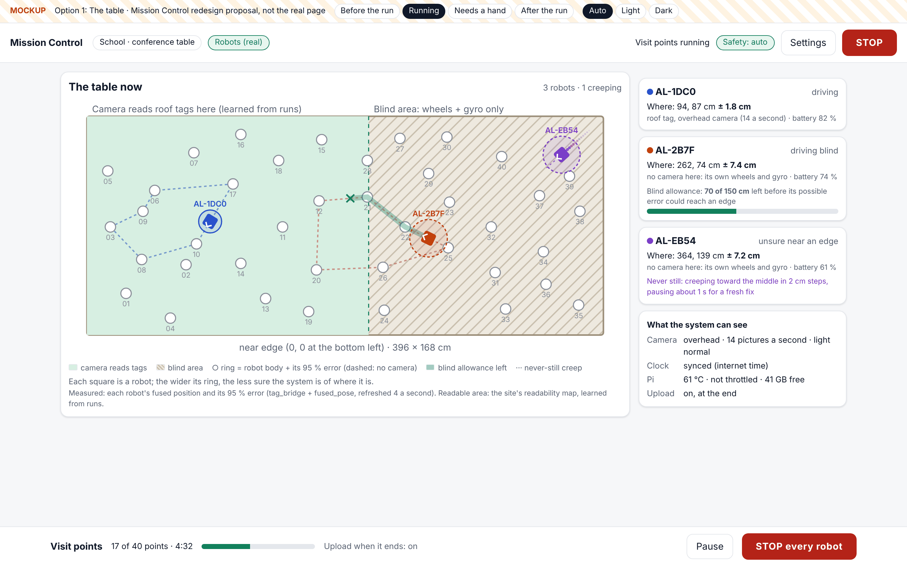
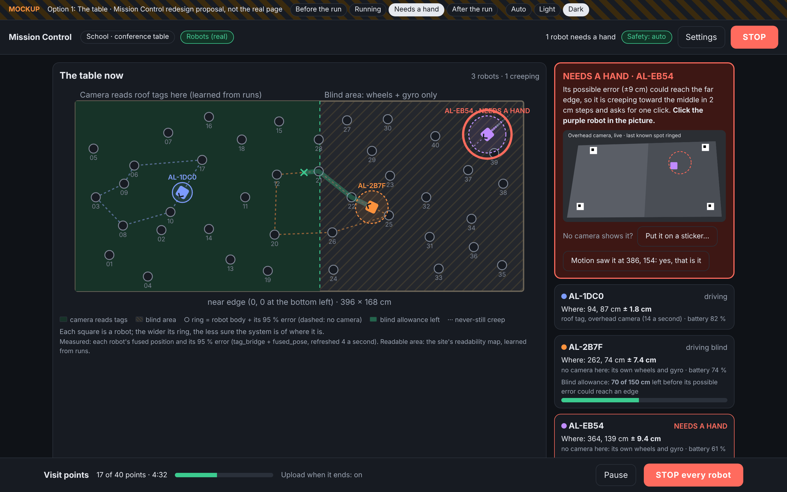
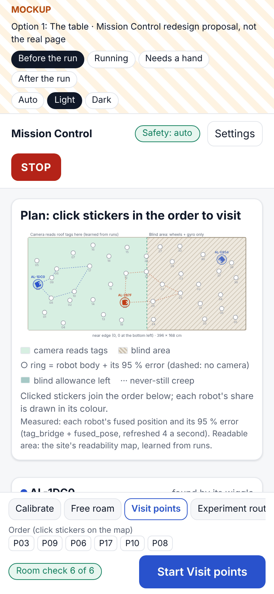
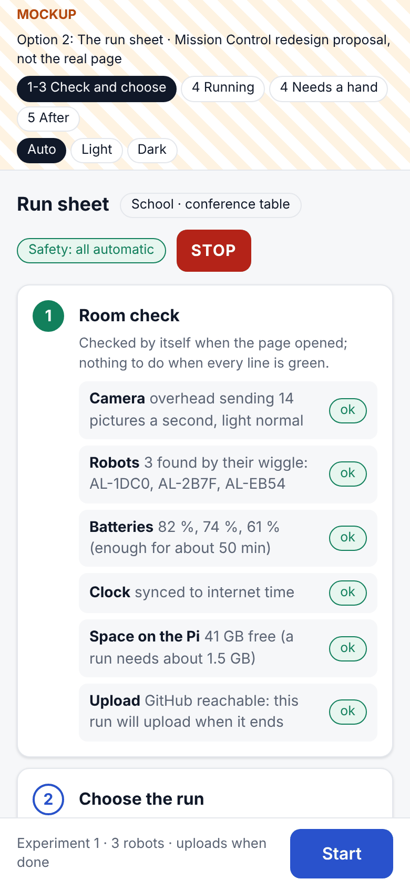
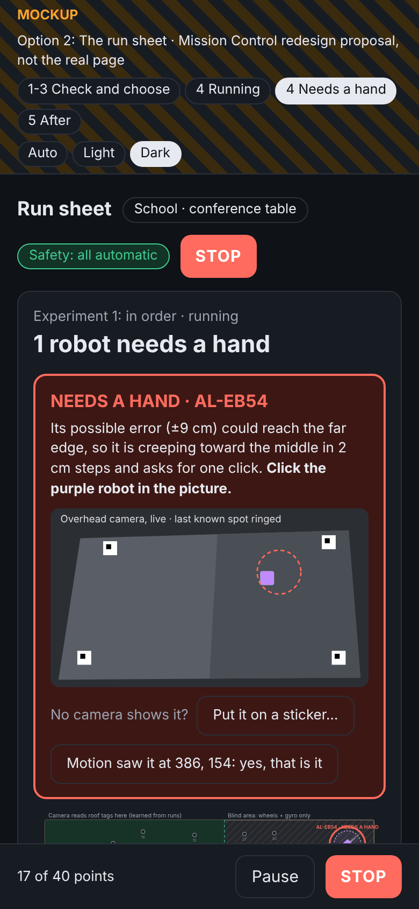
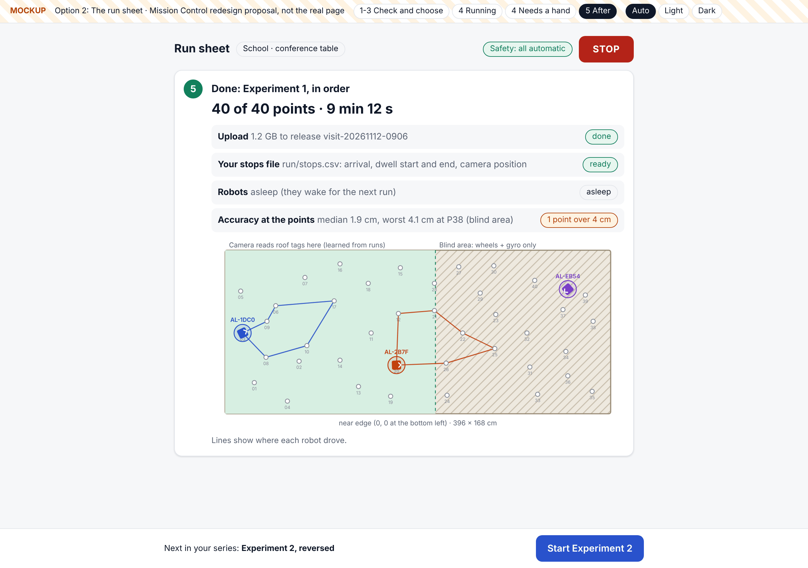
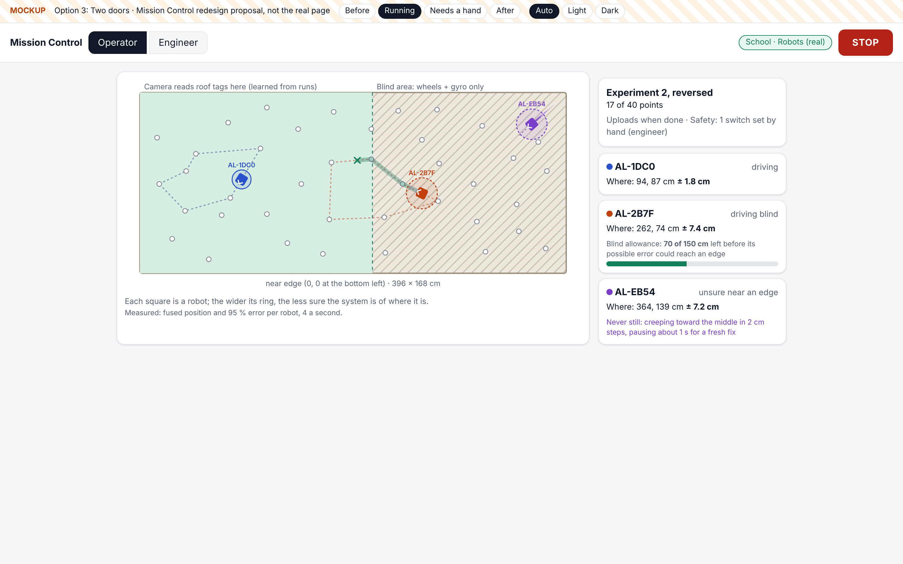
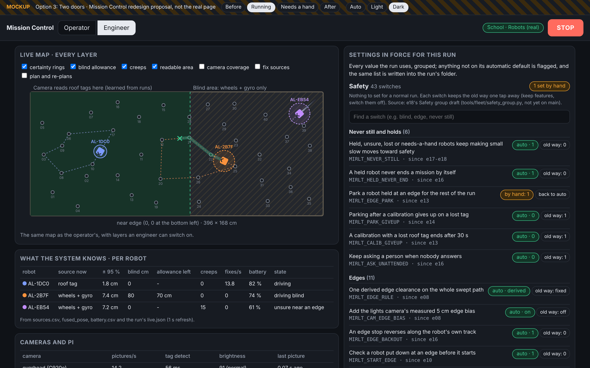
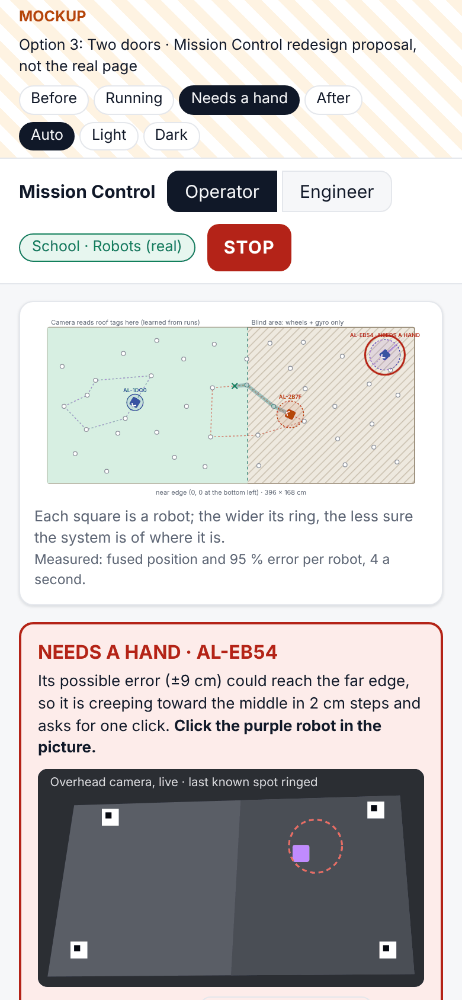

# Mission Control redesign: three directions (design proposal, 12 Nov 2026)

Design only. No product code was changed. The mockups are static pages you can click: `option-1.html`,
`option-2.html` and `option-3.html` in this folder. Open one in a browser, then use the striped bar at the top to
switch between states (before, running, needs a hand, after) and between light and dark.

## 1. Premise

Mission Control (`tools/fleet/mission_control.py` + `.html`, Start screen `start_job.py`, port 8095 on the Pi) has
three kinds of user:
- **Nick** at home: free roam on the 4 x 4 ft board, on a laptop.
- **Jay-Sun** at school: experiment routes and tours on the conference table.
- **Demo visitors and Dr. Sodhi**, who watch.

The page's jobs are:
- start runs (Calibrate, Free roam, Visit points, Experiment routes) and missions;
- set up the cameras and table (Cameras & table, Measure);
- settings and switches, now including e18's **Safety** group;
- a live view of the robots and the camera;
- **NEEDS A HAND** alerts and the click card;
- uploads, recordings and the review after a run.

e13 (10 Nov) audited the page and offered three directions (`docs/build-plans/mission-control-redesign.md`). Nick had
not chosen one yet. This proposal audits the page again on today's code and designs three new directions around
what has changed since: never still, blind-drive allowances and the Safety group.

Method:
- I ran today's page (origin/main 98294a2) in practice mode with `--sim-room school` and `--sim-room home` on a
  scratch folder. No robots, Pi or SSH were used.
- I walked every screen with Playwright at deviceScaleFactor 2, and ran one practice Visit points run from the
  Start screen.
- I read the build reports, the 7 Nov audit and the time tracker.

## 2. Findings: today's problems, with evidence

| # | Problem | Evidence |
|---|---|---|
| F1 | **STOP gave no feedback, and in practice the run carried on.** STOP replied "stopped the run". The page then said "running" for about 4 min, and the tour finished anyway: 10 points done when STOP was pressed, 20 at the end. The end screen says "ended", not "stopped", and the run's log shows no stop. `Run.stop` sends SIGINT to `mission_run`'s process only (`mission_control.py:123`). On real robots `stop_all.py` also broadcasts `stop`, so the robots themselves probably halt; this is not proven. | `mc-design-problem-stop-pressed-run-finished-anyway.png`. Caveat: the test machine was heavily loaded (load 10.8 on 2 cores). |
| F2 | **Runs started from the Start screen do not upload.** `upload` defaults to `False` (`RUN_DEFAULTS`, `mission_control.py:74`). The only place to change it is the 19th row of Details, 4 Run, More. Nothing on the Start screen says whether a run will upload or has uploaded. This matches the runs whose logs never arrived (6 Nov run 2: e08 report and 7 Nov audit). | `mc-design-problem-upload-off-buried-in-details-run-more.png` |
| F3 | **No live view where people look.** During a run the Start screen shows a timer, "Points done" and raw log lines such as "AL-2B7F follow: nothing from the laptop for 1503 ms; standing still". Robots, their certainty and their blind state are drawn only in Details, 4 Run, which is titled "production" even during a Visit run. The data is already served: `/api/state` → `run.live.robots` holds the pose, `plus_minus_cm`, source, `since_fix_cm`, held, battery and `edge_cm` for each robot. | `mc-design-problem-running-no-robots-on-start-screen.png`, `mc-design-problem-live-map-only-behind-details.png`, `mc-design-problem-phone-running-log-lines.png` |
| F4 | **e13's "backwards" order is still there.** The four run buttons come before "Visit points in your order". The overhead picture is still a broken image until a camera model exists. | `mc-design-problem-run-buttons-before-point-picking.png` |
| F5 | **A new site opens on a five-question quiz.** At 1366 x 900 no run control is visible above the fold. On a phone the Start page is 3,486 px tall. | `mc-design-problem-start-screen-opens-on-quiz.png` |
| F6 | **Too many settings, in too many places, and different at each site.** The Start screen has 55-60 inputs and two separate "Advanced" boxes. Details has 5 tabs at school and 7 at home. Its Run tab has 32 inputs, with 9 simulator-only fields at the same level as `upload`. e18 adds 43 Safety switches three levels down (Details, Run, More, Safety). CLAUDE.md asks for automatically decided switches to stay out of a new user's way; today they are out of everyone's way. | `mc-design-problem-home-start-tabs-differ-from-school.png`, Advanced box counts from the Playwright walk |
| F7 | **The new safety behaviour cannot be seen.** The page cannot tell a robot that is creeping (never still) from one that has stopped. It shows nothing of how far a robot may still drive blind. The NEEDS A HAND click card is a banner pushed above everything and is not tied to the robot's place on a map. | Practice run: "Alpha is held ... everyone holds while it is checked again" shown as text only |
| F8 | **Unclear words.** The same robot appears under two names in one line ("Bravo: AL-2B7F follow"). At school the preferences say "home: until the batteries..." and suggest names "(Left, Right)" while the robots are Alpha and Bravo. A full path (`/root/.config/...`) is shown to the user. | `mc-design-problem-run-buttons-before-point-picking.png` (lower half) |
| F9 | **People route around it.** On 6 Nov Nick asked to run "quickly, not through mission control", and the 6-7 Nov runs were all started over SSH. | `docs/audits/2026-11-07/D-chat.md:78` |

## 3. Three directions

All three use the same **live table map**:
- each robot is drawn in its own colour with a **certainty ring** (its body plus its 95 % error; the ring is
  dashed when no camera sees it);
- the **readable area** (where the camera reads roof tags, learned from runs) is shaded, and the blind area is
  hatched;
- a robot driving blind shows its **blind-drive allowance**: a green stretch of path ahead, ending in a cross, plus a
  meter in its card;
- a robot that is held or unsure shows its **never-still creep**: a dotted trail toward its best guess of safety;
- **NEEDS A HAND** puts a pulsing red ring on the map and opens the click card (one click places the robot, a second
  click gives its heading);
- the **Safety group** (e18) is one summary line, "43 switches · all decided automatically", that opens into
  plain-words rows. Each row shows the automatic value and keeps the old way one tap away.

The Safety switches are taken from e18's draft (`docs/how-to/safety-group.md` in e18's working copy). e18 is not on
origin/main yet.

### Option 1: The table (map-first cockpit), `option-1.html`

The live table is the page. Before a run you click stickers on the map to build the order, so the order comes before
Start (this fixes F4). While the run goes, the same map shows the robots and a fixed run bar shows progress, "Upload
when it ends: on", Pause and STOP. After the run the map shows where each robot drove and the bar shows the upload,
Jay-Sun's `stops.csv`, and "Run again". A "What the system can see" box covers camera rate, clock, Pi and upload.
Settings is a drawer: this run (a few lines), Safety (one line) and "Open the engineer view" (today's Details,
kept).

Three robots on the school table: one seen by the camera, one driving blind with 70 of 150 cm of allowance left, and
one creeping away from the far edge.

The robot that needs a hand is ringed in red on the map, and the click card beside the map asks for one click on the
camera picture.

On a phone the order is built by tapping stickers. The 4:1 school table is small at this width.

- **Serves best:** Nick, both sites, and demos (visitors understand a map at once).
- **Pros:**
  - one page for every user;
  - fixes F3, F4, F5 and F7 directly;
  - F2 becomes visible in the run bar;
  - reuses the Details Run map drawing and `run.live`, which already exist.
- **Cons:**
  - on a phone the 396 x 168 cm table is small; it needs a portrait (rotated) map or zoom, which the mockup does not
    do;
  - the setup steps (corners, Measure) still live in the engineer view.
- **Effort:** about 3-4 days.

### Option 2: The run sheet (guided, phone first), `option-2.html`

The page is a checklist built for Jay-Sun's experiment days:
1. **Room check.** Camera rate and light, robots found by their wiggle, batteries, clock, space on the Pi, and
   whether an upload can reach GitHub. Each line is checked by itself and shown green, amber or red, with a fix
   where one exists.
2. **Choose the run** from recipe cards. The next experiment in the series comes first.
3. **Before it moves.** Confirm clear space and that someone is in the room.
4. **Running.** One big sentence ("14 of 40 points · about 6 min left"), then "Your job now: nothing" or the
   NEEDS A HAND card, a small map and the robot cards. The log is folded away.
5. **After.** Upload done, the stops file ready, robots asleep, accuracy at the points, and "Start Experiment 2".

The room check on a phone: six automatic checks, all green, and one Start button.

While a run goes, the sheet says what the person has to do. Here it is one click on the camera picture.

After the run: the upload, Jay-Sun's stops file, the robots' state and the accuracy at the points, with the next
experiment one tap away.

- **Serves best:** Jay-Sun, and any first-time operator.
- **Pros:**
  - the clearest flow;
  - upload and room problems are found before Start, not after;
  - works well on a phone;
  - the steps already exist as code (camera self-check, wiggle binding, battery, `diskguard`, `next_experiment`).
- **Cons:**
  - slower for Nick's quick free roams (though "Run again" helps);
  - the map is secondary, so it is weaker for demos;
  - free-form missions and production orders do not fit the recipes and stay in the engineer view.
- **Effort:** about 2-3 days.

### Option 3: Two doors (operator and engineer), `option-3.html`

A switch in the top bar opens one of two pages:
- **Operator:** a big Start ("Start: Experiment 2, reversed"), the map, robot cards and alerts. Nothing else.
- **Engineer:** a console. It has the map with every layer as a tick-box (certainty, allowance, creeps, readable
  area, camera coverage, fix sources, re-plans) and a "What the system knows" table per robot: source, ±, blind cm,
  allowance, creeps, fixes a second, battery, state. It also shows camera and Pi health, and "Settings in force for
  this run": every group, Safety first, searchable. Anything set by hand is flagged, and the same list is written
  into the run's folder.

The operator page during a run: the map and three robot cards, nothing else.

The engineer page: the map with layers, the per-robot table, and the Safety group with one switch flagged as set by
hand.

The operator page on a phone, with the NEEDS A HAND card.

- **Serves best:** Nick as the engineer and Jay-Sun as the operator, at the same time.
- **Pros:**
  - settings finally have one honest home (fixes F6), and the settings in force for each run become a record;
  - the operator page is the simplest of the three.
- **Cons:**
  - two pages to keep in step;
  - the operator page is too thin for Nick on his own;
  - the biggest rebuild of the three.
- **Effort:** about 4-6 days.

The effort figures are my guesses. The repo's time tracker shows a median of 0.75 actual/estimate over 35 tasks, so
estimates have tended to run a little high.

## 4. Recommendation (mine, not yet Nick's)

**Option 1 as the one page, borrowing from the other two:**
- Option 2's room check becomes its "before" state, and Option 2's after-run card becomes its "after" state.
- Option 3's settings inspector becomes the engineer view behind Settings.
- Today's Details tabs stay behind a switch until that engineer view covers them (keep features, switch them off).

Reasons:
- The map is the one thing all three kinds of user need, and the data for it is already served (F3).
- A checklist alone would slow Nick down and weaken demos.
- Two separate pages would double the upkeep.

Three fixes do not depend on the direction and are small. They could go first:
1. Turn upload on by default for robot runs from the Start screen, and show "will upload / uploaded" (F2).
2. Give STOP a "stopping..." state, and test that a practice STOP ends the run (F1).
3. Draw `run.live`'s robots on the Start screen (F3).

## 5. Questions for Nick

**Substantive**
1. Which of F1-F9 bothers you most today? That decides what gets built first.
2. Who is the first build for: Jay-Sun at the school table, or you at home? And which device: phone or laptop?
3. Should every real run from Mission Control upload by default? I did not measure how big a run's upload is, or
   how fast the school WiFi is.
4. Should Mission Control become the way to start home free roam, in place of `run-fleet-pi.sh` over SSH (F9)?
5. Option 1, 2, 3, or my mix?

**Other**
6. On the page, should robots be called by their WiFi names (AL-2B7F) or by nicknames?
7. Should a sound play when NEEDS A HAND appears?
8. Once the engineer view covers the Details tabs, may the tabs go behind a switch?

## 6. What's next

Once Nick chooses, a build plan follows in `docs/build-plans/`. The three small fixes above can be built and tested
on the simulator while he decides, if he agrees.

## Sweep 1: new tests that may now be needed

- Practice STOP: the run ends within a derived time and the page shows "stopping..." and then "stopped" (F1). Run it
  on a quiet machine to rule out load.
- Real-robot STOP: `stop_all.py` reaches every robot when Mission Control's run ignores SIGINT. Robots on the table,
  with Nick.
- A run started from the Start screen with upload on: the release exists, and the page shows its state.
- The live map on the Start screen: refresh cost on the Pi over a 10-minute run (e16 measured Mission Control at
  1-3 % CPU before adding the map).
- The Safety summary matches `safety_group.py show` (all automatic, or which switches are set by hand).
- A Playwright walk of the chosen design: phone and laptop, light and dark, both sites, and a run with a needs-a-hand
  robot.

## Sweep 2: possible inaccuracies in what this relied on

- **Illustrative mockup numbers.** Robot positions, routes, the 150 cm allowance, ±7-9 cm doubts, battery levels and
  the 1.2 GB upload are made up. The ring (half-diagonal 7 cm + 95 % error) and the blind growth (0.07 cm per cm,
  from e13's measurement) are simplifications. The real allowance is whatever e18 derives, so no number needs a DOE
  on the design side.
- **Readable area.** It is drawn as a straight line at x = 216 cm, taken from Jay-Sun's camera guide. The real
  readability map is learned and irregular.
- **e18 Safety group.** 43 switches, read from e18's working copy. It may change before it lands on main.
- **STOP finding (F1).** One practice run, in practice mode only, on a machine at load 10.8 on 2 cores. The real-robot
  path adds a `stop` broadcast that this test did not exercise.
- **Audit coverage.** The audit used the school site plus home's screens. Only one run kind (Visit points) was run
  end to end, and calibration and free roam were not.
- **Side effect.** The practice runs wrote preference files under this container's `~/.config/mirlt/` (`prefs/home.json`
  and the school site's prefs, from "Skip the quiz"). That directory is shared with other agents' practice runs.
- **Effort figures** are guesses (see the tracker ratio above).
