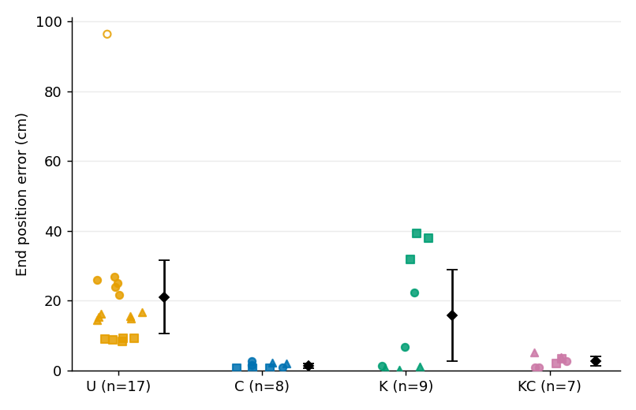
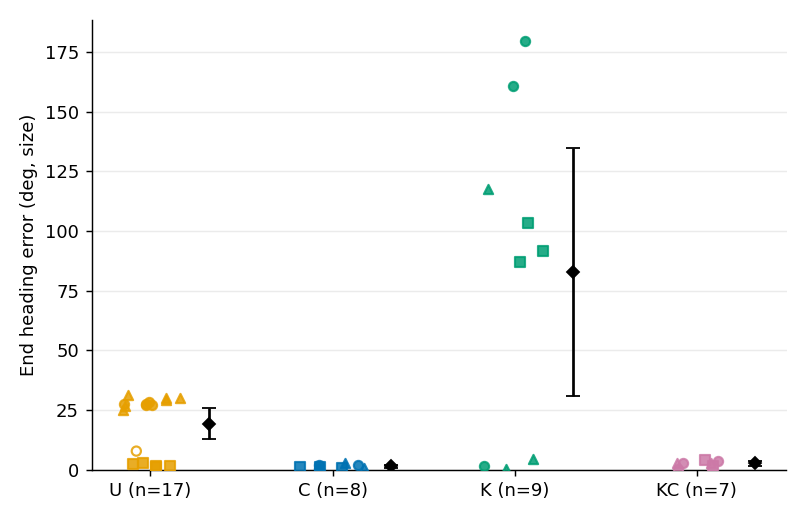
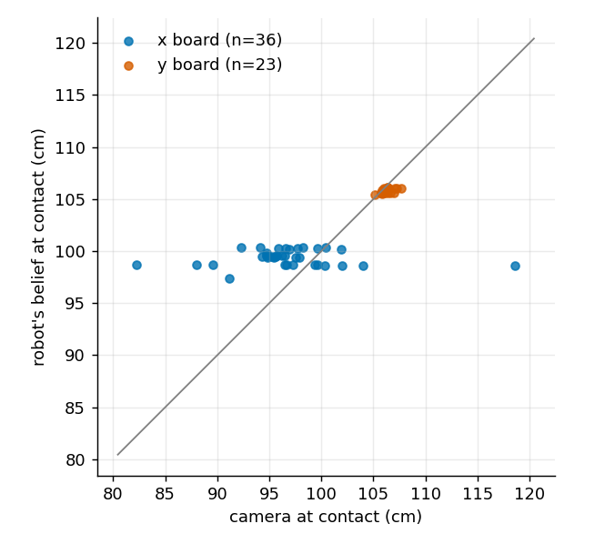

# E02: how far the Alviks end from where they meant to be

## Premise

Each run: the robot finds its position against the two boards, drives one of three fixed routes with a 1 s pause at the far point and returns to its start. The overhead camera measures where it started, paused and stopped; the error is the distance (cm) and heading difference (deg) between what the camera saw and what was intended. Four conditions: U uncalibrated, C calibrated on-board sensors (corrections learned during the session from U runs, so the first block is U-heavy), K camera steering only, KC camera plus calibrated sensors. Question: do the conditions differ, and by how much.

## Data

45 runs (U 18, C 9, K 9, KC 9). 4 needed recovery afterwards (safety_stop 4): the runner drove them back by camera; they stay in every statistic. 1 are statistical outliers on end position error (beyond 1.5 x IQR within the same condition and route); every table gives the mean with and without them. Runs with a missing measurement are in runs.csv with a note and left out of the statistic they lack. The routes differ in length and turns, so each route is reported on its own (pooled numbers: summary.csv, scope all).

41 of 45 runs have a camera-measured end error; the other 4 (failed before or during the route, or not found in the video) are listed in runs.csv with the reason in the flags column.

1.5 x IQR (Tukey's fences): the IQR is the spread of the middle half of the runs (75th minus 25th percentile); a run more than 1.5 IQR below the 25th or above the 75th percentile of its condition and route is called an outlier. Fewer than 4 runs in a group: none are called.

**End position error (cm), all routes pooled (the permutation test shuffles only within robot and route)**

| Condition | n | mean | 95% CI of mean | SD | 95% CI of SD | median | mean without outliers (n) |
|---|---|---|---|---|---|---|---|
| U | 17 | 21.01 | 10.51 to 31.51 | 20.42 | 5.09 to 32.60 | 15.53 | 16.31 (16) |
| C | 8 | 1.37 | 0.71 to 2.03 | 0.79 | 0.43 to 0.95 | 1.19 | 1.37 (8) |
| K | 9 | 15.69 | 2.60 to 28.79 | 17.04 | 10.19 to 19.24 | 6.83 | 15.69 (9) |
| KC | 7 | 2.65 | 1.22 to 4.07 | 1.54 | 0.75 to 1.95 | 2.71 | 2.65 (7) |

95% CI of the mean: the range that would contain the true mean in 95 of 100 repeats of this experiment, from the t distribution (mean +/- t x SD / sqrt(n)). The CI of the SD is a bootstrap: the runs are re-drawn with replacement 4000 times, the SD taken each time, and the middle 95% kept; with few runs it is wide and slightly low-biased.

**End position error (cm), route L**

| Condition | n | mean | 95% CI of mean | SD | 95% CI of SD | median | mean without outliers (n) |
|---|---|---|---|---|---|---|---|
| U | 5 | 8.93 | 8.52 to 9.35 | 0.33 | 0.15 to 0.44 | 8.90 | 8.93 (5) |
| C | 3 | 0.64 | 0.44 to 0.84 | 0.08 | - to - | 0.68 | 0.64 (3) |
| K | 3 | 36.34 | 26.65 to 46.03 | 3.90 | - to - | 37.84 | 36.34 (3) |
| KC | 2 | 2.64 | -5.50 to 10.79 | 0.91 | - to - | 2.64 | 2.64 (2) |

**End position error (cm), route square**

| Condition | n | mean | 95% CI of mean | SD | 95% CI of SD | median | mean without outliers (n) |
|---|---|---|---|---|---|---|---|
| U | 6 | 15.47 | 14.59 to 16.34 | 0.83 | 0.38 to 1.04 | 15.43 | 15.47 (6) |
| C | 2 | 2.02 | 0.61 to 3.42 | 0.16 | - to - | 2.02 | 2.02 (2) |
| K | 3 | 0.62 | -0.67 to 1.90 | 0.52 | - to - | 0.59 | 0.62 (3) |
| KC | 2 | 4.40 | -3.93 to 12.73 | 0.93 | - to - | 4.40 | 4.40 (2) |

**End position error (cm), route straight**

| Condition | n | mean | 95% CI of mean | SD | 95% CI of SD | median | mean without outliers (n) |
|---|---|---|---|---|---|---|---|
| U | 6 | 36.62 | 5.88 to 67.37 | 29.30 | 0.86 to 39.23 | 25.49 | 24.69 (5) |
| C | 3 | 1.67 | -0.58 to 3.92 | 0.91 | - to - | 1.56 | 1.67 (3) |
| K | 3 | 10.12 | -16.93 to 37.17 | 10.89 | - to - | 6.83 | 10.12 (3) |
| KC | 3 | 1.48 | -1.16 to 4.12 | 1.06 | - to - | 0.94 | 1.48 (3) |

**End heading error (deg, size), all routes pooled (the permutation test shuffles only within robot and route)**

| Condition | n | mean | 95% CI of mean | SD | 95% CI of SD | median | mean without outliers (n) |
|---|---|---|---|---|---|---|---|
| U | 17 | 19.28 | 12.80 to 25.76 | 12.60 | 8.94 to 13.70 | 27.08 | 19.99 (16) |
| C | 8 | 1.41 | 0.63 to 2.19 | 0.93 | 0.45 to 1.19 | 1.15 | 1.41 (8) |
| K | 9 | 82.86 | 30.77 to 134.95 | 67.77 | 39.10 to 81.35 | 91.70 | 82.86 (9) |
| KC | 7 | 2.67 | 1.48 to 3.85 | 1.28 | 0.54 to 1.68 | 2.83 | 2.67 (7) |

**End heading error (deg, size), route L**

| Condition | n | mean | 95% CI of mean | SD | 95% CI of SD | median | mean without outliers (n) |
|---|---|---|---|---|---|---|---|
| U | 5 | 1.96 | 1.20 to 2.72 | 0.61 | 0.20 to 0.75 | 1.73 | 1.96 (5) |
| C | 3 | 0.96 | 0.14 to 1.79 | 0.33 | - to - | 1.12 | 0.96 (3) |
| K | 3 | 93.93 | 73.22 to 114.64 | 8.34 | - to - | 91.70 | 93.93 (3) |
| KC | 2 | 2.90 | -14.40 to 20.21 | 1.93 | - to - | 2.90 | 2.90 (2) |

**End heading error (deg, size), route square**

| Condition | n | mean | 95% CI of mean | SD | 95% CI of SD | median | mean without outliers (n) |
|---|---|---|---|---|---|---|---|
| U | 6 | 28.70 | 26.10 to 31.30 | 2.48 | 0.77 to 3.11 | 29.57 | 28.70 (6) |
| C | 2 | 1.99 | -10.96 to 14.94 | 1.44 | - to - | 1.99 | 1.99 (2) |
| K | 3 | 40.65 | -124.51 to 205.82 | 66.49 | - to - | 4.40 | 40.65 (3) |
| KC | 2 | 2.82 | 1.96 to 3.69 | 0.10 | - to - | 2.82 | 2.82 (2) |

**End heading error (deg, size), route straight**

| Condition | n | mean | 95% CI of mean | SD | 95% CI of SD | median | mean without outliers (n) |
|---|---|---|---|---|---|---|---|
| U | 6 | 24.29 | 15.83 to 32.75 | 8.06 | 0.21 to 10.79 | 27.45 | 27.58 (5) |
| C | 3 | 1.47 | -1.28 to 4.22 | 1.11 | - to - | 2.02 | 1.47 (3) |
| K | 3 | 113.99 | -129.02 to 356.99 | 97.82 | - to - | 160.82 | 113.99 (3) |
| KC | 3 | 2.40 | -1.82 to 6.63 | 1.70 | - to - | 2.83 | 2.40 (3) |

*Each dot is one run's end position error (shapes mark the route, hollow dots are statistical outliers); the diamond and bar are the condition's mean with its 95% confidence range.*

*Each dot is one run's heading difference between its end and its start, ignoring left or right; the diamond and bar are the mean with its 95% confidence range.*

### Are the differences real

**End position error (cm), all routes**

| A vs B | mean A - B (95% CI) | permutation p (Holm) | Welch p (Holm) | Mann-Whitney p (Holm) | Cohen's d | spread differs, p |
|---|---|---|---|---|---|---|
| U vs C | 19.64 (9.13 to 30.15) | <0.001 (0.001) | 0.001 (0.007) | <0.001 (<0.001) | 1.15 | 0.196 |
| U vs K | 5.32 (-10.44 to 21.08) | 0.627 (0.627) | 0.489 (0.489) | 0.388 (0.777) | 0.27 | 0.511 |
| U vs KC | 18.37 (7.82 to 28.92) | <0.001 (0.001) | 0.002 (0.010) | <0.001 (<0.001) | 1.05 | 0.253 |
| C vs K | -14.32 (-27.42 to -1.22) | 0.060 (0.239) | 0.036 (0.143) | 0.236 (0.708) | -1.15 | 0.007 |
| C vs KC | -1.28 (-2.74 to 0.19) | 0.168 (0.492) | 0.080 (0.161) | 0.054 (0.216) | -1.07 | 0.143 |
| K vs KC | 13.05 (-0.07 to 26.17) | 0.164 (0.492) | 0.051 (0.153) | 0.470 (0.777) | 1.01 | 0.014 |

Permutation p (the primary test): the condition labels are shuffled 4000 times, but only among runs of the same robot on the same route, and the difference in means is taken each time; p is the share of shuffles with a difference at least as large as the real one. It respects that the same robots and routes recur. Welch's t-test: (secondary) the difference in means divided by its standard error, without assuming equal spreads; it treats every run as independent. Mann-Whitney U (secondary): ranks all runs together and asks whether one condition's runs sit higher; it does not need a bell curve. Holm: each p corrected for the six condition pairs compared within one table (one measure, one route); tables are not corrected against each other. Cohen's d: the mean difference in units of the pooled SD (0.2 small, 0.5 medium, 0.8 large). Brown-Forsythe (Levene on distances from the median): tests whether the spreads differ; p is the chance of spreads this different if they were equal.

**End position error (cm), route L**

| A vs B | mean A - B (95% CI) | permutation p (Holm) | Welch p (Holm) | Mann-Whitney p (Holm) | Cohen's d | spread differs, p |
|---|---|---|---|---|---|---|
| U vs C | 8.29 (7.88 to 8.70) | 0.054 (0.325) | <0.001 (<0.001) | 0.036 (0.214) | 29.95 | 0.197 |
| U vs K | -27.41 (-37.04 to -17.78) | 0.054 (0.325) | 0.006 (0.019) | 0.036 (0.214) | -12.08 | 0.141 |
| U vs KC | 6.29 (-0.34 to 12.92) | 0.117 (0.467) | 0.053 (0.106) | 0.095 (0.381) | 12.48 | 0.049 |
| C vs K | -35.70 (-45.39 to -26.02) | 0.248 (0.744) | 0.004 (0.016) | 0.100 (0.381) | -12.94 | 0.249 |
| C vs KC | -2.00 (-9.97 to 5.96) | 0.491 (0.982) | 0.195 (0.195) | 0.200 (0.400) | -3.80 | 0.001 |
| K vs KC | 33.70 (24.80 to 42.59) | 0.491 (0.982) | 0.003 (0.013) | 0.200 (0.400) | 10.44 | 0.489 |

**End position error (cm), route square**

| A vs B | mean A - B (95% CI) | permutation p (Holm) | Welch p (Holm) | Mann-Whitney p (Holm) | Cohen's d | spread differs, p |
|---|---|---|---|---|---|---|
| U vs C | 13.45 (12.57 to 14.33) | 0.117 (0.584) | <0.001 (<0.001) | 0.071 (0.357) | 17.61 | 0.169 |
| U vs K | 14.85 (13.75 to 15.95) | 0.037 (0.225) | <0.001 (<0.001) | 0.024 (0.143) | 19.61 | 0.351 |
| U vs KC | 11.07 (6.96 to 15.18) | 0.117 (0.584) | 0.011 (0.042) | 0.071 (0.357) | 13.02 | 0.963 |
| C vs K | 1.40 (0.25 to 2.54) | 0.491 (1.000) | 0.032 (0.096) | 0.200 (0.600) | 3.23 | 0.372 |
| C vs KC | -2.38 (-9.83 to 5.07) | 1.000 (1.000) | 0.163 (0.163) | 0.333 (0.600) | -3.58 | <0.001 |
| K vs KC | -3.78 (-8.43 to 0.87) | 0.491 (1.000) | 0.067 (0.133) | 0.200 (0.600) | -5.54 | 0.261 |

**End position error (cm), route straight**

| A vs B | mean A - B (95% CI) | permutation p (Holm) | Welch p (Holm) | Mann-Whitney p (Holm) | Cohen's d | spread differs, p |
|---|---|---|---|---|---|---|
| U vs C | 34.95 (4.21 to 65.70) | 0.108 (0.646) | 0.033 (0.194) | 0.024 (0.143) | 1.41 | 0.486 |
| U vs K | 26.51 (-5.60 to 58.61) | 0.255 (0.992) | 0.092 (0.366) | 0.048 (0.190) | 1.04 | 0.735 |
| U vs KC | 35.15 (4.40 to 65.89) | 0.108 (0.646) | 0.032 (0.194) | 0.024 (0.143) | 1.42 | 0.487 |
| C vs K | -8.45 (-35.24 to 18.35) | 0.248 (0.992) | 0.311 (0.908) | 0.400 (0.800) | -1.09 | 0.230 |
| C vs KC | 0.19 (-2.07 to 2.45) | 1.000 (1.000) | 0.825 (0.908) | 1.000 (1.000) | 0.19 | 0.958 |
| K vs KC | 8.64 (-18.06 to 35.34) | 0.248 (0.992) | 0.303 (0.908) | 0.200 (0.600) | 1.12 | 0.234 |

**End heading error (deg, size), all routes**

| A vs B | mean A - B (95% CI) | permutation p (Holm) | Welch p (Holm) | Mann-Whitney p (Holm) | Cohen's d | spread differs, p |
|---|---|---|---|---|---|---|
| U vs C | 17.87 (11.37 to 24.37) | <0.001 (0.001) | <0.001 (<0.001) | <0.001 (0.002) | 1.70 | 0.038 |
| U vs K | -63.58 (-115.82 to -11.34) | 0.002 (0.011) | 0.023 (0.046) | 0.095 (0.188) | -1.57 | <0.001 |
| U vs KC | 16.61 (10.08 to 23.15) | 0.002 (0.011) | <0.001 (<0.001) | 0.034 (0.135) | 1.54 | 0.057 |
| C vs K | -81.45 (-133.54 to -29.36) | 0.015 (0.046) | 0.007 (0.028) | 0.015 (0.076) | -1.65 | 0.003 |
| C vs KC | -1.26 (-2.55 to 0.03) | 0.291 (0.291) | 0.055 (0.055) | 0.094 (0.188) | -1.14 | 0.631 |
| K vs KC | 80.19 (28.10 to 132.28) | 0.061 (0.122) | 0.008 (0.028) | 0.042 (0.135) | 1.57 | 0.005 |

**End heading error (deg, size), route L**

| A vs B | mean A - B (95% CI) | permutation p (Holm) | Welch p (Holm) | Mann-Whitney p (Holm) | Cohen's d | spread differs, p |
|---|---|---|---|---|---|---|
| U vs C | 1.00 (0.18 to 1.82) | 0.054 (0.325) | 0.024 (0.072) | 0.036 (0.214) | 1.87 | 0.393 |
| U vs K | -91.97 (-112.59 to -71.35) | 0.054 (0.325) | 0.003 (0.013) | 0.036 (0.214) | -19.00 | 0.089 |
| U vs KC | -0.94 (-15.73 to 13.85) | 0.336 (1.000) | 0.615 (0.772) | 0.857 (0.857) | -0.92 | 0.035 |
| C vs K | -92.97 (-113.64 to -72.30) | 0.248 (0.992) | 0.003 (0.013) | 0.100 (0.400) | -15.76 | 0.192 |
| C vs KC | -1.94 (-17.91 to 14.03) | 0.491 (1.000) | 0.386 (0.772) | 0.200 (0.600) | -1.70 | 0.014 |
| K vs KC | 91.03 (72.01 to 110.05) | 0.491 (1.000) | 0.002 (0.009) | 0.200 (0.600) | 13.20 | 0.415 |

**End heading error (deg, size), route square**

| A vs B | mean A - B (95% CI) | permutation p (Holm) | Welch p (Holm) | Mann-Whitney p (Holm) | Cohen's d | spread differs, p |
|---|---|---|---|---|---|---|
| U vs C | 26.71 (22.37 to 31.05) | 0.117 (0.700) | <0.001 (<0.001) | 0.071 (0.429) | 11.43 | 0.558 |
| U vs K | -11.95 (-176.96 to 153.05) | 0.708 (1.000) | 0.785 (1.000) | 0.548 (1.000) | -0.34 | 0.168 |
| U vs KC | 25.88 (23.28 to 28.48) | 0.117 (0.700) | <0.001 (<0.001) | 0.071 (0.429) | 11.44 | 0.225 |
| C vs K | -38.66 (-203.66 to 126.34) | 0.491 (1.000) | 0.420 (1.000) | 0.800 (1.000) | -0.71 | 0.484 |
| C vs KC | -0.83 (-13.54 to 11.88) | 1.000 (1.000) | 0.563 (1.000) | 1.000 (1.000) | -0.82 | <0.001 |
| K vs KC | 37.83 (-127.33 to 202.99) | 1.000 (1.000) | 0.428 (1.000) | 0.800 (1.000) | 0.70 | 0.474 |

**End heading error (deg, size), route straight**

| A vs B | mean A - B (95% CI) | permutation p (Holm) | Welch p (Holm) | Mann-Whitney p (Holm) | Cohen's d | spread differs, p |
|---|---|---|---|---|---|---|
| U vs C | 22.82 (14.38 to 31.27) | 0.037 (0.225) | <0.001 (0.005) | 0.024 (0.143) | 3.34 | 0.561 |
| U vs K | -89.70 (-331.55 to 152.16) | 0.111 (0.446) | 0.253 (0.738) | 0.548 (1.000) | -1.70 | 0.137 |
| U vs KC | 21.89 (13.42 to 30.35) | 0.037 (0.225) | <0.001 (0.005) | 0.024 (0.143) | 3.18 | 0.622 |
| C vs K | -112.52 (-355.48 to 130.45) | 0.509 (1.000) | 0.185 (0.738) | 0.400 (1.000) | -1.63 | 0.308 |
| C vs KC | -0.94 (-4.41 to 2.54) | 0.739 (1.000) | 0.476 (0.738) | 0.400 (1.000) | -0.65 | 0.644 |
| K vs KC | 111.58 (-131.32 to 354.49) | 0.509 (1.000) | 0.187 (0.738) | 0.400 (1.000) | 1.61 | 0.311 |

Per robot (end position error, mean cm, all routes; secondary):

| Robot | U | C | K | KC |
|---|---|---|---|---|
| Center | 17.21 (6) | 1.38 (3) | 20.90 (3) | 1.40 (2) |
| Left | 16.86 (5) | 1.16 (3) | 11.25 (3) | 2.34 (2) |
| Right | 28.27 (6) | 1.66 (2) | 14.93 (3) | 3.68 (3) |

*Each dot is one bump: where the camera saw the robot at contact against where the robot believed it was; dots on the grey line are exact.*

Bumps with a contact frame: 59 of 82. Believed-vs-camera position error mean 5.97 cm (SD 4.09, median 4.85); detection delay reported by the robot median 19 ms.

### Setup and recovery

Front sensor against the map (78 of 1047 readings: heading measured by the camera, map distance within 50 cm): the sensor reads 1.1 cm less than the map (median), spread 6.4 cm, 60% within 8 cm. Per reading: front_sensor.csv.

Spread: the median distance of the readings from their median, x 1.4826 (MAD x 1.4826), which equals the SD for bell-shaped data but is not pulled by a few wild readings.

Suggested for e02.py: **FRONT_OFFSET_CM = -1.1**, **FRONT_TOL_CM = 19.3** (offset = the median; tolerance = 3 x spread, at least 3 cm: the rule --front-learn uses).

Recovery per robot (auto-retries and help calls from e02_state.json; recovery.csv):

| Robot | auto-retries (episodes) | help calls avoided | sweeps for it | rescue finds | drive-outs | help calls |
|---|---|---|---|---|---|---|
| Left | 3 (1) | 1 | 0 | 0 | 0 | 0 |
| Right | 4 (4) | 4 | 0 | 0 | 0 | 0 |
| Center | 1 (1) | 1 | 0 | 0 | 0 | 0 |
| all | 8 (6) | 6 | 0 | 0 | 0 | 0 |

A help call is avoided when a robot's retries end with no help call for it within 2 minutes.

### Finds (the board-push finds, beyond the fix they give)

| Robot | finds ok / failed | own pose off at the boards: median (worst), cm | heading off, deg | drift since its last fix, cm/min | gyro scale between the boards (turn_k) | gyro drift standing still, deg/s |
|---|---|---|---|---|---|---|
| Left | 16 / 2 | 6.0 (12.8) | 2.6 | 10.78 | 1.008 ± 0.005 (n=16) | 0.0000 (n=1) |
| Right | 17 / 2 | 8.2 (14.4) | 2.0 | 14.85 | 1.010 ± 0.003 (n=17) | 0.0003 (n=1) |
| Center | 16 / 1 | 6.2 (23.7) | 2.2 | 11.53 | 1.002 ± 0.005 (n=16) | -0.0002 (n=1) |

Own pose off: how far the robot's wheels-and-gyro position was from where the two boards put it, at the touch (no camera). Drift: that distance divided by the minutes since its last camera fix or find. Per find: finds.csv.

Failed finds: Left: drive to the staging point stopped (2); Right: drive to the staging point stopped (1); y board: no bump within 60 cm (1); Center: x board: still turning after 1511 ms of pushing: not square (1).

± after turn_k: the spread (MAD x 1.4826).

## Conclusion

- End position error (cm), all routes pooled: lowest mean C 1.37 (n=8), highest U 21.01 (n=17). Differences with Holm-adjusted permutation p < 0.05: U vs C (19.64, d=1.15), U vs KC (18.37, d=1.05).
- End position error (cm), route L: lowest mean C 0.64 (n=3), highest K 36.34 (n=3). No pair differs at Holm-adjusted permutation p < 0.05.
- End position error (cm), route square: lowest mean K 0.62 (n=3), highest U 15.47 (n=6). No pair differs at Holm-adjusted permutation p < 0.05.
- End position error (cm), route straight: lowest mean KC 1.48 (n=3), highest U 36.62 (n=6). No pair differs at Holm-adjusted permutation p < 0.05.
- End heading error (deg, size), all routes pooled: lowest mean C 1.41 (n=8), highest K 82.86 (n=9). Differences with Holm-adjusted permutation p < 0.05: U vs C (17.87, d=1.70), U vs K (-63.58, d=-1.57), U vs KC (16.61, d=1.54), C vs K (-81.45, d=-1.65).
- End heading error (deg, size), route L: lowest mean C 0.96 (n=3), highest K 93.93 (n=3). No pair differs at Holm-adjusted permutation p < 0.05.
- End heading error (deg, size), route square: lowest mean C 1.99 (n=2), highest K 40.65 (n=3). No pair differs at Holm-adjusted permutation p < 0.05.
- End heading error (deg, size), route straight: lowest mean C 1.47 (n=3), highest K 113.99 (n=3). No pair differs at Holm-adjusted permutation p < 0.05.

## What's next

- Set FRONT_OFFSET_CM = -1.1 and FRONT_TOL_CM = 19.3 in tools/experiment/e02.py (from 78 front sensor readings), if this was a real session.
- Conditions with fewer than 10 runs (C, K, KC) give wide ranges; more runs there narrow them.
- 12 run(s) carry a note in runs.csv (flags column): open the track file and the video at those times.
- Re-run this script after each batch of runs: python tools/experiment/e02_analysis.py with the same arguments.

## Two sweeps

**New tests that may now be needed**

- A mixed model (robot and block as random effects) to cross-check the permutation test once there are enough blocks.
- A check that the learned C/KC corrections moved the right way (gyro scale, drift, wheel scale before and after learning, against what the camera-measured U runs say).
- A repeat of a few runs with a tape measure at the far point and end, to test the camera's own error (not measured by this experiment).
- A test of the calibration at the robot's height (a robot placed at known marks) before trusting sub-cm differences.
- Order effects: error against run number within a robot (battery, floor wear), since conditions were shuffled in blocks rather than fully randomised.

**Possible inaccuracies in what this relied on**

- Intended far point: 41 run(s) use the far point the robot itself aimed for (E02 far_goal, in its believed start's frame), 0 use the route table (straight 100; L 30 then 30 sideways; square side 50, far point at the second corner), with the turn side read from where the camera saw the far point (a far point more than half a route length off would be misread). End error does not depend on either.
- The robot's centre is taken as the middle of its blob, with the robot top 4 cm above the floor and no offset to the axle (--centre-offset-cm 0): a few mm of bias that cancels in return errors but not in far errors.
- Heading comes from the directions of the blob's edges, known only up to a quarter turn; the quarter is taken from the robot's own record (believed start heading after the find, believed turn since). In the simulator dry run this was within 4 deg of the truth; a believed turn more than 45 deg off would be misread by 90.
- The camera's picture of the empty scene is the median of 41 pictures spread over each run (the moving robot drops out); a robot that stood still for most of its run would vanish into it (flagged: not found).
- Camera calibration error (earlier fit about 0.9 cm RMS) is not separated from the robot's error; start-relative errors cancel most of it, absolute ones do not.
- Bump believed poses are taken as floor coordinates when the find started from a camera fix (FIND known_before 1), else as the robot's own frame from where it was put down; a find whose record lacks known_before is read the second way.
- Contact frame = where the robot stops advancing, at 25 fps (40 ms steps, about 0.2 cm at a gentle approach); the thresholds (1.5 cm/s, plateau tolerance 0.35 cm) are chosen, not derived.
- Outliers by the 1.5 x IQR fence within condition and route are a chosen rule; with 5-8 runs per cell the fences are rough. The permutation test respects robot and route; Welch and Mann-Whitney treat runs as independent although the same robot, battery and learned corrections recur.
- Log column names (BUMP, FIND, E02), the run list and the mark texts were checked end to end against the runner's simulator dry run (the firmware lane's model of the robots), not yet against a real session's files; the readers accept the aliases in ALIASES.
- Camera times come from the runner's laptop-to-Pi clock offset (measured on the live picture) plus a fixed capture delay; an offset error of a few tenths of a second moves the start/far/end windows by that much.
- 4 of 45 runs fall outside the recording's time span and could not be measured.
- Front sensor vs map: the map distance comes from the camera's position and heading, so camera error is inside the spread; the offset and tolerance suggested are a chosen rule (median, 3 x spread), not derived from a miss-rate target.
- Help calls avoided: retries of one robot within 2 minutes of each other are one episode, and an episode counts as avoided when no help call for that robot follows within 2 minutes; a session that ended (or the robot put aside) in that window would also count. Sweeps are counted for the robot looked for, rescue finds per attempt (up to 2 per rescue).
- Finds: the pose error at a touch is only as exact as the touch itself (the bump is felt by tyre slip, about 1-2 cm); finds where the robot had no pose before (known_before 0) are left out of the error columns; 'minutes since its last fix' uses the laptop's clock for both.
