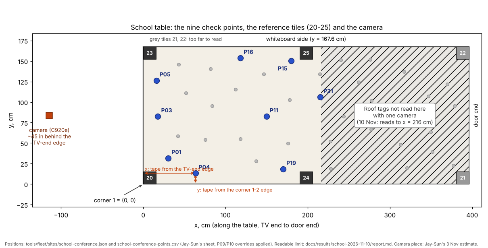

# Re-measuring the school camera setup (for Jay-Sun)

Written 12 Nov 2026 from the repo (Claude). It is for the school conference table, the one C920e camera at the TV end
and Mission Control as it runs on the school Pi from `~/fleet-1109` (code of 9 Nov, commit 02375cd). Expect about
1.5 hours: 40 min of tape, 10 min of Measure, 30-40 min of robot check.

## Why this matters

The camera's idea of the table is what keeps the robots on it, and what every camera position in your data rests on.
Two things show it can be a few cm wrong:

- **Home, 11 Nov:** the camera's y = 122 edge line sat 2-5 cm inside where a robot actually stood for 9 minutes
  without falling (`docs/results/home-2026-11-11/report.md`). The software thought the robot was off the board when
  it wasn't.
- **School, 5 Nov:** the camera's model of the table came from only 4 of the 6 reference tiles (20, 23, 24 and 25; 21
  and 22 are too far to read), so its error grows toward the far side of zone 2. The camera's height was only known as
  "7.5 ft", and whether that is above the floor (145 cm above the table) or above the table (229 cm) was worked out
  indirectly from your 3 Nov four-point offsets (`docs/results/calib-school-2026-11-05-1934/report.md`).

The re-measure has two jobs:

1. Give the software tape measurements to check its own measurements against.
2. Prove, with a robot standing at known points, that the camera's positions are within **1.5 cm** of the tape
   everywhere the camera reads. That includes near the edges, where the 11 Nov error was.

## What the software measures itself, and what your tape is for

The project's rule is "observe, then trust": the camera measures, and a typed number is only a first guess or a
check. Your tape is the input in one place only: the roof tag height. One camera cannot measure that.

| Quantity | Found by the software | Your tape |
|---|---|---|
| Table corners, edges, the (0, 0) corner | Measure reads reference tiles 20, 23, 24 and 25 | **Check:** tiles seated, width, diagonals |
| Scale (cm per pixel) | The tiles' printed 12 cm size | **Check:** table width (the best scale check), one tile's black square |
| The far end (x past about 216 cm) | Not seen: held at the typed length | **Check:** length |
| Camera height and position | Fitted at Measure; the result shows a "Camera height cross-check" line | **Check:** lens height above the table top, distance behind the TV-end edge |
| Roof tag height | **Not measurable with one camera**: the typed height is used | **Input:** each robot's tag height |
| Roof tag tilt | Not measurable with one camera: taken as level | **Check:** phone level on each roof tag |
| Tag offset from the turning point | Measured by the calibration run (0.2 cm on 5 Nov) | nothing |
| Where the camera can read | Learned from runs | nothing |
| Camera bumped | The tag bridge watches the tiles (3 px) | Don't touch the tripod during or after this |

Conclusions in this guide that are Claude's rather than the repo's or the team's are marked **(Claude)**.

## The table frame (used for every measurement)



The school table from above: the camera, the six reference tiles and the nine points the robot check uses (blue).

- **Corner 1 = (0, 0)** is tile 20's corner: the TV end, on the long side away from the whiteboard.
- **x** is measured from the **TV-end edge**, along the table toward the door.
- **y** is measured from the **long edge away from the whiteboard** (the corner 1-2 edge), toward the whiteboard.
- Use the **centimetre** side of the tape. Write every reading to the millimetre (for example `63.7`).

## Part 1. Tape measurements (at the table, no computer)

The precision in each row comes from what the software needs. The working is in Appendix A.

| # | Measure | How | To within |
|---|---|---|---|
| 1 | **Each robot's roof tag height** | Table top to the tag's printed face, at the tag's middle, robot on the table. Do every robot you will use, and write each one's WiFi name (AL-xxxx). | **1.5 mm (1/16 in)** |
| 2 | Each roof tag's tilt | Phone level app laid on the tag | Write the angle. Over 5° means level it (wedge), then measure 1 again |
| 3 | Camera lens height above the **table top** | Floor to lens middle, minus floor to table top. Write all three numbers. | 2.5 cm (1 in) |
| 4 | Camera position | Lens to the TV-end edge (straight back, along x), and lens to the corner 1-2 edge (along y) | 2.5 cm (1 in) |
| 5 | Table width (y) | At the TV end, at the middle, and at the farthest point the camera reads (about x = 216 cm) | 3 mm (1/8 in) |
| 6 | Table length (x) | Along both long edges | 3 mm |
| 7 | Both diagonals | Corner to corner (a second person helps) | 3 mm each. They should agree within 6 mm (1/4 in) |
| 8 | Corner tiles 20-23 | Each tile's lip hooked tight against both edges, no gap, no rounded corner under it | Look and feel. Push each one home |
| 9 | Side tiles 24 and 25 | From the **TV-end edge** to each tile's near side and to its far side (its middle is the average). Use the TV-end edge for **both** tiles: see Question 3 | 3 mm |
| 10 | One reference tile's black square | Steel ruler across the black square, both directions | 1 mm. It should be 12.0 cm |
| 11 | Stickers P03, P05, P01, P04, P19, P11, P21, P15, P16 (and P09, P10: Question 5) | Sticker middle from the TV-end edge (x) and from the corner 1-2 edge (y) | 3 mm |

Write them on the sheet in Appendix C. Leave the robots switched off for now.

## Part 2. Start Mission Control (Mac, then Pi)

Windows used:

- **Mac Terminal**: the Terminal app on the Mac (Cmd+Space, type `Terminal`, press Enter).
- **Pi window**: the Mac Terminal after you have logged in to the Pi (step 2). Its lines end in `nick@rfidthesis:~ $`.
- **Browser**: Chrome or Safari on the Mac.

Type one box at a time, then press **Enter**.

**Step 1. Tailscale.** At the top right of the Mac's screen, click the **Tailscale** icon. Choose the **joincapstonedb**
account. You should see a tick next to it and `Connected`.

**Step 2. Log in to the Pi (Mac Terminal).**

```
ssh nick@100.72.183.28
```

Type the Pi's password (nothing shows while you type), then press **Enter**. You should see a line ending in
`nick@rfidthesis:~ $`. This window is now the **Pi window**.

**Step 3. Go to the 9 Nov code (Pi window).** Do not `git pull` in this folder.

```
cd ~/fleet-1109
```

```
git log -1 --oneline
```

You should see a line starting with `02375cd`. If it says `not a git repository`, carry on and write "no git" on the
sheet. If it shows another number, write it on the sheet.

**Step 4. Restart Mission Control (Pi window).**

```
./run-fleet-pi.sh mc-stop
```

You should see `Mission Control is closing` or `Mission Control is not running`. Then:

```
./run-fleet-pi.sh mc
```

Within about 10 seconds you should see `Mission Control is open: http://100.72.183.28:8095 ...`.

**Step 5. Put the robots down (at the table).** Switch on two robots. Put them in zone 1 (TV end), at least 20 cm
from every tile and every edge, and at least a hand's width apart. They are only there so their roof tags give the
camera-height cross-check. **Robots at school drive only while you are in the room.**

## Part 3. Type the tape numbers and Measure (Browser)

**Step 1.** Go to `http://100.72.183.28:8095`. You should see the **Start** screen with a red bar
`ROBOTS: the real robots` and `Place: School: the conference table`.

**Step 2. Typed values.** At the bottom, click **Advanced**. Under **Typed values**:

- **Table length (cm)**: the average of your two lengths (row 6).
- **Table width (cm)**: your TV-end width (row 5).
- **Roof tag height (cm)**: your row 1 value, **only if** every robot is within 1.5 mm of each other. If they differ
  by more, leave it as it is and see Question 2.

Press **Save typed values**. You should see the numbers stay in the boxes.

**Step 3. Older screens.** Still in **Advanced**, tick **Show all the older screens (Connect ... Production)**. A row of
tabs appears at the top. Click **Cameras & table**.

**Step 4. Camera check.** On the **Camera check-out** card, press **Check the cameras**. After about 3 seconds each
line says PASS, WARN or FAIL. A FAIL tells you what to do. Fix it (light, focus, a robot outside the picture), then
press the button again. Take a phone photo of the card.

**Step 5. Pictures.** On **Click in the pictures**, press **Take pictures**. You should see the camera's picture, with
the reference tags it found marked in orange. Leave **Click the corners by hand too** unticked: the tiles give the
corners.

**Step 6. Measurements card** (the card titled **Measurements (checks, optional)**):

- **Table length / width**: as in step 2.
- **Side tag 24's middle ...** and **Side tag 25's middle ...**: your row 9 middles, **both measured from the TV-end
  edge** (ignore the label's "from corner 3" for tag 25; see Question 3).
- Leave the sticker boxes empty.

Press **Save measurements**. You should see `Saved`.

**Step 7. Measure.** On the **Measure** card, press **Measure**. It says `Measuring (about 10-30 s)...`, then shows the
table size and a list of lines. Take a phone photo of the whole card, and write these on the sheet:

- the table size it shows (for example `396.0 x 167.4`);
- the line starting `Camera height cross-check`: both numbers;
- any line containing `WARNING`, `apart`, `larger` or `smaller`;
- the roof tag table (height, tilt) if one is shown.

Measure saves the new camera model for every run (both code folders share it). It keeps the old one in a folder named
`tagcal-before-<date-time>`.

**What a good Measure looks like:**

- no `WARNING` line;
- the size it measured is within 2.5 cm of your width and within 1.5 % of your length (the software's own limits);
- the camera height cross-check is within **5 cm** of your row 3 (Appendix A);
- no `read ... larger/smaller than printed` line.

## Part 4. Quick look: are the stickers where the camera thinks? (Browser)

**Step 1.** Click the **Start** tab. Scroll to **Visit points in your order (optional)**.

**Step 2.** Under the right-hand picture, click **New picture**. Every sticker is drawn as a ring at the spot where
the new camera model puts it, using its typed position.

**Step 3.** Look at the rings in zones 1-2. Each ring should sit centred on its real sticker. Write down any sticker
where you can see the ring's middle clearly off the sticker. This quick look only covers the table top. Part 5 adds the
robot's height.

## Part 5. Robot check: camera against tape at nine points (Browser, then Pi window)

You must stay in the room for this whole part.

**Step 1. Make the stops long enough to measure.** On the **Visit points in your order** card, set **Stop at each
point (s)** to `120`. Make sure **try unreadable points anyway (this run)** is ticked.

**Step 2. The order.** In the text box, type:

```
P03,P05,P01,P04,P19,P11,P21,P15,P16
```

Press **Enter**. You should see `Order (9): 1. P03 → 2. P05 ...`.

**Step 3. Robots.** Leave **one** robot on the table, in zone 1, and switch the other off and take it away.

**Step 4. Run.** Press the big **Visit points** button. Press **OK** at `Start Visit points ...?` and **OK** at
`Is he here?`. The robot wiggles, then drives to P03.

**Step 5. At each stop (120 s): measure the robot, don't touch it.**

1. Hook the tape on the **TV-end edge** and run it along the table beside the robot.
2. Hold a set square (or a stiff card) upright on the table, touching the robot's **nearest** point to the TV end.
   Read the tape: that is `x near`. Do the same at its **farthest** point: `x far`.
3. Do the same from the **corner 1-2 edge** for `y near` and `y far`.
4. Write all four on the sheet. The robot's centre is `x = (x near + x far) / 2` and `y = (y near + y far) / 2`.

Touch the robot as lightly as you can. If it moves, write "moved" for that point. If the robot leaves before you finish,
write what you have and carry on.

**Step 6.** When the run ends, the status box shows `Its folder: ...`. Copy that folder name onto the sheet.

**Step 7. The camera's numbers.** Log in to the Pi first (Mac Terminal):

```
ssh nick@100.72.183.28
```

Type the Pi's password, press **Enter**. You should see `nick@rfidthesis:~ $`. Then (Pi window) type `cut -d, -f3,10,11,12,13 `
followed by the folder from step 6 and `/run/stops.csv`. For example, if the folder were
`/home/nick/fleet-1109/logs/mission-control-school-conference/runs/20261113-150000-visit`:

```
cut -d, -f3,10,11,12,13 /home/nick/fleet-1109/logs/mission-control-school-conference/runs/20261113-150000-visit/run/stops.csv
```

You should see one line per stop: `point, cam_x_cm, cam_y_cm, plus_minus_cm, n_fixes`. Copy each into the sheet's
"camera" columns. A row with `n_fixes` 0 or empty means the camera did not read the robot there: write "not read".

**Step 8. Put the stop time back.** In the Browser, on the Start screen, set **Stop at each point (s)** back to `8` (your
tours' setting).

**Step 9. Errors.** For each point: `dx = camera x - tape x`, `dy = camera y - tape y`,
`error = square root of (dx² + dy²)`.

## Part 6. Did it work?

| Result at every point the camera read | Meaning | Do |
|---|---|---|
| Error **1.5 cm or less** | **Pass**: inside the software's own limit near an edge | Send Nick the sheet; carry on with experiments |
| Some between 1.5 and 2.2 cm | **Usable, flag it**: still inside the edge safety budget (Appendix A) | Send Nick the sheet; use "If it fails" below to find the cause |
| Any over **2.2 cm** | **Fail**: a robot's corner could reach the table edge at P04 or P16 | Use "If it fails"; don't run experiments that go near edges until Nick has seen it |

**(Claude)** The 1.5 cm is the software's own number (`AGREE_CM` in `site_fit.py`: "the tracking error tolerated near
an edge"). The 2.2 cm comes from the edge budget in Appendix A.

## If it fails: what the pattern of errors tells you **(Claude)**

| Pattern of dx, dy | Most likely cause | Do |
|---|---|---|
| Errors point **away from the camera** and grow with distance (P21 about 2.5 times P03) | Typed roof height **too low** | Re-measure row 1; type it; Measure again; repeat Part 5 |
| Errors point **toward the camera** and grow with distance | Typed roof height **too high** | The same |
| About the same dx, dy at every point | Tile 20 not seated, or the tape hooked on the wrong edge | Re-seat tile 20; check rows 8 and 11; Measure again |
| dy grows from the corner 1-2 edge toward the whiteboard (P04 small, P16 big) | Width or scale off | Re-check rows 5, 7 and 10, then tiles 23 and 25; Measure again |
| dx grows with x (P03 small, P21 big) | Length or scale off along x | Re-check rows 6, 9 and 10; Measure again |
| One point only | That sticker, or that tape reading | Re-tape that sticker (row 11) |

If a second try still fails, stop there. Send Nick the sheet and the phone photos. To put the old camera model back
first, see Appendix B. Only do that if Nick asks, or if the new model is clearly worse than the old one.

## Appendix A. Where the precisions and limits come from **(Claude)**

Numbers taken from the repo: camera lens about 145 cm above the table and about 114 cm (45 in) behind the TV-end edge
(Jay-Sun's 3 Nov estimate, the calibration run's model); roof tag height h = 6.19 cm.

- **Budget.** The limit is 1.5 cm. Three independent things can each add error: the roof height, the camera's fit,
  and the tape and placement. Each gets about 0.5 cm, a third of the limit. The split is a chosen budget, not a
  measured one; a DOE would not set it better.
- **Roof tag height (1.5 mm).** A tag at height h is read where its sight line meets the typed height. Each 1 cm of
  wrong height moves the reading by r × H / (H - h)², where r is the floor distance from below the lens. That is about
  1.0 cm at P03, 1.4 cm at P04, 2.0 cm at P11 and 2.5 cm at P21. To stay within 0.5 cm at P21, the height must be right
  to 0.2 cm, so tape it to 1/16 in. This is also why your 3 Nov offsets were 2.4-5.2 in with no height correction at all.
- **Camera height (2.5 cm, agree within 5 cm).** The same formula with the camera height gives
  r × h / (H - h)²: 0.04-0.11 cm per cm. Staying within 0.5 cm at P21 allows about 5 cm, so 1 in of tape is plenty. Its
  real use is to settle the 145 cm against 229 cm question directly.
- **Width, length, side tiles, stickers, robot (3 mm).** The software treats a careful tape as 0.3 cm (`TYPED_SD_CM`):
  a fifth of the 1.5 cm limit, so a disagreement is the camera's, not the tape's.
- **Diagonals (within 6 mm).** A table out of square by angle a moves the camera's edge line by x × a. Keeping that
  under 0.5 cm at x = 216 cm allows a ≈ 0.0023 rad. For a 396 × 168 cm table that is a diagonal difference of about
  0.7 cm.
- **Tile black square (1 mm).** A printer's "fit to page" scales by 3-6 %, which this catches. 1 mm (0.8 %) is only a
  gross check: the width (row 5) is the fine scale check.
- **Edge budget (2.2 cm).** The school's edge room is 13 cm from a sticker's centre (`edge_in_cm`). Take away the body's
  half diagonal, 6.72 cm (a corner swinging on a turn); the measured stopping distance, up to 2.4 cm; and the measured
  plan-ahead uncertainty, 1.7 cm (e08 report). That leaves 2.2 cm for camera error before a corner could reach the edge.
- **DOE note.** The 1.5 cm limit (`AGREE_CM`) is itself marked "chosen" in the code. Repeating this nine-point check on
  a few days, in different light, would show the camera's real spread and could set it from data.

## Appendix B. Putting the old camera model back (only if Nick asks)

Start with the login (Mac Terminal):

```
ssh nick@100.72.183.28
```

Type the Pi's password, press **Enter**. You should see `nick@rfidthesis:~ $`. Then (Pi window):

```
ls -d ~/.config/mirlt/sites/school-conference/tagcal-before-*
```

You should see one or more folder names ending in a date and time. The newest is the model from before your Measure.
Set the rejected one aside:

```
mv ~/.config/mirlt/sites/school-conference/tagcal ~/.config/mirlt/sites/school-conference/tagcal-rejected
```

Then copy the old one back. Type `cp -r `, then the newest folder name from the list, then
` ~/.config/mirlt/sites/school-conference/tagcal`. For example:

```
cp -r ~/.config/mirlt/sites/school-conference/tagcal-before-20261113-143000 ~/.config/mirlt/sites/school-conference/tagcal
```

Nothing shows if it worked. The next run uses the old model.

## Appendix C. The sheet (copy it, fill it, send a photo to Nick)

Date, time, room lights on or off: ________ Code folder check (Part 2 step 3): ________

| # | What | Value(s) |
|---|---|---|
| 1 | Roof tag height per robot (WiFi name: cm) | |
| 2 | Tilt per robot (°) | |
| 3 | Floor to lens; floor to table top; lens above table (cm) | |
| 4 | Lens behind TV-end edge; lens from corner 1-2 edge (cm) | |
| 5 | Width at TV end; middle; x ≈ 216 (cm) | |
| 6 | Length along corner 1-2 edge; along whiteboard edge (cm) | |
| 7 | Diagonal 1-3; diagonal 2-4 (cm) | |
| 8 | Tiles seated (yes / which one was not) | |
| 9 | Tile 24 near / far side; tile 25 near / far side, from TV-end edge (cm) | |
| 10 | Tile black square, both directions (cm) | |
| M | Measure: table size; camera height cross-check; WARNING / apart lines | |
| Q | Quick look: stickers whose ring is off | |

| Point | Sticker x, y (row 11) | Tape x near, x far | Tape y near, y far | Tape centre x, y | Camera x, y (stops.csv) | ± | dx, dy | error |
|---|---|---|---|---|---|---|---|---|
| P03 | | | | | | | | |
| P05 | | | | | | | | |
| P01 | | | | | | | | |
| P04 | | | | | | | | |
| P19 | | | | | | | | |
| P11 | | | | | | | | |
| P21 | | | | | | | | |
| P15 | | | | | | | | |
| P16 | | | | | | | | |

Why these nine: P03, P04 and P16 are the stickers nearest the TV-end, corner 1-2 and whiteboard edges (13-18 cm), where
the 11 Nov error was. P05 is the corner nearest the camera. P19 and P15 are near the edges on the far side of zone 2,
where the 5 Nov model was least sure. P11 is the middle. P21 is about as far as the camera reads roof tags (x ≈ 215 cm).
**(Claude)**

## Sweep 1: new tests that may now be needed

- This nine-point check repeated on two more days, with the room lights on and off. Its spread would set the 1.5 cm
  limit from data (DOE note above).
- The same check after the newer code's start-of-run camera self-check refits (it compares the tiles every run).
- A short Measure with the second camera (EMEET) at the door end. It would let the software measure each roof tag's
  height itself instead of using the tape (Question 1).
- Each robot's body centre against its turning point (Question 6): put the robot on the same spot, turn it 180° by
  hand, and compare the camera's two readings.

## Sweep 2: possible inaccuracies in what this guide relies on

- The camera height (145 cm), position (45 in back) and table height (33 in) behind Appendix A are Jay-Sun's estimates,
  so the per-point sensitivities are approximate. Part 1 rows 3-4 replace them.
- The robot check compares the tape's **body centre** with the camera's **turning point**. If the axle is not under
  the body's centre, that offset shows up as error, along the robot's heading. Assumed small (the roof platform is
  centred over the axle, Jay-Sun 3 Nov), not measured.
- `stops.csv` holds the median camera position over the stop. Touching the robot while measuring can move it a little.
- The readable limit (x ≈ 216 cm) comes from one evening (10 Nov), in normal light.
- The 2.2 cm edge budget adds the worst cases of quantities measured on other days (e08 report).
- The Advanced "Roof tag height" may not override the per-robot heights in the site file (Question 2). If it doesn't,
  the run keeps using 6.19 cm whatever you type.
- That `stops.csv` is written for a Visit run started from Mission Control on the 9 Nov code was read from the code,
  not seen on the Pi.

## Questions for Nick

**Substantive**

1. **Roof tag height is the one hand measurement the software can't check with one camera.** It holds the typed value,
   and every cm of error moves positions 1-2.5 cm. Accept the tape as the input for now, or set up the second camera
   (EMEET) for Measure only, so `roof_cal` measures each tag's height ("discover, don't pre-map")?
2. **Per-robot heights.** The site file keeps heights per slot name (`heights_cm`: Alpha, Bravo = 6.19). The robots are
   pinned by WiFi name (AL-1DC0, AL-EB54, AL-E7DC), and the Advanced box sets one `height_cm` for all. If Jay-Sun's
   robots differ by more than 1.5 mm, where should each one's height go? Does the Advanced value reach a robot that has
   a `heights_cm` entry?
3. **Possible label bug (Claude's reading of the code).** On "Cameras & table", tag 25's box says "from corner 3 along
   the edge". `ref_tags.centre()` uses that number as x, measured from the TV end. The guide tells Jay-Sun to measure
   both side tiles from the TV-end edge. If tile 25 isn't at the table's middle, the label would give a wrong number.
   The current code has the same label. Fix the label or the code?
4. **Pass and fail limits (Claude).** Are you happy with pass at 1.5 cm or less, flag at 1.5-2.2 cm and fail above
   2.2 cm, and with experiments near the edges pausing after a fail?
5. **P09 and P10.** The site applies overrides (P09 y = 57.5 in, P10 y = 37.5 in), but each override's status reads
   "confirmed by Jay-Sun 3 Nov (spreadsheet correct)", which says the opposite. The guide leaves them out of the robot
   check; row 11 asks Jay-Sun to tape them. Which is physically right?
6. **Body centre against the turning point.** Is the Alvik's wheel axle under the middle of its body? If not, the tape
   comparison needs a correction along the heading.

**Other**

7. Is `~/fleet-1109` a git checkout of 02375cd, or a copy? The guide checks with `git log -1` and copes with either.
8. Should Jay-Sun do this on the 9 Nov code, as written, or after moving to the current code? Measure is the same in
   both and they share the camera model folder. The current code adds the camera self-check at every run's start.
9. The "Stop at each point" value is saved for every later Visit run. The guide has Jay-Sun set it back to 8 s. Would
   you rather the check use its own preset?
