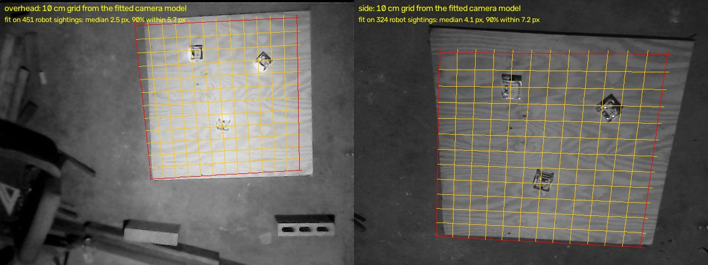
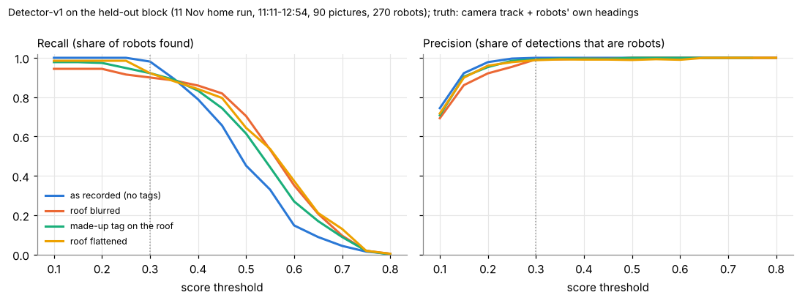
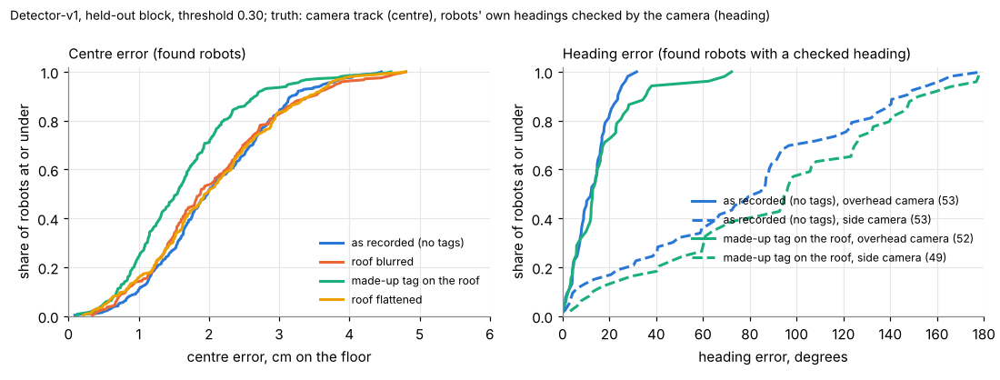
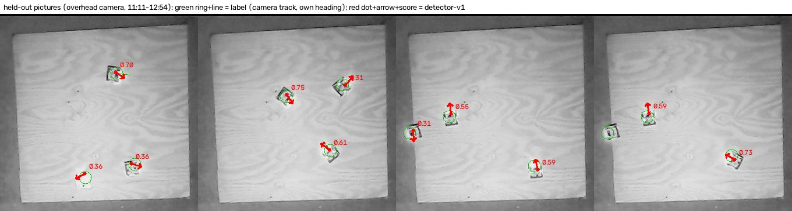
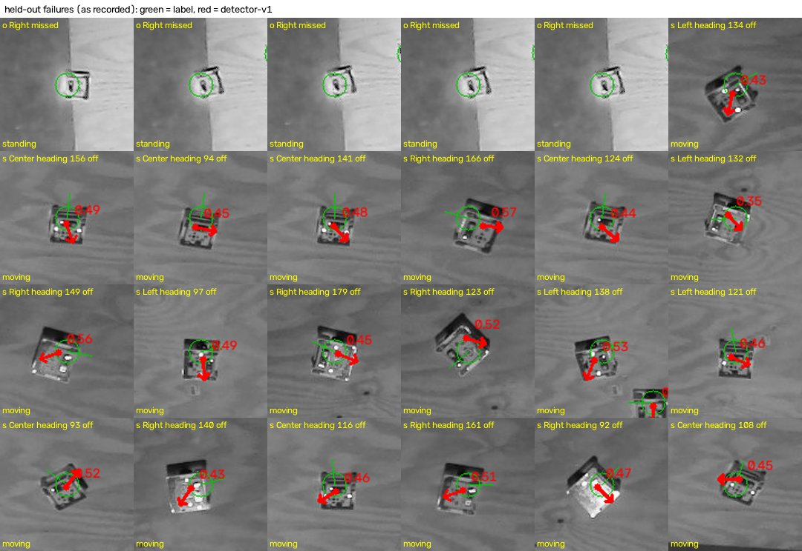
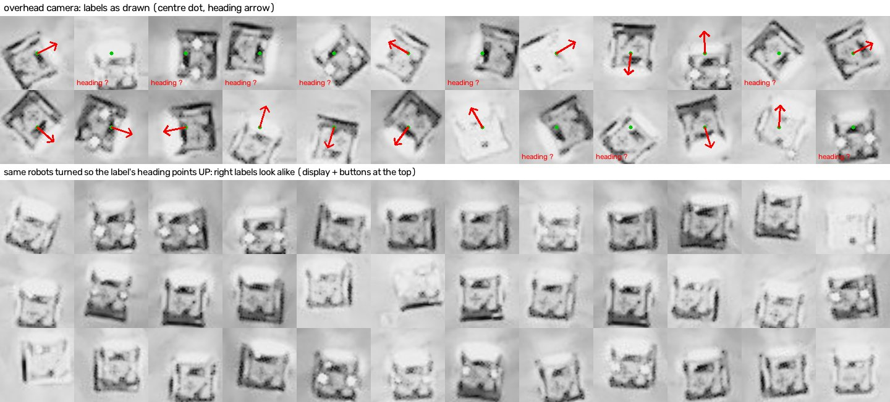
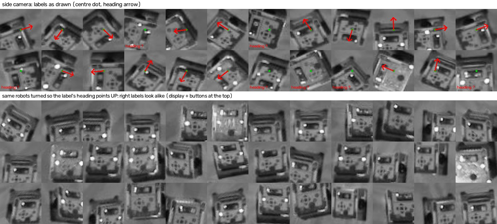

# Detector-v1: the first robot detector trained on real pictures (12 Nov 2026, logs and pictures only)

## Premise
- The detector (`tools/detector`, our own CentreNet, about 77k parameters) had never been trained. Nick's goal (12 Nov): it should learn "a robot here, facing this way". That means one class plus a heading, with no robot names.
  - Robot names come from tracking.
  - It runs on demand on the Pi: for a lost robot, an unclear name, or a doubtful heading.
  - Its main value is finding a **standing** robot whose tag can't be read, since the motion detector can't see still robots. It is also a second heading check, and the start of a tag-free mode.
- Data: the 4-hour home free roam of 11 Nov 08:58. The 08:26 run has no pictures, so it isn't used.
- Nothing here touched a robot, a Pi or a camera. "Measured" means numbers from the run's own pictures and logs. Conclusions that are **Claude's own** are marked; the team hasn't discussed any of them.

## Data
**What the run holds (measured).**
- 182 event pictures from each camera (overhead and side), 640x480, grey. Every one was taken for "unsure near an edge", so the set leans toward edges.
- The bridge's camera track: each robot's position about twice a second.
- Each robot's own pose: 10 times a second.
- **The home robots carry no roof tags.** The run folder also has no camera calibration (it stayed on the Pi) and no video.
- `autolabel.py` as built in e13 needs tag reads, video and a calibration. So it got a new `--pictures` mode (details in Appendix A):
  - The camera model is **found from the pictures themselves**. Robot blobs are paired with the track: 451 pairs on the overhead camera, median 2.5 px off; 324 pairs on the side camera, median 4.1 px off.
  - Each label is checked against an empty board with the robots cut out.
  - A heading is kept only where the camera confirms the robot's own heading.


The 10 cm floor grid drawn through the camera model found from the run's own pictures, one picture per camera.

**Labels (measured):**
- 363 pictures, 1,089 robot labels, 729 of them with a checked heading.
- One picture was dropped because its label didn't sit on a robot.
- By eye on 72 contact-sheet crops, every label sits on a robot.
  - Overhead: turned so the label's heading points up, the robots look alike (Appendix B). Roughly 1 in 12 is turned 20-30 deg.
  - Side camera: you can't judge heading by eye. The robot's near wall always shows at the top of the picture, and the body is square.

**Split by time, not by picture:**
- Train: 09:04-10:46, 227 pictures.
- Validation: 10:47-11:11, 46 pictures. It picks the best epoch and the model.
- **Held-out test: 11:11-12:54**, 90 pictures, 270 robots:
  - 124 of them standing still (moved under 1 cm in 2 s), mostly Right parked half over the left edge, and Left held;
  - 108 with a checked heading, 54 per camera.

**Training (measured):**
- Grey input, 320x240, one class (`alvik`) plus heading.
- In half the training pictures each robot's roof was, at random, left alone, blurred, flattened or covered by a made-up tag. The aim is that the model learns the body, not the roof.
- 40 epochs, 9,600 pictures seen, 63 min on 2 shared CPU cores.
- PyTorch can't be installed here, so training used `train_jax.py`: the same network, data, losses and schedule. It writes the `.onnx` itself, and ONNX Runtime matches it to 2e-6.

**Results on the held-out block** (measured; detection threshold 0.3; "found" means within half a robot of the label):

| test pictures | robots found (recall) | detections that are robots (precision) | centre error, median / 95 % | heading error, overhead camera: median / 95 % / flipped | heading, side camera (median) |
|---|---|---|---|---|---|
| as recorded (no tags) | **0.981** (265 of 270) | **1.000** (0 false) | 2.0 / 3.7 cm | **12 / 26 deg / 0 %** | 84 deg (not learned) |
| roof blurred | 0.900 | 0.992 | 1.9 / 3.8 cm | 13 / 32 deg / 0 % | 57 deg |
| made-up tag on the roof | 0.922 | 0.992 | 1.6 / 3.2 cm | 13 / 49 deg / 0 % | 96 deg |
| roof flattened | 0.922 | 0.988 | 2.0 / 3.7 cm | 14 / 35 deg / 0 % | 69 deg |
| 8-bit model, as recorded | 0.948 | 1.000 | 1.9 / 3.7 cm | 13 / 27 deg / 0 % | 75 deg |
| **standing robots only** (124), as recorded / blurred / tag | 0.96 / 0.80 / 0.85 | | 2.0 / 1.6 / 1.6 cm (median) | (1 checked heading: too few) | |

<sub>Recall: the share of real robots the detector found. Precision: the share of its detections that were real robots. Median: half the errors are smaller. 95 %: 95 in 100 are smaller. Flipped: more than 135 deg off, so front and back are confused. With a stricter match radius of 8 px (about a quarter of a robot), recall is 0.867 as recorded. The extra misses sit 8-16 px from the label, mostly on the side camera. That is label noise as much as detector error; see sweep 2.</sub>


How many held-out robots the detector finds, and how many of its detections are real, as the score threshold changes, for the four kinds of test picture. Measured on the 11:11-12:54 block; the truth is the camera track.


Left: how far each found robot's centre is from the camera track's position, in cm on the floor. Right: how far its heading is from the robot's own camera-checked heading, split by camera. The overhead camera stays within 30 deg; the side camera is spread almost evenly.


Held-out overhead pictures. Green is the label; red is the detector's centre, heading and score.


The only 5 misses are all the same parked robot, half over the board's left edge, scored 0.28-0.30 (just under the 0.3 threshold). The other tiles are side-camera headings.

**Speed (measured here, NOT a Pi).** `benchmark.py`, 320x240, 1 thread, on a shared 2-core Xeon at 2.1 GHz (load about 7 at the time):
- float: 4.4 ms for the network, 4.8 ms mean (7.7 ms at 95 %) for the whole call;
- 8-bit: 3.7 ms for the network, 5.5 ms mean (10.4 ms at 95 %);
- 2 threads was slower than 1 here (the cores were busy).

**Pi estimate (Claude's estimate, not measured):** about 15-30 ms per picture on one Pi 4 core, 8-15 ms on a Pi 5. That's well under one picture interval, for an on-demand call. Only the Pi bench can say.

## Conclusion
- **Finding robots works on this board and this light (measured):**
  - 98 % recall and no false detections on a stretch of time the model never saw;
  - centres within 2 cm (median), 3.7 cm at 95 %;
  - 96 % of the standing robots found. These are the case it's for.
- **Heading works on the overhead camera, not the side camera (measured):**
  - Overhead: 12 deg median, 26 deg at 95 %, never flipped.
  - Side: no better than chance. **Claude's reading:** at that angle the robot's near wall dominates and the body is square, so the front is hard to see.
  - Use the overhead camera for the heading check. Treat a side-camera heading as unknown.
- **The roof matters more than it should (measured):**
  - Blurring or flattening the roof costs about 8 points of recall, and 16-18 points on the overhead camera.
  - A pasted tag costs about 6 points of recall and widens the heading's 95 % from 26 to 49 deg.
  - **Claude's reading:** the overhead robots are only about 12 px across at the network's input size. Roof detail is a large part of what it sees.
- **8-bit:** 3 points lower recall (it drops the parked edge robot), the same centres, and not faster on this x86 machine. Keep the float model until the Pi bench says otherwise.
- **The risk, plainly:**
  - one board, one lighting setup, the home cameras only;
  - three robots, every picture taken near an edge;
  - no roof tags, so school's tagged robots and other surfaces are untested;
  - the test block has 270 robot labels but only 3 robots.
  - **Expect it to do worse at school until it's trained on school pictures.**

## What's next
1. **The Pi bench** (`benchmark.py` with both `.onnx` files, 1 thread, on core 0 or 1, under a run's load): the real time per call.
2. **School pictures with tags:** label them with `autolabel.py` (tag mode), add them to training, and score the home test block again. The hold-out stays split by time.
3. **More pictures at home, not just at "unsure" moments.** Save every Nth picture during a run (frames at 4 a second already exist on the USB drive, `frames_where.txt`). That gives many more standing and middle-of-board robots.
4. **A larger input (480x352) for the overhead camera only.** **Claude's suggestion:** it would give the roof and outline more pixels. It costs about 2.2x the time; worth a test with the Pi bench numbers in hand.
5. **The corrected-label model (detector-v1b, Appendix C):**
   - it is more robust to a blurred roof or a tag (recall 0.94 / 0.99);
   - but its overhead heading is worse (18 deg median);
   - its training was cut short by the shared machine.
   - Retrain it with its full schedule (or on a laptop with `train.py`), then compare on validation again.

## Sweep 1: new tests that may now be needed
- The Pi bench above (time, heat, `vcgencmd get_throttled`). The estimate here is not a measurement.
- A detector test on pictures from a run that wasn't "unsure near an edge" (middle of the board, normal driving).
- School footage with real tags, against the pasted made-up tags used here (are the made-up ones a fair stand-in?).
- An edge test: robots partly over the board's edge (the 5 misses), on purpose, at several positions.
- `train.py` vs `train_jax.py` on the same labels on a machine with PyTorch. The tests check that the layers and the `.onnx` match, not that training gives the same model.
- Whether the side camera's heading improves with side-camera-only training or a larger input. Or keep it position-only.
- The torch-dependent detector tests (`test_model_pipeline`, `test_stage2`, `test_baseline_yolo`, `test_geometry::test_augmented_picture_and_heading_agree`) couldn't run here (no PyTorch). Run them on the laptop.

## Sweep 2: possible inaccuracies
- **The truth is not ground truth.** Positions come from the bridge's camera track, mapped through a camera model fitted to it. The fit's own spread is 2.5 px (overhead) and 4.1 px (side) median, about 1-1.5 cm. That is the same size as the 2 cm centre error, so part of that error is the label's.
  - The cm are in the track's frame at the robot's height, not tape-measured cm. The fitted 0-120 cm grid sits slightly outside the overhead camera's board edge and inside the side camera's.
  - At the board's edge the label can sit on the part hanging over the edge (the parked robot in the failures picture).
- **Heading truth is the robot's own heading, checked by the camera**, within the run's own 95 % travel agreement (23 deg). Label noise of 10-20 deg is likely. Only 1 standing robot in the test block has a checked heading, so heading on standing robots is untested.
- **First-version labels:** the first label rule accepted driving backward, and any standing robot whose position agreed with the camera. The held-out check found a robot parked for an hour labelled about 180 deg wrong that way.
  - The rule was fixed and all numbers above are scored on the fixed labels.
  - The chosen model was **trained** on the first labels. Validation picked it over the retrained one (Appendix C).
  - The wrong labels were mostly in the test block (the parked robots), and about 100 training labels changed to "heading unknown".
- **Small, correlated test set:** 3 robots, one board. The standing robots are mostly one parked robot and one held robot, so a 0.96 recall on 124 standing labels rests on about 3 standing episodes.
- **Pasted tags are made up:** random 5x5 patterns, turned a random multiple of 90 deg from the heading. Real school tags are mounted with the heading, so the tag row may be pessimistic for heading.
- **Chosen numbers (not derived)**, each with whether a designed experiment (DOE) should set it instead:
  - threshold 0.3 (the repo default; the curve chart shows 0.2-0.3 is flat): DOE no, read it off the validation curve per site;
  - "found" radius half a robot (as `evaluate_stops`): no DOE, it's a definition (8 px strict also reported);
  - standing = under 1 cm in 2 s: no DOE, it's a definition;
  - roof square 0.75 of the robot, roof-change share 0.5 of pictures: **DOE yes** (0.6 / 0.75 / 0.9 x 0.25 / 0.5 / 0.75, scored on masked recall and clean heading);
  - 40 epochs x 15 steps, learning rate 3e-3, batch 16: DOE yes once a GPU or laptop is available (they are the e13 defaults);
  - object size 28 px and grey input: DOE yes (28 / 34 px, grey / colour) when school colour pictures exist;
  - autolabel's track-gap factor 2.5, 4 cm travel in 2 s, label-check disc 0.2 robot: DOE yes, scored on the label-check drop rate against a person's verdict on a sample;
  - time blocks 8 (test = last 2): no DOE, but repeat with a middle block held out to check the block isn't special;
  - the Pi speed range: an estimate, to be replaced by the bench.

## Appendix A: how the labels were made (`autolabel.py --pictures`)
1. **Empty board:** the median of each camera's 182 pictures. Its outline gives a starting guess of the floor -> picture map, with the corner order tried all ways round and scored.
2. **Camera model:** robot blobs (picture minus empty board) paired with the camera track at the picture's time. The floor -> picture homography is refitted with RANSAC (a robust fit that ignores outlier pairs) while the pairing radius shrinks from 40 to 8 px.
   - The time offset was checked: 0 s fits best on the overhead camera, -0.25 s on the side camera.
   - The model maps a robot's floor position to its visible body's centre. That's what the detector should learn.
   - It's saved as `floor_calibration.json` in each recording, so `evaluate.py` reports cm.
3. **Label check:** a clean empty board is rebuilt with every labelled robot cut out (a robot parked for an hour would otherwise be in the median).
   - The change under each label, relative to the picture's own noise, must beat the 99th percentile of random empty spots: 2.3x (overhead), 2.8x (side). Labels sat at a median of 35x and 29x.
   - A first version used a fixed share of changed pixels. It dropped 27 overhead pictures of robots washed out under the lamp, which were right. It was replaced by this data-derived bar.
4. **Heading:** the robot's own heading from `follow.csv`, kept only where the camera confirms it:
   - driving forward along it (travel direction within 23.1 deg, the run's own 95th percentile); or
   - standing with that heading unchanged since its last confirmed moment, and its own position within 2.9 cm of the camera's (the run's own 75th percentile).
   - Otherwise "heading unknown": the model isn't taught a front there.
5. **Time blocks:** 8 blocks of equal picture count per camera, one recording each (`<run>_<cam>_t1..t8`).

Commands (scratch paths on this machine; the how-to has the laptop version):
```
python3 tools/detector/autolabel.py <run> --pictures --out dv1/data
python3 tools/detector/train_jax.py --labels dv1/data/labels --out dv1/model --classes alvik --heading-classes alvik --obj-size alvik=28 --in-ch 1 --roof-p 0.5 --epochs 40 --steps-per-epoch 15 --val <run>_overhead_t6,<run>_side_t6 --test <run>_overhead_t7,<run>_overhead_t8,<run>_side_t7,<run>_side_t8
python3 tools/detector/export.py --int8-from dv1/model/best.onnx <the t1-t5 labels folders>
python3 tools/detector/roofmask.py --labels dv1/data/labels --out dv1/test_blur --mode blur --only <test recordings>   (and tag, flat)
python3 docs/results/detector-v1/make_results.py --run <run> --model best.onnx --int8 best.int8.onnx --variant clean=dv1/data/labels --variant blur=dv1/test_blur --variant tag=dv1/test_tag --variant flat=dv1/test_flat --test <test recordings>
```

## Appendix B: label checks by eye

Overhead labels. Top: as drawn. Bottom: turned so each label's heading points up. The display sits at the top and the two LEDs at the bottom in nearly every crop.


Side-camera labels. Centres sit on the robots. The turned crops don't line up by eye: the near wall shows at the top whatever the heading.

## Appendix C: the two trained models

| | detector-v1 (shipped) | detector-v1b |
|---|---|---|
| trained on | the first heading labels (82 unknown) | the fixed labels (180 unknown) |
| schedule | 40 of 40 epochs, best epoch 26, 63 min | cut at 34 of 40 by the time limit (shared CPU 2-3x slower), best epoch 18, 102 min |
| validation (10:47-11:11, fixed labels): recall / overhead heading median | 0.942 / 10 deg | 0.949 / 17 deg |
| test, as recorded: recall / precision / overhead heading median / 95 % | 0.981 / 1.000 / 12 / 26 deg | 0.985 / 0.989 / 18 / 58 deg |
| test, roof blurred / tag: recall | 0.900 / 0.922 | 0.941 / 0.989 |
| test, standing robots: recall | 0.96 | 0.99 |

- The model was chosen on validation, before looking at test.
- v1b's better roof robustness on test is a reason to retrain it properly, not a reason to switch now.

## Appendix D: files
- Code (in git): `tools/detector/autolabel.py` (`--pictures`), `roofmask.py`, `train_jax.py`, `dataset.py` (roof changes, works without PyTorch), `train.py` (`--roof-p`), `export.py` (`--int8-from`, PyTorch only where needed), `tests/test_dv1.py` (8 tests; one more runs where PyTorch exists).
- Results (in git): `results.json`, `per_robot.csv` (every held-out robot, every variant), `make_results.py`, the two charts.
- Models (**not** in git): `detector-v1.onnx`, `detector-v1.int8.onnx`, `detector-v1.npz` (weights under PyTorch's names; `train_jax.py --to-pt` makes a `best.pt` on a machine with PyTorch), `detector-v1b.onnx`, `detector-v1b.npz`. These are meant for a GitHub release `detector-v1`, which hasn't been created yet; for now they are in the build machine's scratch folder.
