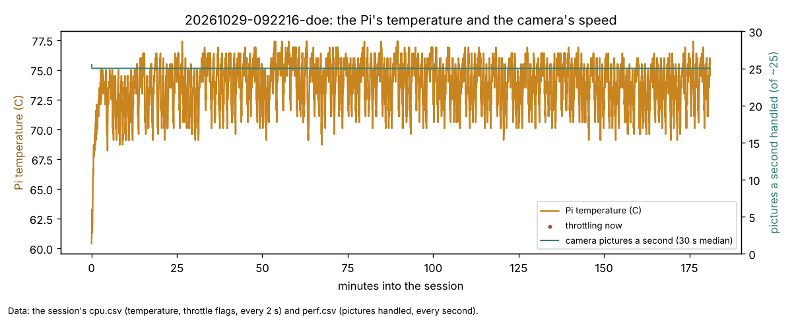
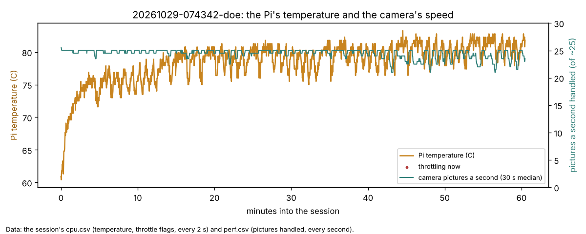
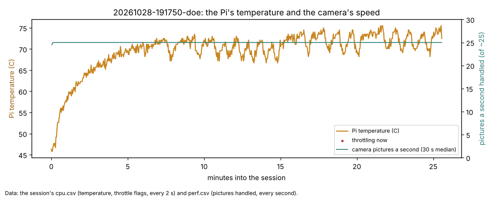
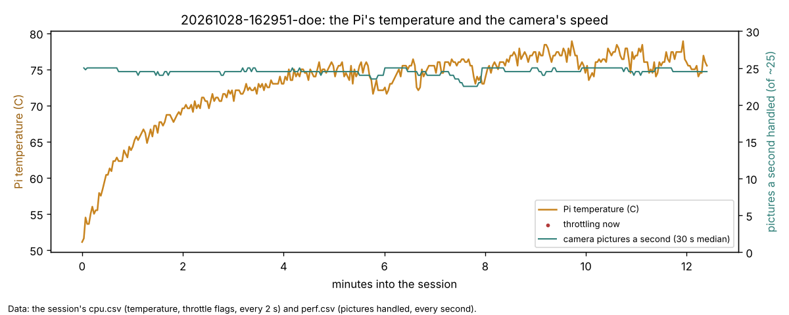
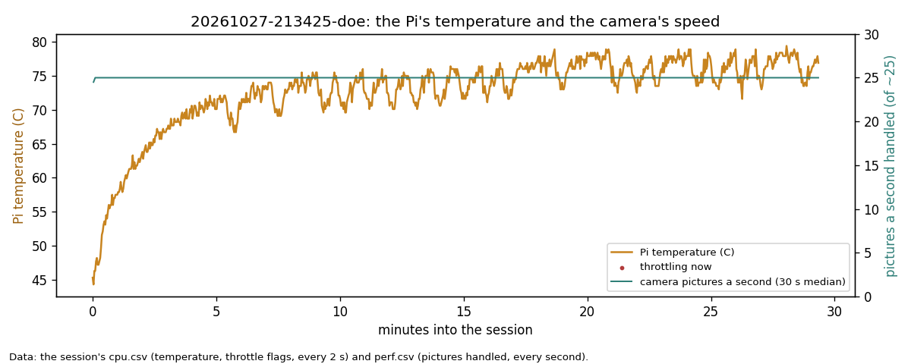
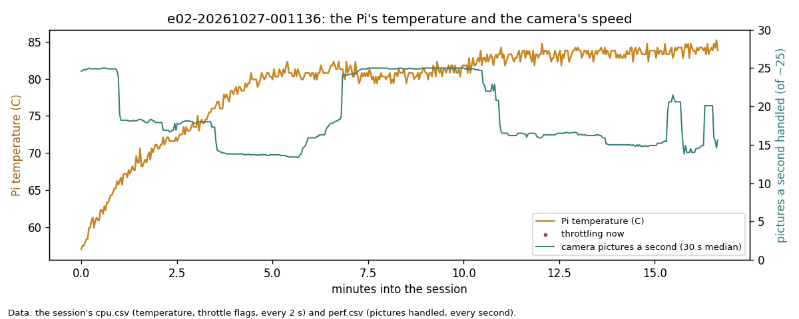
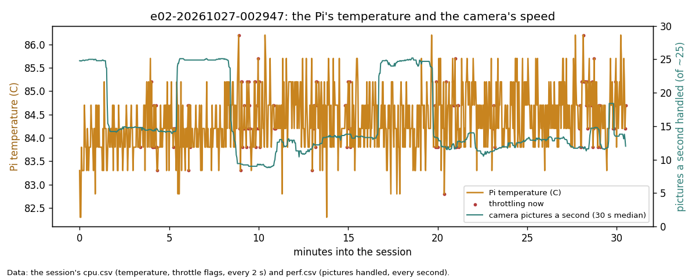
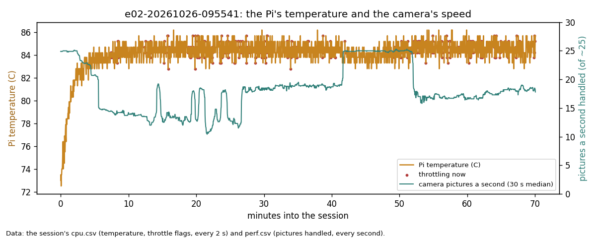

# Heat tracker: the Pi's temperature against the camera's speed

One row per session that logged cpu.csv (from 2026-10-26). Made by `tools/analysis/heat_tracker.py <session folder>`;
each session's chart is in `heat/`. States from the Pi's throttle flags at that moment: **throttling** = clock capped
or throttled now; **soft limit** = only the soft temperature limit now; **none** = no flag. Pictures a second = the
camera pictures the runner handled (perf.csv, of about 25). rho = Spearman rank correlation of temperature with
pictures a second (-1 to +1; near 0 = no link, or temperature barely varied).

| Session | Cooling | Temp median / max (C) | Min at 80 C+ | Time: none / soft limit / throttling | Pictures a second: none / soft / throttling (median) | Picture age 95% (s) | rho temp vs pictures |
|---|---|---|---|---|---|---|---|
| e02-20261026-095541 | none (bare Pi) | 84.2 / 86.2 | 68 | 4 / 80 / 17 % | 24.9 / 17.9 / 17.6 | 0.24 | -0.24 |
| e02-20261027-001136 | unknown | 80.8 / 85.2 | 11 | 63 / 37 / 0 % | 18.3 / 15.9 / - | 0.22 | -0.22 |
| e02-20261027-002947 | unknown | 84.2 / 86.2 | 30 | 0 / 85 / 15 % | - / 13.8 / 12.4 | 0.28 | -0.24 |
| 20261027-213425-doe | unknown | 74.0 / 79.4 | 0 | 100 / 0 / 0 % | 25.0 / - / - | 0.07 | 0.01 |
| 20261028-162951-doe | unknown | 74.5 / 78.9 | 0 | 100 / 0 / 0 % | 24.5 / - / - | 0.15 | -0.10 |
| 20261028-191750-doe | unknown | 70.6 / 75.5 | 0 | 100 / 0 / 0 % | 25.0 / - / - | 0.11 | 0.04 |
| 20261029-074342-doe | unknown | 79.4 / 83.3 | 19 | 97 / 3 / 0 % | 25.0 / 22.5 / - | 0.20 | -0.35 |
| 20261029-092216-doe | unknown | 74.0 / 77.4 | 0 | 100 / 0 / 0 % | 25.0 / - / - | 0.11 | -0.02 |

## Readings (newest first)
- **20261029-092216-doe (DOE loop in keep-going mode, 09:22-12:23, 3 h, daytime, cooling not in the logs):** median
  74.0 C, top 77.4 C, no soft limit or throttling in 3 hours, and the camera handled a median 25.0 pictures a second
  throughout (rho -0.02: no link). Cooler than the same morning's loop by 5 C with more driving (Left 121 drives).
  The loop ended because no robot had room for a drive (build-reports/e02-oct29-daytime-sessions.md), not from heat.
  
  The Pi's temperature and the pictures the camera handled each second, over the session; data: the session's cpu.csv
  and perf.csv.
- **20261029-074342-doe (DOE loop in keep-going mode, 07:43-08:44, 1 h, morning sun, cooling not in the logs):** the
  hottest DOE loop so far: it climbed from 61 C to 80 C in 20 minutes and sat at 79-83 C after minute 40 (median 79.4 C,
  19 minutes at 80 C or more), under the soft temperature limit 3 % of the time, never throttling. Under the soft
  limit the camera handled a median 22.5 pictures a second against 25.0 without it (rho -0.35: the hotter, the
  slightly slower). The 09:22 loop on the same Pi ran 5 C cooler; whether the morning sun was on the Pi is not in the
  logs (question in the report).
  
  The Pi's temperature and the pictures the camera handled each second, over the session; data: the session's cpu.csv
  and perf.csv.
- **20261028-191750-doe (DOE loop in keep-going mode, 27 min, 19:17-19:44, cooling not in the logs):** median 70.6 C,
  top 75.5 C, full clock the whole run, no soft limit or throttling; the coolest DOE loop so far (27 Oct 74 C, 28 Oct
  16:29 74.5 C), at night with the room lamp on. The camera handled a median 25.0 pictures a second. The loop ended at
  19:44 because all three robots were set aside (Left and Center for standing near an edge, Right "lost" during a
  crawl; build-reports/e02-oct28-keep-going-run.md), not from heat. The cooling column says "unknown": the tracker's
  default label is "none (bare Pi)", changed here because nobody recorded it.
  
  The Pi's temperature and the pictures the camera handled each second, over the session; data: the session's cpu.csv
  and perf.csv.
- **20261028-162951-doe (DOE loop, 12 min, cooling not in the logs):** median 74.5 C, top 78.9 C, full clock, no soft
  limit or throttling; the same as the 27 Oct loop. Too short to say more: the loop ended at 16:42 because every robot
  was set aside (the overhead camera saw the robots' bodies in only 3 of 29 checks), not from heat.
  
  The Pi's temperature and the pictures the camera handled each second, over the session; data: the session's cpu.csv
  and perf.csv.
- **20261027-213425-doe (DOE loop, 29 min, cooling not in the logs):** the Pi warmed from 44 C to a median 74 C (top 79 C) at the full
  1800 MHz clock the whole run, never under the soft limit or throttling (the logged "soft limit has happened" flag is
  left over from earlier since boot). Cooler than the 26-27 Oct sessions (80-86 C), with the tracking now split into a
  process per camera. The session ended at 22:03 because the Pi's card was full, not from heat.
  
  The Pi's temperature and the pictures the camera handled each second, over the session; data: the session's cpu.csv
  and perf.csv.
- **e02-20261027-001136 (E1) and e02-20261027-002947 (E2), cooling not in the logs:** E1 started
  cooler (median 80.8 C, no flag 63 % of the time); E2 followed straight on and sat at 84-86 C, under the soft limit 85 %
  of the time and throttling 15 %. These are the first sessions that log the Pi's real clock (`arm_mhz`), and it
  settles what 09:55 could not: **heat did slow the camera here.** With the same work (one robot followed, the others
  parked), the clock fell from 1800 MHz to 1531-1630 under the soft limit and to 600 MHz when throttling, and the tracker's
  median time a picture rose with it, 54 → 62 → 70 → 76 ms (build-reports/e02-oct27-session-edges.md, section 5). A fan
  or heatsink is now worth fitting before long sessions.
  
  
  The Pi's temperature (orange, red dots where it was throttling) and the pictures the camera handled each second
  (green), over each stage; data: the stages' cpu.csv and perf.csv.
- **e02-20261026-095541 (bare Pi, no fan):** the Pi reached 83 C within 5 minutes and stayed at 83-86 C for the rest
  of the 70 minutes, under the soft temperature limit 80% of the time and actually throttling 17%. The camera handled
  a median 24.9 pictures a second in the few minutes with no flag, against 17.6-17.9 with one. But the temperature
  barely varied after minute 5, so this session cannot separate heat from workload (rho -0.24): the big steps in
  picture rate line up with what the runner was doing (e.g. 25 a second at minutes 42-52, while it waited on a
  question), not with temperature. The comparison that settles it: the same session plan with a fan or heatsink case
  on the Pi (the "Cooling" column).
  Update from the session analysis (build-reports/e02-oct26-session-0955.md): the tracker's time per picture was the
  same hot or cool (26-29 ms with nothing to track, about 54 ms watching parked robots, about 73 ms following one
  as well), so in this session the picture rate was set by the tracker's workload on one core, not by heat. Heat
  is still worth a fan: 86 C is close to the Pi's 85 C hard limit.
  
  The Pi's temperature (orange, red dots where it was throttling) and the pictures the camera handled each second
  (green), over the session; data: the session's cpu.csv and perf.csv.
