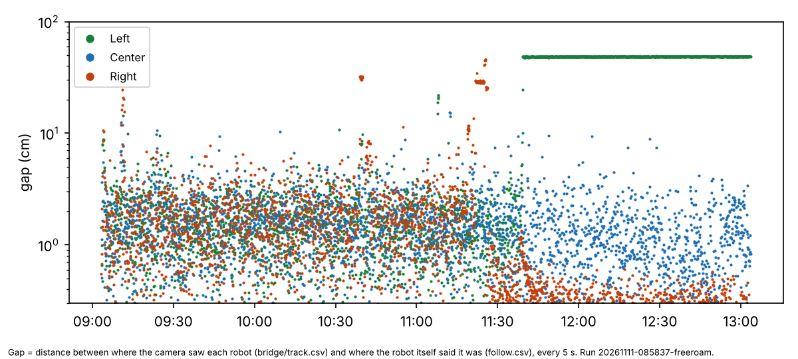

# Home, 11 Nov 08:58: the 4-hour unattended free roam

## Premise

Three robots drove curves on the home board, unattended, from 09:03 to 13:03. The run ended on its 4-hour time cap.

- Code 4732a48 (e14).
- Two cameras, video on.
- Started right after the 08:26 run (report.md in this folder).

Data: the run folder from the release freeroam-20261111-085837-freeroam (logs, and the run's own still pictures). **Measured** = read from the logs. **Claude's reading** = interpretation, marked as such.

## Data

| What | Result (measured) |
|---|---|
| Time roaming | 171 of 240 min. At least two robots moving 68 % of the time, all three 55 %. |
| Left, 11:39-13:03 | **Held for 84 minutes**: "NEEDS A HAND at 66, 98 (24 cm from the edge)". In fact Left was standing still at (31, 64): the camera saw it in 9,242 fixes, steady to 0.3 cm, and the run's 11:46 overhead picture shows it there. The gap was 48 cm. |
| How Left got there | Between 11:39:04 and 11:39:16, five moves were driven while the camera's fixes weren't reaching the run. Left's wheels turned and the camera followed it 50 cm, from (78, 86) to (31, 64). The run believed it had gone to (66, 98). |
| Holds and rejoins | 11 "NEEDS A HAND" holds (Left 4, Right 6, Center 1). 10 "REJOINED" with nobody there, 9 of them at 19-50 cm from any edge. |
| Gap between camera and the robot's own pose (chart) | Median 0.8-2.2 cm. Left's 90th percentile was 48.6 cm, all of it the 84-minute hold. Right had spells of 25-46 cm at 10:40 and 11:20-11:25. |
| Lost while standing | 23 of 56 lost spells with 0 cm driven. 7 came back 7-11 cm off, and 3 came back 26-32 cm off. |
| Watchdog stops ("nothing heard from the Pi") | Left 192, Right 114, Center 94. |
| "Did not move" moves | Center 233, Right 99, Left 68. |
| Touches | 2 reflex stops ended with the circles touching (09:37 Center-Right, 11:22 Left-Right). No push-off. |
| Pi | Cores 2-3 (camera reader + planner) **99 % busy** throughout. Fixes arrived **0.95 s** after the picture (the 08:26 run had 0.44 s). Load median 7.7, temperature 81 °C (max 83). The clock dipped once, to 1726 MHz. |

Each dot is how far apart the camera and the robot's own estimate were, every 5 s. The green line at about 48 cm is Left's 84-minute hold.

## Conclusion

1. **This is the same fault as at 08:26, at its worst.** The camera saw Left standing still for 84 minutes. The tracking layer's search circle has a 25 cm maximum, so no sighting 48 cm away could ever be accepted. Left was never going to come back by itself.
2. **The run drives blind when fixes don't arrive in time.** Left's 50 cm drive happened while camera positions arrived about 1 s late. Claude's reading: the saturated cores 2-3 explain both the late fixes and the 400 watchdog stops. Robots stop when they hear nothing from the Pi.
3. **The "never give up" rule failed here.** A robot held for 84 minutes with good camera data available is exactly what that rule forbids. Under e16's evidence rule for rejoining (8a), this hold would last forever, not 84 minutes. Fixing the tracking layer (e17) has to come before e16 runs at home.

## What's next

- Build e17, as proposed on 11 Nov: the tracking layer takes a steady sighting no other robot can claim, however far away; a heading check before moves; the core layout chosen by the bench.
- An e17 test: a robot driven 50 cm with fixes 1 s late, then held. It must rejoin from the camera within seconds.

## Sweep 1: new tests that may be needed

- Simulator: camera fixes delayed 1 s for 10 s while a robot drives. The run must slow down or stop, not drive blind.
- Simulator: a held robot 48 cm away from its own estimate, with the camera steady.
- Bench: watchdog stops per hour under each core layout.

## Sweep 2: possible inaccuracies

- The gap uses follow.csv (the robot's own filter), matched to the nearest camera fix within 1 s. Any time offset between the two clocks adds to the gap while a robot moves.
- Placing Left at (31, 64) from the picture is a rough pixel-to-cm reading (about 2.5 px per cm). The camera's fixes are the precise source.
- "Fixes not reaching the run" comes from its camera_track rows. Its exact cause in the layer's code path is Claude's reading, from tracking_layer.py's gate (6 cm + growth, max 25 cm).
- One run, one board.

Scripts: gap.py in this folder. The other numbers come from short inline scripts against the run folder.
