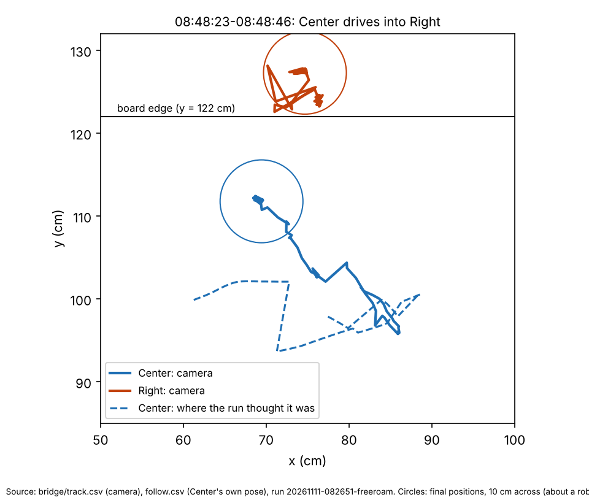
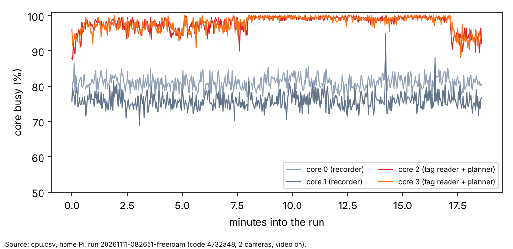

# Home, 11 Nov 08:26: why Right ended up off the board

## Premise

The 08:26 free roam ran for 18 minutes on the home board, 08:31-08:49. Setup:

- three robots, curves;
- code 4732a48 (e14);
- two cameras, video on.

Center ended up pushing Right off the y = 122 edge, and Nick stopped the run. Build e16 fixed the incident from the log lines Nick pasted, before the run's own logs were uploaded. This report reads the run's own logs.

Data: the run folder from the release freeroam-20261111-082651-freeroam (logs only, no pictures). **Measured** = read from the logs. **Claude's reading** = interpretation, marked as such.

## Data

| What | Result (measured) |
|---|---|
| The camera reader (tag bridge) | Saw all three robots almost all the time: 5,542-5,561 of 5,569 pictures each. |
| What reached the run during Right's hold (08:35:50-08:36:27) | The bridge saw Right standing still at (63, 41) cm, steady to 0.5 cm, in 250 fixes. The run received none of them: its camera_track has no Right rows until the REJOINED. Right's own pose said (71.4, 32.7), 11.4 cm away. |
| What reached the run during Center's hold (08:44:50-08:46:09) | The bridge saw Center standing at (9, 83) cm in 316 fixes. None reached the run. Center's own pose said (30.5, 61.3): **30 cm** away. The run asked for a hand with the message "29 cm from the edge". By the camera, Center stood about 9 cm from the x = 0 edge. |
| "Lost" while seen | 25 lost spells. In 14 of them the robot hadn't moved (0 cm driven blind); in 9 of those it was 9.5-30 cm off when "seen again". |
| Own pose re-set from the camera | 39 times, median 10 cm (Center 19 times, up to 24 cm; Right 12 times, up to 26 cm). |
| The push (08:48:23-08:48:46) | Center's own heading was off by 71° ("own -50, camera 21"). Its 14 cm reverse, planned to go away from the edge, went toward Right instead (chart 1). The centres came within **12.9 cm**. The run had also sent Right a 75° on-the-spot turn ("shuffle") while it stood at y ≈ 124. Right's gyro turned 46° and it tilted 6.6°, then 19.5°. |
| Edge stops | Right's and Center's own edge sensors felt 3 drops. The camera's y = 122 line is about 2-5 cm inside where Right actually stood for 9 minutes without falling. |
| Pi | The tag reader and the planner are both pinned to cores 2-3. Those cores were **99 % busy** for the whole run (chart 2). The bridge handled 4-5 of the camera's 25 pictures a second, and fixes arrived 0.44 s late. Load median 7.4, temperature 79 °C (max 82). The clock held 1800 MHz. |

Solid lines: where the camera saw Center and Right. Dashed: where the run thought Center was. Center's 14 cm reverse went north toward Right while the run thought it went west.

How busy each of the Pi's four cores was, every 2 seconds. The tag reader and the planner share the two cores that stayed full.

## Conclusion

1. **The camera saw the robots, but the run threw the pictures away.** The tracking layer matches each camera sighting to where it expects the robot to be. For a standing robot it only searches a small circle: 6 cm, growing about 2 cm per root-second. A robot whose own pose had drifted 11-30 cm was outside that circle, so the sightings weren't used. Without them, the robot counted as "lost", was held "near an edge", and asked for a hand. When the circle finally grew enough, or the hold reset it, the sudden jump to the camera's position was read as "moved in": the false REJOINED. This breaks the "observe, then trust" rule: here the evidence lost to the guess. Claude's reading: this is the root cause behind several symptoms e16 fixed separately (the false rejoin, the hand requests far from any edge, being unsure near an edge).
2. **The push came from a wrong heading, not a missed obstacle.** Center's own heading was 71° off, so a move planned to back away went toward Right. At the same moment, the run turned Right on the spot at the edge. The logs can't tell which tipped Right over: Center coming within 12.9 cm (about touching, for robots roughly 10 cm wide), or Right's own turn.
3. **Cores 2-3 are saturated.** The reader drops 80 % of the pictures, which makes every fix about half a second old. Claude's reading: this adds to the drift in 1. e16's cuts (video off, a slower motion detector) free core 0-1 time, but don't touch the shared pin on 2-3.
4. **e16's "moved in only on evidence" (8a) could make 1 worse.** If the layer still drops the camera's sightings, the run never gets the evidence that would let a held robot rejoin. It would hold forever. This needs fixing together with 1.

## What's next

A build, e17 (needs Nick's go-ahead):
- the tracking layer accepts a lone, steady sighting that no other robot can claim, however far it is from the robot's own pose;
- the run corrects a robot's heading from the camera before any move that follows an off-plan heading;
- the reader and the planner stop sharing two cores;
- a test of 8a with sightings outside the gate.

## Sweep 1: new tests that may be needed

- Simulator: a standing robot whose own pose is 10, 20 or 30 cm off, with the camera steady. It must take the camera's fix within a few seconds, and never ask for a hand.
- Simulator: a robot with a 70° heading error asked to reverse near another robot.
- A Pi bench with the reader and the planner on separate cores, measuring pictures handled per second.

## Sweep 2: possible inaccuracies

- "None reached the run" comes from camera_track.csv. Its rows are written only for sightings the layer named, so a sighting that was named but rejected later isn't counted.
- Robot width ~10 cm is approximate. Contact at 12.9 cm centre-to-centre is likely but not proven.
- The board's y = 122 line comes from the camera calibration. Right standing at y ≈ 124 means that line is off by a few cm there.
- One run, 18 minutes, three robots.

Scripts: charts.py in this folder (inputs: the run folder). The other numbers come from short inline scripts against the same files.
