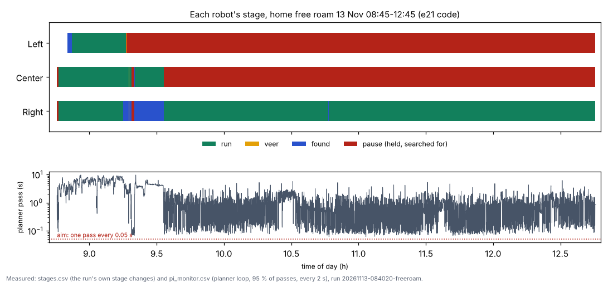

# Home, 13 Nov 08:45-12:45: the 4-hour free roam on e21

## Premise

Three robots on the home board, unattended, curves, code 94d1eaf (e21), started from the terminal after the robots were
power-cycled. Nick watched parts of it live: two robots stood near each other mid-board (08:46, they moved again at
08:47), two robots stood still and boxed the third into a corner (about 10:00), and one robot would not go into a large
open area (12:42). Data: the run folder from the release freeroam-20261113-084020-freeroam (logs and its pictures).
**Measured** = read from the logs; **Claude's reading** = interpretation, marked.

## Data

| What | Result (measured) |
| --- | --- |
| Moving (wheels turning) over the run | Left 2.0 %, Center 3.2 %, Right 70.1 % (report.md, motion.csv) |
| Stage | Left paused from 09:16:31 to the end (3 h 29 min); Center paused from 09:33:10 to the end (3 h 12 min); Right ran |
| What the camera bridge saw in those hours | Left and Center standing still, 17 cm apart, in nearly every picture (Left seen in 47,365 of 47,370 bridge frames over the run); the side camera merged the two into one blob 18,009 times |
| The camera's spot against each robot's own pose | Left 4-5 cm apart; Center 14 cm apart, steady for 3 hours |
| Camera fixes the run accepted for Left or Center after 09:35 | none (camera_track.csv) |
| Anything the run did for them after 09:35 | nothing: no move, search, creep, correction or note (events, moves, searches, creep, fallbacks) |
| How they were held | Left 09:16:28: "lost ... searched for, no room to turn on the spot: stands until seen", then NEEDS A HAND (click it in Mission Control). Center 09:33:08 the same |
| The Pi | all four cores busy (median 99 / 98 / 88 / 86 %); the planner's pass took 0.1-10 s at the slowest 1 in 20 (aim 0.05 s); fixes arrived up to 3.7 s late; 79 C median, never throttled |
| Battery | the robots ended at 29-30 % after 4 h (the time cap) |

Above: what stage each robot was in over the run (red: held and waiting to be found). Below: how long the planner took
for its slowest passes, every 2 s, against the 0.05 s it aims for.

## Conclusion

1. **The two "stuck" robots were held for good with the camera seeing them.** Each lost its camera fix while standing
   next to the other, was held "until seen" with a request for a hand, and was never seen again by the run, although
   the bridge saw both all along (Claude's reading: two lost robots this close cannot be told apart from a merged
   picture, and a held robot took no action that would tell them apart).
2. **This is what e22 changed.** e22 found the same cause in the simulator ("held robots skip everything in the tick"),
   replaced every wait for a person with a self-rescue ladder (turn, an out-and-back the camera can tell apart, creep
   to the middle), and paces the planner. Claude's reading: on e22 these two robots would have kept trying; whether
   they would have been told apart is what the next home run shows.
3. **The Pi was far behind.** The planner took up to 200 times its aim; late fixes made robots "lost" more often.
   e22's paced planning targets this; the Pi timing bench (`./run-fleet-pi.sh timing`) will measure it on the Pi.
4. **Nick's 12:42 photo** (one robot not entering open ground): Right was the only robot running then; the two held
   robots and their keep-outs sat in the board's middle. Claude's reading, unconfirmed: their space and Right's own
   edge doubts left it working the board's edges.

## What's next

- Update the home Pi to e22 and run the same 4-hour free roam: the first real check of the self-rescue ladder.
- The Pi timing bench before it.
- The boxed-in fix (MIRLT_BOX_ASK) made safe enough to switch on, and the all-lost case (the next build).

## Sweep 1: new tests that may be needed

- Simulator: two robots lost while standing 17 cm apart, merged in the side picture, held: both must be told apart and
  moving within minutes.
- The same with the planner's pass at 1-10 s (the measured Pi), not the build machine's.

## Sweep 2: possible inaccuracies

- "Seen" is the bridge's own word; a merged blob counted as both robots seen.
- The Pi's planner time comes from its monitor (95 % of passes, every 2 s), not a per-pass log.
- Conclusion 4 is not checked against the pictures in the run folder.
