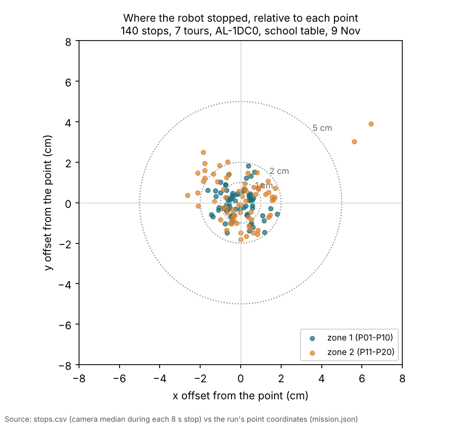
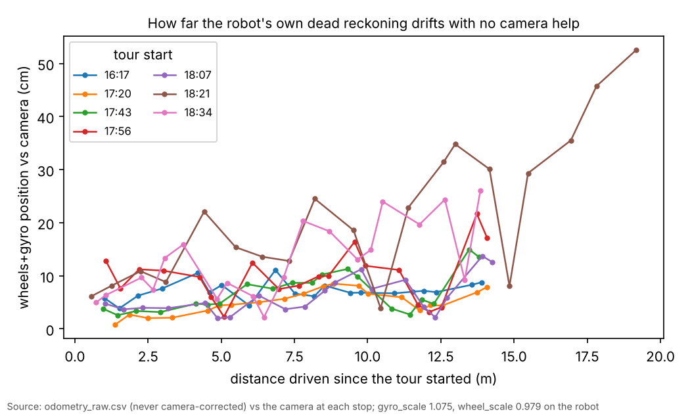
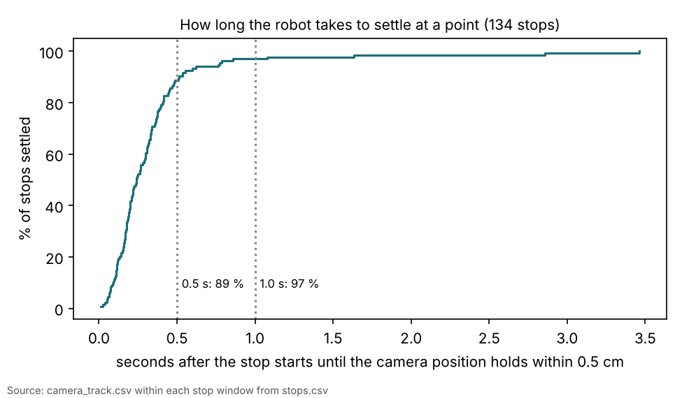

# Jay-Sun's 7 school tours (9 Nov): how accurately the robot stops, and what the data says about our system

## Premise

Jay-Sun ran 7 Visit-points tours on 9 Nov, 16:17-18:43, with one robot (AL-1DC0, "Alpha" in the runs): 20 points each,
10 cm/s, 8 s stops, "try unreadable points anyway" on. Five tours ran in order (P01-P20), one in a mixed order
(18:21) and one reversed (18:34). This is our largest school dataset: 140 stops. Data: each run folder's
`run/stops.csv`, `run/camera_track.csv`, `run/odometry_raw.csv`, `run/coordinator.jsonl` and `mission.json` (logs
only; the camera pictures are on the school Pi's USB stick). Nothing from the RFID reader was used. **Measured** =
read from the logs; **Claude's reading** = interpretation, marked.

## Data

| What | Result (measured) |
|---|---|
| Stops seen by the camera | 140 of 140, including the 8 points flagged "unreadable" before the run (P03, P05, P12, P13, P15, P18, P19, P20) |
| Stop position vs the point (camera) | median 1.1 cm, 95 % within 2.2 cm, worst 7.5 cm (P15, 16:17 tour: see finding 1); zone 1 median 0.7 cm, zone 2 1.4 cm |
| Average offset over all stops | x -0.03 cm, y +0.10 cm (no lean in one direction) |
| Repeatability: spread of the 7 stops at the same point | median 1.0 cm (rms), worst P15 2.9 cm |
| The camera's stated +- per stop | median 2.9 cm |
| Camera position wobble during a stop | median 0.02 cm, 95 % under 0.26 cm |
| Settling: time from the stop's start until the camera position holds within 0.5 cm | median 0.24 s; 89 % within 0.5 s, 97 % within 1.0 s; worst 3.5 s (P12, 17:43) |
| Stop length | 139 stops 8.0 s; one 3.99 s (P15, 16:17: finding 1) |
| Robot's wheels+gyro position (no camera) vs camera, at the tour's end | in-order tours 7.9-17.1 cm after about 14 m (0.6-1.2 % of distance); mixed order 52.5 cm after 19 m (2.7 %); reversed 26.1 cm after 14 m (1.9 %) |

Each dot is one stop: how far, and in which direction, the camera saw the robot stop from the point it was sent to.

Each line is one tour: how far the robot's own wheel-and-gyro estimate had wandered from the camera at each stop,
against the distance driven. The camera corrected the robot during the tours; this estimate is the one it would have
had alone.

The line shows what share of stops had settled within a given number of seconds after the stop began.

## Conclusion

1. **A wrong camera "lock" position interrupted one stop (bug, sent to build e12 as item 9).** At P15 in the 16:17
   tour, the camera's lock tracker (it follows the robot's outline when the roof tag is not decoded) put the robot 7 cm
   from where it stood. The safety check trusted it, set the robot's pose to it, halted the stop and restarted it as a
   4 s wait. So that stop is recorded as 3.99 s long and 7.5 cm off. In the 18:07 tour the same wrong coordinates
   (186.2, 154.4) appear again near P15. **Claude's reading:** the lock tracker latches onto something fixed on the
   table near P15. Fix in progress: a lock-only position may not reset a robot's pose, and a stop interrupted with the
   robot standing still keeps its full length in `stops.csv`.
2. **The robot stops where it is sent, and the same way every time:** about 1 cm from the point, repeatable to about
   1 cm. **Caveat:** these are the camera's numbers. The robot steers by the camera, so this measures how well it
   follows the camera, not how true the camera's centimetres are. The camera's own +- (2.9 cm) is about 3 times the
   spread we see, so most of it must be a fixed error in the table frame that every stop shares. A tape-measured
   check against stickers (Dr. Sodhi's item) is what tests that.
3. **The "unreadable" points are readable.** The cautious starting map of the camera's view was wrong at all 8
   points. Stops at those points are only slightly worse (median 1.3 cm vs 0.9 cm). Build e12 learns the readable area
   from evidence like this.
4. **The robot settles fast.** For Jay-Sun's scoring windows: starting 1.0 s after `dwell_start` keeps 97 % of stops
   fully settled and still gives 7 s of data per stop. (Claude's suggestion; 1.0 s is a chosen number: a DOE is not
   needed, the settle data above is the evidence.)
5. **Without the camera, the robot drifts about 1 % of the distance driven on straight tours, more on turning-heavy
   orders.** The mixed and reversed orders drifted 2-3 times more for the same distance. **Claude's reading, not
   tested:** more and sharper turns, so heading error matters more. The end-of-tour drift also rose over the first four
   in-order tours (8.8, 7.9, 13.5, 17.1 cm), which could be battery or warming. Not proven with 4 points.

## What's next

- Build e12 item 9 (finding 1), tonight.
- Tell Jay-Sun: P15 in the 16:17 tour has a short, interrupted stop; use `stops.csv` positions and times, and the
  point coordinates the run used (below).
- **Point coordinates:** the runs used P09 = (43.2, 146.1) cm and P10 = (83.8, 95.3) cm, not the points sheet's
  (43.2, 95.3) and (83.8, 69.9). The run log says P09 follows "the spreadsheet (confirmed by Jay-Sun 3 Nov)". Jay-Sun
  should check his own analysis uses the same coordinates as the run (`mission.json` "spots").
- **Calibration values:** the robot reported `gyro_scale` 1.075 and `wheel_scale` 0.979 in every tour. Check that
  these are the values the 9 Nov calibration saved.
- A tape-measured accuracy check (Dr. Sodhi's item 2), with the camera's +- compared to the measured error.
- Turning-heavy vs straight orders, and drift vs battery: a small DOE candidate (docs/doe-backlog.md).

## Sweep 1: new tests that may now be needed

- Simulator: a lock that latches onto a fixed feature near a point (e12 item 9).
- A stop interrupted by a halt with the robot standing still: `stops.csv` keeps one full stop.
- A tape-measure check of 5-10 stops against the stickers (independent truth).
- A repeat of the drift comparison with the battery level logged at each tour's start.

## Sweep 2: possible inaccuracies

- Every position here is the camera's. Without independent truth, accuracy means "agreement with the camera".
- Stop offsets compare against the run's point coordinates (`mission.json`), which for P09 and P10 differ from the
  points sheet.
- Settle time uses a chosen 0.5 cm hold band on the camera track. A different band moves the numbers.
- The raw odometry is the analysis's own integration of the robot's rows (run_exports), anchored once at the start.
  A heading error at the start counts as drift.
- One robot, one evening, one table: the drift trend over the evening rests on 4 tours.

Scripts: `analyse.py` and `charts.py` in this folder (inputs: the 7 run folders).
