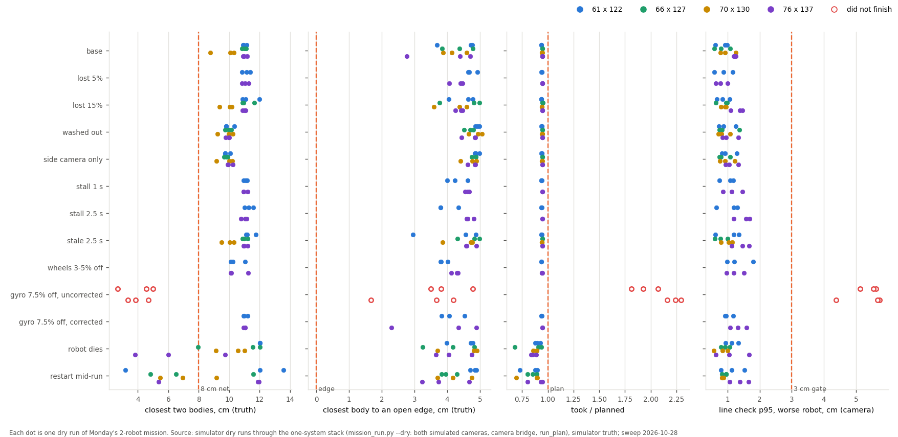
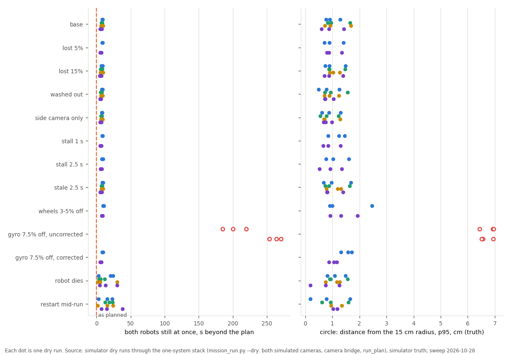
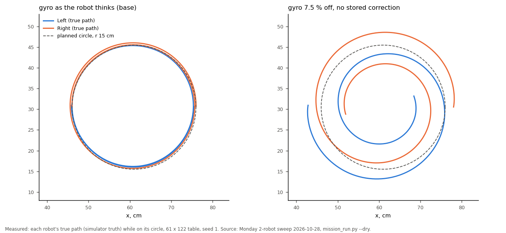

# Monday's 2-robot mission under the school's conditions (simulator sweep, 2026-10-28 overnight)

## Premise

Open question 31 for the new mission: does Monday's 2-robot default (mow from each end, meet, circle 1.5 times,
mow on, Chicken, spread out, dance) hold up on the table sizes Nick gave (61 x 122 to 76 x 137 cm) under the
conditions the school may bring? Simulator only, through the one-system stack exactly as `./run-fleet-pi.sh monday`
runs it: `mission_run.py --dry` (blocks, plan, both simulated cameras, camera bridge, run_plan with every engine
check). Truth comes from the simulator. Mission: commit ceffc31 ("Chicken played together"); the runs before that
commit are kept apart as the pre-fix mission (Appendix C). All these runs use the Chicken of ceffc31 (swerve at 15 cm,
never under 8 cm): **the pre-pass Chicken**. Nick's 03:52 change (swerve a little and drive on past) came after.

180 dry runs, 22:48-04:22, at most two at a time (each in its own network namespace). 13 conditions x 3 seeds on 61 x
122 and 76 x 137; the 7 conditions that matter most also on 66 x 127 and 70 x 130. The safety-net DOE (5 / 6.5 cm) is
its own report: [safety-gap-doe.md](safety-gap-doe.md).

## Data



Each dot is one run (colour = table size, red ring = did not finish): every condition but the uncorrected gyro finished
on time with robots over 8.7 cm apart; the dead and restarted robots are the dots under the 8 cm line.

| Condition | Tables | Runs | Finished | Closest bodies, cm | Closest to an open edge, cm | Took / planned | Both still beyond plan, s | Circle off radius p95, cm | Line check p95, cm (worse robot) |
|---|---|---|---|---|---|---|---|---|---|
| base | all 4 | 12 | 12 | 8.8-11.2 | 2.8-4.8 | 0.94-0.95 | 5-9 | 0.6-1.7 | 0.6-1.3 |
| lost 5 % | 61 x 122, 76 x 137 | 6 | 6 | 10.8-11.4 | 4.1-4.9 | 0.94-0.95 | 5-9 | 0.7-1.4 | 0.6-1.2 |
| lost 15 % | all 4 | 12 | 12 | 9.3-12.0 | 3.6-5.0 | 0.94-0.95 | 5-10 | 0.7-1.5 | 0.6-1.5 |
| washed out | all 4 | 12 | 12 | 9.2-10.3 | 4.4-5.1 | 0.94-0.95 | 5-9 | 0.5-1.6 | 0.7-1.4 |
| side camera only | all 4 | 12 | 12 | 9.2-10.2 | 4.4-5.0 | 0.94-0.95 | 5-9 | 0.6-1.3 | 0.8-1.3 |
| stall 1 s (every 20 s) | 61 x 122, 76 x 137 | 6 | 6 | 10.9-11.2 | 4.0-4.7 | 0.94-0.95 | 6-9 | 0.7-1.5 | 0.7-1.5 |
| stall 2.5 s | 61 x 122, 76 x 137 | 6 | 6 | 10.8-11.6 | 3.8-4.8 | 0.94-0.95 | 6-10 | 0.5-1.6 | 0.7-1.7 |
| stale 2.5 s (frozen picture, new time stamps) | all 4 | 12 | 12 | 9.5-11.8 | 3.0-5.0 | 0.94-0.95 | 5-10 | 0.7-1.7 | 0.6-1.7 |
| wheels 3-5 % off, no warm-up correction | 61 x 122, 76 x 137 | 6 | 6 | 10.1-11.2 | 3.8-4.3 | 0.94 | 8-11 | 0.9-2.5 | 1.0-1.8 |
| **gyro 7.5 % off, no stored correction** | 61 x 122, 76 x 137 | 6 | **0** | **2.7-5.0** | 1.7-4.8 | 1.81-2.29 | 185-271 | **6.4-7.0** | 4.4-5.7 |
| gyro 7.5 % off, stored correction 1.075 | 61 x 122, 76 x 137 | 6 | 6 | 10.9-11.2 | 2.3-4.9 | 0.94-0.95 | 5-10 | 0.9-1.7 | 0.9-1.6 |
| **a robot dies** (10-110 s) | all 4 | 12 | 12 | **3.8**-12.0 | 3.2-4.9 | 0.68-0.94 | 2-30 | 0.2-1.6 | 0.6-1.7 |
| **a robot restarts** (silent 2-6 s) | all 4 | 12 | 12 | **3.2**-13.6 | 3.2-4.9 | 0.69-0.95 | 2-38 | 0.2-1.6 | 0.8-1.7 |

<sub>Closest bodies and edge: the robots' 9.5 cm square bodies (corners), simulator truth, every 0.05 s. Took / planned
under 1: the plan has slack; the dead/restart rows lose the out robot's remaining part. "Both still beyond plan": time
both robots stood still at once (moved under 0.25 cm and 2 deg in 0.5 s), run minus plan. Circle: the true distance from
the circle's centre against its 15 cm radius. Line check: run's own line_check.py (camera spots against planned lines),
gate 3 cm; no run outside the gyro row had a miss run longer than 6 pictures. Drawn conditions per seed (which robot,
when, how much): results.json `words`.</sub>



Each dot is one run (same colours): only the uncorrected gyro stands still for minutes and leaves the circle by 6-7 cm;
everything else stands still 2-38 s beyond the plan and holds the circle within 2.5 cm.



The two robots' true paths on the circle: on the left as planned, on the right with each gyro under-reading 7-8.5 % and
no correction, both spiral inward and meet.

### What breaks, and why

| Condition | What happened | Why (Claude's reading unless the log says it) |
|---|---|---|
| Gyro 7.5 % off, no stored correction (6 of 6) | The circle drifts 5-7 cm off its radius, the robots come 2.7-5.0 cm apart in it, a distance-sensor stop marks the other robot as an obstacle, then 30 re-plans find "no safe route" and the run gives up | On an arc the robot's heading comes from its gyro alone: the camera sends headings only on straight travel, and its position fixes don't steer the heading round a curve. 1.5 turns = 540 deg; 7.5 % short is 40 deg of heading. The stored 1.075 fixes it (next row) |
| A robot dies or restarts between 11 and 50 s (9 of 24 runs) | The other robot finished but passed the stopped one at **3.2-6.9 cm** (bodies) | Logged: the out robot becomes a fixed obstacle "1 cm bigger all round" (run_plan `out_obstacle`), and the planner keeps 1.5 cm from obstacles; the 8 cm net applies to two robots in a plan, not to a robot that is out |
| Closest to an open edge, 2.3-3.0 cm (3 of 90 runs that finished normally; median 4.6; 1.9 cm once in the DOE) | Always Left, always the **turn on the spot at the end of its first lane**, by the x = 0 short end | Measured from the body's corners. Lane 1 runs 7.5 cm from that edge (body side) and a turn on the spot swings the square's corners 6.7 cm from the middle, leaving 5.5 cm by plan. Left drove lane 1 up to 1.8 cm towards the edge (true path), so the turn came closer. Claude's reading: lane 1 is driven before the camera has given a heading; the start's placement angle (the simulator's 1.5 deg) shows as drift. All three are seed 3, whose start placement is the same in every condition |

What held: lost packets 5 and 15 % (after the start-up fixes below), washed-out overhead, side camera only, camera
stalls of 1 and 2.5 s, a frozen camera (after the bridge fix), wheels 3-5 % off, the gyro off with its stored
correction, and all four table sizes.

**The edge distance Nick asked about (~4 cm in the build):** measured from the robot's body (its corners), not its centre
(the centre is 4.75-6.7 cm further in). Healthy runs: median 4.6 cm overall, 3 of 90 under 3.5 cm. Where: the turn at
the end of Left's lane 1 (the x = 0 short end: the closest point overall) and, along the long sides, the step across
to the next lane at a lane's end ("mow lane 2 start", "mow lane 6 start").

### Bugs found and fixed (tools/fleet, each with a test; full suites below)

| Found in | Problem | Fix (commit) |
|---|---|---|
| lost 15 %, 61 x 122 | The dance's "started" report was lost; a dance until switched off never reports "done", so run_plan waited until the time limit (330 s) and stopped everyone | A step a FOLLOW record names as running counts as started (`run_plan.on_follow`, 756e703) |
| frozen camera (stale 2.5 s) | A camera re-sending its last picture with new time stamps put moving robots where they had been; the camera guard (6 cm for 1 s) stopped every run at 10 s | The camera bridge skips a picture identical to the one before, pixel for pixel (`cam_bridge.same_picture`, d4ae0e5; count in the summary, d7c6bd9) |
| lost 15 % start-up | 3 of 4 first starts refused: "did not start their follow run" (its RUNINFO lost) or "Settings not confirmed after 3 tries" (a read-back answer lost 3 times) | FOLLOW records count as the follow run having started; settings read back up to 6 rounds, was 3 (`engine_checks.READBACK_TRIES`, 2797e38). After: 12 of 12 started first time |

Also fixed in the sweep tools only: the gyro corrected / uncorrected runs now use the same robots' errors (paired);
a retried start draws fresh packet losses.

## Conclusion

- **Monday's 2-robot mission holds on all four table sizes** under lost packets (5, 15 %), a washed-out overhead, the
  side camera alone, camera stalls and a frozen camera, wheels 3-5 % off and the gyro with its correction: 90 of 90 runs
  finished 5-6 % early,
  robots 8.8-12.0 cm apart (bodies), never under the 8 cm net, line check p95 0.6-1.8 cm.
- **It breaks when a gyro runs without its stored correction:** the circle spirals in and the robots come 2.7-5.0 cm
  apart, then stand still for good. With the correction (what run_plan sends real robots every run, read back) it holds.
- **A robot that dies or restarts is passed at 3.2-6.9 cm** in 9 of 24 runs: the run finishes, but under the 8 cm net.
- Three start-up and frozen-camera bugs were found and fixed; before them 15 % packet loss refused or stalled 4 of 4
  starts and a frozen camera stopped 2 of 2 runs.
- The closest an open edge comes is 1.9-3.0 cm at Left's first lane-end turn in a few runs (median 4.6 cm), from the
  body's corners.

## What's next

1. **Nick's call (question below):** keep a dead or restarted robot 8 cm away like a live one (pad its obstacle by the
   net minus the planner's 1.5 cm), or keep it a brick (2.5 cm). Small change in `run_plan.out_obstacle`; needs a
   re-run of the 24 dead/restart runs (about 45 min).
2. **Gyro corrections are load-bearing for the circle:** keep "settings read back" as a hard start check (it is), and
   consider camera headings on arcs (the bridge sends them only on straight travel) so the circle survives a lost
   correction. Not small: design first.
3. **Lane 1's first metres:** a short straight run-in before lane 1 (as the meet and Chicken have) so the camera gives a
   heading before the first lane-end turn; or move lane 1 1-2 cm in.
4. **Re-run on the new Chicken** (Nick 03:52: swerve a little, pass to the other end) once it lands: the Chicken rows
   (closest approach, edges near the far ends) change. About 1 h for the 61 x 122 and 76 x 137 rows.

## Sweep 1: new tests that may now be necessary

- The new passing Chicken through this sweep (base, washed out, side only, lost 15 %, 3 seeds, two sizes).
- Dead / restarted robot with the padded obstacle (after Nick's answer): closest approach and whether small tables still
  plan round it.
- On the board: one Monday run with the gyro correction deliberately not sent, stopped by hand at the circle (does the
  real robot spiral like the simulated one?), and the real circle's radius error with the correction.
- Start placement: Left put down 2 deg off on purpose, then the lane-1 turn's edge distance (camera).
- A frozen real camera (unplug the USB mid-run, or pause camrec): does the real stream repeat pictures or stop?
- Start-up on the school WiFi with packet loss measured (the read-back rounds, time to start).

## Sweep 2: possible inaccuracies

- **The simulator's cameras are clean:** camera against truth p95 0.6-2.4 cm (median 0.8) here; the real L3 line check
  was 0.9-3.1 cm against the sim's 0.4-1.7. Real margins will be smaller than these.
- **Side camera only is optimistic:** the simulated side camera saw every body every picture; on 27 Oct the real one
  carried the bodies but at 8-10 pictures a second with dark pictures.
- **Chosen, not measured:** stall pattern (every 20 s from 7 s), death and restart times (10-110 s), boot silence
  (2-6 s), wheel errors (3-5 %, random sign), gyro errors (6.5-8.5 %, stored 1.075), packet loss independent per packet
  (real WiFi loses in bursts). Each has a DOE note in `monday2_sweep.py`; the stall spacing has a DOE row.
- **Shared machine:** a second agent's simulations ran beside the sweep until about 23:00 (load up to 5); per-run load
  is in each run's `sweep_meta.json`. No result changed with load in an obvious way, but real-time margins were thinner.
- **Mixed code versions** (all on the ceffc31 mission): 32 runs were made before the bridge and start-up fixes; none
  had a frozen camera, and the 4 lost-5 % runs among them started first time, so the fixes did not come into play.
  Every run's commit is in results.json `code`.
- **"Closest during"** names the step each robot last started, so a turn after a labelled drive carries the drive's name.
- 3 seeds per cell; the 66 x 127 and 70 x 130 tables ran 7 of the 13 conditions.

## Appendix A. How to run it

```
nice -n 10 python3 tools/fleet/sweeps/monday2_sweep.py run --out DIR --levels 8,6.5,5 [--start-for-s 390]
python3 tools/fleet/sweeps/monday2_sweep.py collect --out DIR
python3 tools/fleet/sweeps/monday2_charts.py --rows DIR/results.json --out docs/screenshots/2026-10-28
```

New conditions in `sim_shim.py`: `live_stall_s` / `live_stall_mode` (stall: no pictures; stale: the last picture again
with new time stamps), `side_only` (the overhead sees no robot), `restart` (stops, silent for a while, new boot ID,
factory settings). `mission_run.py` gained `--sim-cond`, `--sim-arg`, `--rp-arg`, `--setting`.
Rows: [data/monday-2robot-sweep/results.json](data/monday-2robot-sweep/results.json).

## Appendix B. Process notes

The sweep's 2-hour background job hit its time limit at 01:57; the remaining 80 runs ran as bounded 10-minute chunks
(`--start-for-s`). Four runs at 04:04 started while another agent was editing `missions.py` (Nick's passing Chicken)
and failed to plan; they were re-run from a clean checkout of 60b99eb. The disk-fix build's dry DOE loop held the simulator's network
port for about 6 minutes in the early morning: every sweep run has its own network namespace (`unshare -n`), so it
could not meet that port, and no run after 23:57 failed to start or lost its link; none was re-run for it.

## Appendix C. Superseded runs

[data/monday-2robot-sweep/superseded-runs.json](data/monday-2robot-sweep/superseded-runs.json):

- **Pre-fix mission** (before ceffc31, each robot played its half of Chicken alone): 6 runs, base and lost 5 / 15 % on 61
  x 122 and 76 x 137, seed 1. All finished in 0.91-0.93 of the plan, closest bodies 12.0-12.1 cm (during mowing or the
  circle, not Chicken), closest to an edge 3.4-4.8 cm (lane-end steps). On ceffc31 the same runs come 10.9-11.2 cm close,
  at Chicken's swerve.
- **Before the start-up and bridge fixes:** 15 % loss: a 330 s timeout (the lost dance start), two starts refused twice
  (the retry drew the same packet losses), one refused once; frozen camera: 2 of 2 stopped at 10 s.
