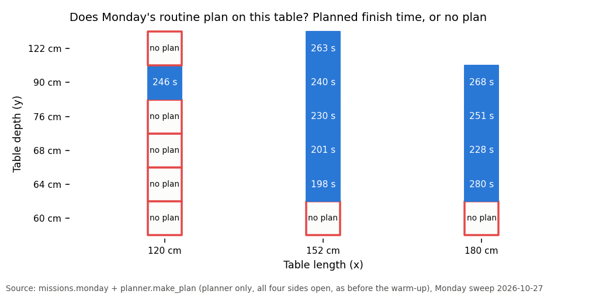
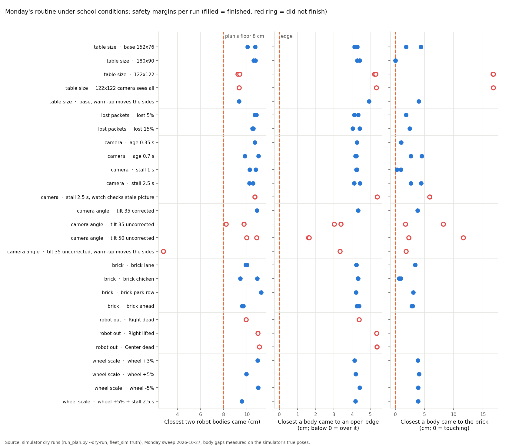
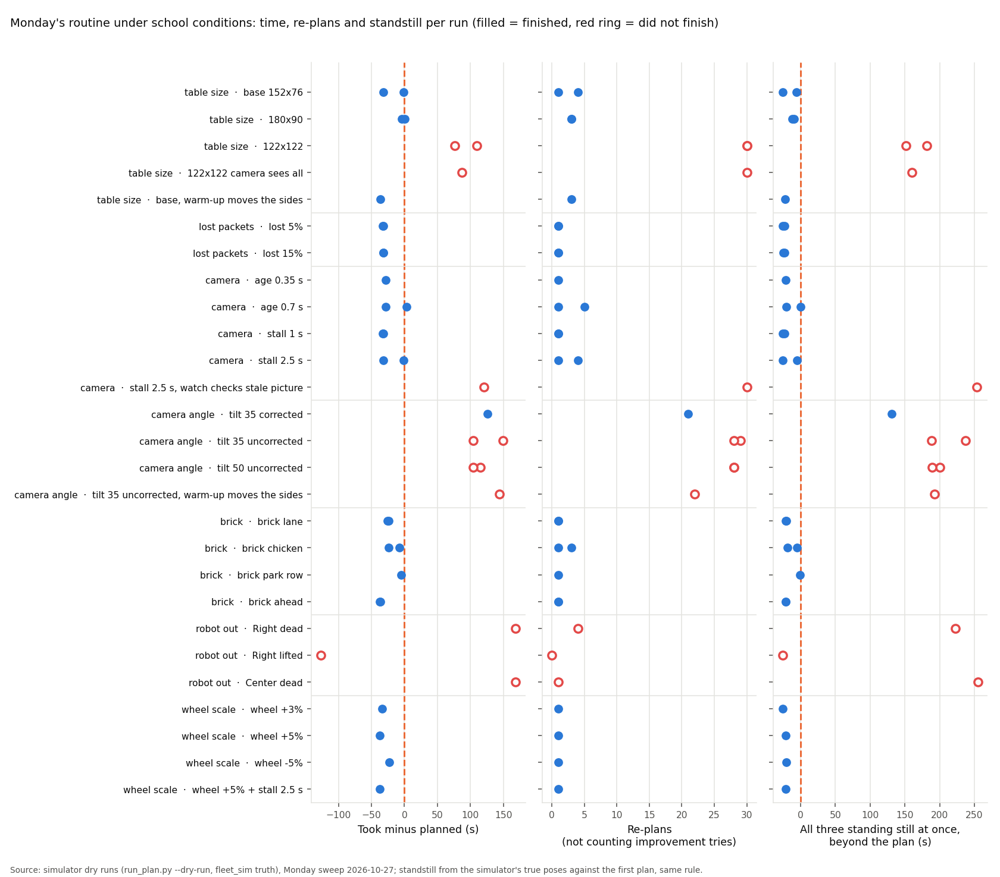
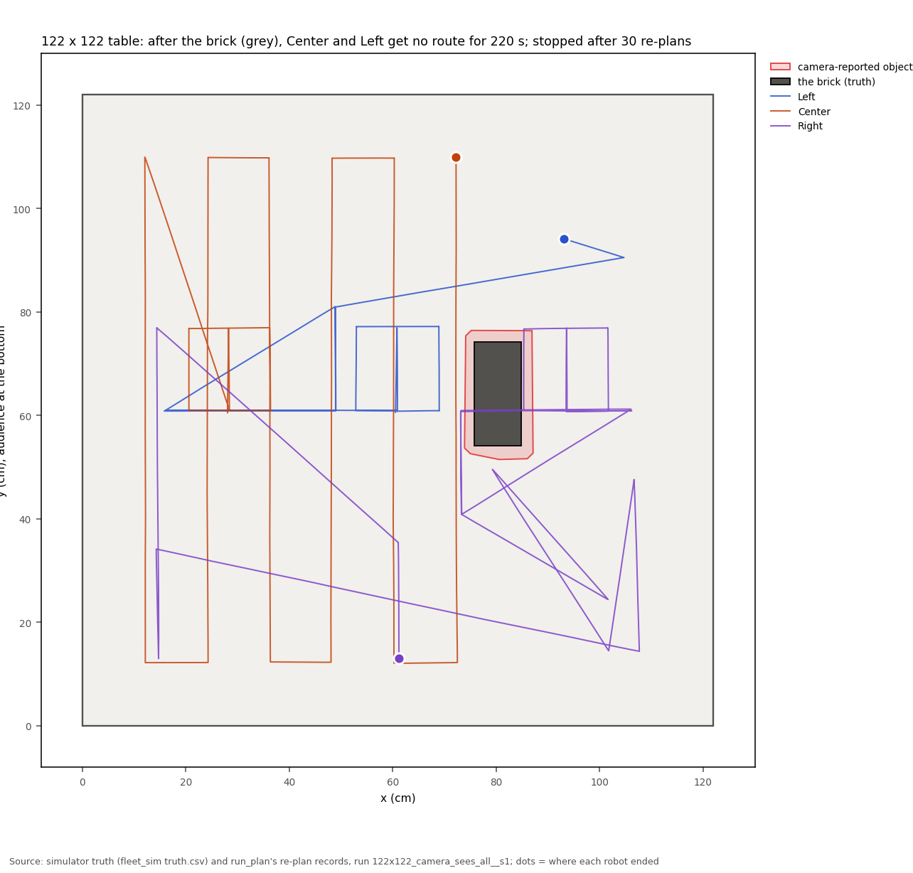
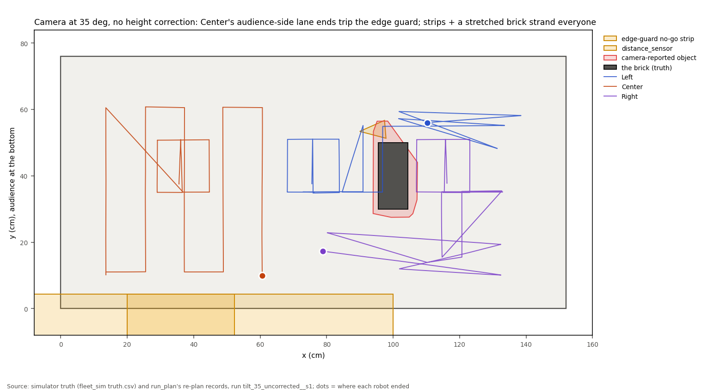
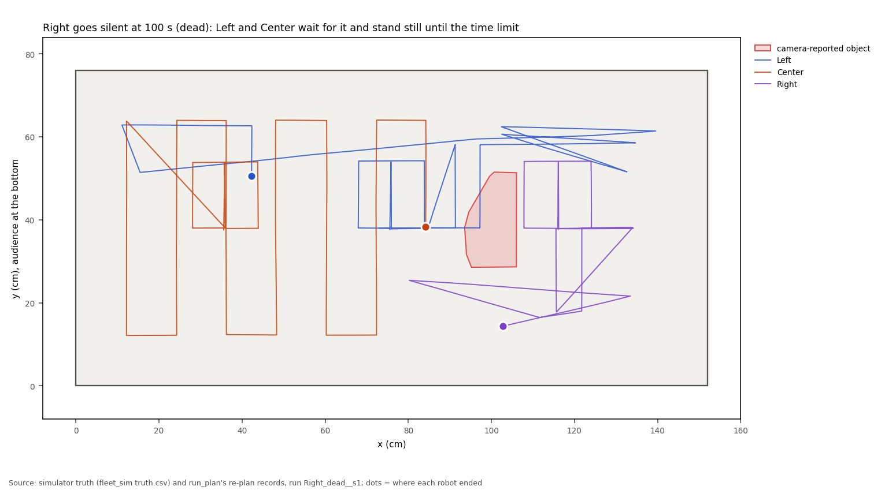
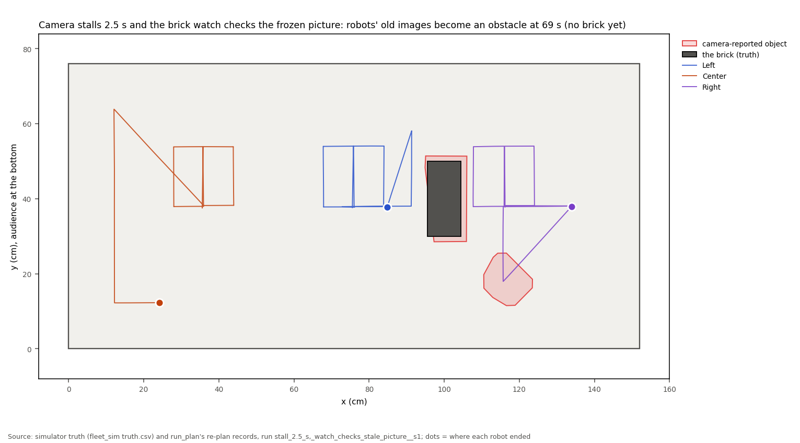
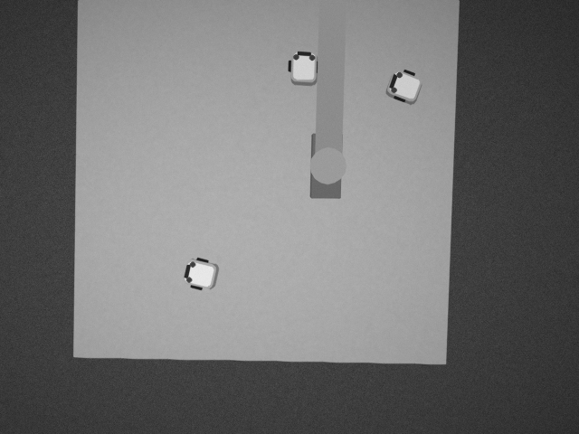
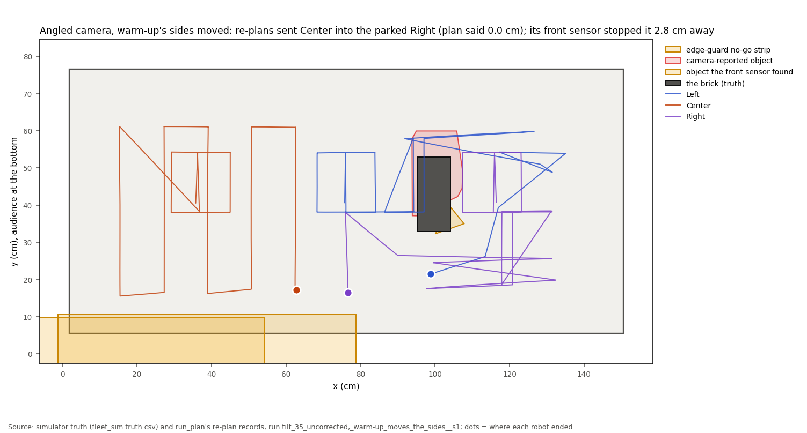

# Monday's school demo under the school's conditions (simulator sweep, 2026-10-27)

## Premise

Monday 2026-11-02 runs at a school: a table of unknown size, the room's WiFi, a camera put wherever it fits. The
question: how does Monday's mission (warm-up, then Show → Center mows while Left and Right do Chicken x2 / Roam /
Follow → park, with a brick dropped mid-run) hold up under conditions the school may bring, and which conditions
break it?

Simulator only (no robots, no Pi): `run_plan.py --dry-run` against the fleet simulator, with the brick seen through
the simulated overhead camera's "what changed" watch, as in the build's M runs. Each condition was added by a wrapper
round the simulator (`tools/fleet/sweeps/sim_shim.py`); run_plan, the planner and Monday's mission are the ones on
main at 236b4e2 plus this sweep's first planner fix (cd166a3, section 4). Every run: warm-up on a blank table of that
size first, its answers applied to the map, Monday planned from that map, then the dry run. 42 dry runs of Monday
and 8 warm-ups, 07:57-12:04, one at a time.

## Data

### 1. Does Monday plan at all on this table? (planner only)



Blue squares planned (number = planned finish time); red outlines found no plan. Monday needs a table about 64 cm
deep and more than 120 cm long.

- **60 cm deep fails at every length:** Chicken's 20 cm swerve lands 10 cm from the edge, where a robot cannot turn
  (it needs 11.2 cm). A smaller swerve (15 or 12 cm) did not rescue 120 x 60: then no order of the three robots fits.
- **120 cm long fails at 64, 68, 76 and 122 cm deep** ("no priority order gave a plan"); 120 x 90 plans, with both
  Chickens squeezed next to the mower. 122 x 122 plans, but see section 2.
- 152 and 180 cm long plan from 64 cm deep up; Roam and Follow shrink to 39-57 s on the shallower tables.

### 2. The dry runs (warm-up, then Monday with a brick)

| Group | Condition | Finished | Closest robots, cm (worst) | Closest to open edge, cm (worst) | Took / planned, s | Re-plans | Longest re-plan, s | Lanes mowed (worst) | All 3 still beyond plan, s |
|---|---|---|---|---|---|---|---|---|---|
| table size | base 152x76 | 2 of 2 | 10.1 | 4.1 | 198 / 230; 228 / 230 | 1, 4 | 5.9 | 12/12 | -26, -6 |
| table size | 180x90 | 2 of 2 | 10.6 | 4.3 | 268 / 268; 264 / 268 | 3, 3 | 4.3 | 14/14 | -9, -12 |
| table size | 122x122 | 0 of 2 | 9.2 | 5.2 | 394 / 284; 361 / 284 | 30, 30 | 6.7 | 5/9 | +182, +152 |
| table size | 122x122 camera sees all | 0 of 1 | 9.3 | 5.3 | 371 / 284 | 30 | 5.7 | 6/9 | +160 |
| table size | base, warm-up moves the sides | 1 of 1 | 9.3 | 4.9 | 205 / 242 | 3 | 1.8 | 11/11 | -22 |
| lost packets | lost 5% | 2 of 2 | 10.7 | 4.1 | 197 / 230; 197 / 230 | 1, 1 | 4.2 | 12/12 | -26, -23 |
| lost packets | lost 15% | 2 of 2 | 10.5 | 4.0 | 197 / 230; 197 / 230 | 1, 1 | 4.2 | 12/12 | -25, -23 |
| camera | age 0.35 s | 1 of 1 | 10.7 | 4.3 | 202 / 230 | 1 | 5.7 | 12/12 | -21 |
| camera | age 0.7 s | 2 of 2 | 9.8 | 4.2 | 201 / 230; 233 / 230 | 1, 5 | 6.4 | 12/12 | -20, +0 |
| camera | stall 1 s | 2 of 2 | 10.2 | 4.2 | 197 / 230; 198 / 230 | 1, 1 | 4.4 | 12/12 | -26, -23 |
| camera | stall 2.5 s | 2 of 2 | 10.2 | 4.1 | 197 / 230; 228 / 230 | 1, 4 | 6.3 | 12/12 | -25, -5 |
| camera | stall 2.5 s, watch checks stale picture | 0 of 1 | 10.7 | 5.4 | 350 / 230 | 30 | 11.9 | 1/12 | +254 |
| camera angle | tilt 35 corrected | 1 of 1 | 10.9 | 4.3 | 355 / 230 | 21 | 6.7 | 12/12 | +131 |
| camera angle | tilt 35 uncorrected | 0 of 2 | 8.2 | 3.0 | 379 / 230; 334 / 230 | 29, 28 | 8.2 | 5/12 | +238, +189 |
| camera angle | tilt 50 uncorrected | 0 of 2 | 10.0 | 1.6 | 345 / 230; 334 / 230 | 28, 28 | 6.6 | 5/12 | +201, +189 |
| camera angle | tilt 35 uncorrected, warm-up moves the sides | 0 of 1 | 2.8 | 3.3 | 333 / 189 | 22 | 7.1 | 5/11 | +193 |
| brick | brick lane | 2 of 2 | 9.9 | 4.2 | 206 / 230; 204 / 230 | 1, 1 | 6.7 | 12/12 | -21, -21 |
| brick | brick chicken | 2 of 2 | 9.4 | 4.3 | 205 / 230; 222 / 230 | 3, 1 | 6.4 | 12/12 | -19, -6 |
| brick | brick park row | 1 of 1 | 11.2 | 4.2 | 224 / 230 | 1 | 0.1 | 12/12 | -1 |
| brick | brick ahead | 2 of 2 | 9.6 | 4.3 | 193 / 230; 192 / 230 | 1, 1 | 5.4 | 12/12 | -22, -22 |
| robot out | Right dead | 0 of 1 | 9.9 | 4.4 | 398 / 230 | 4 | 6.7 | 6/12 | +223 |
| robot out | Right lifted | 0 of 1 | 10.9 | 5.3 | 103 / 230 | 0 | 0.0 | 4/12 | -26 |
| robot out | Center dead | 0 of 1 | 11.1 | 5.4 | 398 / 230 | 1 | 4.0 | 4/12 | +255 |
| wheel scale | wheel +3% | 1 of 1 | 10.9 | 4.1 | 196 / 230 | 1 | 1.4 | 12/12 | -26 |
| wheel scale | wheel +5% | 1 of 1 | 10.0 | 4.2 | 192 / 230 | 1 | 5.6 | 12/12 | -21 |
| wheel scale | wheel -5% | 1 of 1 | 11.0 | 4.4 | 207 / 230 | 1 | 6.0 | 12/12 | -21 |
| wheel scale | wheel +5% + stall 2.5 s | 1 of 1 | 9.6 | 4.2 | 192 / 230 | 1 | 5.0 | 12/12 | -21 |

The time column lists each seed's run. "Re-plans" excludes the background tries for a shorter plan. "All 3 still
beyond plan" is how much longer all three robots stood still at once than the first plan has them still (negative:
the run finished early, after the background search found a shorter plan).



Each dot is one run; filled dots finished, red rings did not. No body went over an open edge in any run. Robots
stayed 8 cm or more apart in every run but one (2.8 cm, angled camera with the sides moved: section 4); the one
0.0 cm brick reading is the brick landing on Right (180 x 90, see below).



The runs that did not finish are the ones with 28-30 re-plans and minutes of standing still; everything else ran
within about 30 s of its plan (most finished early: the background search swapped in a shorter plan after the
brick).

### 3. What broke, and why

| Condition | What happened | Why (Claude's reading unless the log says it outright) |
|---|---|---|
| **122 x 122 table** (3 of 3 runs, including one with the camera scaled to see the whole table) | Brick at 146 s: Center and Left got no route, stood still for over 200 s, run stopped after 30 re-plans | The log: both "no safe route yet" on every retry, also offline with a 60 s budget (4 s, same answer). Claude's reading: a deadlock. A robot without a route is planned as standing still for good, and on the square table Center's remaining lanes pass where Left stands while Left's roam passes where Center stands, so each blocks the other on every retry.  |
| **Camera at an angle, no height correction** (35 deg from 180 cm; 50 deg from 150 cm) | Out of re-plans, 5 of 12 lanes | The robots' top lights are 4 cm up, so an angled camera without the camera's height in its floor calibration puts them further from the audience than they are: 2-3.7 cm at 35 deg from 180 cm, 4-6 cm at 50 deg from 150 cm
(geometry, sim_shim.py). The planner then sends Center's audience-side lane ends 2-3 cm closer to the edge than planned, the edge guard trips there (5 times in one run), each trip adds an 80 cm no-go strip, and the brick's reported footprint grows to 13-14 x 29-35 cm, against 11 x 23 cm from the near-overhead camera
(truth 9 x 20: the watch projects what it sees onto the floor, and an oblique view sees the brick's sides). Together they leave no route.  |
| Camera at 35 deg, **height-corrected** (10 % height and 10 cm spot error left) | Finished, but 355 s against 230 planned, 21 re-plans | No edge trips; the brick's stretched footprint (13.6 x 30 cm for a 9 x 20 cm brick) left all three without routes for about 170 s before a retry found one |
| **A robot dies** (Right or Center silent and still at 100 s) | The other two wait for it until the time limit; no lanes after that | The log: the others' steps wait on the dead robot's steps ("after" lists). Nothing notices that a robot has gone quiet.  |
| **A robot is lifted off** | Everything stops at once (103 s) | By design: a follow run that ends ("robot lifted") stops every robot (run_plan.py) |
| Camera stalls 2.5 s **and the brick watch checks the frozen picture** | A "brick" made of the robots' old images appears at 69 s (no brick yet); all three stranded | The watch masks robots where the camera's newest positions put them, but the picture is old, so their old images look like new objects. With the watch skipping frozen pictures (the other stall runs) nothing happens.  |
| 122 x 122 with the default simulated camera | The palm of the hand was confirmed as an object before the brick landed; the brick came in 3 pieces | The table filled the picture's height, the arm over the light table was not seen as a change, so the palm looked like an island on the table (the hand rule needs the arm to reach the picture's edge or the table's outline). Simulator camera placement, partly; it shows the hand rule's weak spot.  |
| Camera at 35 deg, no height correction, **warm-up's sides moved** (Mission Control's option to put each side where the warm-up found it) | Not better: 22 re-plans, timed out, and Center came 2.8 cm from the parked Right | Moving the sides took the push out of the lane ends, but the brick's stretched footprint still stranded Center and Left; the 2.8 cm is a planner bug (section 4). With the bug fixed the same run stopped safely at 103 s ("Left is boxed in: move it by hand"), robots 10.9 cm apart.  |

What held: lost packets (5 and 15 % each way), picture age 0.35 and 0.7 s, camera stalls of 1 and 2.5 s every 20 s,
the brick across Center's next lane, on Chicken's line before round 2, on the park row, and 3 s ahead of a moving
robot, a 180 x 90 table, and wheels 3-5 % off (the camera's fixes hide it; the warm-up flagged all three robots at
+5 %: 1.057-1.066 x stored). Moving the warm-up's sides on the plain table (152 x 76 becomes 146 x 69: each open edge 3 cm in) also held.

**The brick that touched Right** (180 x 90, 0.0 cm, at 140.04 s, the moment it landed): the sweep placed the drop
15 cm from where the plan had each robot, but the robots ran ahead of their plan and Right was there. A drop on a
robot, not a robot driving into the brick.

**The warm-up** (one per table size, plus one with the angled camera and one with +5 % wheels): all four sides found
open on every size; open edges placed 2.7-3.5 cm inside the true edge (the known cue offset). With the angled camera
the bottom side came out 5.6 cm inside and the top 0.3 cm outside (the 2-3 cm push), and Left's wheel was flagged
1.069 x stored, a false flag from the push.

### 4. Two planner bugs found and fixed (tools/fleet/planner.py)

**a. Re-plans dropped visits (commit cd166a3).**

The first warm-up dry run (152 x 76) never felt the right side: Right's two right-side feels and both its corners
vanished in a re-plan, with no warning. Cause: a step a robot carried on through one re-plan keeps its task number
from before that plan's own visit list; at the next re-plan the remaining visits were taken from index -1, which in
Python means "only the last one". Fix: clamp to the plan's own visits (`task_i = max(task_i, off)`), with a
regression test (`tools/fleet/tests/test_monday_sweep.py`). Fleet tests: 69 passed, 2 skipped. After the fix every
warm-up felt all four sides. In this sweep's Monday runs the old code would have struck twice: in the lost-15 % run a
background improvement try would have kept 1 of Right's 4 remaining Follow-the-leader points (and been kept, since a
shorter plan looks better), and once on the park row run (no visits left to lose).

**b. A robot with nothing left to do could be driven through (commit 53974fe).** A robot whose steps are all done
(Right, parked early while the others were stranded) was given an empty timeline without the check that standing
where it is clears the others. In the first pass the others treat it as standing there for 3 s only, so Center's
re-planned lanes ran through Right's park spot; the plan's own summary said 0.0 cm, run_plan used it anyway, and
Center's front sensor stopped it 2.8 cm from Right, then the next re-plan did the same again, every 12 s. Fix: that
robot is checked like any other (replayed offline, the same re-plan now leaves Center and Left waiting; a minimal
regression test drives one robot past an idle one). Fleet tests after both fixes: 84 passed, 4 skipped. Every other
run in this sweep ran before fix b; repeated after it, the base run was unchanged (done in 197 s, 10.7 cm, 12 lanes).
A scan of every plan file in the 42 runs found no other plan under 8 cm. The two repeated runs:
[data/monday-sweep/results-after-idle-fix.json](data/monday-sweep/results-after-idle-fix.json).

## Conclusion

- On the assumed 152 x 76 table, Monday is robust to the network and camera-timing conditions tried and to the brick
  in every spot tried: every lane and activity done, robots never under 9.4 cm, no edge crossing.
- **Three conditions break it:** a table that is too small or square (60 cm deep, 120 cm long, 122 x 122), an
  angled camera (badly without the camera's height in its floor calibration; even with it, a 125 s stall after the
  brick), and a robot that dies (the others wait for ever). A lifted robot stops the whole run on purpose.
- Two planner bugs found on the way are fixed and pushed; one of them had planned two robots into contact (the front
  sensor caught it).
- The common way it fails is not a collision: robots stop safely, then the re-plans find no routes and the run
  stands still until it gives up. Claude's reading: the planner has no fallback for "nobody can be scheduled".

## What's next

Recommended changes (not built; for Nick's go-ahead):

0. **run_plan should refuse a plan whose own summary is under the separation** (and plan again): the 0.0 cm plan
   above was used as it was. Small, but run_plan.py is being edited by another chat today, so not done here.

1. **Measure the table before Monday** and run this sweep's `planfit` on the real size (1 minute). If it is 60 cm
   deep or about 120 cm long, a smaller Monday is needed (Chicken's swerve sized to the room, and Roam or Follow
   dropped); Mission Control already refuses to plan, so this would be found on the day otherwise.
2. **A fallback when re-plans strand robots** (122 x 122, tilted camera): after two re-plans in a row that leave a
   robot without a route, drop Left and Right's remaining play, let Center finish its lanes alone, and park everyone.
   Also plan a stranded robot as "moves later" rather than "stands for good", so two stranded robots can untangle.
3. **The camera's height in the floor calibration, always**, and the brick's footprint from its top face rather than
   its floor projection when the camera is oblique (or the camera overhead).
4. **A silent robot is a fixed obstacle**: no records for about 3 s (DOE) → the others re-plan without it and carry
   on; its tasks dropped.
5. When the brick watch is wired to the real camera (build report item 3): check only new pictures, never a repeated
   one, and keep a margin of floor round the whole table in the picture.
6. The edge guard's no-go strips accumulate (80 cm each, one per trip): one trip could move that side's line instead.

Runs still to make: see Sweep 1.

## Sweep 1: tests that may now be needed

- `planfit` on the real table size, then the full sweep on it (2 h machine time).
- The fallback (item 2), once built: the 122 x 122 and tilted-camera runs again.
- The camera at its Monday spot: one warm-up with a robot driven along the audience edge, to measure the push.
- A real brick footprint from the real camera at the school's angle (the stretch is the simulator's geometry).
- A dead-robot dry run after item 4, and a lifted one if Nick wants the others to carry on.
- The angled-camera runs again after fix b (only one was repeated), and the whole sweep's failing conditions with a
  planner fallback (item 2) once there is one.
- `stall` and `age` with the real camera bridge (tools/fleet/cam_bridge.py, being built today) instead of the shim.
- Seeds: most conditions had 1-2 seeds; the conditions that held should get 3 more each before calling them safe.

## Sweep 2: possible inaccuracies

- **Simulator, not robots**: the edge cues, hang model, motion and camera are its own guesses (the build report's
  list applies).
- **Real time on a shared 2-core machine**: other agents ran beside the sweep (load 1.4-2.5, recorded per run in
  `sweep_cmd.json`); re-plan times are this machine's, not the laptop's.
- **The camera conditions are models**: the angled camera's push is pure geometry (lights 4 cm up, lens 150-180 cm
  up, on the audience side), its extra noise is a guess ((range / 262)^2 / cos), the stall pattern (once every 20 s)
  and the picture ages are chosen, not measured.
- **The brick watch's picture** is the simulator's table camera: clean, evenly lit, a grey arm; real sleeves,
  shadows and skin will differ, in both directions.
- **Lost packets** are independent per packet; real WiFi loses packets in bursts.
- **"Robot out" is one moment (100 s) and two kinds** (dead, lifted); a robot that hangs over an edge or slips was not
  tried.
- **Brick drop times and spots** are chosen against the plan's poses; the robots run ahead of plan, which is how one
  brick landed on Right.
- **Simulator truth missing in 4 runs** (both lost-packet seed-2 runs and both dead-robot runs): the simulator waits for
  every robot's follow run to end, and a lost or unheard final "stop" kept one going; their closest-approach and edge
  numbers come from the truth file sampled every 0.25 s (within 0.2 cm of the simulator's own on a run that has
  both). A lost final "stop" on real robots would leave one in follow mode: worth a resend.
- **Seeds**: 2 per condition for 13 conditions, 1 for the other 14 (wheel scale, one-off brick and robot-out cases, the angle-corrected and moved-sides cases).
- **Lanes and activities are counted from the step reports** (a lane counts when its end is reported done, or the
  next lane starts); activities count when started.
- **Standstill** uses one rule (under 0.25 cm and 2 deg in 0.5 s) on both the plan and the truth; the plan's own
  pauses (the Show's beats, waits for the mower) are in both.
- **The warm-up's answers were applied as Mission Control does by default** (sides not moved, zones kept as
  proposed).
- Chosen numbers in the sweep: each has a DOE note in the code and in docs/doe-backlog.md ("Monday sweep").

## Appendix A. How to run it

```
nice -n 19 python3 tools/fleet/sweeps/monday_sweep.py planfit --out DIR     # table sizes (planner only)
nice -n 19 python3 tools/fleet/sweeps/monday_sweep.py prep --out DIR        # warm-ups, maps, plans
nice -n 19 python3 tools/fleet/sweeps/monday_sweep.py run --out DIR         # the dry runs, one at a time
python3 tools/fleet/sweeps/monday_sweep.py collect --out DIR
python3 tools/fleet/sweeps/sweep_charts.py --rows DIR/results.json --planfit DIR/planfit.json --out FIGDIR
```

Each dry run runs in its own network namespace (`unshare -n`), so it cannot meet another dry run's UDP ports.
Rows: [data/monday-sweep/results.json](data/monday-sweep/results.json); table sizes:
[data/monday-sweep/planfit.json](data/monday-sweep/planfit.json); warm-ups:
[data/monday-sweep/prep.json](data/monday-sweep/prep.json).

## Appendix B. Simulator fixes made during the sweep (shim only)

- The first three angled-camera runs had the simulated camera looking past the table (table_cam tilts about the
  point under the lens): the brick was never seen. The shim now aims the lens at the table; those runs were redone.
- The first stall runs let the brick watch check the frozen picture; they are kept as their own condition ("watch
  checks stale picture") and the stall runs were redone with the watch skipping frozen pictures.
