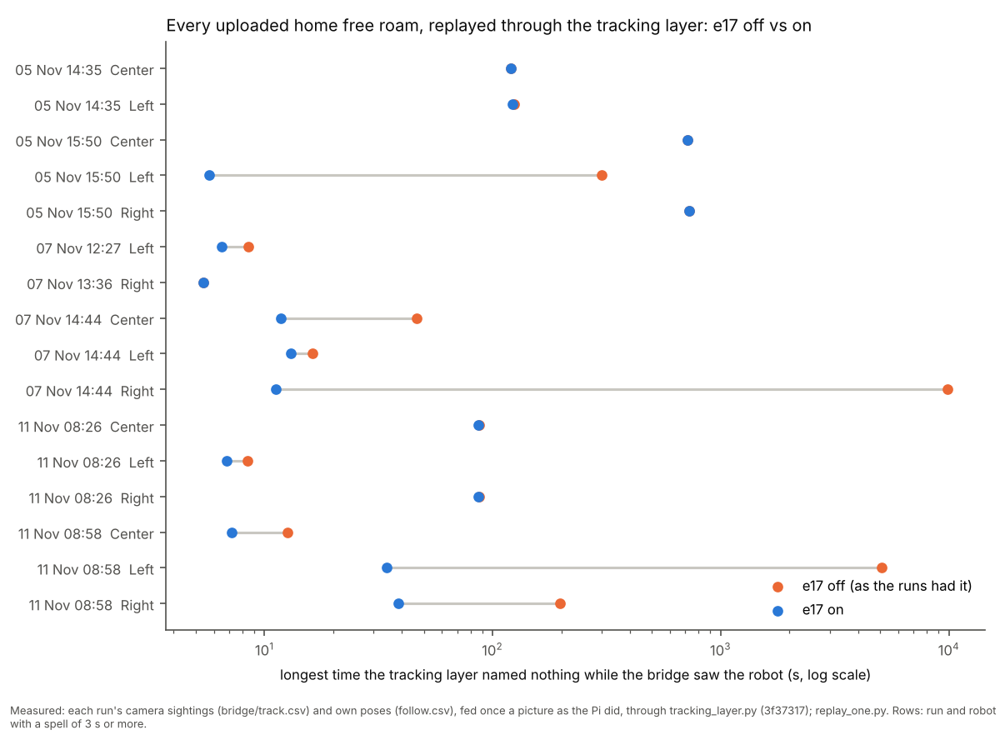
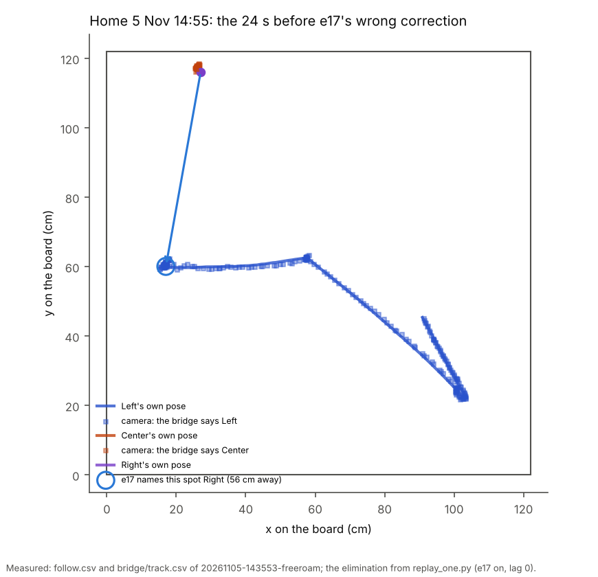
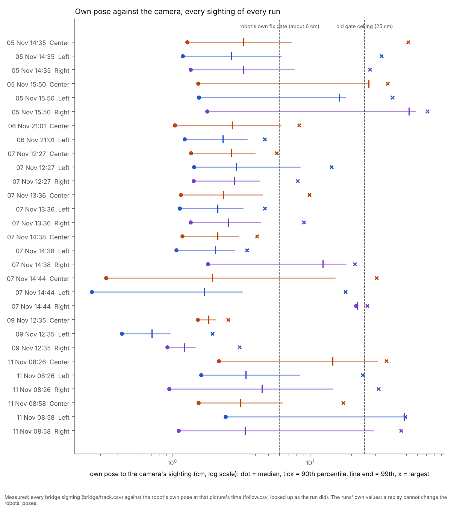
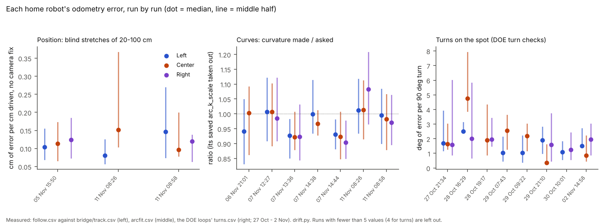

# Every uploaded run replayed: does e17 hold? (12 Nov, logs only)

## Premise

- e17 (`docs/build-reports/e17-nov12-tracking-trust.md`) fixed the tracking layer and showed it on the two home runs of 11 Nov.
- The question here: does it hold on **every** run we have, and does it ever do worse?
- Also asked: each robot's odometry drift across runs and dates, for e18's blind-drive allowance.
- Nothing touched a robot or a Pi. **Measured** = read from the uploaded logs or a replay of them. **Claude's reading** = an interpretation, marked.

What the GitHub releases hold (measured, `gh api .../releases`):

| Kind | Releases | Used here |
|---|---|---|
| Home free roams, 5-11 Nov | 12 | **10 replayed** (13.7 h, 2 or 3 robots). 6 Nov 06:16 and 9 Nov 12:52 ended before any robot or camera log. |
| DOE loops (home, single-robot drives and 90 deg turn checks), 27 Oct - 2 Nov | 8 | turn drift only (505 turn checks). No free-roam tracking happens in them. |
| School or calibration sessions | 0 | none uploaded. The 5 Nov and 10 Nov school reports exist in `docs/results/`, but their logs are not in the releases. |
| Older e02 sessions, recordings, clips | 30+ | not used: before the tracking layer's logs (`follow.csv` + `bridge/track.csv`) existed. |

## Data

### 1. The tracking layer, e17 off vs on, run by run (measured)

Each run's camera sightings went through the final e17 code (3f37317) twice:

- **off**: the layer as the runs had it (`MIRLT_OWN_RESET_RULE=speed`, no elimination, the fixed gate);
- **on**: e17's defaults.

Own poses were fed once a picture, looked up at the picture's time as the run did (`replay_one.py`).

| Run (home) | Robots, min | Longest unnamed while the camera saw it, s: off / **on** | Unnamed while the camera saw it standing: spells, s (off / **on**) | Name swaps against the bridge (episodes) off / on | e17 corrections: n, median / max cm (revoked, wrong robot) | Re-seed heading jumps over 15 deg: as run / **e17 estimate** | REJOINED with nobody moving it (as run) |
|---|---|---|---|---|---|---|---|
| 5 Nov 14:35 | 3, 18 | 125 / **122** | 3, 236 / **3, 183** | 2 / **3** | 1, 56 cm (0, **1 wrong**) | no pose log | - |
| 5 Nov 15:50 | 3, 240 | 730 / **730** | 37, 1,537 / **8, 1,454** | 1 / 0 | 6, 19 / 31 (1, 0) | no pose log | - |
| 6 Nov 21:01 | 2, 3 | 0 / 0 | 0 / 0 | 0 / 0 | 0 | no pose log | - |
| 7 Nov 12:27 | 3, 30 | 8.5 / **6.5** | 0 / 0 | 0 / 0 | 0 | 0 / 0 | - |
| 7 Nov 13:36 | 3, 30 | 5.4 / 5.4 | 0 / 0 | 0 / 0 | 0 | 0 / 0 | - |
| 7 Nov 14:38 | 3, 2 | 2.8 / **1.1** | 1, 1.4 / **0** | 0 / 0 | 0 | 0 / 0 | - |
| 7 Nov 14:44 | 3, 232 | **9,890** / **13** | 15, 9,962 / **15, 49** | 0 / 0 | 3, 16 / 34 (0, 0) | 1 / **0** | - |
| 9 Nov 12:35 | 3, 9 | 0 / 0 | 0 / 0 | 0 / 0 | 0 | 0 / 0 | - |
| 11 Nov 08:26 | 3, 18 | 87 / **87** | 13, 214 / **5, 142** | 0 / 0 | 0 | 11 / **7** | 3 of 3 |
| 11 Nov 08:58 | 3, 240 | **5,070** / **38** | 34, 5,483 / **16, 141** | 0 / 0 | 8, 19 / 40 (2, 0) | 16 / **7** | 8 of 10 |
| **All 10** | | worst **9,890 → 730** | **17,434 s → 1,970 s** | 3 → 3 | **18**: 3 revoked, **1 wrong** | 28 → 14 | 11 of 13 |

<sub>"Unnamed while the camera saw it": the layer named none of a robot's sightings for longer than e17's own "unaccounted" time (max(1 s, 3 × the robot's median gap between sightings)), while the bridge saw it at least every 2 s. "Standing": all of the bridge's sightings stayed within 3 cm. "Name swap": the layer named a sighting for a robot other than the bridge's own label; the bridge's labels are a check, not the truth. Heading jumps count only re-seeds (a heading re-set is meant to change the heading). The "e17 estimate" assumes re-seeds sent while turning faster than 8 deg/s land standing, as e17's rule makes them.</sub>



Each row is one robot in one run. Orange is how long it went unnamed as the runs had it, blue is the same run with e17. Where the dots sit on top of each other, e17 changed nothing.

- **e17 holds on 7 of the 10 runs.** It shortens or leaves alone every spell there.
- **7 Nov 14:44 is the biggest win.**
  - Off: Right went 2.7 h unnamed. Its own pose sat 22 cm off the camera all run (median 21.6 cm, section 4).
  - On: 13 s.
- **5 Nov 15:50, 5 Nov 14:35 and 11 Nov 08:26 keep their longest spells: 730 s, 122 s and 87 s.** Section 3 says why.
- Corrections: 18 in all. 17 went to the robot the bridge also named. 3 were revoked by their probation. 1 went to the wrong robot (section 2).

### 2. The one place e17 does worse: 5 Nov 14:55, a correction to the wrong robot (measured)



Left drove across the board and stopped at 17, 60. Its own pose and the camera agreed within a centimetre all the way. With e17 on, the layer gave that spot to Right, 56 cm away by Right's own pose (blue arrow).

The trace (`elim_0514.json`; the layer's state when it decided):

- What was going on, at the run's end:
  - Center and Right stood together near the top edge;
  - their own poses were 1 cm apart;
  - the camera saw one blob there;
  - the bridge called it Center.
- At the moment of the decision:
  - Center and Left were both **unaccounted** (no fix for over a second);
  - both were inside an unresolved **close pass** (Center's track had been pulled onto Left's spots);
  - the elimination leaves robots in a close pass out of its count;
  - so Right was the only unaccounted robot counted.
- Left's steady spot then met every condition:
  - nobody accounted could claim it;
  - Right's wheels stood still.
- The elimination did not look at Left's **own** pose, which was 0.1 cm from the spot.
- Probation would never revoke it: Right never drove again before the run ended.
- **Claude's reading:** this is a corner (two robots merged at an edge, a third stopped by its front sensor). But the rule has two holes that will come back:
  - a robot in a close pass can still be unaccounted;
  - another robot's own pose, sitting on the spot, is evidence against the elimination.
- Also measured: with own poses taken 0.44 s earlier (Appendix A), the same run swaps names with e17 and not without.
  - The cause is the velocity re-set rule alone: switching only that part back removes the swap.
  - It happens in the same merged-blob minute, where the bridge's labels are not reliable either.

### 3. What e17 does not cover (measured, each with its numbers)

1. **Two robots unaccounted at once.** Every spell over 10 s left with e17 on (14 of 14) had a second robot unnamed for most of it:
   - 5 Nov 15:50: 12 min, Center + Right;
   - 5 Nov 14:35: 2 min;
   - 11 Nov 08:26: 87 s, Center + Right;
   - 11 Nov 08:58: three of 30-38 s, Left + Right;
   - 7 Nov 14:44: 11-14 s.

   e17 then needs a wiggle. The replay cannot make one, and e17's own sweep found the home lights cannot see one (scatter 0.3-0.5 cm). **Claude's reading:** this is now the main way a robot stays unnamed at home.
2. **Named, but too far for the robot's own filter.**
   - What happens: the layer named the robot all along, but its own pose was over the firmware's fix gate (about 6 cm) away, so it refused every fix.
   - e17 turns only eliminations into corrections (an fpose), so these are not corrected.
   - As run, the longest such spells:
     - 11 Nov 08:26, Center: **86 s at 31 cm**, held "unsure near an edge", then a REJOINED nobody caused;
     - 11 Nov 08:58: 39 s at 26 cm (Right, standing);
     - 7 Nov 14:44: 38 s at 21 cm (Center).
   - All 11 REJOINEDs that nobody caused (as run) were robots the layer kept naming. The replay shows no elimination in any of them.
   - e16's label fix ("not called rejoined when nothing moved it") covers the words, not the 31 cm.
3. **Re-seeds landing while standing still.**
   - e17's rule (wait until the turn ends) would remove about half the big jumps.
   - 7 of 11 (08:26) and 6 of 16 (08:58) remain: re-seeds sent standing that jumped the heading 16-64 deg.
   - 6 of them could be checked against the camera's course over the next 6 cm. In 4, the jump made the heading worse.
4. **The drift record's per-cm rate never switches on.**
   - It needs 5 corrections with at least 5 cm driven inside 15 min. No robot reached that in any of the 10 runs, so the gate's per-cm growth stayed at e09's 0.15.
   - Where the rate could be computed, it is 0.8-3 cm per cm. "Driven since" counts from the layer's last naming, not from when the robot's own pose last matched the camera.
   - **Claude's reading:** e18 should not read its blind-drive allowance from this record (section 5 has a measured one).
5. **A robot whose own pose is off from the start.** 7 Nov 14:44:
   - Right's own pose was 22 cm off for the whole 4 h;
   - e17 names it within 13 s, which is the fix working;
   - but the replay's own poses cannot show whether the correction then held.

   Only a real e17 run can.

### 4. Own pose against the camera (measured; e17 cannot change this in a replay)



Each row is one robot in one run: how far its own pose was from where the camera saw it. Most robots sit at 1-2 cm, but in five runs one or two robots spent long stretches past the 25 cm the old gate could ever accept.

| Run | Sightings | Share over 25 cm | Whose |
|---|---|---|---|
| 11 Nov 08:58 | 84,909 | **11.4 %** | Left 9,217 (the 84 min hold, 48-49 cm), Right 481 |
| 5 Nov 15:50 | 311,898 | **9.4 %** | Center 16,878, Right 12,236 |
| 11 Nov 08:26 | 16,651 | 2.5 % | Center 392, Right 23 |
| 5 Nov 14:35, 7 Nov 14:44 | 29,784, 63,881 | 0.1 %, 0.02 % | - |
| the other 5 | 49,055 | 0 | - |

Medians are 0.3-2.4 cm everywhere except Right on 7 Nov 14:44 (21.6 cm all run).

### 5. Each robot's drift record across runs and dates (measured)



Each dot is one robot in one run.
- Left: how far its position drifted per cm driven with no camera fix.
- Middle: how much more or less its curves turned than asked.
- Right: how many degrees each 90-degree turn on the spot was off.

| Robot | Position: blind stretches 10-100 cm (n), cm error per cm (Theil-Sen slope, 95 %) + floor | 20-100 cm stretches: median / 90th pct, cm per cm | Curves, made / asked, per run (scale taken out) | Turns on the spot, deg per 90 deg (n): median / 90th pct |
|---|---|---|---|---|
| Left | 225: **0.050** (0.027-0.075) + 2.1 cm | 0.10 / 0.26 | 0.93-1.01 | 285: 1.2 / 3.3 |
| Center | 190: **0.076** (0.046-0.107) + 2.0 cm | 0.12 / 0.29 | 0.92-1.01 | 83: 1.9 / 4.3 |
| Right | 144: **0.050** (0.022-0.085) + 3.2 cm | 0.13 / 0.34 | 0.90-1.08 | 137: 1.4 / 3.6 |
| Fleet | 559: **0.060** (0.044-0.076) + 2.3 cm | 0.11 / 0.28 | - | 505: 1.3 / 3.6 |

<sub>Blind stretch: the robot's own filter took no camera fix and its pose was not re-set, over 10-100 cm of its own path (mostly curves). Error = how far its own displacement and the camera's disagree at the ends. Theil-Sen slope: the median of the slopes between every pair of stretches, a straight-line fit that a few wild points cannot drag; its "floor" (intercept) is mostly the camera's own noise at the two ends. Kruskal-Wallis test (below): whether several groups could come from one distribution, by ranks; p under 0.05 = they differ.</sub>

How stable each measure is:

- **Position drift: the same for all three robots and across runs.**
  - Between runs (stretches of 20 cm or more), per robot: p = 0.15 (Left), 0.25 (Center), 0.57 (Right).
  - Between robots: p = 0.11.
  - Per-run slopes are 0.04-0.07 cm per cm. Only three runs had 20 or more stretches: 5 Nov 15:50, both 11 Nov runs.
  - What changes between runs is the floor: 3.5 cm on 5 Nov, 0.9-1.9 cm on 11 Nov.
- **Curves: a session property, not a robot property.**
  - Each robot differs between runs: p under 0.000002.
  - Within any one run, the three robots do not differ: p = 0.10-0.95.
  - All three read about 1.00 at 12:27 on 7 Nov, 0.90-0.93 at 13:36 and 14:44, and 0.97-1.08 on 11 Nov.
  - Left's saved `arc_k_scale` 1.0736 is exactly 1 / its 7 Nov 14:44 median (0.931). Center and Right read the same that session.
  - Since then Left turns 7 % more than asked: e17 saw this, and this is its cause.
  - The curves' length ratio moves the other way at the same time (1.03-1.05 when curvature reads 0.92). **Claude's reading:** the session's camera scale or the curve fit is the likelier cause than the robots. Not checked.
- **Turns on the spot (DOE, 27 Oct - 2 Nov): stable.**
  - Between sessions: p = 0.12 (Left), 0.35 (Right).
  - Center p = 0.013, carried by one 4-turn session (28 Oct 16:29, 4.8 deg).

**Claude's reading, for e18:**

- One record per robot is not supported: the robots are not distinguishable from each other on position or curves.
- One fleet prior for position (about 6 cm per metre plus a 2-3 cm floor; 90th percentile 0.28 cm per cm on 20-100 cm), updated live each run, fits the data.
- Curves need a per-session value measured in the run, not a saved per-robot scale.
- Per-surface records: no data. Every run here is the home plywood, and no school logs are uploaded.

## Conclusion

1. **e17 holds on 7 of 10 runs and is a large gain where it matters.** On 11 Nov 08:58 and 7 Nov 14:44 it cuts 84 min and 2.7 h unnamed to 38 s and 13 s. Across all 10 runs, time unnamed while the camera saw a robot standing drops from 17,434 s to 1,970 s.
2. **e17 did worse once:** on 5 Nov 14:55 it corrected Right onto Left's spot, 56 cm away (section 2). The cause is a close pass hiding unaccounted robots from the elimination's count, and another robot's own pose not being checked.
3. **What is left is almost all two robots unaccounted at once** (1,454 of the 1,970 s). e17 needs a wiggle there, which the home lights cannot show.
4. Not covered by e17:
   - a robot named all along but too far for its own filter (86 s at 31 cm, then a false REJOINED);
   - re-seeds that jump the heading while standing (about half of the big jumps);
   - the drift record's per-cm rate, which never switches on.
5. e17's report numbers for the two 11 Nov runs do not reproduce on the final code (Appendix C). Its conclusion stands.
6. **Drift:** position drift is about 0.06 cm per cm for all three robots and is stable between runs. Curve response moves by session, together for all three robots. Turns on the spot are stable (1.2-1.9 deg per 90 deg).

## What's next

- **Nick, home:** the e17 free roam e17 asked for (switch the home Pi to main, one free roam, upload). It is the only way to see whether corrections hold once they reach the robot (section 3, item 5).
- **Claude, a build (e17d or inside e18; needs Nick's go-ahead, questions below):**
  - the elimination counts robots in a close pass as unaccounted;
  - it refuses a spot that sits on another robot's own pose;
  - a named robot more than its fix gate away while standing gets a correction (an fpose), not only an eliminated one;
  - the blind-drive allowance from blind stretches, not the layer's record.
- **Nick, uploads:** the 5 Nov and 10 Nov school sessions' logs (logs only), so the drift record covers a second surface.

## Appendix A: sensitivity (measured)

| Setting | Changes |
|---|---|
| Camera watch off (as layer_replay's default) | none: identical numbers on all 10 runs (`runs_w0.csv`) |
| Own poses 0.44 s earlier (layer_replay's CLI default) | 11 Nov 08:58: the 84 min hold lands on **Right** (5,084 s) instead of Left (5,070 s). 5 Nov 14:35: no swap off, a 968-981-fix swap on (the velocity rule alone causes it) and 3 wrong corrections instead of 1. Every other run within a few seconds (`runs_w1-lag0.44.csv`). |

Which robot the old layer loses is sensitive to timing. What e17 does on the long holds is not.

## Appendix B: every robot in every run

`robots_w1.csv`: per run, robot and mode. Columns: sightings, named, the unaccounted time, longest unnamed, steady spells, swaps, corrections, own vs camera percentiles. `runs_w1.csv`: per run and mode.

## Appendix C: e17's report against the final code (measured)

| | e17 report | e17's saved replay files (its scratch) | e17's own tool, final code, own poses not shifted | This replay (final code) |
|---|---|---|---|---|
| 11 Nov 08:26, longest, off → on | Right 27.7 s → 0.5 s | 86.7 s → 86.7 s (Center + Right at the run's end) | - | 87.1 s → 86.7 s |
| 11 Nov 08:58, longest, off → on | Left 5,071 s → 5.2 s | 5,071 s → 5.2 s | on: 38.5 s (8 eliminations) | 5,070 s → **38.5 s** (two-robot spells at the start and at 12:11-12:13) |

**Claude's reading:** e17's 08:58 numbers came from a replay with an earlier e17 version. That replay had one more elimination at the start, 9 against 8 on the final code. The 08:26 "0.5 s" came from a different window. Neither changes e17's conclusion. Both understate the two-robot case.

## Appendix D: method and files (this folder)

- `replay_one.py`: one run, one mode; `replay_all.py`: all runs. Raw runs stay in the scratchpad, never in the repo.
- `asrun.py`: heading jumps and REJOINED; `named_far.py`: section 3.2; `drift.py`: section 5; `summarise.py`; `charts.py`.
- Output tables: `runs_*.csv`, `robots_w1.csv`, `asrun.json`, `named_far.json`, `drift_long.csv`, `drift.json`, `arc_k_scale_in_use.json`, `elim_0514.json`.
- How to run:
  ```
  python3 replay_all.py RUNS_ROOT OUT --watch 1
  python3 asrun.py RUNS_ROOT OUT asrun.json
  python3 named_far.py RUNS_ROOT OUT named_far.json
  python3 drift.py RUNS_ROOT DOE_ROOT OUT .
  python3 summarise.py OUT asrun.json . --tag w1
  python3 charts.py RUNS_ROOT . ../../screenshots/2026-11-12
  ```

## Sweep 1: new tests that may now be needed

- A tracking-layer test of the 5 Nov 14:55 scene:
  - two robots merged at an edge, a third standing on its own pose's spot;
  - the elimination must not name the merged robot onto it.
  - A replay excerpt like e17's `e17_home_0826_right_hold`.
- A test that a robot in a close pass that has had no fix for over its unaccounted time counts as unaccounted.
- A rig test: a standing robot named all along, its own pose 30 cm off. Does anything correct it within seconds? (Today: nothing in the layer.)
- A replay test of the drift record: the per-cm rate from a known correction history. Does it ever reach REC_MIN?
- A rig or simulator test of a standing re-seed whose carried heading is wrong. The heading should not jump by it.
- When school logs arrive: the same replay and drift record there (roof tags, a second surface).
- A check of each session's camera scale against the board's known size, for the curves' session shift.

## Sweep 2: possible inaccuracies

- **The replay's own poses never change.** A live e17 run would correct a robot's pose at an elimination; the replay keeps the logged pose. So after an elimination the "named, too far" spells (section 3.2) cannot be measured with e17 on, and are only given as run. Section 3.5 rests on this.
- **The "off" replay is the final code with e17's switches off**, not the code each run had. The runs had layers 07a/07b/07d; 5-6 Nov had no tracking layer at all. "As the runs had it" means the layer's old behaviour on their sightings, not the run's own record.
- **The replay feeds no run flags** (lost / unsure / held). The live layer gets `set_unaccounted` from the run, so live e17 would count some robots unaccounted earlier than here.
- **No wiggles in the replay.** Two-robot cases may resolve live if a wiggle shows. e17 measured that it does not at home.
- **The bridge's labels are a check, not the truth.** Section 2 is judged by Left's own pose agreeing within 0.1 cm, not by the label.
- **Heading-jump "e17 estimate"** assumes held re-seeds land with no jump. The landing and jump measure are e17's (`reseed_heading.py`), from receive times, not the robot's clock.
- **Blind stretches:** "no fix" is read from `fixes_used`. Small re-sets under the jump test (3 cm + 15 cm/s) cannot be ruled out, so stretches over 100 cm were left out. The camera's own noise sits inside every ratio (the floor). Only 3 runs have enough stretches.
- **Robot identity:** Left / Center / Right are taken as the same three robots on every date (fixed addresses in `tools/fleet/sites/home.json`). Nothing in the logs proves it.
- **Chosen numbers here, and whether a DOE should set them:**
  - stand 3 cm and the bridge's 2 s "saw it": no (descriptive thresholds for this report);
  - MOVED_CM 5 for "nobody moved it": no (half the run's own hand's width);
  - spells reported from 5 s (`named_far.py`): no;
  - blind stretch 10-100 cm, 20 cm for per-cm medians: DOE no; more runs, yes;
  - re-seed "turning" over 8 deg/s and "big" over 15 deg: taken from e17, no.
- e17's own chosen numbers that this replay touches:
  - STEADY_S, ELIM_FOLLOW, REC_N / REC_MIN / REC_K: DOE yes, as e17 said.
  - REC_MIN 5 with ELIM_VERIFY_CM 5 in particular never triggered in 10 runs.
- **Statistics on few runs:** the "stable between runs" results rest on 3 runs for position and 6-7 sessions for curves and turns. A p above 0.05 means no difference was found, not that there is none.

## Questions for Nick

**Substantive**

1. Close-pass and named-but-far fixes (What's next): build them now as e17d, or fold them into e18?
2. A robot the layer names all along but whose own pose is 30 cm off while it is held: may the run correct it from the camera at once (an fpose while it stands), as e17 does after an elimination? That is the 86 s case on 11 Nov 08:26.
3. For e18: one fleet-wide drift prior updated live each run, rather than a saved record per robot? The data cannot tell the three robots apart.
4. Left's saved `arc_k_scale` 1.0736 came from one session in which all three robots read the same. Reset it to 1.0 (and stop saving curve scales per robot until the session shift is understood), or keep it?

**Other**

5. Can the 5 Nov 19:34 calibration and the 10 Nov school sessions' logs be uploaded as releases (logs only, no RFID)?
6. Were Left, Center and Right the same three physical robots on every date from 27 Oct to 11 Nov?
