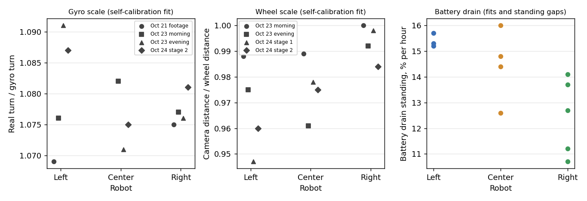

# How the three robots differ, the sensor weaknesses found, and how the software handles each (2026-10-25)

**Premise.** Nick, 2026-10-25 13:03: "We should also note the ways that robots are different from each other and
weaknesses found in the sensors and point to how our software overcomes that, in the documentation." This collects
every measured difference between Left, Center and Right, and every sensor weakness found so far, each with its
evidence and source, and what the software does about it now (or the plan to). Nothing new was measured for this
document. Conclusions marked **[Claude]** are Claude's own reading, not measurements; Nick works alone on this
capstone, so there is no group position to separate from.

**What "now" means.** Statuses describe the code committed at 4208770 (2026-10-25 13:11). At the time of writing
another lane had uncommitted changes to the trust code (`e02_trust.py`: each robot judged against its own references
and history first, compared with the others only afterwards, per Nick at 13:03) and to the readers of `v_cms`
(fusion, live lab, session checks). Rows W4, W6, W7, G6 and C7 may change when those land.

**How the software deals with weaknesses, in four ways** (named in the table's last column):
- **Self-calibration:** each robot's gyro scale and wheel scale are fitted again every session from its own driving
  under the camera (`tools/experiment/e02_fit.py`).
- **Learned trust:** each sensor's noise is learned from how well it agrees with the others; one that gets twice as
  noisy as healthy is flagged and weighted less (`e02_trust.py`).
- **Fresh against history:** a value from this session replaces the stored one as soon as there is enough of it, and
  a shift from the stored one is reported (`e02_front.py`, `e02_unc.py`, the battery-rate learner).
- **Provenance:** every number carries whether it was measured, derived, guessed or copied, and only measured values
  are written into a robot (`docs/build-plans/sensor-array-self-calibration.md` §2; heading fixes 1-4).

## Headline numbers

| | Left | Center | Right | Source |
|---|---|---|---|---|
| Gyro scale (real turn ÷ gyro turn), range over sessions | 1.069-1.091 | 1.071-1.082 | 1.075-1.081 | 2026-10-21-real-footage.md §4; logs-doe.md App. A1 |
| Gyro drift standing still (°/s) | 0.0000 | −0.0002 | 0.0003 | E02-accuracy/results/2026-10-23-session1/report.md, "Finds" (n = 1 each) |
| Wheel scale (camera ÷ wheel distance), range over sessions | 0.947-0.988 | 0.961-0.989 | 0.984-1.000 | night-analyses.md App. B1 (track cut at 3 cm) |
| Battery drain standing (% per hour) | 15.2-15.7 | 12.6-16.0 | 10.7-14.1 | night-analyses.md §C |
| Front sensor offset (reading − map, cm) | −3.4 | −0.9 | +1.2 | `tools/experiment/e02_front.py` docstring (115 readings, 10-23/24) |
| Front sensor reads at a board 45 cm away (cm) | 30 | 24 | 37 | right-front-and-rpm.md §1 |
| Wheel rpm reported ÷ true rpm | 1.080 | 1.085 | 1.081 | right-front-and-rpm.md §2 |
| Stretches ending 30°+ off in heading (runner-caused) | 17 % | 12 % | 21 % | e02-oct25-heading.md hypothesis 5 |

Each point is one robot's fitted value in one session (left, middle) or one measured drain rate (right). Gyro and
wheel scales are from the self-calibration fits of each session; drain is from battery readings in the session
logs (sources: the table above).

**Conclusion [Claude].**
1. **The robots differ less from each other than each one differs from session to session.** Left's gyro scale moves
   0.022 between sessions while the three robots sit within 0.020 of each other in any one session. Left's wheel
   scale moves 0.041. Fixed numbers typed in once would be wrong by more than the robot-to-robot differences. This is
   why calibration is redone every session rather than measured once per robot.
2. **Two differences are steady:** Right's wheel scale is the highest in every session (1.2-5.1 points above Left,
   roughly 2-10 cm over a 200 cm route), and Right drains its battery slowest standing still (10.7-14.1 against
   Left's 15.2-15.7 % per hour).
3. **Every robot shares the biggest weaknesses:** the gyro under-reports turns by about 7-9 %, wheel rpm reads 8 %
   high, and the front sensor reads short beyond 30 cm. These are properties of the Alvik, not faults in one unit.
4. **Right's front sensor is fine.** The blind discovery replay flagged it, and the follow-up check found the cause
   was what Right faces while parked, not the sensor (right-front-and-rpm.md conclusion 1).
5. **The heading problems were the runner's, not the gyros'.** The 30°+ heading errors came from headings the runner
   wrote into the robots without measuring them. Left alone, a gyro heading drifts a median 1.4-3.6° between fixes (heading.md, hypothesis 3).

## The weaknesses, and what the software does about each

Status: **Handled** = in the code that runs sessions now. **Partly** = handled in part, the rest planned. **Plan** =
found and planned, not built. **Open** = no plan yet.

### Gyro (the IMU's turn rate)
| # | Weakness | Evidence | How the software overcomes it | Status |
|---|---|---|---|---|
| G1 | Under-reports turns by about 7-9 %, every robot | Camera turn ÷ gyro turn 1.069 (Left, 16 turns) and 1.075 (Right, 21 turns) on 10-21; fits 1.071-1.091 on 10-23/24; earlier team data: 0.916-0.931 read ÷ real on 5 robots, 23 turns | Self-calibration fits each robot's gyro scale every session (prior 1.075, refused outside 0.97-1.18). After correction the turn between the boards reads 1.002-1.010 | Handled |
| G2 | A fitted drift absorbs other errors | Fitted drift ran to the ±0.05 °/s band edge in every session against a measured 0.000; holding it at the measured value predicts where the robot went 0.12-0.15 cm better (p < 0.001, 49 runs) | Drift held at the robot's measured standing-still drift (`DRIFT_BAND_DPS` 0, commit a9267a9) | Handled |
| G3 | Unmeasured headings written over the gyro (a runner fault, not the gyro's) | 100 of 112 stretches ending 30°+ off traced to fixes writing a heading the runner had not measured: ±90° placeholder 68 %, a run's end heading echoed 12 %, a stale heading after a refind 10% | **Provenance:** a fix carries a heading only if measured; the placeholder only for a robot with no pose; a measured heading pushed when the robot's is 8°+ off (heading fixes 1-4) | Handled (simulator: 15+ cm → under 1 cm); not yet seen on the board |
| G4 | A gyro left to itself can creep (simulator, 0.57 °/s) | Simulated Right crept 156° in 8 min once nothing overwrote its heading; its find drove towards the open edge | **Fresh against history:** a robot's own heading counts before a find only if reported in the last 15 s (`FIND_OWN_FRESH_S`) | Handled |
| G5 | Gyro sign came out negative against the camera in 2 of 12 cases | Discovery replay calibration table | None yet; a test is listed (board side flipped, or the camera scan locked on a mirror) | Open |
| G6 | 5 % gyro jitter on one robot is not flagged (simulator) | Right's gyro learned 1.1° a stretch against 0.3° for the others; healthy is 1.0°, so k stayed ≈ 1.1 | Learned trust exists but misses it **[Claude]**: k is judged against the real robots' healthy noise | Open (simulation-register.md row 16) |

### Wheels (encoders and motor board)
| # | Weakness | Evidence | How the software overcomes it | Status |
|---|---|---|---|---|
| W1 | Wheel scale differs by robot and by session | 0.947-1.000 across robots and sessions; tape on 10-20: Left 0.976, Center 0.981 | Self-calibration fits it every session; tracker jumps cut from the camera track first, so fits pass (stage 2: 2.1-2.35 → 0.8-1.3 cm) | Handled |
| W2 | Reported rpm reads 8 % high and lags 50 ms | `w*_rpm` ÷ wheel-angle rate 1.080 / 1.085 / 1.081 (212 runs; spread 0.004); the motor board assumes a 20 ms update that really takes about 21.6 ms; 5-update moving average | The robot's pose and the runner use wheel angles, which carry no time error. Plan: wherever rpm is a speed, divide by 1.08 or use the angle rate; check the ratio every session | Partly |
| W3 | Robots drive about 7.5 % slower than commanded | The speed loop holds the reported (8 % high) rpm on the command: a 15 rpm spin reports 15.2-16.3, really about 14.3; creep 4.6 cm/s, not 5 | Distances are unaffected (angles). Stall detection keeps its meaning (both sides in the same units). Plan: a per-robot step measuring rpm against the angle rate | Partly |
| W4 | `v_cms` is in mm/s, not cm/s (Arduino_Alvik library bug) | `v_cms` ÷ rpm = 1.78 in every session (10 × the cm/s factor) | The runner and the firmware's control don't read it. Plan: the offline fusion (`tools/fusion/engine.py`) and the live lab's wheel trust read it as cm/s, 10.8 × too large: fix them to ÷ 10 or use the angle rate | Plan |
| W5 | Wheels slip on turns on the spot | Wheels ÷ gyro on 576 turns: 0.95-0.97 per robot | Heading comes from the gyro, never the wheels | Handled |
| W6 | A wheel fault on one robot | Simulator: Center's wheels at 5 % / 10 % jitter flagged after 8 / 7 runs (k 3.8 / 4.6) | **Learned trust:** the robot that stands out from the others is flagged and its fits weighted less | Handled (simulator); not yet tested on the board |
| W7 | A fault every robot shares can't be told from the camera | Simulator, every robot's wheels 8 %: only Center flagged; the "can't tell the camera from every robot's wheels" note fired | The runner says so plainly. Plan: tape marks as a second reference | Plan |

### Front distance sensor (5 range zones and a bottom zone)
| # | Weakness | Evidence | How the software overcomes it | Status |
|---|---|---|---|---|
| F1 | Each robot reads a different offset from the map, with a wide spread | Per robot −3.4 / −0.9 / +1.2 cm, all −1.1 cm, spread 5.5 cm (115 readings); another cut of the data: −2.1 / −2.1 / −2.8 cm, spread 6.8-8.2 (374 checks) | **Fresh against history:** each robot's offset is learned from its history, replaced by this session's own after 8 readings, and a shift beyond 3 cm and 3 standard errors is reported (`e02_front.py`); tolerance 3 × spread | Handled |
| F2 | Reads short beyond about 30 cm, every robot | At 45 cm: Left 30, Center 24, Right 37 cm; the runner's own checks 10-15 cm short at 35-45 cm | Partly: the check only counts boards within 50 cm, met within 45° of head-on. Plan: a DOE on the 50 cm range (30 against 50); a 5-minute test at 20 / 40 / 60 cm to find the cause | Partly |
| F3 | The centre zone is the mean of its two neighbours, not a sensor | `dC_cm` = mean of `dCL_cm` and `dCR_cm`, R² 1.000 in all 20 rich cases | **Provenance:** the discovery replay tags it derived. **[Claude]** The fusion should not count it as a sixth independent zone; not yet changed there | Partly |
| F4 | Zones flicker 17-56 cm at rest when nothing is in range; 0 means nothing in range | Right-front report (parked windows) | Readings of 0 are ignored; only boards met within 45° count | Handled |
| F5 | Misreads at a slant | In the simulator, 92 cm for a board 42 cm away at 19° | Only boards met within 45° of head-on count as landmarks | Handled |
| F6 | The bottom zone can miss a slanting open edge | 10-23 night: Right went over at a slant; the bottom zone stayed 7-8 cm while one line sensor tripped | Both edge cues on; explore crawls at 4 cm/s near edges; the camera's virtual border (15 cm) and the robots' own border (10 cm) | Handled (no fall since) |
| F7 | A bias on one robot's sensor is caught slowly (simulator) | +8 cm on Left flagged after 16 runs; the session's own offset never replaced the default (under 8 readings per robot) | Learned trust catches it, late **[Claude]** | Open (register row 17) |
| F8 | Few usable readings on the Pi | 0-7 per robot per session on the Pi against 14-21 on the laptop morning | Trust waits for 6 readings before judging | Partly |
| F9 | Right's front zones looked like line sensors in the blind replay | Moved only 3-7 × their rest noise, against 12-29 × on the others | Checked: not a fault. Right agrees with the map at least as well (spread 6.8 against 7.7-8.2; 57 % within 6 cm) | Handled (no fault) |

### Line sensors (the edge guard)
| # | Weakness | Evidence | How the software overcomes it | Status |
|---|---|---|---|---|
| L1 | Learning the floor with the sensors already over the edge switches the guard off | 10-22: Center fell this way | Firmware 2026-10-22b: no forward drive when the line sensors start off the plywood | Handled |
| L2 | The margin is set from few edge trips | Plywood 52-84 while driving; the two real trips 241 and 573; limit 150. Bottom zone on plywood at most 10.3 cm (7.2-8.8 per robot); at line trips 9.0-9.7, so a backup at 11 cm | Both cues on (`safe_edge 3`); every EDGE record says which fired first | Handled; the limits are chosen (DOE rows) |

### Overhead camera and tracker
| # | Weakness | Evidence | How the software overcomes it | Status |
|---|---|---|---|---|
| C1 | Tracker jumps 3 cm or more in one picture | 66 % of stage-2 stretches held one (laptop morning 51 %); they missed by 5.96 cm against 1.60 | Track cut at one-picture jumps over 3 cm before fitting (`JUMP_CM`); 2-4 cm give the same results | Handled |
| C2 | The camera's picture drifts | Up to 2 px (about 1 cm at the top board) over 10-23; at most 0.43 px on the Pi sessions | Camera drift watch: each picture aligned to the session's first, positions corrected, a warning past 1 px | Handled |
| C3 | Its error is known only in the find corner | All finds within 2.7 cm of one point; the error map is a constant shift (−3.5, −3.6 cm) wherever it applies, nothing beyond 75 cm | Plan: tape marks across the board | Plan |
| C4 | Glare by the top board flattens the robot's look | Floor brightness 190-197 there; the lock-on held 8-36 % of the time against 90 %+ by the open edges (r = 0.73 detail against hold) | Plan: a camera-quality map from the calibration runs, raising the camera's uncertainty there | Plan |
| C5 | The robots' lights throw a glow on the floor beside them | Mark-the-robot instructions: put the ring on the robot, not its glow; a ghost held for 3 s after a leg, possibly the lights or a reflection | 3.5 s recheck before calling a robot lost. Plan: a session with the lights off (`set blink_codes 0`) | Partly |
| C6 | Late pictures when the network or the machine is loaded | Laptop with a file copy: 26 % of seconds over 1 s late; an upload during Right's session halved the runner's picture rate | Runs on the Pi (median age 0.12-0.13 s, none over 1 s); the runner watches its own speed; no uploads during sessions | Handled |
| C7 | A noisy camera (simulator) | 2 cm noise: flagged before the first run, but 31 holds in 8 runs; 4 cm: no runs | **Learned trust:** a bad camera shrinks the working area, the robots' own border takes over, park spots move in. Holds 31 → 5 (2 cm), 17 → 7 (4 cm) | Partly |
| C8 | Right looks washed out to the tracker | The detector's look threshold 38 sits between the floor's 27 and Right's 49 | None beyond the lock-on tracker **[Claude: a thin margin worth a check]** | Open |

### Battery reading
| # | Weakness | Evidence | How the software overcomes it | Status |
|---|---|---|---|---|
| B1 | Whole-percent, smoothed reading; driving cost too small to see | Reading while driving = reading standing (−0.01 to +0.03 %, 70 runs); standing drains 11-16 % an hour | Logged every 300 s; the battery-rate learner learns each robot's drain from its history and reports a shift | Handled (learning); the meaning of the % is unchecked |

## What's next
1. Apply the planned fixes that need no board: `v_cms` ÷ 10 in the fusion and the live lab (W4); rpm ÷ 1.08 or the
   angle rate wherever rpm is a speed (W2); the centre zone counted as derived in the fusion (F3).
2. Rerun the simulator's gyro and front-sensor faults with real-sized noise (G6, F7).
3. On the board, about 5 minutes each: the front sensor square to a board at 20 / 40 / 60 cm (F2); a short session
   with the lights off (C5).
4. Tape marks across the board: the one reference that separates the camera's error from the wheels' (C3, W7).

## Sweep 1: new tests that may now be needed
- **Robot-to-robot against session-to-session, formally:** a mixed model on the fitted gyro and wheel scales (robot
  and session as factors) once there are 6 or more sessions, to test whether Right's wheels really differ.
- **Right's battery:** the same standing-drain test for all three side by side (switched on, parked, 1 h) to check
  its lower drain is the robot, not the day.
- **Motor-board period per robot:** the rpm ÷ angle-rate ratio in every session; a change means the timing changed.
- **Gyro sign check** on the 2 discovery cases with a negative factor.
- **Front offsets, two cuts:** rerun both front analyses on the same readings to find why the per-robot offsets
  disagree (−3.4 / −0.9 / +1.2 against −2.1 / −2.1 / −2.8).
- **Right's look in the camera:** the detector's look value per robot over a session, against the 38 threshold.

## Sweep 2: possible inaccuracies in what this relied on
- **The camera is the reference for almost every number here** (gyro and wheel scales, front offsets, heading
  errors). A camera scale or tilt error across the board would show up as a robot difference.
- **The per-robot front offsets depend on which readings are used.** Two cuts give different orders; the differences
  (1-4 cm) are inside the spread (5.5-8.2 cm). **[Claude]** They should not be read as a real difference yet.
- **Standing drift is one reading per robot** (n = 1, session 1 report).
- **Gyro scale values are fits with a drift band of 0.05** (logs DOE A1), before the band went to 0; with band 0 they
  may move slightly. Left's 10-21 value is from 16 turns with an IQR of 1.044-1.090.
- **Battery rates** rest on integer readings over 1-2 h; the driving rate is poorly pinned (it moves 10 % per hour
  between days). Right's 13.7 % per hour uses a 35 % reading taken from the brief, not a log.
- **The 21.6 ms motor-board period is inferred** from the rpm ratio, not timed; the library source read was 1.1.1.
- **The earlier team's gyro data** (5 robots, 23 turns) was taken on different robots and firmware.
- **Simulator results (G4, G6, W6, W7, F5, F7, C7)** use the simulator's guessed noise; its gyros are quieter than
  the real ones.
- **Chosen numbers behind the fixes**: jump cut 3 cm, 15 s fresh heading, 8° heading push, 8 front readings, 3 cm
  front shift, 45° and 50 cm front check, 3.5 s recheck, 1 px drift warning, line limit 150, bottom zone 11 cm. Each
  has a DOE row in `docs/doe-backlog.md`, except the 15 s fresh-heading window, for which a logs replay of heading
  age against error would be the sensible DOE.

---

## Appendix A. Values by session

Gyro scale (fits; logs-doe.md App. A1, leave one run out, band 0.05; 10-21 from the real-footage notes):

| Session | Left | Center | Right |
|---|---|---|---|
| 10-21 footage (direct turns) | 1.069 | - | 1.075 |
| 10-23 morning | 1.076 | 1.082 | 1.077 |
| 10-23 evening | 1.091 | 1.071 | 1.076 |
| 10-24 stage 2 | 1.087 | 1.075 | 1.081 |

Wheel scale, as run / track cut at 3 cm (night-analyses.md App. B1):

| Session | Left | Center | Right |
|---|---|---|---|
| 10-23 morning | 0.991 / 0.988 | 0.993 / 0.989 | 1.021 / 1.000 |
| 10-23 evening | 0.976 / 0.975 | 0.971 / 0.961 | 1.003 / 0.992 |
| 10-24 stage 1 | 0.963 / 0.947 | 0.981 / 0.978 | 1.000 / 0.998 |
| 10-24 stage 2 | 0.975 / 0.960 | 0.988 / 0.975 | 1.002 / 0.984 |

Battery drain, % per hour (night-analyses.md §C):

| Robot | Pi afternoon fit, standing / driving | 10-23 morning fit, standing / driving | Standing gaps |
|---|---|---|---|
| Left | 15.3 / 24.2 | 15.2 / 17.9 | 15.7 |
| Center | 16.0 / 13.7 | 14.4 / 16.9 | 14.8, 12.6 |
| Right | 14.1 / 13.3 | 12.7 / 17.9 | 10.7, 11.2, 13.7 (17:32 → 19:35) |

Front sensor per robot (right-front-and-rpm.md §1, 374 runner checks, 7 sessions):

| | Left | Center | Right |
|---|---|---|---|
| Reading − map, median (cm) | −2.1 | −2.1 | −2.8 |
| Spread (MAD × 1.48, cm) | 7.7 | 8.2 | 6.8 |
| Within 6 cm of the map | 59 % | 53 % | 57 % |
| Time between new zone values | 53 ms | 54 ms | 54 ms |
| Bottom zone at rest (reads the floor) | 7.0 cm | 8.1 cm | 7.3 cm |
| Front-sensor holds in the runner logs | 4 | 7 | 4 |

Finds on 10-23 morning (session 1 report): own pose off at the boards median 6.0 / 6.2 / 8.2 cm (Left / Center /
Right); worst 12.8 / 23.7 / 14.4. Center's large ones came from a camera heading fix 2 s before the find and from
parking 100 cm from its first board (e02-oct24-analyses.md §3), so they are a placement effect, not Center's sensors.

## Appendix B. Where each weakness was found
| Weakness | Found by | Date |
|---|---|---|
| G1 gyro scale | Real footage (and an earlier team's data) | 10-19 to 10-21 |
| G2 drift band | Logs DOE row 2 | 10-25 |
| G3 unmeasured headings | Heading diagnosis (logs) | 10-25 |
| G4 gyro creep | Simulator dry run | 10-25 |
| G5, F3, F9 | Blind discovery replay (logs) | 10-25 |
| G6, W6, W7, F7, C7 | Simulator bad-sensor grid | 10-24/25 |
| W1, C1, C3 | Night analyses (logs) | 10-24 |
| W2, W3, W4, F2 | Right's front and rpm check (logs) | 10-25 |
| W5 | Heading diagnosis (logs) | 10-25 |
| F1 | Session 1 report; front learner | 10-23 to 10-25 |
| F4, F5 | Review and simulator | 10-22 |
| F6, L1 | Real falls | 10-22, 10-23 |
| C2, C4 | Four checks on 10-23 data | 10-24 |
| C5 | Right's session; mark-the-robot page | 10-24/25 |
| C6 | Session comparison, 10-23 | 10-23/24 |
| C8 | Build notes, 10-23 morning | 10-23 |
| B1 | Night analyses §C | 10-24 |
