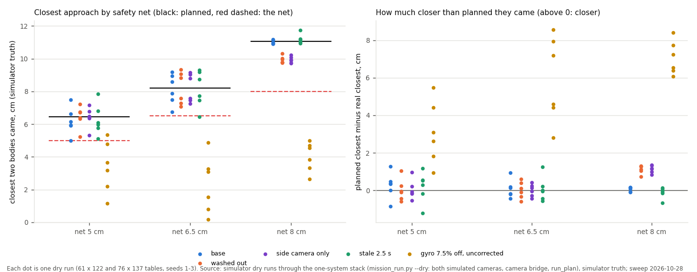

# The safety net: 5 / 6.5 / 8 cm (simulator DOE, 2026-10-28 overnight)

## Premise

Nick wants the 8 cm safety net (no plan may bring two robot bodies closer than this) narrowed this week. The question:
at 5, 6.5 and 8 cm, how close do the robots really come (simulator truth) under noisy conditions, against what the
plan promised? One setting moves three things together, as the net does on the robots: the planner's separation,
Chicken's "never under", and run_plan's `--min-gap-cm` refusal (`mission_run.py --setting separation_cm=L --setting
chicken_min_cm=L --min-gap-cm L`).

Monday's 2-robot mission at commit ceffc31 (Chicken played together, swerve at 15 cm: the pre-pass Chicken), 61 x 122
and 76 x 137 tables, 3 seeds, 5 conditions: base, washed-out overhead, side camera only, a frozen camera (2.5 s every
20 s), and both gyros 6.5-8.5 % off with no stored correction. 90 dry runs; the 8 cm level is the robustness sweep's
own runs ([monday-2robot-sweep.md](monday-2robot-sweep.md)).

## Data



Left: each dot is one run's real closest approach, the black line the planned one, the red dashed line the net; the
healthy conditions stay above the net at every level, the uncorrected gyro (yellow) falls through all three. Right:
planned minus real, the same runs.

| Net | Planned closest | Real closest, healthy conditions (24 runs) | Planned minus real: mean / worst | Where the closest moment is | Finished | Took |
|---|---|---|---|---|---|---|
| 8 cm | 11.1 cm | 9.7-11.8 (median 10.6) | 0.55 / 1.35 cm | Chicken's swerve | 24 of 24 | 127.6 s |
| 6.5 cm | 7.7 (61 x 122) / 8.7 (76 x 137) | 6.4-9.3 (median 8.2) | 0.04 / 1.25 | the circle while the other robot mows lane 4-6 | 24 of 24 | 126.2 s |
| 5 cm | 6.3 / 6.6 | 5.0-7.8 (median 6.4) | 0.13 / 1.28 | the circle while the other mows lane 5 | 24 of 24 | 126.2 s |
| any, gyro uncorrected | as above | 0.2-5.3 | 3-8.6 | the circle (both spiral in) | 0 of 18 | - |

<sub>Real closest: the two 9.5 cm square bodies, simulator truth every 0.05 s. Healthy = base, washed out, side camera
only, frozen camera. "Took": mean of the healthy runs (plans 128-142 s).</sub>

## Conclusion

- **In the simulator the net holds at every level for healthy conditions:** the real closest approach was never more
  than 1.35 cm short of the plan, and never under the net itself (worst: 5.0 cm at a 5 cm net, 6.4 cm at 6.5).
- **Narrowing the net buys Monday almost no time** (1.4 s of 128) and changes the show: below 8 cm the closest moment
  moves from Chicken to the circle passing the other robot's mowing.
- **The net does not protect against an execution fault:** with an uncorrected gyro the robots came 0.2-5.3 cm apart at
  every level. The net bounds the plan, not the driving.
- **Recommendation: 6.5 cm, with an honest margin of about 4 cm on the real robots.** The simulator's worst shortfall
  is 1.35 cm, but its camera is clean: its line check p95 was 0.4-1.7 cm (median 0.8) against the real 27 Oct L3 drives'
  0.9-3.1 cm, about twice as much. Doubling the shortfall (2.7 cm) leaves about 5 cm (planned 7.7 cm at 6.5) between
  bodies on the real board; at a 5 cm net the same reasoning leaves about 3.6 cm, too close to call from the simulator
  alone. *Claude's reading:* go to 6.5 cm for Monday only after one board check (below); 5 cm needs the board DOE.

## What's next

1. **Board check before Monday at 6.5 cm (10 min):** two robots, the camera's closest approach over 5 Chickens and 2
   circles at the 6.5 cm net, against the plan's (the DOE row "safety net", now 8 / 6.5 / 5).
2. Keep the gyro correction a hard start check (it is: settings read back), since no net level covers its loss.
3. Re-run this DOE on the passing Chicken (Nick, 03:52) once it lands: Chicken's planned closest becomes ~10 cm by
   design, so the circle-against-mower moment may decide the net alone.

## Sweep 1: new tests that may now be necessary

- The board check above; then the full board DOE (8 / 6.5 / 5 cm, 10 Chickens and 10 crossings each).
- The same DOE with the frozen camera and 15 % packet loss together (only one condition at a time here).
- A circle with the other robot mowing closer (the moment the lower nets expose) on 66 x 127 and 70 x 130.
- The passing Chicken at 6.5 cm.

## Sweep 2: possible inaccuracies

- **The simulator's camera is optimistic** (clean pictures, a side camera that sees every body); the "twice" factor
  comes from one afternoon's five real drives, not a measured shortfall.
- **The front distance sensor** in the simulator sees other robots cleanly; the real sensor's phantom readings (see the
  ladder report's follow-up) would stop robots earlier, in both directions for the margin.
- **Chicken's "never under" moved with the net** (as one setting). If Nick wants Chicken kept at 8 cm while the net
  narrows, the 6.5 / 5 cm results here describe the circle-against-mower moment only.
- **3 seeds, two tables, 5 conditions;** wheels-off and packet loss were not crossed with the lower nets.
- The planned closest is the first plan's; no run re-planned in the healthy conditions, so it is the plan in force.

## How to run it

```
nice -n 10 python3 tools/fleet/sweeps/monday2_sweep.py run --out DIR --levels 8,6.5,5
python3 tools/fleet/sweeps/monday2_charts.py --rows DIR/results.json --out docs/screenshots/2026-10-28
```

Rows: [data/monday-2robot-sweep/results.json](data/monday-2robot-sweep/results.json) (`level` = the net).
