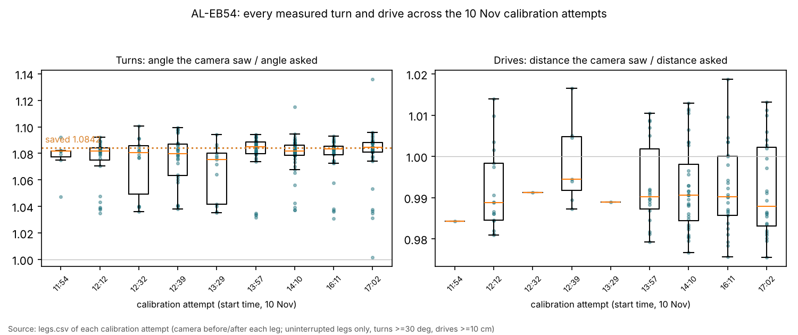
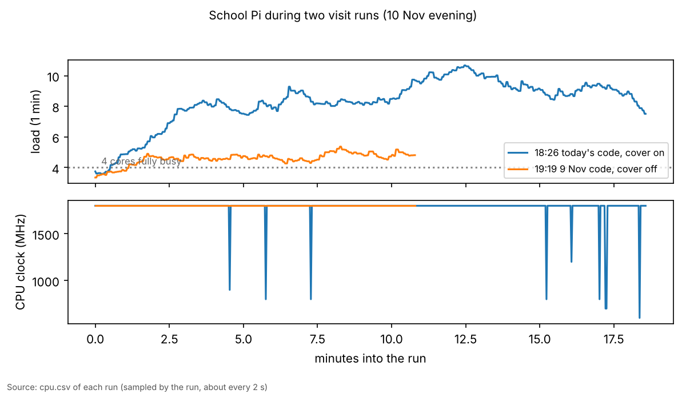

# School, 10 Nov: what the day's runs show

## Premise

On 10 Nov at the school table, the runs were:

- 11 calibration attempts on AL-EB54 (roof tag 4), in changing light: room lights on, off, and lit by the TV only;
- two 40-point Visit runs on AL-1DC0 (roof tag 2):
  - 18:26, on that day's code (e13);
  - 19:03 and 19:19, on 9 Nov's code, after the Pi's case cover came off at about 18:45;
- Jay-Sun's own visit runs, 20:41-21:59.

Data: every run folder (logs only, no pictures, no RFID). **Measured** = read from the logs; **Claude's reading** = interpretation, marked as such.

## Data

| What | Result (measured) |
|---|---|
| AL-EB54 turns, pooled from every uninterrupted turn of 30 deg or more in all attempts | 261 turns: the camera saw **1.082 x** the angle asked (IQR 1.078-1.087). This held in every attempt and every light. The saved gyro_scale 1.0842 matches it. |
| AL-EB54 drives, pooled from every uninterrupted drive of 10 cm or more | 126 drives: the camera saw **0.990 x** the distance asked (IQR 0.985-1.002). This held in every attempt. |
| AL-EB54's 17:02 wheel fit | **0.726 ± 0.20, refused**. The same run's own 24 drives say 0.988. |
| 40-point runs, 9 Nov code (19:03, 19:19) | Both finished: 25 and 26 points. 16 points were skipped from the start by the camera model's read-rate estimate (P23, P24, P29-P40, plus P03 and P15). Robot and camera agreed within **0-1.4 cm** at every stop. |
| How far the camera follows the robot | Roof-tag reads out to **x ≈ 216 cm** (P21, P28). Motion fixes out to **x ≈ 277 cm** (P23, P25). That's well past the 180 cm that zones 1-2 assume. |
| 40-point run, that day's code (18:26) | 25 stops out to P29, then ended: "every robot is out (none heard again within 90 s)". It started with the heading-check failure covered in e15. |
| Pi load | Today's code: 1-minute load **8-10** on 4 cores, and the clock dropped to 600-900 MHz eight times. 9 Nov code with the cover off: load **4.5-5**, and the clock held 1800 MHz. |
| Per-program CPU, both runs | recorder about 100 % (one full core), tag reader 110-120 %, planner 26-31 %, Mission Control 1-3 %. Very similar in the two runs. |
| Pi temperature | Cover on: median 82-85 C all day. Cover off: 81-83 C. A 2-3 C drop. |
| Jay-Sun's 20:41-21:59 runs | 12 runs, every one "done". |

Each dot is one turn or drive that AL-EB54 made in a calibration attempt. The boxes show the middle half of each attempt's measurements.

Above: how many tasks were waiting for the Pi's 4 cores. Below: the Pi's clock speed. Each line is one run.

## Conclusion

1. **AL-EB54 is well measured. The wheel fit, not the robot, is broken.** All day, every attempt agreed: it turns about 8 % short and drives about 1 % short. The 17:02 fit's 0.726 ± 0.20 contradicts that run's own drives (0.988). Claude's reading: the fit used the wrong legs, or too few of them; pooling (e14) should give about 0.99 once its pooled uncertainty is checked. A test of the wheel fit against these legs goes into the audit.
2. **The camera sees much further than the software assumes.** Tags read out to about 216 cm and motion out to about 277 cm in normal light. Yet the 9 Nov code skipped P29-P40 without trying, from its camera-model estimate. The e14 learned readability should replace that estimate. That needs the brightness-keyed map to be used at the start (deferred in e13; done in e14).
3. **Today's code roughly doubles the Pi's load, for reasons not yet found.** The tracked programs used about the same CPU in both runs, so the extra load (8-10 against 4.5-5) comes from something cpu.csv doesn't track: extra threads, leftover or helper processes, or logging. Claude's reading: this is the first thing the Pi audit has to explain. The cover came off between the two runs, but load counts waiting tasks, not heat. The clock drops in the first run are the heat; the load gap isn't.
4. **The video recorder uses a whole core.** Nick decided on 11 Nov that video isn't needed. Turning it off frees about a quarter of the Pi.
5. **Taking the cover off helped by only 2-3 C.** The Pi still sat at 81-83 C. Trimming the load matters more than the cover.

## What's next

- The Pi audit, starting after e15: find where today's code's extra load comes from, measure the recorder off, and test the wheel fit against these legs.
- Tell Jay-Sun: nothing in his runs needs action. All 12 finished.
- The heat tracker couldn't take these runs, because they have cpu.csv but no perf.csv. The audit should make every run write what the tracker reads.

## Sweep 1: new tests that may be needed

- The wheel fit against AL-EB54's 10 Nov legs: it must give about 0.99 with a small ±.
- A load test on the Pi, today's code against 9 Nov's, same table, same robot, same cover state, to separate code from heat.
- Readability far out (x > 200 cm) with the room lights on, to replace the camera-model estimate there.

## Sweep 2: possible inaccuracies

- The turn and drive ratios use the camera as truth. A systematic camera-scale error would move both.
- The 18:26 and 19:19 runs differ in code, cover and robot start. The load gap is the code's, or a process left over; it isn't proven which.
- "Uninterrupted legs only" uses the legs.csv `interrupted` column. Legs cut short by losses may still be in it.
- One robot per run, one day, changing light.

Scripts: inline in this session, run against the 10 Nov folders. The charts' sources are named under each chart.
