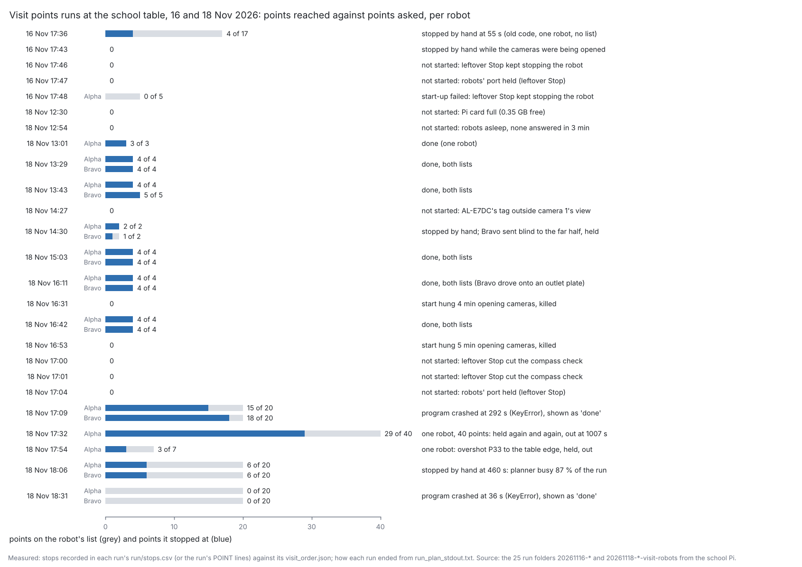

# Why Jay-Sun's two-robot Visit points runs did not complete (16 and 18 Nov 2026)

Logs-only analysis of the 25 run folders `20261116-*` and `20261118-*-visit-robots` from the school Pi, against the code at `015e311`. Nothing was run on robots, Pis or cameras.

## 1. Premise

Jay-Sun ran Visit points at the school table with a list per robot and could not complete the two-robot runs. The question is why, run by run, and what fixes each cause.

## 2. Data

### 2.1 What the 25 runs were

- **16 Nov:** no two-robot run. All five runs found one robot (AL-1DC0, tag 2); the binding read tag 2 only.
- **18 Nov:** two robots (AL-E7DC = Alpha, tag 3; AL-EB54 = Bravo, tag 4) answered in 10 of 20 runs. Five runs with 4 or 5 points per robot finished both lists. None of the three runs with 20 points per robot finished.
- **Code version:** run 1 (16 Nov 17:36) ran `c51ca63` (its traceback lines match that version; `observe.py` 2026-11-10a). Every later run ran `015e311` (`observe.py` 2026-11-12e19).
- **Cameras:** the run used camera 1 alone until 14:30 on 18 Nov; from 15:03 it used camera 1 and camera 2 ("side"). The start-up wiggle read roof tags with camera 1 only in every run.

Each row is one run: the grey bar is how many points were on the robot's list and the blue bar is how many it stopped at; only short lists were completed, and 14 runs never reached a point.

### 2.2 Run table

"Reached" counts recorded stops against each robot's own list. Times are run start on the Pi clock.

| # | Start | Code | Robots found | Lists asked | Reached | How it ended | Root cause |
|---|---|---|---|---|---|---|---|
| 1 | 16 Nov 17:36 | c51ca63 | AL-1DC0 | none (table share, 17 points) | 4 | interrupted at 55 s | Stopped by hand (Pi update at about 17:40: inferred) |
| 2 | 17:43 | 015e311 | none yet | – | 0 | stopped by hand about 20 s in | Stop pressed while cameras were being opened; set off cause A |
| 3 | 17:46 | 015e311 | AL-1DC0 | – | 0 | not started | A: finding moves "failed, stop command" |
| 4 | 17:47 | 015e311 | – | – | 0 | not started | A: "port 5005 is in use" |
| 5 | 17:48 | 015e311 | AL-1DC0 | P01,P13,P18,P09,P01 | 0/5 | start-up failed at 69 s | A: follow run "stopped (stop command)" three times, about 3 s after each start |
| 6 | 18 Nov 12:30 | 015e311 | – | – | 0 | not started | Pi card full: 0.35 GB free (floor 0.5) |
| 7 | 12:54 | 015e311 | none (2 tags seen) | – | 0 | not started after 3 min | Robots asleep; run waits 3 min, school check-in is hourly |
| 8 | 13:01 | 015e311 | AL-E7DC | P10,P16,P18 | 3/3 | done 68 s | completed (one robot) |
| 9 | 13:29 | 015e311 | both | Alpha 4, Bravo 4 | 4/4, 4/4 | done 114 s | completed |
| 10 | 13:43 | 015e311 | both | Alpha 4, Bravo 5 | 4/4, 5/5 | done 82 s | completed |
| 11 | 14:27 | 015e311 | both (1 tag seen) | – | 0 | not started | E1: AL-E7DC stood where only camera 2 saw it |
| 12 | 14:30 | 015e311 | both | Alpha P14,P16; Bravo P26,P23 | 2/2, 1/2 | stopped by hand at about 61 s | E2: Bravo's points are in the far half, run had camera 1 only; drove 98 cm unseen, then held |
| 13 | 15:03 | 015e311 | both | Alpha 4, Bravo 4 | 4/4, 4/4 | done 86 s | completed |
| 14 | 16:11 | 015e311 | both | Alpha 4, Bravo 4 | 4/4, 3/4 really | "done" 169 s (planned 61), 12 plans | completed on paper; Bravo drove onto the zone 4 outlet plate and never reached P29 |
| 15 | 16:31 | 015e311 | none yet | – | 0 | killed after 4 min 20 s, no message | B: start hung opening cameras |
| 16 | 16:42 | 015e311 | both | Alpha 4, Bravo 4 | 4/4, 4/4 | done 110 s | completed |
| 17 | 16:53 | 015e311 | none yet | – | 0 | killed after about 5 min, no message | B: start hung opening cameras (robots also off until 16:57:59) |
| 18 | 17:00 | 015e311 | both | – | 0 | not started | A: compass check "stopped (stop command)" after 3.4 s |
| 19 | 17:01 | 015e311 | both | – | 0 | not started | A: same |
| 20 | 17:04 | 015e311 | – | – | 0 | not started | A: "port 5005 is in use" |
| 21 | 17:09 | 015e311 | both | Alpha P01–P20, Bravo P21–P40 | 15/20, 18/20 | crashed at 292 s, shown as "done" | C: `KeyError: 'Alpha'` in `finish_replan` |
| 22 | 17:32 | 015e311 | AL-1DC0 | Alpha P01–P40 | 29/40 (3 not at the point) | "every robot is out" at 1007 s | E3: 22 veer recoveries, 10 holds, 58 re-plans |
| 23 | 17:54 | 015e311 | AL-1DC0 | Alpha 7 points | 3/7 | "every robot is out" at 334 s | E3: overshot P33 by 11 cm to the table edge, then held 10 times there |
| 24 | 18:06 | 015e311 | both | Alpha P20–P01, Bravo P40–P21 | 6/20, 6/20 | stopped by hand at 460 s (plan said 264 s) | D: planner busy 399 s of 460 s |
| 25 | 18:31 | 015e311 | both | same as 24 | 0/20, 0/20 | crashed at 36 s, shown as "done" | C: `KeyError: 'Bravo'` in `finish_replan` |

### 2.3 Root causes, ranked by runs stopped

M = measured in the logs or code; I = inferred.

**A. A Stop pressed before the robots are named never finishes, and keeps stopping the robots of the next runs. 6 runs (3, 4, 5, 18, 19, 20). Software bug.**

- M: runs 2 and 17 were stopped before any `binding.json` existed and have no `stop.json`. The three runs stopped after binding (12, 23, 24) have one ("every robot confirmed 2 to 9 s after STOP").
- M: three minutes after run 2's stop, run 3's robot answered `nothing running` 34 times and each finding move ended `failed ... stop command`.
- M: run 5 had 290 `nothing running` answers; follow runs A5FA-21, -22, -23 each `stopped (stop command)` about 3 s after starting.
- M: runs 18 and 19 had 332 and 302 `nothing running` answers in about 35 s. The compass check started, was `stopped (stop command)` 3.4 s later, and every later move was `refused: no compass check since power-on`.
- M (code): with no binding, `start_job.robots_for_stop` falls back to the site's robots. At school these are `Alpha`/`Bravo` with `ip: null`, so `stop_confirm.StopWatch.step` can never match them to the robots that answer. It resends `stop` to the broadcast every 3 s "for as long as it takes", and each try opens port 5005 for 1 s.
- I: the two "port 5005 is in use" refusals (runs 4, 20) are that 1 s listen.
- I: the rate of about 5 stops a second per robot suggests Stop was pressed more than once, each press starting its own watcher.
- Not in the logs: what ended the storm before runs 16 and 21.

**B. Start hangs with no message while opening cameras. 2 runs (15, 17), and it sets off cause A. Software bug.**

- M: in both runs the output stops in the middle of the third camera probe, 4 s after the start. Nothing more appears for 4 min 20 s and about 5 min, with no traceback and no end line.
- M: the tag bridge read both tags throughout (548 fixes each in run 15).
- M: run 2's traceback shows the program inside `cv2.VideoCapture(dev)` at `camera_discovery.find_cameras` line 178 when stopped. Good starts show 9–10 probes of about 0.7 s each.
- I: `find_cameras` opens every `/dev/video` node, including the Pi's codec nodes and cameras the recorder holds, and one open blocked. Both hangs came after camera 2 was plugged in.

**C. The run program crashes when a robot finishes its veer recovery before a re-plan made without it is ready; the crash is shown as "done". 2 runs (21, 25). Software bug.**

- M: `run_plan.py` line 1526, `newplan["robots"][n]`, raised `KeyError: 'Alpha'` (run 21) and `'Bravo'` (run 25).
- M: in run 21 Alpha went out (recovering) at 285.9 s and rejoined 3.1 s later; the re-plan started for Bravo at 285.9 s took 5.08 s against a 2.0 s budget.
- M: in run 25 Bravo went out at 22.2 s and rejoined at 26.2 s; the re-plan took 12.18 s.
- M: `main()` does not catch the exception, `abort` stays empty, and the summary and `mission_summary.json` say `done`. Run 21 left 7 of 40 points unvisited; run 25 left all 40.

**D. Re-planning is too slow on the Pi for long lists, and a false "did not move" check keeps asking for more. 1 run stopped (24); it slowed run 14 and makes cause C likely. Software, made worse by Pi load.**

- M: run 24 had 27 re-plans, median 14.8 s, longest 19.0 s; 399 s of planner time in a 460 s run (87 %).
- M: first plans for 20 + 20 points took 30.5 s and 37.4 s. With 4-point lists, re-plans took 2.5–8.5 s.
- M: 18 of 19 "did NOT move" verdicts were false: the robot's own pose moved and ended within 3 cm of the step's target (for example 17.4 cm of 17.5 cm).
- M: in all 9 verdicts that could be matched, the newest camera reading had moved less than half the step when the step was reported done.
- M: 5 of 10 "not physically possible" verdicts were also false: the new plan's first step started 10–18 cm behind where the robot already stood.
- I: the camera's vote (weight 3 of 7.5 in `observe.move_outcome`) comes from a reading older than the step. Each false verdict costs a re-plan plus an "improvement" try while both robots stand.
- M (Pi): Alpha's median gap between camera fixes was 0.13 s at 13:29 (one camera), 0.31–0.53 s once camera 2 joined, and 0.71 s at 18:06.
- M (Pi): from about 16:30 the Pi was throttled in most health rows at 83–85 °C (0 rows before 16:00; 264 of 293 rows in run 24).
- M (Pi): in run 24 the robots refused 213 of 501 fixes (Alpha) and 410 of 1423 (Bravo), against 1 of 589 at 13:29.

**E. Camera coverage of the far half. 4 runs.**

- **E1 (run 11; software limit plus setup).** M: the binding's bridge lists `cams: ["overhead"]` in every run. AL-E7DC was seen moving by `stream-8001` only, and the run ended "pinned to tag 3: PIN CHECK FAILED".
- **E2 (run 12; setting).** M: P26 and P23 were flagged "the camera cannot read its roof tag there (kept as asked)". Bravo's P23 stop is "odometry for 98 cm since the last camera fix", and it was then held. This cannot repeat while camera 2 stays in the run.
- **E3 (runs 22 and 23; one robot each; software plus camera timing).**
  - M: in run 23, on the 62 cm leg to P33 (19.7 cm from the long edge), the robot's own pose ended on the point. The camera read it 11.1 cm further on, 8.9 cm from the edge, and its own edge guard stopped it.
  - M: it was then held 10 times in a row at that spot and put out.
  - M: run 22 had 22 veer recoveries and 10 holds; P22, P33 and P34 were skipped ("the camera lost its tag on the way a second time").
  - I: pose corrections from late pictures pull the pose back along the direction of travel (the reset at 50.9 s in run 23).

**F. Setup conditions. 2 runs.**

- **Run 6 (card).** M: 0.35 GB free. M: every finished run says "No GitHub token ... nothing uploaded", so nothing is ever cleared; the card was at 0.81 GB at the end of the day.
- **Run 7 (sleep).** M: 2 roof tags seen, no robot answered in 3 min; the next run got AL-E7DC after 80 s, "woken from sleep".
- **Run 7 (code and site file).** M: the wait is 3 min, the school check-in is 60 min, and the message says "every 10 min". Every run ends with "The robots will be put to sleep in 10 min".

**Stopped by hand, no fault found:** runs 1 and 2.

### 2.4 Things that went wrong and may not have been noticed

| What | Run | Evidence |
|---|---|---|
| Two crashes reported as "done" | 21, 25 | Cause C |
| Bravo drove onto the zone 4 outlet plate | 14 | Commanded heading 166°, camera heading −176°; camera position inside the plate's rectangle from 58.3 to 62.7 s; own pose 1.3 cm from it; tilt stop "standing tilt 3.6 deg for 2.0 s" |
| P29 credited to Bravo four times, never reached | 14 | Stops at (263, 100), (263, 100), (261, 100), (277, 100); P29 is at (261.6, 124.5), 24–29 cm away; each said "±1.7 cm" or "±2.4 cm" |
| Stops credited far from the point | 22, 24, 14 | Run 22: P04 76.5 cm, P06 39.5 cm, P20 25.4 cm. Run 24: P36 12.8 cm, P35 15.6 cm. Run 14: P11 11.2 cm |
| Near-fall at the long edge | 23 | Middle 8.9 cm from the edge, so the body's front about 4 cm from it |
| Close pass of the middle outlet box | 22 | Middle 5.8 cm from the box at 440 s; the plan keeps 8.9 cm or more |
| A stop with no record | 12 | Bravo reached P26 by its own pose (227.2, 51.2) but no stop row exists |
| Alpha's 14 remaining points handed to Bravo | 24 | "its points not done go to the robots still running"; Bravo then skipped P14, P12, P11 ("no room to turn") |
| Points dropped | 22 | P05 and P21 "moved to the end of its list" and never reached; P22, P33, P34 skipped |
| Alpha (AL-E7DC) ran under the battery floor | 13, 21 | 18 % and 24 % against a 25 % floor ("it runs anyway") |
| The repo's pins are the other way round | all | Site file: AL-EB54 tag 3, AL-E7DC tag 4. The Pi and the wiggle say AL-E7DC tag 3, AL-EB54 tag 4 |

Not found:
- **No name swap.** AL-E7DC was Alpha and AL-EB54 Bravo in all 9 two-robot runs, wherever they stood.
- **No near-collision.** Closest middles were 25.5 cm by camera and 25.8 cm by the robots' own poses; a touch needs under 13.4 cm.

## 3. Conclusion

1. Two-robot Visit points works at school for short lists: all 5 runs that got going finished, in 82–169 s.
2. The 20-points-per-robot runs failed for software reasons, not because of robots, light or WiFi: two crashes (C) and one run starved by re-planning (D).
3. Ten of 19 lost attempts never moved a robot. Eight of those trace to two start-up bugs that chain: the camera-opening hang (B) leads to a Stop, and a Stop before binding (A) poisons the next three starts.
4. "Done" cannot be trusted in this version: two crashes and one unreached point were reported as success, and six more stops were credited 11–77 cm from their points.
5. Since camera 2 joined, fixes come 2–5 times less often, and from 16:30 the Pi was throttled. This is the likely common factor behind the plate contact, the edge overshoot, the holds and the slow planning. That link is inferred from timing, not proved.

These conclusions are my own reading of the logs, not something the team has agreed.

## 4. What's next: the fix for each cause

None of these is fixed in later code.

| Cause | Fix | Where | Until then |
|---|---|---|---|
| A | With no binding, watch no named robots (confirm once the drivers are gone and one `stop` has gone out); end any running watcher when a new run starts; allow one watcher at a time | `start_job.py` (`robots_for_stop`, `stop_all`, `start`); `stop_confirm.py` (`StopWatch.step`) | After a Stop during start-up, restart Mission Control before the next run |
| B | Probe only USB capture nodes the recorder does not hold; open each in a child process with a time limit; print "looking for cameras" | `camera_discovery.py` (`find_cameras`); `wiggle_bind.py` (`real_cams`) | If nothing appears within 30 s of Start: stop, restart Mission Control, start again |
| C | Skip robots missing from the new plan in the dropped-visit check, and plan again when a robot rejoined mid-planning; catch any exception in `main()` and report "crashed", never "done" | `run_plan.py` (`finish_replan` about line 1524; `main` about line 6449) | Lists of 5 points or fewer per robot |
| D | Count the camera in the move check only when its picture is newer than the step's end; accept a step whose own pose ended at the target; start a new plan's first step from where the robot is when it is sent; plan only the next few points of a fixed-order list; skip the "improvement" try when the first plan was over budget | `run_plan.py` (`fast_done`, `handle_obstacle`); `observe.py` (`move_outcome`) | Short lists; 10 cm/s; cool the Pi with a fan |
| E1 | Let the binding's bridge use every camera the run uses | `wiggle_bind.py` (`run_for_mission`, `CR.start_bridge`) | Place both robots in camera 1's half at Start |
| E2 | Refuse or warn loudly when a listed point is outside every camera the run uses | `mission_run.py` (`visit_orders`) | Keep camera 2 on |
| E3 | Apply each fix at its picture's time; slow the last part of a leg that ends within the edge rule's room; do not credit a point when the drive to it failed | `run_plan.py` (pose reset at `blind_end`; point crediting) | At 15 cm/s avoid P33, P35, P24, P19, P04, P05, P03 (under 23 cm from an edge) |
| F card | Set up the GitHub token so runs upload and can be cleared; free space now | `docs/pi-run.md` "GitHub token"; `./run-fleet-pi.sh space` | – |
| F sleep | Wait as long as the site's check-in, or say "robots asleep: press their button"; correct the "every 10 min" text | `wiggle_bind.py` (`bind_for_run`, `wake_min`); `calib_run.py` (`discover`) | Wake the robots by hand before Start |

Chosen numbers and whether a designed experiment should set them:
- **Stop resend period (3 s):** no experiment needed.
- **Camera-open time limit:** no experiment needed; derive it from the measured 0.5–0.9 s opens.
- **Points planned ahead, and speed near an edge:** yes, a designed experiment on the simulator using the Pi's measured planning cost.

## 5. Sweep 1: tests that may now be needed

1. Simulator: a veer recovery ends while a re-plan made without that robot is still running (slow planner, two robots, 20 points each). It must not crash.
2. Any exception inside `coord.run`: the summary must not say "done".
3. Stop pressed before binding at a site whose robots have no address: the watcher ends, no `stop` is sent 10 s later, and port 5005 is free.
4. A `/dev/video` node that blocks on open: Start still reaches the wiggle within its time limit.
5. Move check with camera readings 0.5–2 s late: a step that reached its target counts as "moved".
6. A drive that fails short of a point: no stop row is written for that point.
7. Two cameras on the Pi bench: fix gap and picture age with and without a fan, against the 1 s fix age limit.
8. Binding with one robot visible only to camera 2.
9. A real two-robot 20 + 20 run after C and D, at 10 cm/s, with the Pi cooled.

## 6. Sweep 2: possible inaccuracies

1. Cause A's mechanism is read from the code plus the stop answers in the logs. Mission Control's own log (its `STOP:` lines) was not in the data; it would confirm which presses started it and what ended it.
2. Runs 15 and 17 are counted as "hung opening cameras" from where the output stops; there is no traceback. Run 17's robots were also off until 16:57:59, so it would have waited anyway.
3. The stops of runs 1 and 2 are assumed deliberate. If run 2 was stopped because it looked stuck (first probe at 14.7 s), it belongs under B.
4. "False did-not-move" takes the robot's own pose as truth; spinning wheels would fool it. The camera comparison covers 9 of 19 verdicts.
5. Camera 2's positions carry the run's own stated ±2 to 7 cm. The plate contact rests on camera, own pose and tilt stop together; the box pass on camera (5.8 cm) and own pose (6.8 cm).
6. The link from Pi load to late corrections and off-course driving is inferred. Per-picture timing in `bridge/detect_times.csv` was not analysed and would test it.
7. Keep-out sizes and point positions are the site file's typed values; the body is taken as 9.5 cm square.
8. The logs do not show who switched camera 2 into the runs between 14:30 and 15:03, or whether runs 22 and 23 (AL-1DC0 alone) were Jay-Sun's.
9. Run 14's "3/4 really" is my correction; the run's own summary says 4/4.

## Appendix A. Cause A, exact lines

- **Run 3, `bind/messages.csv`:** `LEG,-,1692221,turn,0.00,failed,...,stop command`; the same result for `go,6.00`, `go,-6.00` and `turn,45.00`.
- **Run 5, `run/messages.csv`:** `run A5FA-21: follow starting` (…458.880), then `run A5FA-21: stopped (stop command)` (…461.808); the same for -22 and -23.
- **Run 5, output:** "Start-up failed: no robot could be made ready, twice (Alpha: it did not take its pose (fpose))".
- **Run 18, `bind/messages.csv`:** `run 8BC7-1: calib starting` at 17:00:37; `RUNEND,8BC7-1,stopped:stop command,...,3444` at 17:00:41; then `LEG,...,refused,...,no compass check since power-on: send calibrate first` for every move.
- **`nothing running` counts in the binding:** run 2: 18; run 3: 34; run 5: 169 (plus 121 in the run); run 17: 40; run 18: 332; run 19: 302; zero in every clean two-robot run.

## Appendix B. Cause C, timeline (`run/coordinator.jsonl`, run seconds)

- **Run 21:** 285.9 `robot_out` Alpha "recovering (veer ...)"; 288.97 `robot_rejoined` "seen again after its straight recovery"; then `replan` with `t_run 285.93, source robot_out, cpu_s 5.083, budget_s 2.0`; then the traceback.
- **Run 25:** `robot_out` Bravo at 22.21; `robot_rejoined` at 26.19; `replan ... cpu_s 12.182`; then the traceback.

## Appendix C. Planner time and move-check verdicts per run

| Run | Length s | Re-plans | Planner busy s (share) | Median / longest s | "did not move": false / all | "not possible": false / all |
|---|---|---|---|---|---|---|
| 10 | 81 | 2 | 16 (20 %) | 8.5 / 8.5 | 1 / 1 | – |
| 12 | 64 | 3 | 17 (27 %) | 6.1 / 6.6 | 1 / 1 | – |
| 14 | 167 | 21 | 73 (43 %) | 3.0 / 5.7 | 4 / 5 | 0 / 2 |
| 16 | 109 | 2 | 7 (6 %) | 3.3 / 3.3 | 1 / 1 | – |
| 22 | 1006 | 58 | 341 (34 %) | 4.7 / 17.1 | 2 / 2 | 1 / 1 |
| 23 | 333 | 15 | 66 (20 %) | 3.9 / 6.3 | 1 / 1 | – |
| 24 | 460 | 27 | 399 (87 %) | 14.8 / 19.0 | 8 / 8 | 4 / 7 |

Run 14's one true "did not move" and two true "not possible" are Bravo stuck 24 cm short of P29 after the plate.

## Appendix D. Pi health and camera fixes while the plan ran

| Run | Cameras in the run | Pi temp median °C | Health rows throttled | Alpha: median gap between fixes s | Alpha: time over 1 s without a fix | Fixes refused by the robots (Alpha, Bravo) |
|---|---|---|---|---|---|---|
| 9 (13:29) | 1 | 75 | 0 of 145 | 0.13 | 0 % | 1 of 589, 1 of 590 |
| 10 (13:43) | 1 | 77 | 0 of 101 | 0.18 | 3 % | 2 of 343, 2 of 343 |
| 13 (15:03) | 2 | 78 | 0 of 128 | 0.31 | 1 % | 3 of 248, 3 of 344 |
| 14 (16:11) | 2 | 79 | 6 of 166 | 0.41 | 28 % | 22 of 322, 139 of 606 |
| 16 (16:42) | 2 | 83 | 119 of 144 | 0.53 | 22 % | 24 of 193, 21 of 388 |
| 21 (17:09) | 2 | 81 | 52 of 226 | 0.44 | 2 % | 11 of 618, 25 of 1170 |
| 24 (18:06) | 2 | 83 | 264 of 293 | 0.71 | 50 % | 213 of 501, 410 of 1423 |
| 25 (18:31) | 2 | 81 | 25 of 89 | 0.40 | 39 % | 10 of 64, 23 of 90 |

Closest approaches measured from the camera track:
- **Robot to robot:** 25.5 cm (run 14).
- **Table edge:** 8.9 cm (run 23); 9.6 cm (run 12, Alpha at P16); 10.7 cm (run 24); 11.9 cm (run 21).
- **Keep-outs:** 0.0 cm (run 14, zone 4 plate); 5.8 cm (run 22, middle box); 9.8 cm or more otherwise.

## Appendix E. Files

All scripts were run with `python3 -I` against the data folder; nothing was written into it.

Files are in `/tmp/claude-0/-home-claude/fff6dc9c-5876-54f9-92a7-a08483d3d5c7/scratchpad/jayruns-report/`:
- `runs_progress.png`
- `chart.py`
- `digest.py`
- `digest.json`
- `notmoved.py`
- `notmoved_cam.py`
- `fixes_pairs.py`
- `stop_error.py`
- `msgs.py`
- `args.py`
- `f.sh`