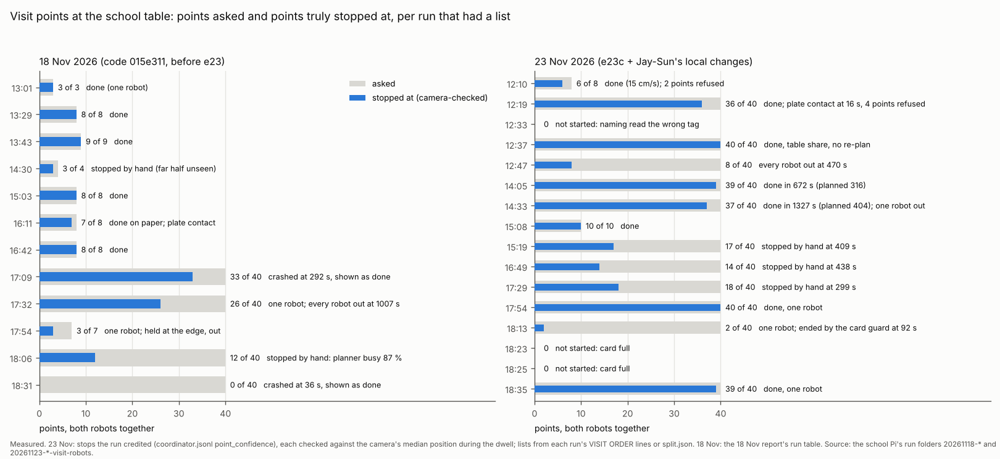
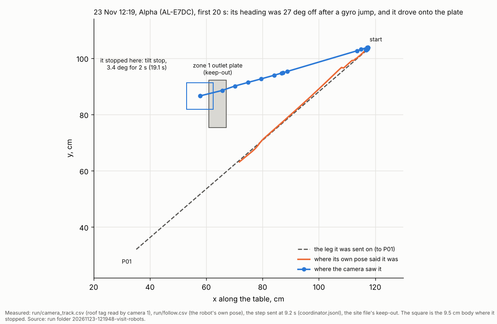
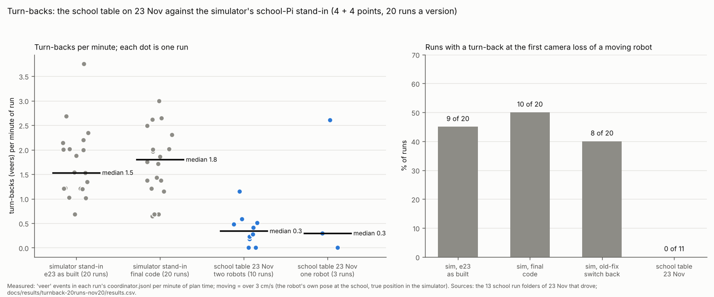
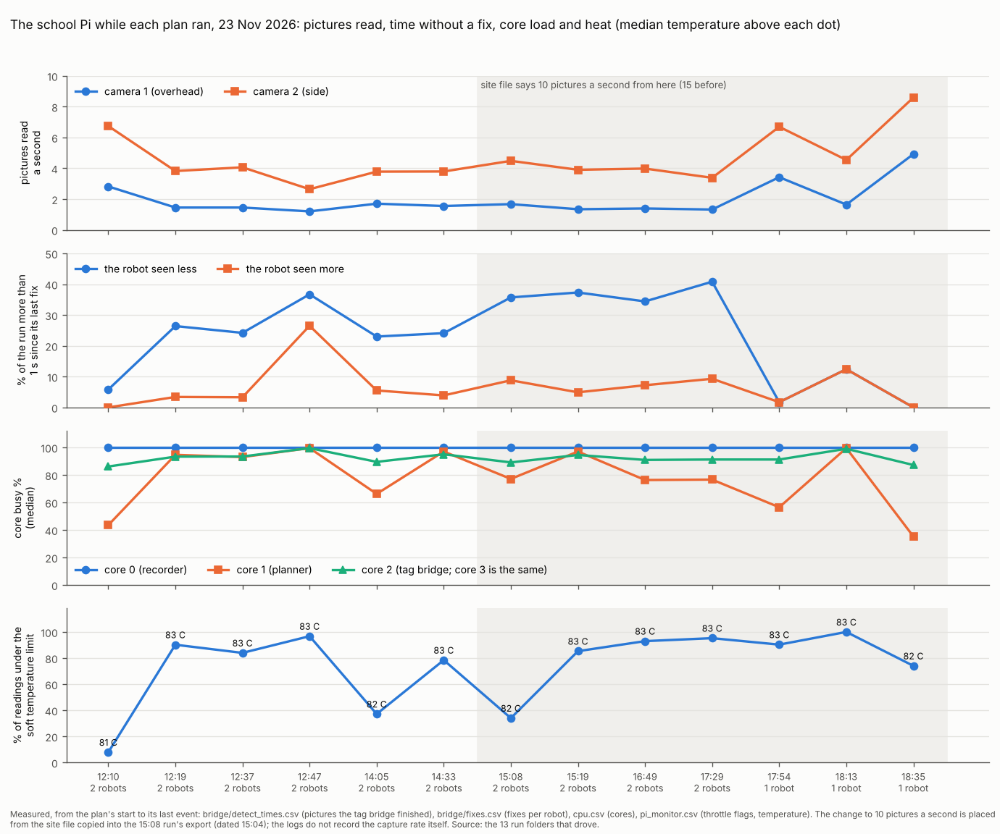
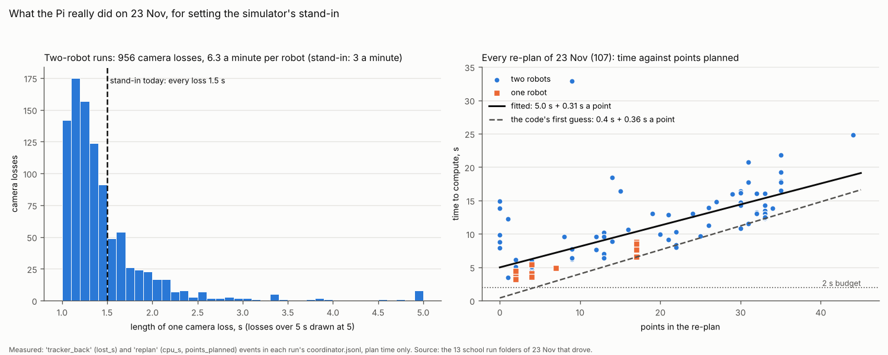

# Jay-Sun's 16 Visit points runs at the school table, 23 Nov 2026: did the e23 fixes hold?

Logs-only analysis of the 16 run folders `20261123-*-visit-robots` from the school Pi and the Pi's git state. Nothing was run on robots, Pis or cameras, and no code was changed. M = measured in the logs; I = inferred.

## 1. Premise

The 18 Nov analysis (`../school-2026-11-18/report.md`) found why two-robot Visit points runs did not complete, and e23 / e23c (`../../build-reports/e23-nov19-school-fixes.md`) fixed each cause in the simulator. On 23 Nov Jay-Sun ran 16 starts on the school Pi with e23c (`294d937`) plus his own local changes. The questions: did each fix hold on the real table, what is new, what did the Pi do before and after the change from 15 to 10 pictures a second, and is the simulator's school-Pi stand-in close to the real Pi?

## 2. Data

### 2.1 What ran

- **Code (M):** `294d937` plus Jay-Sun's `1a5a58c` (side camera on the Visit points card) and `1fa268e` (capture 15 → 10, AL-EB54's new calibration logged). Camera 2 was in every run.
- **Robots (M):** AL-E7DC = Alpha, tag 3 and AL-EB54 = Bravo, tag 4 in all ten two-robot runs. One robot alone in runs 12, 13 (AL-E7DC) and 16 (AL-EB54, named Alpha in that run, tag 4).
- **When the capture rate changed (M + I):** not at 17:05, which is only the commit. The site file copied into the 15:08 run's export is dated 15:04 and already says 10; the 14:05 run's copy says 15. The recorder's process changed between 14:33 and 15:08, again before 16:49 and before 17:29 (M). So runs 1–7 were at 15 and runs 8–16 at 10 (I). The logs do not record the capture rate itself, and the gaps between picture stamps look the same all day (first gaps 84–114 ms in every run).
- **RFID (M):** no RFID file in any folder, no `--jay-requested` or `MIRLT_RFID_JAY_REQUESTED` in any run's command, and the `other` column of every `sources.csv` is 0. The RFID input stayed off.

Each row is one run: the grey bar is how many points were asked and the blue bar how many the robots truly stopped at; on 23 Nov four 40-point runs finished with 36 to 40 points where none finished on 18 Nov.

### 2.2 Run table

"Credited" = stops the run counted, against each robot's own list (a point driven by the other robot after a hand-over counts for the list it was on). Every credited stop was checked against the camera's median position during the dwell: 308 credited stops, median 2.6 cm from the point, largest 5.8 cm (M). Speeds: run 1 at 15 cm/s, all others 10 cm/s.

| # | Start | Robots found | Lists asked | Credited / asked | How it ended | Root cause |
|---|---|---|---|---|---|---|
| 1 | 12:10 | both | Alpha 4, Bravo 4 | 2/4, 4/4 | done 119 s (planned 88) | P01 stood 6.2 cm off: refused, not tried again. P13 lost with no line: a re-plan cut in as Alpha arrived (new, N4) |
| 2 | 12:19 | both | P01–P20, P21–P40 | 16/20, 20/20 | done 438 s (planned 320) | Alpha's gyro jumped 26° at its first turn; heading 27° off; it drove onto the zone 1 outlet plate (N1). P01–P04 refused (46, 38, 8, 9 cm), not tried again |
| 3 | 12:33 | both answered | – | 0 | not started (about 90 s) | Naming read tag 3 as moving with AL-EB54; tag 4 left unclaimed (new, N3) |
| 4 | 12:37 | both | table share (planner chose 20 + 20) | 20/20, 20/20 | done 253 s (planned 194), no re-plan | completed |
| 5 | 12:47 | both | P20–P01, P40–P21 | 4/20, 4/20 | "every robot is out" at 470 s | Thrash with held robots (open item): 15 times a robot went out, 8 standing turn-backs, 9 points dropped "no room to turn" |
| 6 | 14:05 | both | P20–P01, P40–P21 | 20/20, 19/20 | done 672 s (planned 316) | Bravo held at 313 s (camera and own pose disagreed 3 times); 4 points handed to Alpha; P34 never credited |
| 7 | 14:33 | both | 20 + 20 in mixed order | 19/20, 18/20 | done 1327 s (planned 404) | Bravo held at 86 s, "no plan fits it back in" 10 times, out at 750 s; Alpha did both lists. P25, P13 refused; P40 dropped |
| 8 | 15:08 | both | Alpha 5, Bravo 5 | 5/5, 5/5 | done 117 s (planned 97), no re-plan | completed |
| 9 | 15:19 | both | crossed: Alpha P21–P40, Bravo P01–P20 | 14/20, 3/20 | stopped by hand at 409 s | First plan took 78.5 s. Bravo held 3 times, twice as "could be past an edge" (seen too rarely by camera 1), then Alpha held |
| 10 | 16:49 | both | same crossed lists | 11/20, 3/20 | stopped by hand at 438 s | First plan 79.4 s. Bravo held 8 times (4 "could be past an edge", 4 "no plan fits it back in") |
| 11 | 17:29 | both | same crossed lists | 5/20, 13/20 | stopped by hand at 299 s | First plan 80.8 s. Alpha held at 133 s; Bravo was still visiting points. Bravo started at 19 % battery (floor 25 %) |
| 12 | 17:54 | AL-E7DC | P01–P40 | 40/40 | done 806 s (planned 606) | completed; held 3 times on the way |
| 13 | 18:13 | AL-E7DC | P40–P01 | 2/40 | ended by the card guard at 92 s | Pi card at 0.55 GB |
| 14 | 18:23 | – | – | 0 | not started | Pi card at 0.55 GB |
| 15 | 18:25 | – | – | 0 | not started | Pi card at 0.55 GB |
| 16 | 18:35 | AL-EB54 | P01–P40 | 39/40 | done 705 s (planned 606) | completed; P26 stood 19.1 cm off: refused, not tried again |

Totals (M): 13 of 16 starts drove. Of 8 two-robot 40-point runs, 4 finished by themselves (36, 40, 39, 37 of 40), 1 ended with every robot out (8 of 40) and 3 were stopped by hand (17, 14, 18 of 40). No crash, no start hang, no Stop storm.

### 2.3 Did each e23 fix hold?

| Fix | Verdict | Evidence |
|---|---|---|
| A. Stop storm | **Held where tested; main case not exercised** | M: 3 Stops (runs 9, 10, 11), each "every robot confirmed" in 1.5–2 s; the next starts found both robots in 4 s; `nothing running` 0 in every binding. No Stop was pressed before the robots were named |
| B. Camera hang | **Held** | M: all 14 starts that reached it printed "LOOKING FOR CAMERAS" and "CAMERAS FOUND" within 0.2 s; held cameras were skipped |
| C. Rejoin crash | **Held** | M: "rejoined while a plan made without it was being worked out" 7 times in 5 runs; no traceback other than the hand stops' |
| D. False "did not move" | **Held** | M: 534 late move checks, all agreed. 3 verdicts all day (run 10), each a 3 cm step reported done in 0.02–0.04 s |
| D. Slow planning | **Not fixed** | M: 113 of 114 re-plans were over the 2 s budget (median 3.4–13.9 s a run). Only 37 % planned 4 points or fewer. First plans for the crossed lists took 78–81 s |
| E1. Naming with both cameras | **Held, with a new fault** | M: every run named "with both cameras". Run 3's naming gave tag 3 to the wrong robot (N3) |
| E2. Unseen points warned | **Not exercised** | M: no listed point was outside both cameras |
| E3. Honest credit | **Held** | M: 15 stops refused (6.2–198 cm, and two within 3.6 cm but known only to ±9.7 and ±14 cm). No credited stop was over 5.8 cm off by camera; the tolerance stayed between 5.5 and 8.3 cm |
| E3. Slow leg ends | **Held** | M: closest any middle came to an open edge was 10.8 cm (run 12), against 8.9 cm on 18 Nov |
| F. Card full | **Message held; cause open** | M: runs 14 and 15 refused with the exact steps; run 13 was ended cleanly at 0.55 GB. Still "No GitHub token", so nothing is ever cleared: the card fell from 0.8 to 0.55 GB in the day |
| F. Robots asleep | **Not exercised** | M: robots answered in 4–20 s in every run |
| G. Pins | **Held, with a new fault** | M: pins AL-E7DC = 3, AL-EB54 = 4 used in every run. Run 3 printed "PIN DISAGREES" on false evidence (N3); the next run's pins were right |
| I. Standing at a point stays | **Held, too narrow** | M: 24 stays. But 13 of the 16 turn-backs that drove back were robots standing somewhere else (section 2.5) |
| Audit: Stop nobody answered | **Not exercised** | Every Stop was answered |
| Audit: old pictures carried | **Held** | M: 70 old pictures carried forward (oldest 2.4 s), none left |
| Audit: reach tolerance | **Held** | M: 5.5–8.3 cm (with ±: 12.6–18.3 cm) over 323 stops |
| Audit: missing robot at start | **Not exercised** | M: runs 12, 13, 16 saw 0 roof tags before the one robot answered; no second robot stood on the table as far as the logs show |

The four open items of e23, on the real table:

- **Thrash with held robots: confirmed (M).** Runs 5, 7, 9 and 10. In run 7 Bravo stood held for 21 of 22 minutes.
- **A "NOT REACHED" point is never tried again: confirmed (M).** 13 of the 15 refused points were never credited; 2 were visited later in the same run.
- **Plan-ahead mostly reverts to the whole list: confirmed (M).** Only 37 % of re-plans planned 4 points or fewer.
- **Turn-back of a moving robot at a picture stall: rare here (M).** 3 of 223 camera losses of a moving robot (section 2.5).

### 2.4 New failure modes

**N1. A gyro yaw jump at the start of a turn put a robot on an outlet plate (run 2). The run-14 plate contact of 18 Nov has a candidate cause.**

The blue line is where the camera saw Alpha, the orange line where Alpha believed it was, and the grey box the outlet plate it was meant to pass.

- M: at 0.3 s, as Alpha's first turn began, its raw gyro yaw rose 26° in one 29 ms sample while its gyro rate read 21°/s.
- M: over that turn the wheels counted 67° and the camera 64°; the robot's own heading said 92°.
- M: its own heading then stayed about 27° from the camera's until its pose was set from the camera at 49.7 s. The run's after-turn pause compares position only, and the heading guard needs a fix under 0.3 s old for a full second; Alpha's fixes came 0.58 s apart (median).
- M: sent on a 108 cm leg at −139°, it drove at −165°. The camera put its middle inside the plate's rectangle at 16.2 s; its tilt stop fired at 19.1 s (3.4° for 2 s) and its edge guard at 26.7 s.
- M: four such jumps of 19–26° all day: two before a plan started (runs 4 and 10, harmless), one at 276 s in run 10 (Alpha's next stop was 15.9 cm off), and this one. Both robots had one.
- I: the cause of the jump is not known. Gyro bias times standing time does not fit (1.8° expected, 26° seen).

**N2. Camera 1 is read 1.2–1.7 times a second with two robots, so the robot in its half is unseen for over 1 s a quarter to two fifths of the time (section 2.6).** I: this is what feeds the "could be past an edge" holds of runs 9 and 10 and the camera/own-pose disagreements.

**N3. Naming gave a tag to the wrong robot (run 3).** M: AL-E7DC's stroke moved no tag read; AL-EB54's stroke was matched to tag 3 although it stood 62 cm away. The run printed "PIN DISAGREES ... the Pi's pin is updated", then refused to start because tag 4 was unclaimed. I: late pictures of the first robot's stroke were read during the second's.

**N4. A point lost with no line (run 1).** M: Alpha's "point P13" step started and ended at 41.4–41.6 s, 4 cm from P13, as a re-plan for Bravo's turn-back began; the new plan had no P13 and no stop, refusal or skip was written.

**N5. A hold on heading reads as "disagree by 0.0 cm" (run 12).** M: Alpha's heading was 46.6° from the camera's at 391–399 s; the three warnings said 0.9, 0.0 and 0.6 cm.

**N6. A second Ctrl+C during the wrap-up loses the run's exports (runs 9, 10, 11).** M: no `stops.csv`, `camera_track.csv` or `mission_summary.json`; the second traceback is inside the wrap-up's chart code.

**N7. A pause step far from its point (run 7).** M: "point P28" judged 198 cm from P28. Refused correctly; the same thing appeared once in the simulator's acceptance runs.

**N8. The robots' watchdog fired 192 times** ("nothing from the laptop for 1.5 s; standing still", up to 5.4 s), 0 in the two short clean runs and 36 in run 5. Not traced.

### 2.5 Turn-backs (veers)

Each dot on the left is one run's turn-backs per minute and each bar on the right the share of runs that turned back at the first camera loss of a moving robot; the real table turned back about five times less often than the stand-in.

| | School table, 23 Nov (13 runs, 102 min) | Simulator stand-in, final code (20 runs of 4 + 4) |
|---|---|---|
| Turn-backs (veer events) | 36 | 72 |
| Per minute of run | 0.35 | 1.84 |
| Robot moving / standing when called | 11 / 25 | not split |
| Really turned and drove back | 16 (13 of them standing robots) | – |
| Stayed (standing at a point, fix I) | 24 | 30 |
| Turn-back at the first camera loss of a moving robot | 0 of 11 runs | 10 of 20 runs |
| Camera losses of a moving robot that had a turn-back | 3 of 223 | – |

"Moving" = over 3 cm/s by the robot's own pose in the 0.6 s round the moment; the simulator study used the same 3 cm/s on true positions. The two-robot runs here are mostly 20 + 20 lists, the simulator's are 4 + 4, so compare the per-minute rates, not the counts.

M: the 13 standing robots that drove back were waiting for a re-plan, turning, or just rejoined; 8 of them in run 5.

### 2.6 The Pi, before and after 10 pictures a second

Each dot is one run in time order and the shaded half is after the change to 10 pictures a second; nothing steps at the change, and the only clear gain comes in the last runs, which had one robot.

Like with like: two-robot 40-point runs. Median (range) over runs, plan time only (M).

| | 15 a second (5 runs, 12:19–14:33) | 10 a second (3 runs, 15:19–17:29) | 18 Nov, two cameras |
|---|---|---|---|
| Core 0 (recorder) busy | 100 % (100–100) | 100 % (100–100) | 100 % |
| Recorder's share of core 0 | 92 % (92–94) | 93 % (92–94) | 92–98 % |
| Core 1 (planner) busy | 95 % (66–100) | 77 % (76–97) | – |
| Cores 2 / 3 (tag bridge) busy | 93 / 92 % | 91 / 91 % | – |
| Camera 1 pictures read a second | 1.45 (1.2–1.7) | 1.34 (1.3–1.4) | 2.9–4.4, last runs 1.6–2.6 |
| Camera 2 pictures read a second | 3.8 (2.6–4.1) | 3.9 (3.4–4.0) | 4.1–9.1 |
| Picture age when read, camera 1: median / 95 % | 0.43 / 0.94 s | 0.42 / 1.07 s | 0.29–0.40 s median |
| Camera 1 pictures over 1 s old | 4.4 % (3.4–12.1) | 6.2 % (6.2–13.0) | 0, then 4–6 % |
| Oldest picture read | 2.5 s (1.9–4.1) | 2.0 s (2.0–2.8) | – |
| Recorder's own lag (capture to stream) | 0.18 s, never over 0.33 | 0.18 s, never over 0.35 | – |
| Gap between fixes, robot seen less: median | 0.39 s (0.33–0.59) | 0.63 s (0.63–0.65) | 0.31–0.71 s |
| That robot over 1 s without a fix | 24 % of the run (23–37) | 37 % (34–41) | 1–50 % |
| Re-plan time: median / longest | 9.7 / 23.3 s | 8.2 / 14.3 s | 14.8 / 19.0 s (run 24) |
| First plan, 40 points | 15.4 s (14.6–23.5) | 79.4 s (78.5–80.8), crossed lists | 30.5, 37.4 s |
| Temperature, median | 82.8 °C | 82.8 °C | 81–83 °C late in the day |
| Readings under the soft temperature limit | 84 % (37–97) | 93 % (85–95) | 0 before 16:00, then most |
| Processor clock, median | 1726 MHz | 1726 MHz | 1726–1775 MHz |

Median: the middle value when the runs are put in order. 95 %: 95 of 100 readings were at or under it.

- **10 a second did not help (M).** Core 0 stayed at 100 % with the recorder using 92–97 % of it, and the tag bridge read no more pictures.
- **The number of robots is what moves the numbers (M).** With one robot (runs 12 and 16) camera 1 was read 3.4–4.9 times a second, camera 2 6.7–8.6, and the robot was over 1 s without a fix 0–2 % of the time.
- **The "4 s picture lag" is not in the run's own numbers (M).** The recorder's lag was about 2.0 s only during the first 80 s of each start (naming the robots) and 0.14–0.22 s while plans ran. The oldest picture the bridge read was 4.1 s.
- **Heat (M).** 80.8–83.3 °C in every run, soft temperature limit in 8–100 % of readings, never the hard throttle. On 18 Nov the limit first showed at 16:30; on 23 Nov from the second run (12:19).

### 2.7 Plates and edges, from the camera track

Closest approach of a robot's middle while a plan ran (M). The body is 9.5 cm square, so a middle under 4.75 cm from a rectangle has the body over it. Runs 9–11 use the bridge's fixes (their exports were lost, N6).

| | Closest | Where |
|---|---|---|
| Zone 1 outlet plate | **0.0 cm: contact** | Run 2, Alpha, 16.2 s, middle at (65.7, 88.6); tilt stop at 19.1 s (N1). Otherwise 10.9 cm or more |
| Zone 4 outlet plate | **4.7 cm: a touch cannot be ruled out** | Run 7, Bravo, 76.4 s, at (338.9, 94.2) by camera 2, 10 s before it was held; no tilt stop. Otherwise 10.1 cm or more |
| Middle outlet box | 9.8 cm | Run 9, Alpha. Plans keep 8.9 cm |
| Edge y = 0 | 10.8 cm | Run 12 near P04 (13.3 cm from the edge by its typed place) |
| Edge y = 167.6 | 11.1 cm | Run 5, Alpha |
| Edge x = 0 | 12.3 cm | Run 7, Alpha |
| Edge x = 396.2 | 12.6 cm | Run 13 |
| Robot to robot | 21.5 cm | Run 2 (a touch needs under 13.4 cm) |

M: one tilt stop and one edge-guard stop all day, both in run 2 after the plate. No robot left the table as far as the logs show.

### 2.8 The simulator stand-in against the real Pi

The left panel counts how long each real camera loss lasted beside the stand-in's fixed 1.5 s; the right panel is every real re-plan's time against how many points it planned, with the fitted line.

| | Stand-in today | Real Pi, 23 Nov (M) |
|---|---|---|
| Camera losses per robot | 3 a minute, both cameras together | 6.3 a minute with two robots (median 3.2 s apart); 0.8 a minute with one |
| Length of a loss | 1.5 s, every time | median 1.30 s; 75 % under 1.54 s; 90 % under 1.97 s; 4 % over 2.5 s; longest 16.2 s |
| Which camera | both at once | mostly the robot in camera 1's half |
| Re-plan time | 6 × this machine: 2.3–4.2 s (4 + 4), 3.0–10.6 s (20 + 20) | 5.0 s + 0.31 s a point; 4.5 s for 2–4 points, 13.2 s for 20 or more |
| Results, 4 + 4 | 6–8 of 8 | 6 of 8 (at 15 cm/s), 10 of 10 (5 + 5) |
| Results, 20 + 20 | 22–39 of 40; 2 of 4 finished | 36, 40, 39, 37 of 40 finished; 8 of 40 (all out); 3 stopped by hand at 14–18 |
| Run time, 20 + 20 (planned about 316 s) | 511–1089 s | 253–1327 s |
| Turn-backs per minute | 1.84 | 0.35 |

The fitted line is least squares over 107 re-plans; the scatter round it is 3.8 s (standard deviation: the typical distance of a point from the line).

### 2.9 Jay-Sun's local changes

- **AL-EB54's calibration (M):** the robot reported wheel_scale 0.9790, gyro_scale 1.0750, drift 0 in every run, including 16:49, 17:29 and 18:35; the logged 0.9743 / 1.0790 / 0.0037 never appear. Only its stop lead changed (0.325 / 0.625 → 0.369 / 0.754 cm) from 16:49.
- **Its track error (M):** camera distance over wheel distance on drive steps of 15 cm or more was 1.040 before 16:00 and 1.042 after (AL-E7DC: 1.037 and 1.040). Error after driving unseen: 1.0 cm per 10 cm before, 2.6 after (3 runs, 5 drives; too few to read).
- **Both robots' wheels count about 4 % less than the camera sees (M).** I: either the wheel scale is low for both, or the late check's camera distance runs long; not settled here.
- **Side camera on the Visit points card:** a page change only; nothing in a run folder records which camera the page showed, so no effect can be measured. I: fetching camera 2's picture for the page adds a little work for the recorder on core 0.
- **Stopped background refits (M):** every finished run still starts a new one at its end ("refit started in the background").

## 3. Conclusion

These are the analysis's own conclusions from the logs, not something the team has agreed.

1. **The faults that ended the 18 Nov runs did not come back.** No crash, no start hang, no Stop storm and no false credit in 16 starts; four 40-point two-robot runs finished with 36–40 points where none did on 18 Nov. The Stop-before-naming, asleep and missing-robot cases were not exercised.
2. **"Done" is now honest but not complete.** 15 stops were refused and 13 of those points were never credited; one point vanished with no line (N4).
3. **The largest remaining loss is the thrash with held robots**, which the simulator had already shown: it ended run 5, tripled run 7's time and is the likely reason runs 9 and 10 were stopped by hand (I).
4. **A gyro yaw jump is a new safety fault.** It put a robot on a plate with nothing checking heading after a turn, and it fits the unexplained 18° of 18 Nov's plate contact (I; the 18 Nov raw rows were not re-read).
5. **10 pictures a second changed nothing measurable.** The recorder fills core 0 either way and the tag bridge cannot read camera 1 more than about 1.5 times a second with two robots on the table.
6. **AL-EB54's new calibration was never in force** (section 2.9), so it had no effect to measure.
7. **The stand-in is too pessimistic on turn-backs and too kind on camera losses.** Its results range covered the real finished runs; it did not predict the all-out run.

## 4. What's next

1. **Check heading after a turn** before the next leg is sent (camera heading against own heading while the robot stands), and find the yaw jump in the firmware's raw rows. A simulator case that injects a 25° yaw jump at a turn's start comes first.
2. **Build for the thrash:** a held robot must not block the other for good, and a standing robot waiting for a plan should not be sent on a turn-back.
3. **Try a refused point again**, and write a line for any point a re-plan drops.
4. **Pi load:** run the two-camera timing bench with each core layout (`./run-fleet-pi.sh bench`); the recorder, not the capture rate, is what holds core 0. Whether 15 or 10 is kept makes no measured difference.
5. **Set the stand-in from this data** (below) and repeat the 20-run turn-back study on it.
6. **Set up the GitHub token or run `./run-fleet-pi.sh space --move` before each session:** the card ended two starts and cut one run.
7. **Find why AL-EB54's calibration did not reach the robot**, then compare its track error before and after on the same list.

Proposed stand-in numbers, all measured unless marked:

| Setting | Now | Proposed | A designed experiment? |
|---|---|---|---|
| Camera loss length | 1.5 s fixed | drawn from the 956 measured losses (median 1.30, 90 % 1.97, longest 16.2 s) | No: a measurement. Re-measure after any Pi change |
| Losses per robot | 3 a minute, both cameras | 6.3 a minute for the robot in camera 1's half, 2 a minute for the other **[chosen split: the logs give 6.3 as the mean of both]**; 0.8 with one robot | No, but split per camera from `bridge/fixes.csv` before use |
| Re-plan time | 6 × this machine | 5.0 s + 0.31 s a point, scatter 3.8 s | No: a measurement |
| First plan, crossed lists | not modelled | 79 s | No |
| Yaw jump | not modelled | +19 to +26° at a turn's start; 4 seen in the day's 13 runs | Yes for the rate once more runs exist |

## 5. Sweep 1: tests that may now be needed

1. Simulator: a 25° yaw jump at the start of a turn; the robot must not drive the next leg on the wrong heading.
2. The 18 Nov run-14 raw rows: is there a yaw jump before Bravo's plate contact?
3. Naming with one robot's pictures 1–2 s late: no tag may be given to the robot that did not move it.
4. A re-plan that starts while a robot is arriving at a point: the point is kept or a line says it was dropped.
5. A second Ctrl+C during the wrap-up: the exports are still written.
6. The 20-run turn-back study on the new stand-in, 20 + 20 as well as 4 + 4.
7. Pi bench: recorder at 15 and at 10, cores per layout, with one and two robots in view; pictures read a second per camera.
8. A Stop pressed before naming, a sleeping robot, and one robot missing with its tag on the table, at school: none was exercised on 23 Nov.
9. Camera distance against wheel distance on a measured straight (a tape on the table), to settle the 4 %.
10. A real 20 + 20 run with crossed lists after the thrash build; and why its first plan takes 79 s.

## 6. Sweep 2: possible inaccuracies

1. **The camera is the only truth here.** "Camera-checked" uses the same camera track the run credited from, so it checks the run's arithmetic and the dwell, not the table frame. The frame was refitted in run 1 (table 399.5 → 399.1 cm long against the typed 396.2).
2. **The 15 / 10 split is inferred** from a site file copy and the recorder's process changing; no log states the capture rate. If the recorder was still at 15 after 15:04, section 2.6 compares 15 with 15.
3. **Before and after differ in more than the rate:** the after runs used crossed lists, a later hour and lower batteries. Three runs against five.
4. **"Moving" (3 cm/s) is the simulator study's chosen number**, applied to the robot's own pose. No designed experiment needed: it only sorts events.
5. **Camera losses are the run's `tracker_back` events** (losses of about 1 s and up); shorter gaps are not counted. The "1 s" is the firmware's oldest accepted fix, not chosen here.
6. **The yaw jump threshold (5°, and "large" over 15°) is chosen** to separate jumps from sampling noise at high turn rates. No designed experiment; the four large ones are far from the rest (5–8°).
7. **The plate rectangles and point places are the site file's typed values;** camera 2's positions carry a few cm. Run 7's 4.7 cm rests on camera 2 alone.
8. **Runs 9–11 have no exported camera track;** their stops and distances use the bridge's fixes, at most 10 a second.
9. **Why Jay-Sun stopped runs 9–11 is not in the logs.** "Thrash" for 9 and 10 is the analysis's reading; run 11 was progressing.
10. **The re-plan line pools one- and two-robot runs** (two robots alone: 5.5 s + 0.30 s a point).
11. **The proposed 6.3 / 2 split of camera losses is an estimate,** not measured per camera.
12. **The 18 Nov column** is copied from that report and the e23 report, not recomputed.

## Appendix A. Per-run numbers

| # | Start | Re-plans computed | Re-plan median / longest s | Camera 1 / 2 pictures a second | Robot seen less: % over 1 s without a fix | Turn-backs (moving / standing) | Times a robot went out | Refused stops | Points dropped "no room to turn" |
|---|---|---|---|---|---|---|---|---|---|
| 1 | 12:10 | 3 | 3.9 / 4.9 | 2.8 / 6.7 | 6 | 0 / 1 | 1 | 1 | 0 |
| 2 | 12:19 | 9 | 4.9 / 13.8 | 1.5 / 3.8 | 26 | 2 / 1 | 1 | 4 | 0 |
| 4 | 12:37 | 0 | – | 1.5 / 4.1 | 24 | 1 / 1 | 0 | 0 | 0 |
| 5 | 12:47 | 21 | 13.9 / 24.8 | 1.2 / 2.6 | 37 | 1 / 8 | 15 | 1 | 9 |
| 6 | 14:05 | 16 | 6.3 / 32.9 | 1.7 / 3.8 | 23 | 0 / 2 | 6 | 0 | 1 |
| 7 | 14:33 | 20 | 13.0 / 21.8 | 1.6 / 3.8 | 24 | 2 / 3 | 11 | 4 | 2 |
| 8 | 15:08 | 0 | – | 1.7 / 4.5 | 36 | 0 / 0 | 0 | 0 | 0 |
| 9 | 15:19 | 14 | 8.2 / 11.5 | 1.3 / 3.9 | 37 | 2 / 2 | 6 | 0 | 1 |
| 10 | 16:49 | 13 | 12.5 / 14.3 | 1.4 / 4.0 | 34 | 0 / 2 | 8 | 1 | 1 |
| 11 | 17:29 | 5 | 4.2 / 14.8 | 1.3 / 3.4 | 41 | 0 / 0 | 1 | 2 | 0 |
| 12 | 17:54 | 7 | 6.6 / 8.7 | 3.4 / 6.7 | 2 | 2 / 2 | 3 | 0 | 0 |
| 13 | 18:13 | 2 | 4.9 / 5.4 | 1.6 / 4.5 | 12 | 1 / 3 | 0 | 1 | 0 |
| 16 | 18:35 | 4 | 3.4 / 4.9 | 4.9 / 8.6 | 0 | 0 / 0 | 0 | 1 | 0 |

## Appendix B. The yaw jumps

From `yawjump.py` (raw rows, `yaw_deg` against `gz`), jumps over 15°:

| Run | Robot | Run time | Jump | What followed |
|---|---|---|---|---|
| 2 (12:19) | Alpha, AL-E7DC | 0.3 s | +25.7° | Heading about 27° off until 49.7 s; plate contact; P01–P04 refused |
| 4 (12:37) | Alpha, AL-E7DC | 108 s before the plan | +21.0° | Pose set again from the camera before the plan; nothing |
| 10 (16:49) | Bravo, AL-EB54 | 100 s before the plan | +19.4° | The same; nothing |
| 10 (16:49) | Alpha, AL-E7DC | 275.7 s | +25.8° | P25 stop 15.9 cm off at 285 s (refused); heading 10.3° off at 313 s |

Standing reads of own heading against the camera's (`heading_err.py`): median 0.1–0.7° in every run; stretches over 10°: run 2 (28.9°), run 7 Bravo at the end (10.6°), run 10 (10.3°), run 12 (46.6°, no yaw jump found; not traced).

## Appendix C. Files

All scripts ran as `python3 -I <script> <run folders>` from outside the data; nothing was written into it. In this folder:

- `digest23.py` → `digest.json`: the run table, the camera check of each stop, closest approaches.
- `pi23.py` → `pi23.json`: section 2.6.
- `veers23.py` → `veers23.json`: section 2.5.
- `standin.py` → `standin.json`: section 2.8.
- `track_err.py` → `track_err.json`: section 2.9.
- `yawjump.py`, `heading_err.py` → `yawjump.json`, `heading_err.json`: N1 and Appendix B.
- `charts23.py`, `plate_run2.py`: the five pictures.

Heat tracker rows for the 13 sessions that drove are in `../heat-tracker.md` (cooling: none known).
