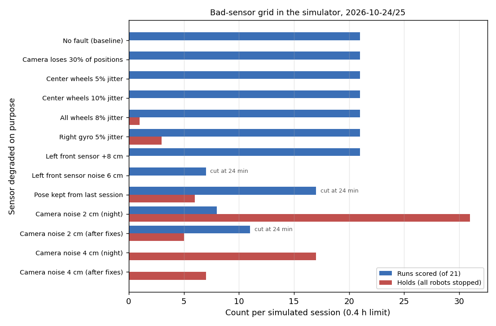
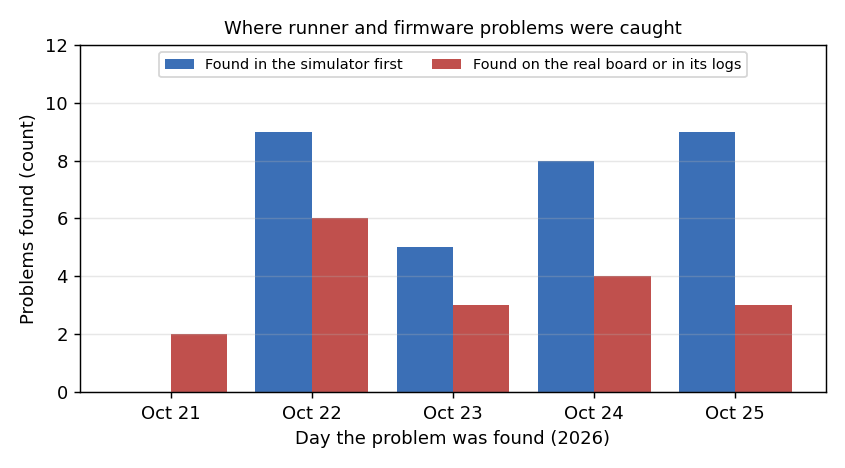

# Simulation register: every simulator result so far, quantified (2026-10-25)

**Premise.** Nick, 2026-10-25 13:03: "Are we tracking and quantifying all the results that have come from simulation
for our documentation?" Until now they were spread over build reports, build plans, code comments and a grid folder
in /tmp. This register puts every simulator result in one table, with its numbers, what it changed, and whether a
real session has confirmed it. Section 2 puts a number on what simulating first has saved.

**Sources.** Build reports in `docs/build-reports/`, the build plan `docs/build-plans/e02-oct22-build.md`, the summary
notes `docs/summary/next-week-notes.md`, dated comments in `tools/experiment/e02.py`, the git log, the bad-sensor grid
(`/tmp/claude-0/grid`, summarised by `tools/experiment/analyses_oct24/grid_summary.py`; a copy of the output is
saved in `docs/results/data/grid_summary_2026-10-25.txt`), and the 61 dry-run folders `logs/*-dryrun` (indexed by
`tools/experiment/analyses_oct25/dryrun_index.py` into `docs/results/data/dryrun_index_2026-10-25.md`). No new
experiment was run for this register.

## Headline numbers

| | Count |
|---|---|
| Simulator dry runs on disk (2026-10-23 to 10-25) | 61 folders; 57 with a log, **22.2 h** of simulated sessions, **382 simulated route runs** done |
| Bad-sensor grid sessions (2026-10-24 21:14 to 10-25, still running) | 14 sessions, 13 degradations plus a baseline |
| Results in the register below | 26 |
| Problems found in the simulator first (catch log, Appendix C) | **31** (2026-10-22 to 10-25) |
| Problems found on the real board or in its logs first | 18 (2026-10-21 to 10-25) |
| Simulator results a real session has confirmed | 1 yes (row 6), 2 partly (rows 2, 4), 3 where the real board or its logs disagreed (rows 1, 24, 25); the rest not yet (no real session has run since 2026-10-24 19:35). Real session 2026-10-25 15:10 (rows 27-29): row 6's border **disagreed** (6 false trips, a sign fault the simulator could not show), row 3's explore **partly** (camera fit fine, sides failed), and explore's robot clearance partly |
| Board time saved by simulating first | **about 16 h (range 5-24 h): an estimate**, section 2 |

## 1. The register

"Confirmed" means a real board session has shown the same thing. *Not yet* is the honest state of most rows: the
last real session was Right alone on 2026-10-24 at 19:35, and most of these results came after it.

| # | Date | What was simulated | What it found (numbers) | What changed because of it | Confirmed on the board? | Source |
|---|---|---|---|---|---|---|
| 1 | 10-21/22 night | Whole E02 sessions in the simulator after the tracker rebuild: robots near their spots (5 runs), every robot on another's spot, scattered start with mapping | 0 help calls, 0 watchdog stops; tracking error median 0.7 cm (95 % under 1.2 cm); a scattered start showed Center waiting behind Right (review problem 7) | Paths checked against every robot, up to two detours | **Real board disagreed**: the 10-22 morning session finished 1 run (tracker took Right for Left, a robot learned into the floor). The simulator's camera has no halo, shadows or hands | e02-fix-build.md; e02-oct22-build.md |
| 2 | 10-22 | Left hidden from the camera 60 s and 140 s (`E02_SIM_HIDE`), then 13 minutes | 60 s: back on the 2nd retry. 140 s: 3 retries, 2 sweeps (1 false hit, dropped by the camera), then Left found itself; 0 help calls. 13 min: it drove out to its spot unseen. 9 bugs on the way (catch log C1-C9) | Retry, finder sweep, rescue find, drive-out blind, search before stopping | **Partly**: 10-23 session 1 used 8 auto-retries and avoided 6 help calls (0 help calls). Sweeps, rescue finds and drive-outs never had to run for real (0 each) | e02-oct22-build.md; E02-accuracy/results/2026-10-23-session1/report.md |
| 3 | 10-23 | Explore (the robots calibrate the camera themselves), 14 dry runs, 4.1 h | Calibration within 1.1 cm median (worst 1.6) of the simulator's true camera when turned and shifted; within 0.1 cm with a scale. Board found 125.2 x 118.1 cm against a true 121.55 x 121.3; the finds then moved the y-board line 7.7 cm. A tracker stuck on an old spot for 19 stops (refit guard: 1.5 px) | Stop refit guard, sides check (`rect_check`), board lines learned from finds | **Not yet**: no real session has finished explore (stage 3 stopped during identify, 10-24 17:38) | e02-oct22-build.md lines 125-221; logs-doe.md §5 |
| 4 | 10-24 | Scattered start with explore kept (1.5 cm at the tape marks) and a forced fallback | 14 runs, 0 failed; end / far-point mean C 2.7 / 1.9, KC 2.3 / 0.8, K 0.3 / 0.7, U 24.1 / 16.7 cm. Fallback: 7 runs, 0 failed. Found: KC's first fix 138 cm off (a safety stop); explore passing its own checks 4.3 cm off the marks, then 29 lost robots | KC's belief is its route waypoint; one fix per waypoint; tape-mark check after explore with a fallback | **Partly**: Pi stages 1-2 (10-24) ran 30 runs, none failed. Accuracy did not carry over (row 24) | e02-oct22-build.md lines 273-288; next-week-notes.md |
| 5 | 10-24 18:10 | Explore with one robot (Right's plan) | Explore missed its own fit limit with one robot | Fallback to the session-1 calibration file | Not yet (Right's real session held before explore) | commit 27312d6 |
| 6 | 10-24 evening | Virtual border, first version (7 dry runs 18:51-19:00) | Would have held a real session 5 times for nothing (driving along the edge, turning on the spot, backing away after a crawl, settling 5 cm) and twice backed a robot into the border | Only movement mostly towards the edge counts; the reference restarts each leg; the latch lets go 3 cm inside | **Yes**: in Right's real session (10-24 19:35) the border held once, rightly (Right put down 13 cm from an open edge), with no false border holds | next-week-notes.md; e02-oct24-right-session.md; commit 2253d96 |
| 7 | 10-24 21:14 | Grid baseline: no fault, true calibration, classic setup, 0.4 h | 21 runs, 0 holds, no sensor flagged. Back at start: C 1.3 cm, KC 0.9 cm; KC far point 1.2 cm. Learned camera noise 0.5 cm per axis (healthy 0.8) | Reference for rows 8-17 | Not comparable (row 24) | grid_summary |
| 8 | 10-24 21:56 | Grid: robots keep a pose from the session before (the stage-3 case, `--dry-kept-pose`) | 17 runs before the 24-min limit; 6 holds (5 the robots' own border at 14.9-15.0 cm, 1 the camera's border); no robot left the board | Showed the robots' own border at 15 cm sits in the parking band (with row 9: border made a fixed 10 cm backstop, 10-25 07:15) | Not yet | grid_summary; keptpose.txt; commit 871daf5 |
| 9 | 10-24 23:14 | Grid: camera noise 2 cm per axis (after a first attempt at 22:46: 3 runs, 15 holds) | Camera flagged at setup (k 4.0, before any run). 8 runs, **31 holds** (11 camera border, 12 robots' own border, 8 front sensor). KC back at start 89.3 cm, far point 1.9 cm | Bad camera shrinks the working area (border in by 2 sd of its extra noise, at most 10 cm); front-sensor holds off while the camera is bad; robots' own border 10 cm; park spots move in up to 22 cm | Not yet | grid_summary; commits c2a97bc, 871daf5, de93429 |
| 10 | 10-24 23:56 | Grid: camera noise 4 cm | Flagged at setup (k 5.7). 0 runs, 17 holds | Same as row 9; 4 cm treated as beyond the system for now | Not yet | grid_summary; doe-backlog.md (border shrink row) |
| 11 | 10-25 00:14 | Grid: camera loses 30 % of positions | 21 runs, 0 holds, nothing flagged. C 1.5, KC 0.8, KC far 1.0 cm (baseline 1.3 / 0.9 / 1.2) | Nothing needed **[Claude: drops cost nothing measurable at 30 %]** | Not yet | grid_summary |
| 12 | 10-25 07:15-08:53 | Grid: camera noise 2 cm and 4 cm again, after the fixes of row 9 | Noise 2: 1 run and 5 holds (07:15, before the park-spot change), then 11 runs and 5 holds (07:58, cut at 24 min; camera k 5.0). Noise 4: 0 runs, **7 holds (was 17)** | Kept; the noise-2 rerun is the one in the DOE backlog | Not yet | grid_summary; dryrun_index (075840: C / K / KC median 1.6 / 2.1 / 1.7 cm) |
| 13 | 10-25 08:53 | Grid: Center's wheels 5 % jitter | Center's wheels flagged after 8 runs (k 3.8). 21 runs, 0 holds. C 0.7, KC 0.4, KC far 0.7 cm | None needed: caught | Not yet (no swap test on the board) | grid_summary |
| 14 | 10-25 10:00 | Grid: Center's wheels 10 % jitter | Flagged after 7 runs (k 4.6). 21 runs, 0 holds. C 1.4, KC 1.2, KC far 1.9 cm | None needed: caught | Not yet | grid_summary |
| 15 | 10-25 10:42 | Grid: every robot's wheels 8 % jitter | Only Center flagged (after 7 runs, k 8.0); Left 0.2 and Right 0.6 cm a stretch. The "can't tell the camera from every robot's wheels" note fired. 21 runs, 1 hold. C 1.0, KC 0.4, KC far 1.4 cm | Open **[Claude: a fault every robot shares is not pinned on each robot; the tape marks are the reference that would separate it]** | Not yet | grid_summary |
| 16 | 10-25 11:26 | Grid: Right's gyro 5 % jitter | **Not flagged.** Right's gyro learned 1.1° a stretch against 0.3° for the others, but the healthy value is 1.0°, so k stayed near 1.1. 21 runs, 3 holds. C 2.0 cm (baseline 1.3), KC 0.8, KC far 1.3 | Open **[Claude: the healthy values come from the real robots, whose gyros are noisier than the simulator's; the simulator needs real-sized noise, or the flag should also look at how far one robot stands out]** | Not yet | grid_summary |
| 17 | 10-25 12:11 | Grid: Left's front sensor reads 8 cm long | Flagged after **16 runs** (k 2.9; learned 14.6 cm). 21 runs, 0 holds. C 1.2, KC 1.0, KC far 0.8 cm. The per-session front offset never left the fleet default (fewer than 8 readings per robot) | Open **[Claude: a slow catch; the front learner needs more readings per session than a 21-run plan gives]** | Not yet | grid_summary; front_Left_bias_8.txt line 228 |
| 18 | 10-25 12:55 | Grid: Left's front sensor noise 6 cm (**still running** when this was written) | At 13:12: 7 runs. The camera was flagged 3 times in setup (k 2.1) and cleared each time within 30-45 s: false flags | Open | Not yet | grid_summary; front_Left_noise_6.txt |
| 19 | 10-25 morning | Firmware 2026-10-25b: the find backs into the boards (switches at the back) | Gyro corrected: 20 of 20 finds, worst reset error 0.22 cm. Gyro 7 % short: 13 of 20, the other 7 stopped safely ("no board behind"). Board removed: the look stops the find (reads 139 cm against 20 expected); with the look off the cap stops the axle 2.08 cm from the line. Docking backwards: 12 of 12, within 0.3 mm and 0.4°. Found: a wrapped turn (turn_k 0.83, 5 cm error) | Turns summed unwrapped; the look before backing; the backing cap | Not yet (the back attachment is not on the robots) | e02-oct25-reverse-find.md |
| 20 | 10-25 | Random-draw spread of two older tests (after new parameters shifted the draw) | Far-corner find, 30 seeds: median 0.11 cm, max 0.30. Route 1 far point, 20 seeds: median 1.6, 90 % 2.8, max 4.5 cm | Test limits 1.0 → 1.5 cm and 2.5 → 3.0 cm, spread written beside them | n/a (test limits) | e02-oct25-reverse-find.md |
| 21 | 10-25 | Backing cap, keep 2 / 3.5 / 4.6 cm x camera fix error, 30 finds a cell, board in | 0.8 cm, 2°: 2 / 4 / 8 of 30 false "no board behind". 1.5 cm, 4°: 4 / 9 / 21 of 30 | Keep stays 2 cm (the look protects the rear caster) | Not yet | e02-oct25-backing-unc.md |
| 22 | 10-25 11:32 | Dry run with backing in, learned uncertainty, recovery ladder, heading fixes 1-4 | 19 of 21 runs (2 failed: Right's finds); 12 confidence pauses (was 8), correction median 2.0 cm (was 3.5-4.2); end error median U / C / K / KC 14.2 / 1.23 / 0.23 / 0.99 cm; 3 border holds; learner switched to each robot's own model at its 30th correction, every term at its floor (1.7 cm after 50 cm and a half turn); 88 % of 113 corrections inside 2.45 sd; 22 heading pushes, 0 unmeasured headings sent. Found: Right's gyro drifting 0.57 °/s crept 156° in 8 min with nothing overwriting it; its find drove towards the open edge | `FIND_OWN_FRESH_S` 15 s: a robot's own heading counts before a find only if reported in the last 15 s. A later full dry run (12:19, likely the rerun) did 21 of 21, 0 holds, U / C / K / KC 12.0 / 1.2 / 0.2 / 1.2 cm | Not yet | e02-oct25-backing-unc.md; dryrun_index (113244, 121952) |
| 23 | 10-25 | Heading fix with a simulator robot that reproduces the ±90° placeholder; fleet planner backing into boards | Placeholder: a 20 cm drive ended 15+ cm from its belief with the old fix, under 1 cm with the new. Fleet: 6 of 6 board visits backed in; back face 1 cm from the board within 0.13 cm, sideways 0.22 cm, heading 0.5°; 79 s against 86 s planned | Heading fixes 1-4 kept; fleet visits back in | Not yet. Expected from the logs **[Claude]**: 30°+ heading errors 17 % → about 2 % | e02-oct25-backing-unc.md; e02-oct25-heading.md |
| 24 | 10-24 | Simulator accuracy against the real board | Simulator KC 0.6 cm back at the start; real 2-17 cm. Grid baseline C 1.3 cm; real 10-23 morning C 1.37 cm mean (8 runs), Pi stages 1-2 C 3.4 cm | Simulator's role written down: it catches logic faults, it does not predict accuracy | **Real board disagreed** on accuracy | next-week-notes.md; session1 report.md |
| 25 | 10-24 / 10-25 | Uncertainty model in the simulator against the real logs | Simulator: the model said ~4 cm where the simulator's truth was 1.6 cm (too cautious). Real logs: too confident (59 % of 673 corrections inside its 95 % range). The simulator's robots err less on turns than the real ones | The model is learned each session from real corrections (`e02_unc.py`); the simulator is not used to set it | Real logs disagree with the simulator; the simulator's turning noise is still to be fixed | e02-oct22-build.md line 287; e02-oct25-logs-doe.md §1 |
| 26 | 10-21 to 10-25 | Unit tests on the simulator | 121 test functions in `tools/sim/tests` (dock 13, e02 51, edge 14, follow 10, look 9, sim 24); whole suite 434 passing at commit 4208770 | Every change is run through them first | n/a | tools/sim/tests; git log |
| 27 | 10-24 evening (row 6) | The virtual border's "only movement mostly towards the edge counts", checked against real explore | Simulator: no false holds after the fix (rows 6, 22: 3 border holds in a full dry run) | - | **Real board disagreed** (10-25 15:10, home mode): 6 of 9 shadow trips false, 4 of them holds and 2 forward stops. Every time a robot's centre was 3.8-5.5 cm past the stored edge line after a line-sensor edge stop, moving back in; `border_check` uses an absolute distance, so coming back in reads as approaching. In the simulator the edge and the calibration agree, so a centre never ends past the line | e02-oct25-session-1510.md Q1, Q6 |
| 28 | 10-23 (row 3) | Explore with three robots from scratch | Calibration within 1.1 cm median of the simulator's true camera; board found each time | - | **Partly** (10-25 15:10, the first real explore to reach its fit): camera fit 6.8 px rms (simulator 1.5-4.5), every robot used; its floor within 2.7 cm median of the stored calibration (90 % within 6.4), scale within 2.5 %. But the fitted camera is 99 cm high with f 234 px (real about 262 cm, 606 px), and the sides failed: the top board was never met (a held-out robot's rays, a 105 cm ray cap 28 cm short, rays skipped next to a touching robot) and an object past an open edge read as a board twice | e02-oct25-session-1510.md Q3 |
| 29 | 10-23 night (catch B10) | Explore rays kept 25 cm off the other robots | Rays that would pass another robot are skipped | Ray clearance check | **Partly** (10-25 15:10): 8 rays were skipped rightly, but a home leg (not checked) drove Left into parked Center; the camera's parked-robot stop does not run while exploring (no board yet) | e02-oct25-session-1510.md Q2 |

k = a sensor's learned noise ÷ its healthy noise; 2 or more flags it as bad, under 1.5 clears it. C = calibrated
runs, K = camera-steered, KC = camera fixes blended with the robot's own belief, U = uncalibrated. "Back at start" =
the end error of a route that returns to its start, scored by the simulator's true camera in degraded-camera
sessions. Grid numbers are means over each condition's runs (grid_summary); dry-run index numbers are medians.

Each bar pair is one simulated 24-minute session with one sensor made bad on purpose: blue is how many of the 21
planned runs it finished and scored, red is how many times it stopped every robot to wait for Nick (data:
grid_summary_2026-10-25.txt).

**Conclusion.**
1. **The program survives most single-sensor faults in the simulator.** With bad wheels, a bad gyro, a biased front
   sensor or 30 % of camera positions lost, every session finished all 21 runs, and calibrated runs stayed within
   0.7-2.0 cm of their start (baseline 1.3).
2. **A noisy camera is the fault the system cannot yet work through.** It is flagged before the first run, but at
   2 cm of noise sessions hold 31 times for 8 runs. The fixes cut holds (2 cm: 31 → 5; 4 cm: 17 → 7), but at 4 cm no
   run is scored.
3. **Trust catches a single robot's bad wheels in 7-8 runs. It misses or is slow on three faults [Claude]:** a 5 %
   gyro jitter (never flagged), a front sensor 8 cm long (16 runs), and a fault shared by every robot (pinned on one).
   It also raised false camera flags in one session's setup. These are open, with tests below.
4. **The simulator agrees with the real board on whether the program works** (rows 2, 4, 6), and not on accuracy
   (row 24) or on how the robots err on turns (row 25).

## 2. What simulating first saved

**Catch log.** Appendix C lists every problem with its date, where it was found first, and what it would have
cost on the board. Counts: **31 found in the simulator first, 18 on the real board or in its logs first.**

Problems found each day, split by where they were found first: in a simulator dry run, or in a real board session
and its logs (data: Appendix C of this register).

**Board time saved (an estimate, not a measurement).** Each simulator catch is rated by what it would most likely
have done in a real session: **S** = stopped or spoiled the session (a hold loop, every later run failing, a robot
sent off the board or into another); **H** = a few holds for Nick; **M** = wrong numbers but no lost time.

| | Count | Board time each (chosen) | Total |
|---|---|---|---|
| S: session stopped or spoiled | 15 | 1 h (the runner's own plan says 45 min for 21 runs, plus about 15 min to reset and recharge) | 15 h |
| H: holds | 8 | 10 min | 1.3 h |
| M: wrong numbers only | 8 | 0 | 0 |
| **All** | **31** | | **about 16 h** |

Range: 5 h if each S would have been seen in its first 15 minutes; 24 h if each cost a session plus a recharge
(1.5 h). The board-time figures are chosen, not measured. A DOE would not settle them; a count of real sessions
lost to unsimulated bugs would (one so far: stage 3).

Of the 15 S catches, 4 put a robot at physical risk (driven into another robot, backed past the board line, a find
driven towards an open edge, a backing cap that would let the rear caster drop). **The measured cost of not
simulating:** the one bug the simulator could not show (stage 3, 10-24: the robots kept a pose from the session
before, because the simulator switched them on fresh) sent **two robots over the edge** in a real session. The
simulator now models it (`--dry-kept-pose`, row 8).

**What it cost.** 22.2 h of simulator time on the 57 logged dry runs (the grid's sessions are among them, about
10 h), all on the laptop with no board and no Nick. Next-week-notes.md counted 39 runner fixes marked "found by a dry run" and 25
of 366 commits; this register finds 16 dated dry-run notes in `e02.py` and 31 catches in all (method in
Appendix C), so those counts are not reproduced exactly.

## What's next
1. Run the trust swap test the DOE backlog asks for (20 faults per sensor and level), with the simulator's gyro and
   front noise raised to the real robots' size, so rows 15-17 are scored properly.
2. Give the simulator the real robots' turning noise (from the 551 real chains in the logs DOE) before its
   confidence-pause grid is trusted.
3. Record each catch as it happens (date, where found, S / H / M) in this register, so the count stops being
   rebuilt from comments.
4. First board session with the 10-25 builds: fill the "confirmed" column for rows 6, 19, 21-23.

## Sweep 1: new tests that may now be needed
- **Gyro fault with real-sized noise:** rerun row 16 with the simulator's gyro noise at the real 1.0° a stretch; does
  5 % jitter then flag? Also a flag rule on how far one robot stands out (`STANDS_OUT`) when k alone stays under 2.
- **Front learner reach:** count front readings per robot in a 21-run session; at 16 runs to a flag, test
  `SESSION_MIN` 4 / 8 or a longer front-check range (with the shared short readings beyond 30 cm in mind).
- **Camera false flags in setup:** replay row 18's setup; what in a still robot's scatter pushed k to 2.1 three times?
- **Every robot's wheels bad at once** with tape marks in the simulator, to check the shared-fault note can be
  resolved when a second reference exists.
- **Kept pose with the 10 cm own border:** rerun row 8 after 871daf5, to see the 5 own-border holds gone.
- **A ghost held 3 s after a leg** in the simulator (the real 10-24 event), so the 3.5 s recheck is tested end to end.
- **Front noise 6 cm to the end** (row 18 was still running).

## Sweep 2: possible inaccuracies in what this relied on
- **The 24-minute limit.** Grid sessions ran with `--hours 0.4`; rows 8, 12 (noise 2 rerun) and 18 were cut before
  21 runs, so their run counts are lower bounds and their accuracy is not scored.
- **Means and medians mix.** Grid numbers are means (grid_summary); dry-run index numbers are medians. Each row says
  which source it is.
- **The simulator's camera is cleaner** (no halo, shadows or hands) and its robots err less on turns. Every
  "confirmed: not yet" row may change on the board.
- **The catch log is rebuilt** from reports, dated code comments and commit messages. Catches nobody wrote down are
  missing, and the day a catch is dated by is the day it was written up. The S / H / M ratings are mine (Claude's).
- **Board time per catch (1 h, 10 min) is chosen**, not measured.
- **Row 22's rerun** is matched to the 12:19 dry run by time; the build report still has its placeholder
  (`DRYRUN2`) where that result should be.
- **Row 1's "0.7 cm tracking error"** is against the simulator's truth; the real tracker has no such truth.
- **Grid healthy values** (e02_trust `HEALTHY`) were set from the same real sessions the trust code later judges,
  so k ≈ 1 on healthy data is partly by construction.
- **The trust code is being reworked** (uncommitted at the time of writing: each robot judged against its own
  references and history first). Rows 13-18 describe the committed trust code; rerun them once it lands.
- **Concurrent dry runs.** Some dry runs ran while the grid was running (e.g. 08:29, 12:19), sharing the machine;
  the runner's speed checks may have seen a slower machine.

---

## Appendix A. The grid, session by session
From `docs/results/data/grid_summary_2026-10-25.txt` (`grid_summary.py`), progress in `grid_progress_2026-10-25.txt`.

| Session | Started | Runs scored | Holds | Sensors flagged (k, after runs) | C back at start | KC back at start | KC far |
|---|---|---|---|---|---|---|---|
| baseline | 10-24 21:14 | 21 | none | none | 1.3 cm | 0.9 cm | 1.2 cm |
| keptpose | 21:56 | 17 (cut) | camera border 1, own border 5 | none | - | - | - |
| camera noise 2 | 23:14 | 8 | camera border 11, own border 12, front 8 | camera 4.0 (0) | - | 89.3 cm | 1.9 cm |
| camera noise 4 | 23:56 | 0 | camera border 6, own border 4, front 6, lost 1 | camera 5.7 (0) | - | - | - |
| camera drop 30 % | 10-25 00:14 | 21 | none | none | 1.5 cm | 0.8 cm | 1.0 cm |
| camera noise 2.0 | 07:15 | 1 | own border 5 | camera 8.2 (0) | - | - | - |
| camera noise 4.0 | 07:35 | 0 | camera border 2, own border 5 | camera 9.5 (0) | - | - | - |
| camera noise 2.00 | 07:58 | 11 (cut) | camera border 2, own border 2, lost 1 | camera 5.0 (0) | - | - | - |
| Center wheels 5 % | 08:53 | 21 | none | Center wheels 3.8 (8) | 0.7 cm | 0.4 cm | 0.7 cm |
| Center wheels 10 % | 10:00 | 21 | none | Center wheels 4.6 (7) | 1.4 cm | 1.2 cm | 1.9 cm |
| all wheels 8 % | 10:42 | 21 | lost 1 | Center wheels 8.0 (7) | 1.0 cm | 0.4 cm | 1.4 cm |
| Right gyro 5 % | 11:26 | 21 | own border 1, lost 2 | none | 2.0 cm | 0.8 cm | 1.3 cm |
| Left front +8 cm | 12:11 | 21 | none | Left front 2.9 (16) | 1.2 cm | 1.0 cm | 0.8 cm |
| Left front noise 6 cm | 12:55 | 7 at 13:12 (running) | none | camera 2.1 (0) three times, cleared | - | - | - |

Learned noise at the end (cm a stretch for wheels, degrees for gyro, cm for front and camera; healthy 0.6 / 1.0 /
5.0 / 0.8): baseline camera 0.5, wheels 0.2 for every robot, gyro 0.3. Center wheels 5 %: Center 2.0. 10 %: 4.6.
All wheels 8 %: Left 0.2, Center 3.9, Right 0.6. Right gyro 5 %: Right 1.1, others 0.3. Left front +8: 14.6.
Camera noise 2 / 4: camera 3.7 / 6.1 per axis.

## Appendix B. Every dry run on disk
The full table (61 rows: plan, runs done / failed / not reached, median end error per condition, holds, degraded
sensor) is `docs/results/data/dryrun_index_2026-10-25.md`. By day:

| Day | Dry runs with a log | Simulated hours | Runs done |
|---|---|---|---|
| 2026-10-23 | 14 | 4.1 | 27 |
| 2026-10-24 | 29 | 10.2 | 167 |
| 2026-10-25 (to 13:00) | 14 | 7.9 | 188 |

Dry runs before 10-23 (10-21 and 10-22, the hidden-robot and fix-build runs) were not kept under `logs/`; their
results are in the build reports (rows 1-2).

## Appendix C. Catch log
S / H / M = stopped or spoiled a session / a few holds / wrong numbers only (Claude's rating). Sources: build
reports and plans named, `e02.py` dated comments (line numbers at commit 4208770), and commits.

**Found in the simulator first (31)**

| # | Date | Problem | Rating | Source |
|---|---|---|---|---|
| C1 | 10-22 12:22 | Retry step named `recover()`, replacing an existing method: a help call looped | S | commit 105e623 |
| C2 | 10-22 13:15 | A robot lost turning in the corner was put aside where every find drives; every later run failed | S | e02.py 2394, 2662 |
| C3 | 10-22 13:40 | A find that failed squaring up was not retried | H | e02.py 2333 |
| C4 | 10-22 14:31 | The runner kept a stale park spot after the robot found itself in the find corner | S | e02.py 2623 |
| C5 | 10-22 14:51 | Drive-out along the board from the corner | H | e02.py 2576 |
| C6 | 10-22 15:01 | A robot put aside on the routes stopped the next run (watchdog) | S | e02.py 2649 |
| C7 | 10-22 15:15 | A robot with an unknown place kept at its park spot while the others drove round it | S | e02.py 2629; e02-oct22-build.md |
| C8 | 10-22 15:35 | Front landmark at 19° read 92 cm for a board 42 cm away; stopped the drive-out | H | e02.py 1520 |
| C9 | 10-22 17:11 | The search planned round the lost robot's stale place; no lookout reachable | S | e02.py 2246 |
| C10 | 10-23 | Explore: Left's tracker stayed on its old spot for 19 stops | S | e02-oct22-build.md line 126 |
| C11 | 10-23 | Explore rays from a fixed heading, not the robot's own | H | e02.py 3493 |
| C12 | 10-23 | The sidestep stopped beside an open edge | H | e02.py 5332 |
| C13 | 10-23 22:30 | Edge find fails when its second boundary lies behind a parked robot (fails cleanly) | H | e02-oct22-build.md line 214 |
| C14 | 10-23 23:20 | Routes not rechecked after a board is gone; the watchdog stopped a run | H | e02.py 6087 |
| C15 | 10-24 | KC took raw odometry as its board pose: first fix 138 cm off, a safety stop | S | e02-oct22-build.md line 274 |
| C16 | 10-24 | Camera jitter made one KC stop look like twelve | M | same |
| C17 | 10-24 | Explore passed its own checks 4.3 cm off the marks; 29 lost robots after | S | same |
| C18 | 10-24 18:10 | Explore with one robot missed its fit limit | S | commit 27312d6 |
| C19 | 10-24 19:41 | Virtual border v1: 5 holds for nothing | S | next-week-notes.md; e02.py 3217, 5806, 5818 |
| C20 | 10-24 | Virtual border v1: twice backed a robot into the border | S | next-week-notes.md; e02.py 280, 3401 |
| C21 | 10-24 | Uncertainty model 4 cm against a true 1.6 cm | M | e02-oct22-build.md line 287 |
| C22 | 10-24 23:14 | A noisy camera held a session 31 times in 8 runs | M | grid (row 9) |
| C23 | 10-25 07:15 | The robots' own border at 15 cm sat in the parking band (5 setup holds) | H | commit 871daf5 |
| C24 | 10-25 | Turning round wound the gyro past 180°: turn_k 0.83, 5 cm error | S | e02-oct25-reverse-find.md |
| C25 | 10-25 | Backing cap alone would let the rear caster past a removed board; the look added | S | same |
| C26 | 10-25 | A comma in a CSV message | M | time-tracker.md |
| C27 | 10-25 11:32 | With heading fix 1, a drifting gyro crept 156° unchecked; the find drove towards the open edge | S | e02-oct25-backing-unc.md |
| C28 | 10-25 11:26 | 5 % gyro jitter never flagged | M | grid (row 16) |
| C29 | 10-25 12:11 | Front sensor 8 cm long flagged only after 16 runs | M | grid (row 17) |
| C30 | 10-25 10:42 | A fault every robot shares is pinned on one robot | M | grid (row 15) |
| C31 | 10-25 12:56 | False camera flags in setup (k 2.1, three times) | M | grid (row 18) |

**Found on the real board or in its logs first (18)**

| # | Date | Problem | Source |
|---|---|---|---|
| B1 | 10-21 | Tracker followed the wrong thing (a spot just left, a hand, things past the edge) | e02-fix-build.md |
| B2 | 10-21 | Camera-steered parking drove Center into Right (not yet found) | same |
| B3 | 10-22 | Tracker took Right for Left during a 167° turn | e02-oct22-build.md |
| B4 | 10-22 | A still robot learned into the floor memory | same |
| B5 | 10-22 | Obstacle loop: turn legs reset the stop count | same |
| B6 | 10-22 | Park spots 17-20 cm from an open edge | same |
| B7 | 10-22 | Center fell: its edge guard learned the floor with all three line sensors over the edge | same |
| B8 | 10-22 evening | Mapping loop: a refused back-off checked against the previous ray's 72 cm | e02-oct22-build.md (10-23 morning appendix) |
| B9 | 10-23 night | Explore: a slanting approach left only the line sensors; Right over the edge | e02-oct23-falls.md |
| B10 | 10-23 night | Explore rays ignored the other robots; Center pushed off | same |
| B11 | 10-23 | A camera heading fix 2 s before a find; Center's finds 13-24 cm off | e02-oct24-analyses.md §3 |
| B12 | 10-24 | Stage 3: pose kept from the session before; two robots over the edge | e02-oct22-build.md (Pi plan results) |
| B13 | 10-24 | Stage 2: every wheel fit refused (tracker jumps inside stretches) | e02-oct24-night-analyses.md B |
| B14 | 10-24 | Stage 2: 3 of 6 K / KC runs lost at the start; a far point planned off the board | e02-oct22-build.md |
| B15 | 10-24 19:39 | A 3 s ghost after a leg called a robot lost | e02-oct24-right-session.md |
| B16 | 10-25 (logs) | Fixes wrote unmeasured runner headings into the robots (17 % of chains 30°+ off) | e02-oct25-heading.md |
| B17 | 10-25 (logs) | Uncertainty model too confident on turns | e02-oct25-logs-doe.md §1 |
| B18 | 10-25 (logs) | `v_cms` is mm/s (library bug) | e02-oct25-right-front-and-rpm.md |
