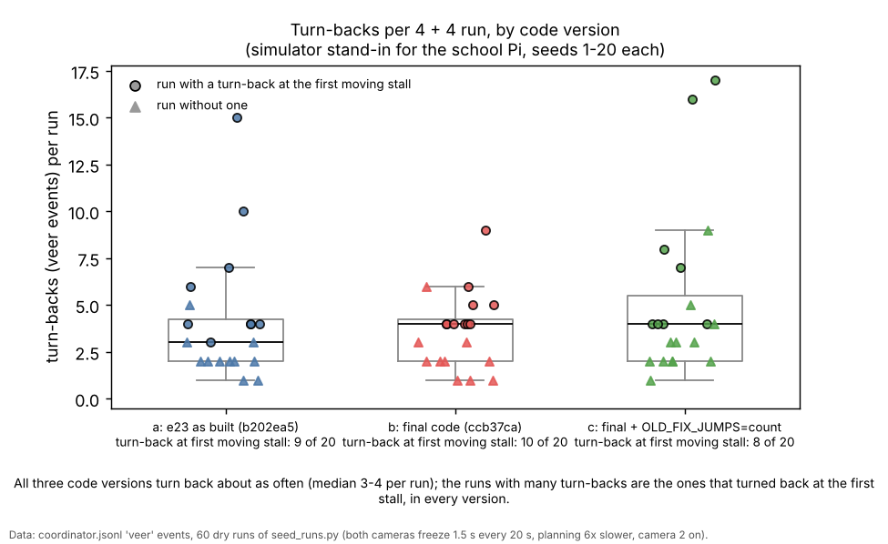

# Turn-backs: e23 as built against the audit fix pass, 20 runs each (20 Nov 2026)

## Premise

The e23 audit fix pass (e23c, ccb37ca) seemed to turn back at an edge more often than e23 as built (b202ea5): at the
first picture stall while a robot drove, 5 of 6 runs against 1 of 5. One or two runs per seed could not say whether
that was the fix pass (fix 2, old pictures carried by motion only) or chance.

## Data (simulator only: the school Pi stand-in, 4 + 4 points, seeds 1-20 per version, 60 runs)

Stand-in: both cameras freeze 1.5 s every 20 s, planning 6 times slower, camera 2 on. Median (range).

| | a: e23 as built | b: final code | c: final, `MIRLT_OLD_FIX_JUMPS=count` |
|---|---|---|---|
| Truly reached / 8 | 7 (5-8) | 7 (5-8) | 7 (4-8) |
| False credits | 0 | 0 | 0 |
| Turn-backs | 3 (1-15) | 4 (1-9) | 4 (1-17) |
| Turn-back at the first moving stall | 9 of 20 | 10 of 20 | 8 of 20 |
| Re-plans | 7.5 (0-27) | 8 (0-16) | 7.5 (0-30) |
| Closest body to an open edge (cm) | 6.8 (4.0-11.4) | 6.7 (6.4-11.3) | 6.7 (6.5-12.2) |
| Crashes / contact / over an edge | 0 / 0 / 0 | 0 / 0 / 0 | 0 / 0 / 0 |

a against b: turn-backs p = 0.97, first-stall turn-back p = 1.0. b against c: p = 0.52 and p = 0.75.

Turn-backs: Mann-Whitney test (ranks all 40 runs together and asks whether one version's runs sit higher; p is the
chance of a gap at least this big if the versions behaved the same). First-stall yes/no: Fisher's exact test (the exact
chance of a split at least this uneven if the versions were the same).

Each dot is one simulated run; the three versions turn back about as often, and the runs with many turn-backs are the
ones that turned back at the first stall.

## Conclusion

1. The fix pass does not change how often robots turn back; the earlier 5 of 6 against 1 of 5 was chance.
2. Fix 2 is not the cause; the school Pi takes e23c with its defaults.
3. What decides a run is the first stall while a robot drives (runs that turned back there: median 4 turn-backs, others
   2; p about 5e-8, all versions pooled). That is the open veer question for moving robots (e23 report, question 1).

## What's next

- Nick's answer on the veer for a moving robot near an edge, then a build for it, tested the same way (20 runs each).

## Sweep 1: tests that may now be needed

- The 20 + 20 list over 20 seeds per version (only 4 + 4 here).
- A stand-in set from the school runs' own per-picture timing instead of a fixed 1.5 s every 20 s.

## Sweep 2: possible inaccuracies

- "Moving" = true speed above 3 cm/s at the stall's start; a turn-back counts from the stall's start to 0.5 s after
  pictures return. Both [chosen] by the analysis, not derived; no DOE needed (they only sort events for counting; they
  reproduce the report's earlier 1 of 5, 5 of 6 and 2 of 5 exactly).
- 20 runs per version rule out only large differences (say 45 % against 90 %), not small ones.
- The stand-in's stall sits exactly at the veer limit at 10 cm/s, which makes runs flip; the real Pi's stalls vary.
- Simulator only; nothing ran on robots.
