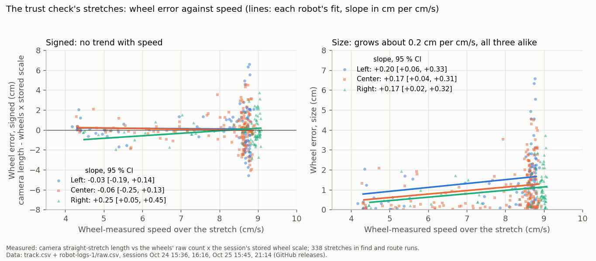
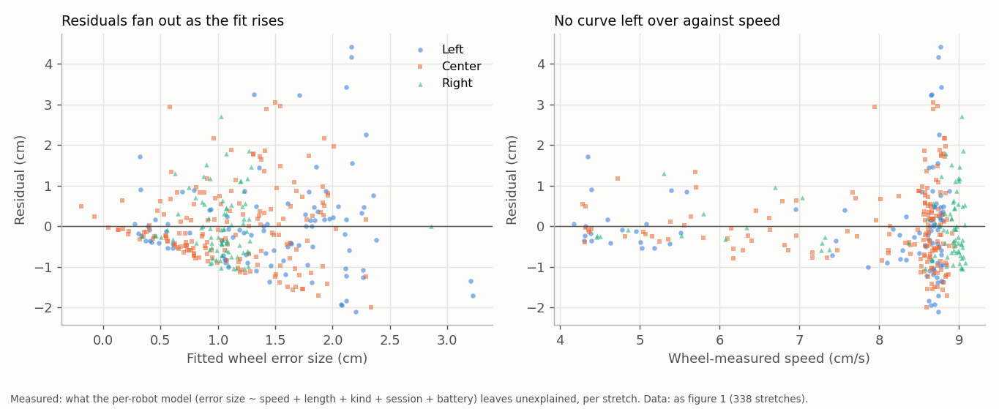
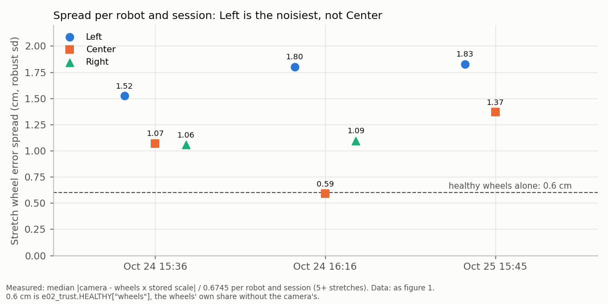
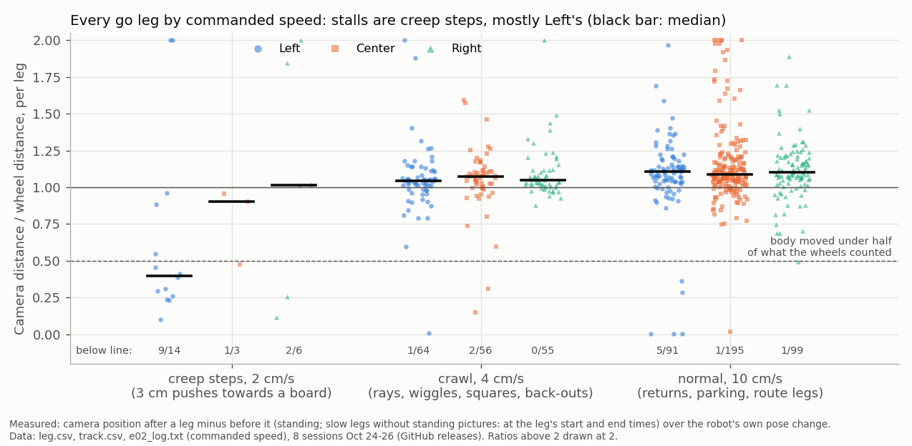

# Is wheel error related to speed? (logs only, 2026-10-27)

## Premise

At 00:16 tonight the live page showed **"Wheels ×2.9 looks bad"** for Center (sensor-trust check,
`tools/experiment/e02_trust.py`). Claude's untested guess was that the cause is edge finds and creeps: legs where the
wheels turn while the body barely moves. This report tests that guess, and asks Nick's question directly: does wheel
error change with speed?

**Wheel error** = what the camera says the robot moved, minus what the wheels counted, using the session's stored
wheel scale (cm).

## Data

Two datasets, from every real session with robot logs since 2026-10-23, fetched from the GitHub releases. The three
Oct 23 releases hold video only, with no robot logs.

| Dataset | What one item is | Items | Sessions | Speeds in it |
|---|---|---|---|---|
| **A. Stretches** (what the trust check uses) | a straight piece of driving, at least 6 cm and 2.5 cm/s, inside a find or route run that streamed raw wheel counts (`e02_fit.camera_stretches` + `pair`) | 338 (Left 95, Center 163, Right 80) | Oct 24 15:36, 16:16; Oct 25 15:45, 21:14 (4 items) | 4-9 cm/s, measured |
| **B. Legs** (every `go` command) | camera position standing still after the leg, minus before it, against the robot's own pose change | 506 usable of 954 | all 8 (Oct 24-26) | 2, 4, 10 cm/s, commanded (`set e02_cms` in `e02_log.txt`) |

**C. Tonight** (`e02-20261027-001136`, stage 1, 00:11-00:28; release `e02-session-20261027-001136`), its own group:
0 stretches (1 run finished: Right's, cut short by a safety stop; Left's failed at the edge find; Center ran none) and
18 usable legs of 45 (section 4).

### 1. Which driving can reach the ×2.9 at all

The trust check's wheel number is built only from the dataset A stretches (`e02.py` `learn()` after U runs →
`stretch_rms_against`). Two code facts follow:

- **Edge finds, explore rays, creeps and back-outs never reach it.** They are idle legs (run `-`). No robot run
  streams their raw wheel counts, so `learn()` cannot pair them. Tonight's edge finds return `run=None`
  (`e02.py` `_edge_find`), so they are left out as well.
- **Creeps are also too slow to count.** A stretch must move at least 2.5 cm/s on camera, and creeps run at 2 cm/s.

### 2. The trust check's stretches: error against speed

The trust check's 338 stretches, three robots. Left panel: signed error. Right panel: its size. Each line is that
robot's fitted slope. The signed error stays flat as speed rises; the size grows slowly and about equally for all
three robots.

| Wheel error against wheel-measured speed (model: + length, kind, session, battery) | Left | Center | Right | All |
|---|---|---|---|---|
| **Signed**: slope, cm per cm/s [95 % CI] | −0.03 [−0.19, +0.14] | −0.06 [−0.25, +0.13] | +0.25 [+0.05, +0.45] | **+0.04 [−0.07, +0.15]**, p = 0.52 |
| R², speed alone | 0.00 | 0.00 | 0.02 | 0.00 |
| **Size** (\|error\|): slope, cm per cm/s [95 % CI] | +0.20 [+0.06, +0.33] | +0.17 [+0.04, +0.31] | +0.17 [+0.02, +0.32] | **+0.19 [+0.11, +0.27]**, p < 0.001 |
| R², speed alone / whole model | 0.16 / 0.24 | 0.11 / 0.23 | 0.05 / 0.12 | 0.10 / 0.19 |
| **Center against Left and Right** (pooled, robot × speed term) | | slope +0.01 [−0.12, +0.13], p = 0.93; level −0.32 cm [−1.24, +0.61], p = 0.50 | | |

Slope: change in wheel error for each 1 cm/s faster, with the other predictors held fixed. 95 % CI: the range
that would hold the true slope in 95 of 100 repeats of this sampling (robust HC3 standard errors, because the scatter
grows with the fit, figure 3). p: the chance of a slope at least this far from zero if speed truly had no effect. R²:
the share of the spread in wheel error that the model accounts for (0 none, 1 all).

- The same regression against **camera-measured** speed gives +0.43 [+0.35, +0.50] cm per cm/s for the signed
  error. That is built in: a camera that over-reads a stretch's length raises both its error and its speed. Against
  wheel-measured speed the same built-in link pulls the other way, and that slope is +0.04. Only effects that show
  up against both measures are reported as real.
- **Speed barely varies in this data.** Route and find drives are commanded at 10 cm/s, and 80 % of stretches sit at
  8.5-9 cm/s. Each session's median is 8.6-8.9 cm/s.

Residuals are what the size model leaves unexplained for each stretch. Left: they fan out as the fitted error grows.
Right: no bend is left over against speed, so a straight line is enough.

Each robot's typical stretch error in each session, against the 0.6 cm the trust check treats as healthy for the
wheels alone. Left is highest every session; Center moves between 0.59 and 1.37 cm at the same speed.

### 3. Every leg, by commanded speed

Each dot is one leg: camera distance divided by wheel distance, grouped by the speed the robot was told to drive.
Dots under the dashed line are "wheels turned, body barely moved". Almost all of those are 2 cm/s creep steps.

| Legs where the body moved under half of what the wheels counted | Left | Center | Right | All |
|---|---|---|---|---|
| Creep steps, 2 cm/s (pushes towards a board) | 9 / 14 | 1 / 3 | 2 / 6 | **12 / 23** |
| Crawl, 4 cm/s (rays, wiggles, squares, back-outs) | 1 / 64 | 2 / 56 | 0 / 55 | 3 / 175 |
| Normal, 10 cm/s | 5 / 91 | 1 / 195 | 1 / 99 | 7 / 385 |

Creep steps against all other legs: odds ratio 60, Fisher p < 0.001.
Fisher's exact test: the chance of a split this lopsided if creep steps stalled no more often than other
legs.

- **Commanded speed does not predict leg error size.** Slope +0.09 cm per cm/s [−0.16, +0.33], p = 0.49, with R²
  0.001 for speed alone. None of the three robots' slopes is clear of zero.
- **Center's 4 cm/s crawl legs miss more than the others' do.** Median size 1.8 cm, against 1.3 for Left and 0.8 for
  Right (robot × speed term p = 0.001). The sign is the opposite of the guess, though: there **the camera saw more
  than the wheels counted** (median +1.5 cm). Most of it is from Oct 25 15:10 (median 3.7 cm), an explore session
  whose camera positions are converted from explore's provisional camera.
- Center's 09:55 hang over the right edge (wheels 102.7 cm, camera 15.3 cm, a crawl ray) is real, but it is one leg.

### 4. Tonight, and where Center's ×2.9 came from

| Tonight's legs (all 10 cm/s, except one 2 cm/s creep) | Left | Center | Right |
|---|---|---|---|
| Usable legs | 4 | 7 | 7 |
| Median camera / wheel distance | 1.18 | 1.13 | 1.13 (creep step 1.05) |
| Body moved under half of the wheels | 0 | 0 | 0 |

The edge finds' 3 cm crawls are not `go` legs, so they are not in this table.

**Center's ×2.9 was carried over, not new.** From tonight's `e02_log.txt`, `fits.csv`, `runs.csv` and
`e02_trust.py`:

- The flag was raised on **Oct 25 at 17:02**, in the 15:45 session: "Center's wheels looks bad: 2.3 x its own
  baseline (stretches: 1.96, baseline 0.87)". Left's was raised in the same session, at 16:37 ("runs: scale 6.2 %
  apart run to run"). No log since then records a recovery.
- A flag clears only when the robot has this session's own evidence and its ratio drops under 1.5
  (`update_flags`: `j["live"]`). The 21:14 and 09:55 sessions had no U runs, so they had no evidence. Tonight Center
  drove no run, and the self-calibration saw 0 stretches for any robot. At 00:28 the log shows, for both Left and
  Center: "wheels: too little evidence yet ... LOOKS BAD: wheels".
- With nothing from this session, the live page (`e02_view.py`) shows k = the weighted error of all earlier
  sessions' stretches ÷ the bare healthy 0.6 cm. ×2.9 means about 1.7 cm a stretch, close to Center's Oct 25 15:45
  level (1.37 cm, figure 3) plus older sessions. It is not a measurement from tonight.

## Conclusion

1. **Wheel error is not related to speed in direction.** Over 4-9 cm/s, faster stretches do not over-count or
   under-count more (+0.04 cm per cm/s, CI −0.07 to +0.15).
2. **Its size grows a little with speed**: about +0.2 cm per cm/s, the same for all three robots. Speed explains about
   10 % of the spread. *Claude's reading:* this may be partly the camera, not the wheels. A picture time that is off
   by a fixed amount misplaces the robot by more at higher speed, and these data cannot separate the two.
3. **Center does not differ from Left and Right** in the trust check's data, either in its slope or in its level.
   Left is the noisiest robot every session.
4. **Claude's guess is wrong as an explanation of the ×2.9.** Creeps and edge finds never enter the number. The
   stalling pattern is real, but it is a 2 cm/s creep-step effect (12 of 23 legs), mostly Left's, and it is not what
   the trust check measures. **Tonight's log confirms the ×2.9 was carried over** (section 4): Center's flag from Oct 25 17:02,
   never cleared, shown as earlier sessions' stretch error over the bare 0.6 cm. Left carries the same kind of flag.
   Tonight added no wheel evidence for any robot.

## What's next

1. The flags only clear once Left and Center finish U runs in a session. Until then the live page's "looks bad"
   says nothing about tonight's wheels. Option: show "carried from Oct 25" and the flag's date on the live page, or
   clear a flag that has had no evidence for N sessions. N would be a chosen number; the analyses so far give no
   basis for one, so a replay of the trust history at N = 1, 2 and 3 would be the way to choose it.
2. Re-plan creep steps: 12 of 23 stalled. The explore build already calls a stalled creep a board contact; tonight's
   no-board edge finds are the first real data on that.

## Sweep 1: new tests now needed

- **Speed sweep on a straight line:** one robot, 4 / 7 / 10 / 13 cm/s, 40 cm legs, 10 each, camera and tape. It would
  separate camera timing error from wheel slip; real speeds now cover only 4-9 cm/s. A design of experiment
  (speed × robot × direction) is the right way to set it up.
- **Creep push test:** creep steps into a board at 2 / 3 / 4 cm/s, front sensor logged. Does the stall depend on speed,
  or only on touching?
- **Camera timing check:** a robot standing still while a second, timed robot drives past. The camera's
  position-against-time scatter at each speed is the camera's share of the speed effect.
- **Leg start and stop:** legs read 5-10 % longer on camera than on the wheels (standing positions, figure 2), while
  stretches agree to about 1 %. A video check of the first and last 0.3 s of 10 legs would tell skid from camera.

## Sweep 2: possible inaccuracies

- **Stored wheel scale.** Each session's last pooled fit, or the 0.979 prior where a robot had none (Right Oct 25;
  everyone at 21:14 and later). Center's own fit moved from 0.981 to 0.963 within 15:45.
- **Explore sessions' camera positions** (15:10, 21:14, 09:55, Oct 24 17:32) are converted from explore's
  provisional camera to roam1, as the 09:55 analysis did. Center's large 15:10 crawl errors may be this conversion.
- **Chosen numbers** (no design of experiment; each is a filter, so a sensitivity rerun at ½× and 2× would be better
  than a DOE): standing windows 1.0 s before and 0.4-1.4 s after a leg; still means scatter under 1.2 cm; the slow-leg
  fallback uses the position at the start and end times (up to 1.2 cm off at 4 cm/s); a stall is camera under 0.5 ×
  wheels.
- **A flag's age is not stored with the flag** (only `flag_session`, which is a counter). The Oct 25 17:02 origin
  comes from the logs here; `logs/sensor_trust.json` on the Pi would confirm it.
- **Leg kinds are guessed from the command value** (105 = ray, 3 = creep, −9.5 = back-out, 12 = wiggle, 15 = square).
  A changed explore setting would mislabel legs.
- **Commanded speed is the last `set e02_cms` in the log.** The firmware may slow a leg on its own (find creep 5 cm/s,
  edge guard) without a log line.
- **Clock alignment** uses each leg's lowest radio delay (about 10-50 ms).
- **Battery** is filled with the session mean where no reading lies near a leg.
- **Camera faults are counted as wheel error.** Examples: Left's three 10 cm legs at 15:45 with 0.02 cm on camera
  (tracker frozen), and 448 legs left out for too few standing pictures, most of them explore crawls. The leg table
  under-samples exactly the legs the guess is about.

## Appendix: method and scripts

`tools/experiment/analyses_oct27/wheel_speed/`. Downloads go to the scratch folder in `common.py` (`WS_DL`); outputs
to `WS_OUT`.

- `common.py`: sessions, track loader (held rows dropped; explore positions moved onto roam1), battery.
- `stretches.py`: dataset A, with the runner's own `camera_stretches` and `pair`, per raw-streaming run (find, route).
- `legs.py`: dataset B, plus the slow-leg fallback.
- `regress.py`: OLS with HC3, per robot and pooled, robot × speed Wald F test (whether Center's and Right's slopes
  differ from Left's), Center-against-others contrast; prints every model in this report.
- `figs.py OUTDIR`: the four figures.
