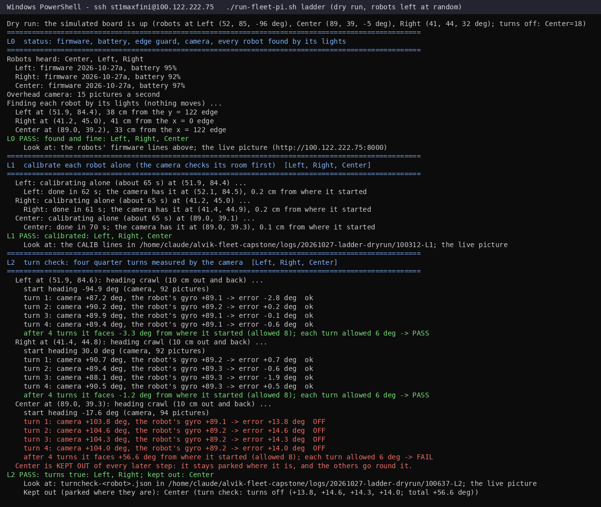
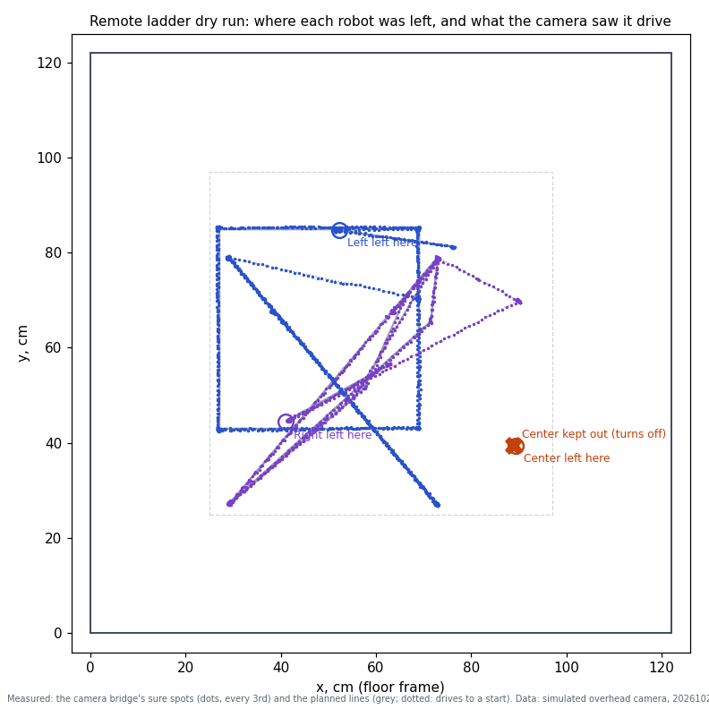
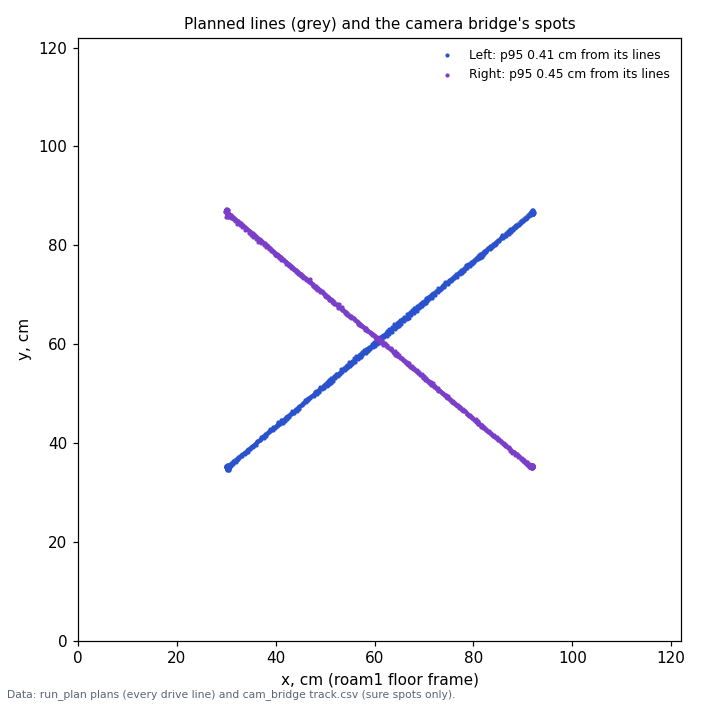
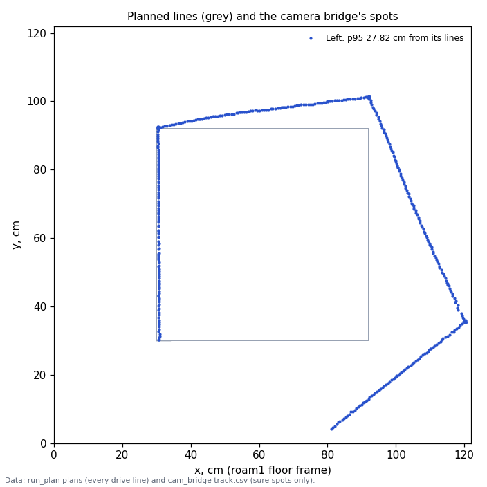

# Session plan, Tuesday 2026-10-27

**Premise.** Monday's school demo runs everything through the fleet planner (`tools/fleet/run_plan.py`), and that has
never driven a real robot. The brief's Phase 0 ([mission-control.md](../build-plans/mission-control.md)) is a
45-minute board test: one robot follows a planned route with camera fixes, then two robots cross paths. The gate is
"within about 3 cm of the planned lines". Tonight the edges session runs again, this time with the fixes from last
night ([session-edges](../build-reports/e02-oct27-session-edges.md); fixes 1-4 are being built to `e02.py` now and
will be written up in `e02-oct27-edge-fixes.md`).

**What was missing, and is now built (dry runs only):** a way to get camera fixes from the Pi's overhead camera into
run_plan. Blink naming (`track_live.py`) named robots too rarely on real footage. The new **camera bridge**
(`tools/fleet/cam_bridge.py`) runs the E02 tracker family (MultiTracker, floor memory) on the Pi and works out who is
who from each robot's **own pose**, which run_plan now forwards (`--poses-to`). When the tracker is unsure, it sends
no fix. The new launcher **`run-fleet-pi.sh`** runs it all on the Pi. Details: section 4.

**One address (2026-10-28).** Everything below is also reachable from one page: **http://100.122.222.75:8091** (tabs
Live lab | Mission Control | Start/Stop; a DOE loop's or Monday mission's screen and its Stop on the Live lab tab).
After `git pull` on the Pi, restart it once: `sudo systemctl restart mirlt-launcher`. See docs/pi-run.md.

## 0. Today's change: the remote ladder (nobody at the board)

**Premise.** Nick runs today's board test from his laptop (Tailscale, PowerShell, SSH into the Pi). The robots are
switched on and left on the plywood (no boards, every side an open edge), at least 30 cm from the edges and 40 cm
apart, at spots and headings nobody wrote down. Nobody can move them. Nick: "start cautious and grow increasingly
more bold. I'll be available at my laptop to review as needed." So the taped start spots, the ruler for Center's
turns and "put it back on A" in parts (a) and (b) cannot happen. The **remote ladder** (`tools/fleet/ladder.py`,
`./run-fleet-pi.sh ladder`) replaces them: the camera finds each robot, measures its turns, and the planner drives
each robot to its test's start spot itself.

| Step | What it does | Gate (PASS) | A FAIL means |
|---|---|---|---|
| **L0** status | Firmware and battery; edge guard on; camera pictures arrive; **each robot found by its lights** (`led`, nothing moves) | ≥ 1 robot found, firmware ≥ 2026-10-18b, battery ≥ 25 %, ≥ 25 cm from every edge | that robot is kept out (parked) |
| **L1** calibrate | Each robot **alone**, after the camera checked its room (30 cm to the edges, 35 cm to the others) | calibration done; the camera still sees it | kept out |
| **L2** turns | The **camera-measured turn check** (replaces the ruler): a 10 cm out-and-back crawl gives the heading, then 4 × (`turn 90` + crawl) | every turn within 6° of 90, the four together within 8° | kept out of every later step; it stays parked and the others go round it |
| **L3** straight | Each robot that passed L2: the planner drives it 25 cm straight out and back at 5 cm/s with camera fixes (the first planner drive) | line check p95 ≤ 3 cm, run done | kept out |
| **L4** square (b1) | Drives one robot to the square's start (healthy robots in the way are driven to a holding spot first), then the square twice: **5 cm/s, then 10 cm/s** | start spot within 4 cm / 6°; p95 ≤ 3 cm at both speeds | the ladder stops |
| **L5** cross (b2) | Drives two robots to their starts, then they cross 4 times: **5 cm/s with bodies ≥ 10 cm apart, then 10 cm/s at the normal 5 cm** | as L4, both robots | the ladder stops |
| L6 brick (b3) | Test cross with the brick watch; **only with someone at the board** (`./run-fleet-pi.sh L6 attended`) | as L5, plus the brick seen | - |

Each step runs only after the one before passed; each ends with `PASS` or `FAIL`, "Look at:" and, on a FAIL,
"For you to decide:". **Ctrl+C stops every robot**, and so does a dropped SSH link. Running `./run-fleet-pi.sh
ladder` again carries on from the first step not yet passed (`logs/<date>-ladder/state.json` keeps what passed and
where each robot is).

How the pieces fit:

- **Heading.** One still picture cannot tell a square robot's heading. Every heading comes from a straight line the
  camera watched: the crawls in L2, and after a planner run, the camera's line through its last straight leg plus
  what its gyro turned after that leg.
- **Start spots.** Each test starts 15 cm along its first line from a corner, and the drive there goes through the
  corner first, so it arrives straight along the start heading. (Dry run finding: a final turn on the spot swings the
  robot's centre round its axle, 4 cm for a half turn, and the start check refused it.)
- **Room.** The square and the cross are placed where they fit: the biggest size (62 → 52 → 42 → 32 cm square,
  62 × 52 → 42 × 36 cross) with every line 20 cm from a parked robot and 25-30 cm in from the edges. The camera puts
  them in its own floor frame, so the layouts are not the Phase 0 maps' taped spots.
- **Slow runs and the camera's heading.** At 5 cm/s the camera bridge never sent a travel heading (its 1 s window
  holds under its 5 cm minimum), so a wrong heading stayed wrong. Slow runs now use a 2 s window
  (`cam_bridge.py --heading-window-s`).

**Dry runs** (the simulator as the board: three robots at random spots and headings, 30 cm in and 40 cm apart,
**Center's turns 18 % off**, starting uncalibrated; the simulated overhead camera through the camera bridge):

| Run | Result | Turn check (camera) | L3 / L4 / L5 p95 from the lines | Truth |
|---|---|---|---|---|
| 1 (seed 7, first code) | stopped at L4 | Center +13 to +15° per turn: **FAIL, kept out**; Left, Right within 3.2° | L3 0.63 / 0.23 cm | problems found: no square fitted (fixed: holding spot, 32 cm); start 4.5 cm off (fixed: lead-in); headings handed on 15-22° wrong (fixed); no slow-run headings (fixed) |
| 2 (seed 7, fixed) | **every step PASS** | Center FAIL (+13.8, +14.6, +14.3, +14.0); Left, Right within 3° | L3 0.37 / 0.34; L4 0.46 (slow) / 0.46 (normal), 42 cm square; L5 0.24 / 0.24 (slow, wide), 0.31 / 0.31 (normal) | no contact; closest bodies 6.8 cm (Left past the parked Center on a drive; parked robots now get 3 cm more room); closest to an open edge 19 cm |
| 3 (seed 11, through `FLEET_DRY=1 ./run-fleet-pi.sh ladder`) | **every step PASS** | Center FAIL (+14.7 to +15.9); Left, Right within 2.4° | L3 0.36 / 0.28; L4 0.40 / 0.38 (42 cm square, Right driven aside first); L5 0.67 / 0.57 (slow, wide), 0.56 / 0.33 (normal), the full 62 × 52 cross | no contact; closest bodies 8.0 cm (Left and Right crossing at normal spacing); closest to an open edge 17 cm |
| Ctrl+C mid turn check; SIGHUP (dropped SSH) mid planner run | robot stopped | - | - | true heading / position frozen 0.2 s after the signal; no run_plan or bridge left running |

Camera-measured turns against the simulator's true turns (run 1): within 2.5° (the first turn) and 0.9° (the
others); Center's true turns were 104°, the camera said 103-105°.



The ladder's window in dry run 2: each robot found by its lights, calibrated alone, then the turn check. Center's four
turns are 14° too big each, so it is kept out (data: simulated overhead camera, robots' own gyro from their LEG
records).



Where the three robots were left (circles) and every spot the camera saw Left (blue) and Right (purple) drive in dry
run 2: L3's short lines, the 42 cm square and the cross, around the kept-out Center (data: camera bridge track.csv).

**Conclusion.** In the simulator the ladder takes three robots left anywhere, keeps the one whose turns are off out,
and runs b1 and b2 to the 3 cm gate without anyone touching the board. **Next:** run it on the board today
(Appendix B). The square will usually be smaller than 62 cm, because the parked robot is in the middle somewhere.

## 1. The plan

| Part | What it answers for Monday | Time | Nick's minutes |
|---|---|---|---|
| **(a) Bench checks** | Which firmware each robot runs (the planner needs 2026-10-18b+; the four-sided border needs 27a). Whether Center turns true again, so it can drive at all | 15 min | 15 (attended) |
| **(b1) Test one**: Left drives a 62 cm square twice, 3 runs | Does the camera keep **one** real robot within 3 cm of its planned lines? (The Show and the mowing lanes depend on this) | 10 min | 10 |
| **(b2) Test cross**: Left and Right cross paths 4 times, 3 runs | Do the "after" lists keep two real robots apart, and does who-is-who hold when they pass 13 cm apart? (Chicken and Follow-the-leader depend on this) | 10 min | 10 |
| **(b3) Hand and brick**: 3 min watch-only, then 2 runs of test cross with the brick watch on | Does the "what changed" watch see a real brick on the real camera, ignore hands and robots, and do the robots go round it? (Monday's brick drop) | 12 min | 12 |
| (b4) If time: test one with Right, then Center if it passed (a) | Same as b1, one robot each | 5-10 min | 5-10 |
| **(c) Evening edges session**, unattended | Do fixes 1-4 remove last night's set-asides (identity swap at a parked robot, one-picture camera jumps, the barrier-kept find, the rescue into its own border)? More no-board edge data and side-camera footage for Monday | until the batteries run out (4 h cap) | 5 to start |

Total attended: about 50-60 minutes, then 5 minutes to start the evening session.

## 2. The parts, with their gates

### (a) Bench checks (15 min)

1. **Firmware** (`./run-fleet-pi.sh check`): prints each robot's firmware and battery.
   - Any of 2026-10-25b / 26a / 27a: fine for today. 26a and 27a were never compiled with the Arduino tools, so a robot
     reporting either one also shows that this firmware compiled.
   - Under 2026-10-18b: the planner refuses it. Flash it first.
   - Optional, 2 minutes, nothing uploaded: in the Arduino IDE, **Verify** (not Upload) `firmware/home_lab/home_lab.ino`
     at 2026-10-27a. This is the first real compile of 27a, which Monday needs.
2. **Center's turn** (remote today: the ladder's L2, or `./run-fleet-pi.sh turncheck Center`, measured by the camera,
   section 0; with someone at the board: `./run-fleet-pi.sh turn Center`, 4 times): Center sits in the middle of the board with one side
   against a straight edge (a ruler or a book). After 4 turns it should face the way it started.
   - **Pass:** its side is back along the ruler, with a gap of under about 1 cm at the far corner (about 5°), and every
     printed `LEG ... done` line ends near 90. Center may join (b4) and (c).
   - **Fail** (a visible slant, like last night's 15-20°): run `./run-fleet-pi.sh calibrate` once and try again. If it
     still fails, Center stays **switched off and off the board** for today, and (c) runs without it.
   - **Why this gate matters (dry-run finding, section 4):** with an 18 % gyro error the simulated robot could not
     follow its lines even with camera fixes, and drove off the table. The new camera guard now stops it first.
3. **Calibrate** (`./run-fleet-pi.sh calibrate`): every robot on the board, at least 40 cm apart and 30 cm in from the
   edges. The planner needs a calibration since power-on. About 75 s.

### (b) Phase 0 planner board test (45 min, attended)

The robots go on taped spots, measured from two edges as they look **in the overhead camera's picture**
(`./run-fleet-pi.sh rec` shows it at http://100.122.222.75:8000). Each robot is squared to the board's edge by eye.
A dry run with the robot put down 10° off still passed (p95 2.2 cm), so by eye is enough.

| Spot | From the edge at the BOTTOM of the picture | From the edge at the RIGHT of the picture | Used by |
|---|---|---|---|
| one: A | 30 cm | 30 cm | test one: the robot faces along the bottom edge, towards the LEFT of the picture |
| cross: A | 30 cm | 35 cm | test cross: Left, facing the TOP of the picture |
| cross: B | 30 cm | 87 cm | test cross: Right, facing the TOP of the picture |

Robots that are not in the test must be **off the board**, because the planner does not know about them.

Each test prints what the camera bridge sees every 2 s. At the end it prints a **line check** for each robot: how
far the camera's spots were from the planned lines (median / 95th percentile / max), then `GATE: PASS` or `FAIL`.

| Result | Decision for Monday |
|---|---|
| b1 and b2 PASS in every run (each robot's 95th percentile ≤ 3 cm) | The planner with camera fixes is a go. Next: a scaled Monday rehearsal on the home board |
| FAIL with "camera and X's own pose disagree ... stopping everyone" | That robot's turns or gyro: bench it (a), calibrate. Monday needs a camera-heading fix in the firmware's gate (question 2) |
| FAIL with "unsure" / "lost" lines from the bridge | The tracker on real pictures. Look at `bridge/track.csv` statuses and the video at those times |
| FAIL with the robots on their lines by eye | Calibration or offset: compare the side video with `line_check.png` |
| b3: the brick is reported within ~2 s of the hand leaving, no object from hands or robots in the watch-only minutes, and the robots go round it | Monday's brick drop as planned |
| b3: false objects (hands, shadows, robots' trailing edges) | Not for Monday as-is: a DOE on CONFIRM_CHECKS / ROBOT_MASK_SCALE on today's video (no board time) |

**Stop rule:** press Ctrl+C at once if a robot heads within about 10 cm of an edge or towards another robot. That
stops every robot. The robots' own edge guard is switched on before every test (`safe_edge 3`).

### (c) Evening edges session (unattended)

- **Before:** the edge-fixes build ([e02-oct27-edge-fixes.md](../build-reports/e02-oct27-edge-fixes.md), being
  finished as this plan is written) must be pushed. The launcher does `git pull` itself. If it is not pushed by then,
  run anyway: the analysis compares against last night either way, and says which code ran.
- **What the fixes do:** (1) a robot's spot passing within 20 cm of a parked robot opens a "who is who" doubt, settled
  by its own wheels; routes ending under 25 cm from a set-aside robot are not run. (2) Camera holds near edges use
  medians, not single pictures. (3) After a find that felt a barrier, the robot's own pose stands until the camera
  agrees within 3 cm. (4) A rescue whose last drive went inward drives on inward.
- **Command:** `./run-e02-pi.sh --with-side --plan edges` (E1: 15 min on their own sensors, then E2 until the
  batteries run out; unanswered holds rescue after 3 min). If Center failed (a):
  `E02_PLAN_EXTRA="--robots Left,Right" ./run-e02-pi.sh --with-side --plan edges` (new today; Center switched off and
  off the board).
- **Gate (next morning's analysis):** compared with last night's E2 (3 set-asides, 5 holds, 15 idle minutes, 4 runs
  done in 31 min). Fixes 1-4 should give no identity swap next to a parked robot, no hold from a one-picture jump, no
  rescue that backs into its own border, and more runs done.
- **Known gap:** "a stage that starts with a hanging robot from the stage before leaves it out" (last night's item 7)
  is not in fixes 1-4. Check every robot is on the board between E1 and E2 if you are still there (E1 ends about
  15 min in).
- **When it ends:** the plan uploads the logs and video itself. If you stop it early, start the upload at once
  (`python3 tools/pi/upload_session.py --recordings <USB>/recordings --stop-recorder`) so it transfers while we talk.

### Data to look at afterwards

| Part | Where | What |
|---|---|---|
| (a) | `logs/<time>-cmd/` (`leg.csv`, messages) | Center's four `turn 90` gyro readings; firmware lines |
| (b) | `logs/<time>-p0-<test>/`: `bridge/line_check.json` + `line_check.png`, `bridge/track.csv`, `bridge/events.jsonl`, `coordinator.jsonl`, `run_plan_summary.json`, `follow.csv`; the recording | Cross-track error per robot, sure-sighting share, fixes used vs refused (`fixes_used_rejected`), `cam_guard` events, closest pair, brick report time, false objects; side video for an independent check of the 3 cm |
| (c) | the uploaded E1 / E2 logs and both cameras | Set-asides and holds; the fixes at work: log lines "who is who is checked", "its own pose is used", "drives on inward" and `e02_state.json` `identity_doubts`, `own_pose_kept` / `fix_own_kept`, `rescue_inward`; heat tracker row (`--cooling=` your answer to question 10) |

## 3. Chosen numbers

Each one also has a DOE note in its code comment and, where a DOE fits, a row in [doe-backlog.md](../doe-backlog.md).

| Number | Value | DOE? |
|---|---|---|
| Gate: each robot's 95th percentile from its lines | 3 cm (Nick's "about 3 cm"; the 95th percentile is Claude's reading of "within") | No: a pass mark. Say if you meant max, or median |
| `FIX_SIGMA_CM` (camera spot error the robot weighs fixes by) | 1.0 cm | **Yes:** 0.5 / 1 / 2 cm on the board, cross-track error |
| `HEADING_SIGMA_DEG` (travel heading) | 3° | **Yes:** same runs, 2 / 3 / 6° |
| `CAM_GUARD_CM` / `CAM_GUARD_S` (camera vs own pose: stop everyone) | 6 cm for 1 s | **Yes:** 4 / 6 / 8 cm × 0.5 / 1 / 2 s, false stops against distance driven blind |
| Travel heading: window / least distance / "straight" | 1 s / 5 cm / 2° | No (guards; the heading's sigma is the DOE) |
| `MAX_BACKLOG_S` (skip pictures the bridge is late on) | 0.3 s | No (a guard; the robot takes fixes up to 1 s old) |
| Phase 0 spots 30 cm in from every edge | 30 cm | No: keeps the camera away from the edge zone where its spot rides onto the nose (last night: 9-15 cm) |
| Start-spot check (`--place-tol-cm`) | 4 cm (run_plan's default is 2) | No: a placement check for a tape-measured spot |
| Runs per test | 3 | No: enough to see a pattern, not a statistic (n = 3) |
| Ladder: turn check, each turn / all four (`TURN_TOL_DEG`, `TOTAL_TOL_DEG`) | 6° / 8° | **Yes:** 4 / 6 / 8° on repeated checks of a healthy robot (false FAILs) against the turn error that breaks L3/L4 |
| Ladder: heading crawl (`CRAWL_CM`) | 10 cm out and back | **Yes:** 6 / 10 cm, heading spread against time |
| Ladder: cautious speed (`SLOW_CMS`) | 5 cm/s (normal 10) | **Yes:** 5 / 7.5 / 10 cm/s against p95 and camera-guard stops |
| Ladder: cautious spacing in the cross (`WIDE_SEP_CM`) | 10 cm (normal 5) | **Yes:** 5 / 10 / 15 cm, unsure moments against closest approach (20 had no plan: start spots too close) |
| Ladder: edge refusal / calibration room / room round a parked robot | 25 cm / 30 and 35 cm / 20 cm from the lines, 10 cm circle on the map | No: safety rules (25 cm is Nick's) |
| Ladder: lead-in to a start spot / start check | 15 cm / 4 cm and 6° | No: geometry and a check |

## 4. What was built and tested (simulator only)

| Piece | What | Where |
|---|---|---|
| Camera bridge | Pictures from the recorder's `/live` → MultiTracker with prediction from each robot's own pose → fixes (position always; heading from the start spot, then from straight travel) and, with `--brick-watch`, obstacles. Unsure / merged / lost = no fix. `--observe` sends nothing | `tools/fleet/cam_bridge.py` |
| run_plan | `--poses-to` (own poses to the bridge); **camera guard**: camera and own pose more than 6 cm apart for 1 s stops everyone | `tools/fleet/run_plan.py` |
| Line check | Camera spots against every planned drive line, gate, closest pair, picture | `tools/fleet/line_check.py` |
| Bench helper | One console command to the robots, prints the answers and firmware | `tools/fleet/robot_cmd.py` |
| Launcher | `rec`, `check`, `turn`, `calibrate`, `one`, `cross`, `watch`, `brick`, `stop`; edge guard sent before every test; `FLEET_DRY=1` runs the same steps against the simulator | `run-fleet-pi.sh` |
| Maps | Test one (square), test cross (X, twice) | `tools/fleet/examples/phase0_one.json`, `phase0_cross.json` |
| Simulator | `--serve-live`: the simulated overhead camera served as the recorder serves it (2.34 px/cm, as the real one) | `tools/sim/fleet_sim.py` |
| Evening plan | `E02_PLAN_EXTRA` passes runner options to every stage (leave a robot out) | `tools/pi/session_plan.sh`, `run-e02-pi.sh` |

**Dry runs** (simulated pictures → bridge → run_plan → simulated robots; camera p95 = 95th percentile distance of the
camera's spots from the planned lines):

| Run | Result | Camera p95 from lines | Camera vs truth, median | Notes |
|---|---|---|---|---|
| one (Left) | done 68.5 s (plan 68.0) | 0.26 cm | 0.59 cm | 648 of 649 fixes used |
| cross (launcher, `FLEET_DRY=1`) | done 52.4 s (52.3) | 0.41 / 0.45 cm | 0.47 / 0.56 cm | no unsure moments; closest bodies 14.2 cm (truth) |
| brick (launcher) | done 66.7 s | 0.35 / 0.41 cm | 0.58 / 0.66 cm | brick reported **1.5 s** after it landed, re-plan 1.1 s, closest to it 4.7 cm, no contact |
| one, robot put down 10° off its start heading | done | 2.22 cm | 0.60 cm | the first straight drive's camera heading corrected it |
| **one, 18 % gyro error, no guard** | **hung over the edge at 31 s** | 22-28 cm | 0.6 cm | **problem:** the robot's pose drifted past its fix gate, it refused every later fix (118 of 302) and drove off blind. Same with or without the travel heading |
| one, 18 % gyro error, **with the guard** | stopped everyone at 20.7 s, 10.5 cm from the edge | 8.6 cm (FAIL) | 0.76 cm | **fixed:** the gate fails safely instead of the robot going off |



The two robots' camera spots (dots) on the planned lines (grey) in the crossing dry run. Both stayed within half a
centimetre (data: simulated overhead pictures through cam_bridge; run_plan's plans).



The square test with an 18 % gyro error and no guard. After the first corner the robot slants off its lines and ends
over the x = 122 edge (data: as above, simulated robot with `gyro_scale_err_pct` 18).

Tests: `tools/fleet/tests/test_cam_bridge.py`, 6 tests including the end-to-end dry run (`FLEET_DRYRUN=1`), all
passed. Existing fleet and simulator suites: see the commit message.

## 5. Untested on real hardware

- Everything in section 4. In particular: the MultiTracker on the **real** overhead pictures with **two robots
  moving at once** (E02 moves one at a time; the dance used this tracker, and its real footage results are not in
  this plan's sources); the floor memory taken with robots standing on their spots; the Pi's CPU with the recorder
  (two cameras), the bridge and run_plan's re-plans all together (last night the tracker alone ran 54-76 ms a
  picture as the Pi heated).
- The brick watch on real pictures (bright room, shadows, hands from the side).
- run_plan's follow runs on real robots at all (firmware follower, step release, fixes on the robot).
- The robots' outline as a heading (`--start-heading camera`): on simulated pictures single pictures were up to 37°
  off away from the middle. It is **off**. The start heading is the map's (you place the robot facing it).
- `robot_cmd.py` and the launcher's real (non-dry) path: camera names, the USB drive, tmux and upload are the same
  code as `run-e02-pi.sh` but have not been run on the Pi.

- **The remote ladder** (section 0): finding robots by their lights on the real camera (the simulator's lights are
  clean white dots; the flash check on the camera setup page measured the real ones); the heading crawls' 10 cm on
  real wheels and the real outline (the simulator's camera put turns within 2.5°); idle `go` / `turn` legs and the
  `fix` command between them on firmware 26a/27a; calibration with the other robots 35-40 cm away; run_plan started
  five or more times in a row against the same robots (each start sends `stop` and `run follow`); the 2 s heading
  window on real pictures; the holding-spot drive; SIGHUP (a dropped SSH link) stopping run_plan and the ladder.
  L6 (the brick) was not dry-run through the ladder. A robot whose body the camera cannot see (found by its lights
  only, kept out and parked there) was not simulated.

## 6. Questions for Nick

*Substantive*
1. **Gate reading:** is "within about 3 cm" the 95th percentile (one camera jump does not fail a run), or the
   maximum? I used the 95th percentile.
2. **If Center's turns are still 15-20° off after calibrating,** should Monday's plan count on two robots? The dry run
   says a robot like that cannot follow lines even with the camera. Fixing it means the camera's heading must be
   allowed to correct big errors (a firmware gate change, untested), or the gyro scale must be calibrated per robot.
3. **Phase 0 timing:** b1-b3 back to back need about 35 minutes plus the bench. Can you be at the board for about
   60 minutes before the evening session starts?

6a. **Remote ladder, square size:** with a robot parked where it was left, the square is usually 42 cm (dry runs),
   not the plan's 62 cm. Is a smaller square a fair test one for Monday, or should a 62 cm square wait for a day when
   the robots are placed? (Claude's call for today: the biggest that fits, said on the screen.)
6b. **Remote ladder, going on without asking:** the ladder runs straight on while steps pass and stops at a FAIL.
   `./run-fleet-pi.sh ladder pause` waits for Enter before each step instead. Which do you want as the default?

*Other*
4. If 26a or 27a shows up in `check`, did you flash it last night, and from which commit?
5. Is the light object beyond the x = 0 edge still there? Phase 0's spots stay 30 cm in, so it should not matter
   today; for tonight it reads as a barrier at y 30-60.

## Sweep 1: new tests that may now be necessary

- On the board: the camera guard's false stops on real runs. How often camera and own pose drift 6 cm apart without a
  real fault (the DOE row).
- On the board: two robots passing at 13 cm under the real camera. Count unsure moments in `track.csv`.
- Replay: the bridge on last night's or today's overhead video with the robots' own poses from `follow.csv` (no
  board time), to tune the gate sizes.
- Firmware: a heading fix larger than the fix gate after a bad turn (the 18 % case). Test in the simulator first,
  then on the bench.
- The Pi's load with the recorder, bridge and run_plan together (`cpu.csv` is not written by run_plan; add it, or
  watch `top`).

- Remote ladder: repeated turn checks on a healthy robot (the 6° tolerance's false-FAIL rate) and on Center (is its
  error steady from turn to turn, as in the simulator, or slip that varies?).
- Remote ladder: the start-spot check on the board (4 cm / 6°) against the side video.
- Remote ladder: a test with Ctrl+C in the middle of a crawl and of a planner run on the real robots (dry: see
  section 0).

## Sweep 2: possible inaccuracies in what this relied on

- **Remote ladder:** the simulated board's robots turn about a point the simulator chose; the swing a real robot's
  centre makes in a turn (the reason for the 15 cm lead-in) is ~3 cm in E02's notes, so the start check may see more
  than the dry runs' 0.2-0.4 cm. Lights are found from the simulator's clean white LEDs; the real ones glare on the
  floor. Chosen numbers: TURN_TOL 6°, TOTAL_TOL 8°, CRAWL 10 cm, SLOW 5 cm/s, WIDE spacing 10 cm (DOE rows in
  doe-backlog.md, "Remote ladder"); the 20 cm room round parked robots, 10 cm obstacle circle, 25 cm edge refusal,
  4 cm / 6° start check (no DOE). Center's "18 % off" is a stand-in (its real error was 15-20° per quarter turn).

- **The simulator's camera** is a clean rendering (2.34 px/cm, no shadows, a flat-topped box robot). The 0.5-0.7 cm
  camera-vs-truth error is the simulator's, not the real camera's (E02's real errors near the board's middle were
  1-2 cm).
- **The gate is camera against plan:** the camera also steers the robot, so a calibration offset in roam1 would move
  both together and still pass. The side video is the independent check.
- **The roam1 calibration** is assumed still valid (camera unmoved since the boards came off; last night used it).
- **The 18 % gyro case** is a stand-in for Center's 15-20° turn errors. Those may have been wheel slip in an edge
  find rather than gyro scale.
- **Spot coordinates** rely on the edges report's description of the roam1 frame (x = 0 at the bottom of the picture,
  y = 0 at the right). Check it on the first placement: the bridge prints where it sees the robot.
- Chosen numbers: see section 3. `FIX_SIGMA_CM`, `HEADING_SIGMA_DEG` and the guard are chosen, not derived.

## Appendix A. Nick's steps for (a) and (b)

The same steps as in the chat message. Every box is one command: type it (or paste it), press Enter.

**Start (laptop).** Open **PowerShell** (Start menu → type `PowerShell` → Enter). Type:

```
ssh st1maxfini@100.122.222.75
```

Type the Pi's password when asked (nothing shows while you type), press Enter. You should see a prompt ending in `$`.
Every command below goes into **this window**.

```
cd ~/alvik-fleet-capstone
```
```
git pull
```

You should see a list of changed files, or `Already up to date`.

**(a1) Firmware.** Switch on all three robots on the board.

```
./run-fleet-pi.sh check
```

You should see `Robots heard: Center, Left, Right`, then one line per robot like `Left: firmware 2026-10-26a, battery
87%`. Write down the three versions.

**(a2) Center's turn.** Put Center in the middle of the board with its left side touching a ruler or book lying flat.

```
./run-fleet-pi.sh turn Center
```

Center turns a quarter turn. The window shows a line with `LEG` and `done`, ending in a number near 90. Press the
Up arrow, then Enter, to send it again. Do this until it has turned 4 times. Its side should be back against the
ruler. Pass: a gap under about 1 cm at the far corner. If it fails, do (a3) and repeat (a2) once. If it fails again,
switch Center off and take it off the board.

**(a3) Calibrate.** Spread the robots out: 40 cm apart, 30 cm in from every edge.

```
./run-fleet-pi.sh calibrate
```

Each robot spins and rolls a little. About 75 seconds later the window shows each robot's firmware line again.

**(b0) Recorder.**

```
./run-fleet-pi.sh rec
```

You should see `Recording both cameras ...`. On the laptop, open a browser at http://100.122.222.75:8000 to see the
overhead picture.

**(b1) Test one, 3 times.** Take Center and Right off the board. Put Left on spot "one: A": 30 cm from the edge at the
**bottom** of the picture and 30 cm from the edge at the **right**. Its side should run along the bottom edge, and its
front should face the **left** of the picture. Keep your hands out of the picture.

```
./run-fleet-pi.sh one Left
```

You should see `Camera bridge starting`, then `Left: camera puts it ... cm / ... deg from its start spot`, then Left
drives the square twice (about 70 s). If it says `Left is not on its start spot (5.2 cm ...)`, nothing has moved: put
it closer to the mark and run the command again (allowed: 4 cm). At the end you should see `GATE: PASS` or `GATE: FAIL`. Put Left back on A and
press the Up arrow and Enter to run it again (3 runs). Ctrl+C stops every robot at once.

**(b2) Test cross, 3 times.** Left on "cross: A" (30 cm from the bottom edge, 35 cm from the right edge). Right on
"cross: B" (30 cm from the bottom edge, 87 cm from the right edge). Both face the **top** of the picture. Center off
the board.

```
./run-fleet-pi.sh cross
```

They cross 4 times (about 55 s), then `GATE: ...`. Put them back and run it 3 times.

**(b3) Hand and brick.** Left and Right on the cross spots, standing still. Have a brick or a box (about 20 x 9 cm)
ready.

```
./run-fleet-pi.sh watch
```

For 3 minutes: wave your hand over the board, then put the brick down in the middle and take your hand away, then pick
it up again. The window should print `brick watch: new object ...` once for each time the brick was put down, and
never for your hand alone. Press Ctrl+C to stop.

```
./run-fleet-pi.sh brick
```

The robots cross as in (b2). About 15 seconds in, put the brick down where they cross and take your hand away. You
should see `camera: new obstacle` and the robots going round it. Run it twice.

**(b4) If there is time:** `./run-fleet-pi.sh one Right`, and `./run-fleet-pi.sh one Center` if Center passed (a2).

**End.**

```
./run-fleet-pi.sh stop
```

This stops the recorder and uploads the logs and video. Leave the window open until it says it is done.

## Appendix B. Nick's steps for the remote ladder (from the laptop)

Every box is one command: type it (or paste it), then press Enter. The whole ladder took about 20 minutes in the
dry runs; on the real board expect 25-35.

**1. Connect.** On the laptop, open **PowerShell** (Start menu → type `PowerShell` → press Enter). In the PowerShell
window, type:

```
ssh st1maxfini@100.122.222.75
```

Type the Pi's password when asked (nothing shows while you type), press Enter. You should see a prompt ending in `$`.
Every command below goes into **this window**.

```
cd ~/alvik-fleet-capstone
```
```
git pull
```

You should see a list of changed files, or `Already up to date`.

**2. Start the ladder.**

```
./run-fleet-pi.sh ladder
```

You should see `Recording both cameras ...` and `Recorder starting (8 s) ...` (the recorder starts by itself). If it
also says `No calibration saved by the camera setup page`, it is using yesterday's camera calibration: that is fine
unless the overhead camera moved since last night; if it did, press Ctrl+C, run the camera setup page first
(`./run-fleet-pi.sh setup`), then start the ladder again.

**3. Watch.** In the laptop's browser, open http://100.122.222.75:8000 to see the overhead picture. In the PowerShell
window you should see, in order (nothing moves until L1):

- `L0 ... Robots heard: Center, Left, Right`, one line per robot with its firmware and battery, then `Finding each
  robot by its lights`: each robot's lights flash white for 2 seconds in turn. Then `L0 PASS`.
- `L1`: each robot calibrates **on its own** (spins and rolls, about 65 seconds each). `L1 PASS`.
- `L2`: each robot crawls 10 cm forward and back, turns a quarter turn, crawls again, four times. Each turn prints a
  line like `turn 1: camera +89.5 deg, the robot's gyro +89.2 -> error -0.5 deg  ok`. A robot whose turns are off
  prints `OFF` lines and `is KEPT OUT of every later step`: it stays where it is and the others drive round it.
- `L3`: each robot that passed drives 25 cm straight out and back slowly. `L3 PASS`.
- `L4`: one robot drives to the square's start, then drives the square twice slowly, then twice at normal speed. If
  another robot is in the square's way, it is driven aside first (`making room: ...`).
- `L5`: two robots drive to their starts, then cross four times slowly and wide apart, then four times at normal
  speed and spacing.
- At the end: `The ladder is done: every step passed`.

**To stop every robot at once: press Ctrl+C** in the PowerShell window. If the connection to the Pi drops, every
robot stops by itself.

**4. If a step says FAIL or STOPPED.** The ladder stops there. Read the lines under it: `Look at:` (where the
pictures and numbers are) and `For you to decide:`. Send me those lines if you want a second opinion. Then, to carry
on from the step that stopped (after you decide), type:

```
./run-fleet-pi.sh ladder
```

To see what has passed so far and where each robot is:

```
./run-fleet-pi.sh ladder-status
```

If L0 says a robot was `not found anywhere on the board`, nothing moves (the planner would not know where it is).
Run L0 again:

```
./run-fleet-pi.sh L0
```

Only if it is still not found and you are **sure** that robot is not on the board (here Center as the example):

```
./run-fleet-pi.sh L0 ignore Center
```

If L0 says `the camera cannot see its body there`, that robot stays parked all day where its lights are and the
others drive round it (the 10:07 flash check found one robot whose top barely shows against the board).

If L4 stopped because no square fits (`No square of ... fits`), you can still run the cross:

```
./run-fleet-pi.sh L5
```

**5. Center's turns alone** (the bench check a2; only after the ladder's L1 has calibrated it, because an
uncalibrated robot refuses to drive):

```
./run-fleet-pi.sh turncheck Center
```

It ends with `TURN CHECK Center: PASS` or `FAIL`, and the four turns' errors above it.

**6. End.**

```
./run-fleet-pi.sh stop
```

This stops the recorder and **starts uploading the logs and video at once**, so they transfer while we talk. Leave the
window open until it says it is done.

**Another day** (robots switched off and on, or moved): start the ladder from L0 again with this, then step 2:

```
./run-fleet-pi.sh ladder-reset
```
