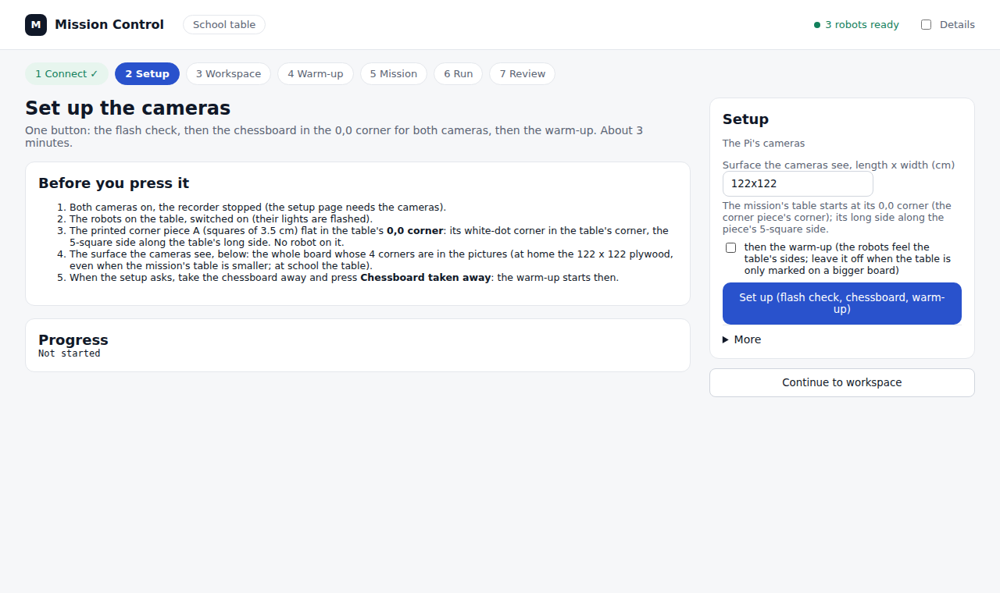
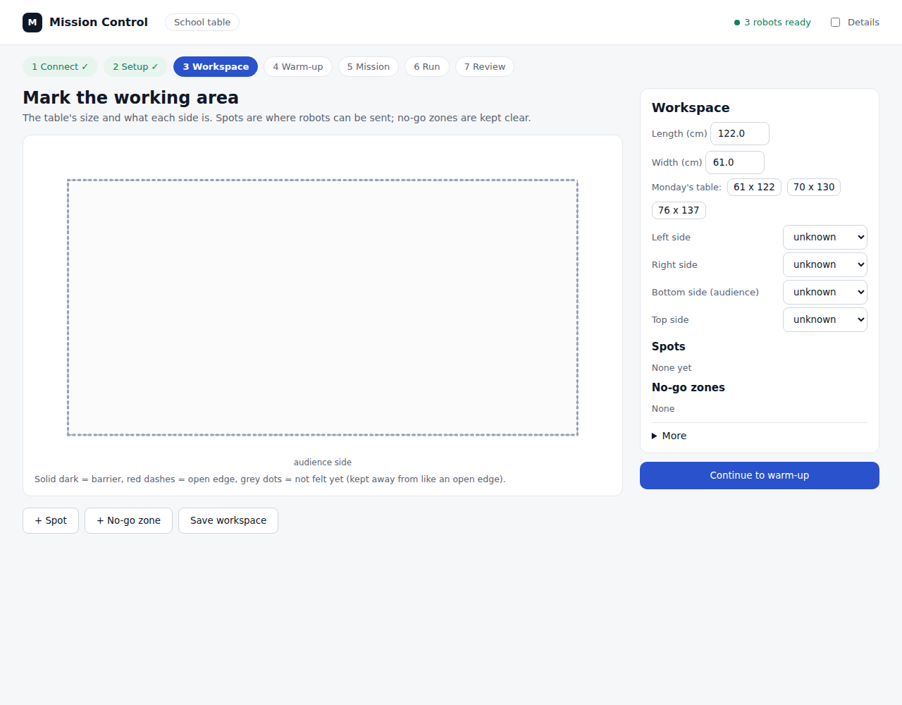
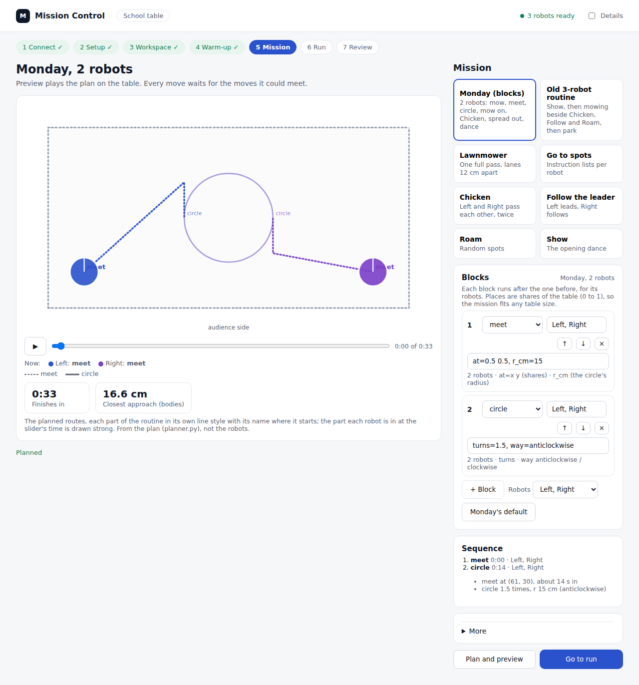
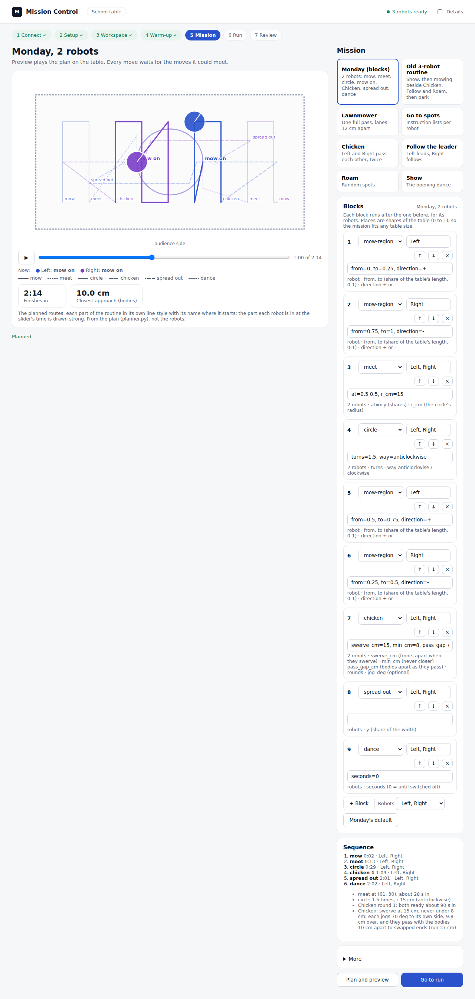
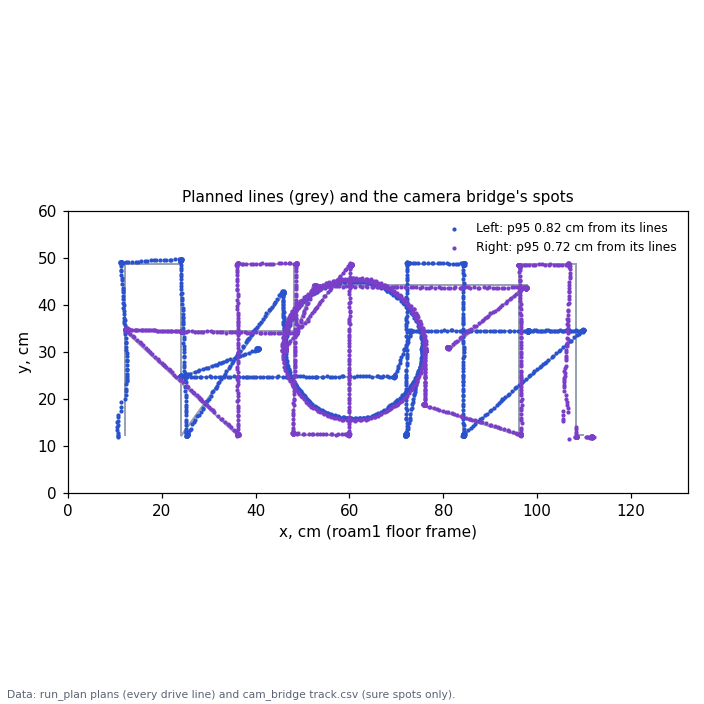

# Session plan, Wednesday 2026-10-28: practise Monday's moves on the home board

**Premise.** Monday's school demo is 2 robots (Left and Right) running the default mission in Mission Control:
mow, meet, circle, mow on, Chicken pass, spread out, dance. It needs firmware **2026-10-28a** (the arc for the
circle, the dance, the boot ID, the school WiFi "ISE"). All three robots still run 2026-10-25c (yesterday's flash did
not take). Today: flash, check, set up the cameras, then practise each block alone before the whole mission, on the
122 x 122 cm plywood (no boards on it), with a 61 x 122 cm "Monday table" marked on it with tape.

**Stages and time** (one person at the board; your minutes):

| Stage | What | Time |
|---|---|---|
| 0 | Pi ready: stop the DOE loop, get the new code | 5 min |
| 1 | **Flash 2026-10-28a** on Left and Right (Center optional) | 20 min (+5 for Center) |
| 2 | Bench checks: firmware, battery, settings, turns, dance | 10 min |
| 3 | Tape the Monday table, camera setup | 15 min |
| 4 | Practice 1-4: one block at a time | 25 min |
| 5 | The full mission, twice | 10 min |
| 6 | Wrap up: upload the video | 5 min |
| | **Total** | **about 1 h 30 min** (1 h 35 with Center) |

Every robot run uploads its logs by itself at its end. Tell me the time of each run; I analyse while you reset.

**The one command that stops everything** (in the Pi window, any time, even mid-run):

```
./run-fleet-pi.sh stopall
```

It presses Ctrl+C in every fleet run, presses Mission Control's Stop, and sends `stop` straight to all three robots.
In Mission Control, the red **Stop** button on the Run screen does the same for its own run.

---

## Stage 0. Get the Pi ready (5 min)

**Window: PowerShell on the laptop, logged into the Pi.** If you don't have one open: press the **Windows key**, type
`powershell`, press **Enter**. In the blue window type this and press **Enter**:

```
ssh st1maxfini@100.122.222.75
```

Type the Pi's password when asked (nothing shows while you type), press **Enter**. You should see a line ending in `$`.
Every "Pi window" command below is typed here.

1. Stop this morning's DOE loop (if it was started). Pi window:

```
cd ~/alvik-fleet-capstone
```

```
./run-fleet-pi.sh doe-stop
```

You should see `Sent Ctrl+C to the DOE loop: every robot stops; it then uploads` or `No DOE loop running.` If it was
running, wait 1 minute (it uploads), then check it has finished:

```
tmux ls
```

You should **not** see a line starting `doe:`. (If you still do after 3 minutes, tell me what `./run-fleet-pi.sh
doe-status` shows.)

2. Get today's code. Pi window:

```
git pull
```

You should see a list of files ending in `... files changed` (or `Already up to date.`).

3. Restart the start page so it runs the new code. Pi window:

```
sudo systemctl restart mirlt-launcher
```

Type the Pi's password if asked. Nothing is printed when it works.

4. If Mission Control was already open from the tab, close it so it reopens with the new code. Pi window:

```
./run-fleet-pi.sh mc-stop
```

You should see `Mission Control is closing.` or `Mission Control was not opened from the tab`.

---

## Stage 1. Flash firmware 2026-10-28a (20 min)

**Do it by USB cable today.** WiFi flashing only works if your `secrets.h` has an `OTA_PASSWORD` line *and* the
robot is idle; the cable has no such conditions.

**Important:** firmware 2026-10-26a, 27a and 28a have **never been through the Arduino compiler.** I compiled 28a on
this machine against stand-in Arduino headers (no errors) and checked every Alvik and ESP32 function it uses against
the real Arduino_Alvik library: all exist with the same arguments, and no name in the firmware clashes with the
library's or the ESP32 board package's names. **The first real compile is your Verify button (step 1.4).** If it
shows an error, nothing has been uploaded and nothing is broken: send me what step 1.4 says to send.

### 1.1 Get the new code onto the laptop

1. Open **File Explorer** and go into the project folder **alvik-fleet-capstone**.
2. Click the **address bar** at the top of the File Explorer window, type `powershell` and press **Enter**. A blue
   PowerShell window opens in the project folder (this is a laptop window, not the Pi).
3. In it, type and press **Enter**:

```
git pull
```

You should see `... files changed` or `Already up to date.`

### 1.2 Add the school WiFi to secrets.h (your password, never in the repo)

1. In File Explorer, open the folders **firmware**, then **home_lab**.
2. Find **secrets.h**.
   - If it is there: right-click it, **Open with**, **Notepad**.
   - If it is not there: right-click **secrets.example.h**, **Copy**, then right-click an empty spot, **Paste**.
     Rename the copy to exactly `secrets.h` (if Windows warns about changing the extension, click **Yes**). Open it
     with Notepad and type your **home** WiFi name and password into the `WIFI_SSID` and `WIFI_PASSWORD` lines.
3. Look for a line starting `#define WIFI_SSID2`. If it is not there, add these two lines at the end of the file:

```
#define WIFI_SSID2     "ISE"
#define WIFI_PASSWORD2 "type-the-school-password-here"
```

4. Replace `type-the-school-password-here` with the school WiFi's password, keeping the quote marks. If you don't
   have the password yet, delete both lines instead (the robot then only knows your home WiFi; flash again before
   Monday).
5. Optional, for WiFi flashing later: add a line `#define OTA_PASSWORD "a-password-you-choose"`.
6. **File, Save** in Notepad. Close Notepad.

`secrets.h` is never uploaded to GitHub (the repo ignores it). Don't send me its contents.

### 1.3 Open the right sketch in the Arduino IDE

1. Open the **Arduino IDE**.
2. **File, Open...**, go to the project folder, **firmware**, **home_lab**, choose **home_lab.ino**, **Open**.
3. Check you have the new copy: along the top of the code there is a row of tabs. You should see **dance.h** and
   **border.h** among them. In the **home_lab.ino** tab, near line 45, it should say
   `#define FW_VERSION "2026-10-28a"`. If not, you opened an old copy (see "Why yesterday's flash didn't take").
4. **Tools, Board**, **Arduino ESP32 Boards**, **Arduino Nano ESP32**. (If **Tools, Pin Numbering** is listed,
   leave it on **By Arduino pin (default)**.)
5. **File, Preferences** (on a Mac: Arduino IDE, Settings): **Compiler warnings** should be **None** or **Default**.
   ("More" or "All" turns some ESP32 warnings into errors.) Click **OK**.

### 1.4 Verify (the first real compile)

Click the **check mark** button (Verify) at the top left. Wait; the first ESP32 compile takes 1-3 minutes.

- **Good:** the Output panel at the bottom ends with `Sketch uses ... bytes (..%) of program storage space`.
- **Error:** orange text, and the bottom says `Compilation error`. Click **Copy error messages** (top right of the
  Output panel, or select all of the Output text with Ctrl+A, Ctrl+C) and paste it to me, plus a screenshot of the
  IDE. Also tell me the version shown under **Tools, Board, Boards Manager** for "Arduino ESP32 Boards" and under
  **Library Manager** for "Arduino_Alvik". Don't upload until it verifies.

### 1.5 Upload to each robot (Left first, then Right, then Center if you want)

For each robot:

1. Plug the USB-C cable from the laptop into the robot's **Nano ESP32** (the small board on top).
2. Switch the robot's **power switch ON** (the firmware talks to the motor board when it starts).
3. **Tools, Port**: pick the port that says **Arduino Nano ESP32** (for example `COM5`).
4. Click the **arrow** button (Upload). Wait about 1 minute.
   - **Good:** the Output ends with lines like `Download done.` / `File downloaded successfully` and no red error.
   - **"No DFU capable USB device available"** (or "no device found"): double-tap the Nano's tiny **reset** button
     (its light pulses), pick the port again in **Tools, Port**, click Upload again.
5. **Tools, Serial Monitor**, set the speed at the right of its bar to **115200 baud**. Press the Nano's reset
   button once. Within about 15 seconds you should see:
   - `home_lab 2026-10-28a ready, battery NN%`
   - `... joined WiFi <your home WiFi> as 192.168.1.250` (Left), `.252` (Center) or `.253` (Right).
6. Close the Serial Monitor tab, unplug the cable, leave the robot switched on.

### 1.6 Confirm all of them at once

**Pi window:**

```
./run-fleet-pi.sh check
```

You should see, at the end, one line per robot that is switched on:

```
Left: firmware 2026-10-28a, battery 87%
Right: firmware 2026-10-28a, battery 90%
```

**Pass:** Left and Right both say 2026-10-28a. If one still says 2026-10-25c, its upload did not reach it: repeat 1.5
for that robot, and watch the Output panel's last lines.

### Why yesterday's flash probably didn't take (most likely first)

1. **An old copy of the sketch was compiled.** The robots kept reporting exactly 2026-10-25c, which is what the
   laptop folder held before 26 Oct. If the laptop folder was not pulled, or the IDE opened a copy of `home_lab`
   from the Arduino sketchbook folder (Documents\Arduino), it compiles and uploads 25c again, and `check` shows no
   change. Step 1.3's check (dance.h tab, FW_VERSION line) rules this out.
2. **Verify failed and nothing was uploaded.** 26a-28a had never been compiled by Arduino; a compile error stops
   before the upload, and the message is easy to miss in the Output panel.
3. **The upload went to another port or failed half-way** (the "No DFU" case), or it went **over WiFi** while the
   robot was running something (updates are refused while an experiment runs) or without `OTA_PASSWORD` in
   secrets.h (then the robots never appear as network ports).

What did you do yesterday (cable or WiFi, and did the IDE say anything at the end)? That tells us which one.

---

## Stage 2. Bench checks (10 min)

Put Left and Right on the plywood, at least 30 cm in from the edges and 40 cm apart, switched on. **Pi window**
for each command.

1. **Firmware and battery** (nothing moves):

```
./run-fleet-pi.sh check
```

**Pass:** both say `firmware 2026-10-28a`, battery **50 % or more** (charge any robot under 50 % before stage 4).

2. **Calibrate** (each robot spins and rolls on the spot, about 65 s; keep hands clear):

```
./run-fleet-pi.sh calibrate
```

**Pass:** the robots spin, roll a little and stop; the last lines show each robot's firmware and battery.

3. **Settings read-back** (nothing moves): sends each robot its driving corrections and reads them back.

```
./run-fleet-pi.sh settings
```

**Pass:** for each robot you see `gyro_scale = 1.075` and `wheel_scale = 0.979`. (After a power-on a robot holds 1.000
for both; every run sends these again and reads them back before anything moves. This check proves the send and
read-back work on 28a.)

4. **Turn check, Left** (it turns a quarter turn on the spot). Put Left with one side against a straight edge (a
   book or ruler). Then, 4 times (press the **Up arrow** key then **Enter** to repeat a command):

```
./run-fleet-pi.sh turn Left
```

**Pass:** after 4 turns its side is back along the ruler with a gap under about 1 cm at the far corner (about 5
degrees). Then the same for Right: `./run-fleet-pi.sh turn Right`. **Fail** (a clear slant): run
`./run-fleet-pi.sh calibrate` once more and repeat; if it fails again, tell me before stage 4.

5. **Dance, Left** (new in 28a: spins and wiggles where it stands, coloured lights, about 8 s, then it stops):

```
./run-fleet-pi.sh dance Left
```

**Pass:** it spins one way, wiggles, spins back, the lights change colour, and it stops by itself. It should end
within a few cm of where it started. Then `./run-fleet-pi.sh dance Right`.

6. **Arc (the circle):** there is no bench command for it, because the robot steers the circle from its own position
   inside a planned run. Practice 2 below is the arc check.

---

## Stage 3. The Monday table and the cameras (15 min)

### 3.1 Where the 61 x 122 table sits on the plywood (tape)

The code puts Monday's table in the **camera's 0,0 corner**: x from 0 to 122 cm along one plywood edge, y from 0 to
61 cm in from that edge. The 0,0 corner is wherever you put the printed **corner piece A** (or the earlier one-system
print: the same 3.5 cm squares). Its **5-square side lies along x**, the table's long side.

1. Choose the plywood corner both cameras see best. Put **corner piece A** flat in that corner: the corner square
   with the **white dot** in the plywood's corner, the **short side (5 squares)** along one plywood edge. That edge
   is Monday's long side (x).
2. Measure **61 cm** in from that edge (at right angles to it), near each end of the edge, and lay a straight tape
   line through both marks, all the way across (122 cm). The half between the edge and the tape is the Monday table;
   the tape is its far long side.
3. Optional, two small tape crosses for the start spots (each robot's centre): **Left at 12 cm along the edge from
   the corner piece's corner and 12 cm in**; **Right at 12 cm from the other end of the same edge and 12 cm in**.
   Both robots face **across**, towards the tape line.

How the code treats the edges: the three plywood edges of the Monday table (x = 0, x = 122, y = 0) are real drops,
like the school table's. The tape side (y = 61) is not a drop here, but the mission keeps away from it as if it were
(an unknown side is treated as an open edge), so it is practised as the real table. A robot that overshoots the tape
has 61 cm of plywood left before a real edge: a safety margin you won't have Monday.

**The full 122 x 122 plywood** as the mission's table: Mission Control accepts it (type 122 and 122 in Workspace),
but it is outside every simulator sweep (61-76 x 122-137) and longer lanes than Monday. Use it only after the
61 x 122 runs, if at all (question 3).

### 3.2 Camera setup in Mission Control (one button)

**Browser on the laptop:** click the address bar, type `100.122.222.75:8091`, press **Enter**. Click the
**Mission Control** tab. If it says Mission Control is closed, click **Open Mission Control** and wait a few seconds.

Opening Mission Control also starts the recorder, and the setup needs the cameras to itself. So, **after** Mission
Control is open, stop the recorder. **Pi window:**

```
tmux kill-window -t fleet:rec
```

(`can't find window: rec` is fine: it wasn't running.)

1. **1 Connect**: click the **Robots** card, then the blue button at the bottom (it opens **2 Setup**).
2. **2 Setup** (see the screenshot below):
   - Corner piece A in the corner (3.1), robots on the plywood, switched on, off the paper.
   - In **Surface the cameras see**, type `122x122` (the whole plywood: the cameras find its 4 corners).
   - **Untick** "then the warm-up" (the warm-up feels the table's sides; on a taped table it would drive past the
     tape to the real edge).
   - Click **Set up (flash check, chessboard, warm-up)**. About 2 minutes. The robots' lights flash in turn.
3. **What good looks like** in the Progress box:
   - `2. the flash check ...` followed by a line naming each robot's lights.
   - `overhead: lens NNN cm up, board fit 0.xx px, table corners within N.N px, saved`
   - `side: lens NNN cm up, board fit 0.xx px, table corners within N.N px, saved`
   - **Pass:** both say `saved`; board fit under 1 px; table corners within 5 px; and each lens height within about
     5 cm of a tape measure from the floor to that camera's lens. **Tell me both lens heights and your tape
     measurements.**
   - **Fail** messages and what to do: `the chessboard was not found` (all of it in both pictures, flat, no glare);
     `the corner piece is turned` (white-dot square in the corner, 5-square side along the edge); `the table's
     corners were not found` (clear the plywood's corners).
4. Take the corner piece away.
5. Start the recorder again (the robot runs need its pictures). **Pi window:**

```
./run-fleet-pi.sh rec
```

You should see `Recording both cameras (overhead /dev/video0, side /dev/video2)` and `Recorder running`.



The Setup screen as you'll use it today: the surface the cameras see set to the whole plywood, the warm-up off
(Mission Control on this machine's simulator, not the Pi).

### 3.3 The workspace

**3 Workspace**: click **61 x 122** next to "Monday's table". Length shows 122, Width 61; the picture shows the table
long and low. Leave the four sides on **unknown**. Click **Continue to warm-up**, then (skip the warm-up) click
**5 Mission** at the top.



The Workspace after clicking 61 x 122: the table as the planner sees it, audience side (y = 0, the corner piece's
edge) at the bottom.

**Upload switch (once):** click **6 Run**, open **More** at the bottom right, set **upload** to **true**, click
**Save run settings**. Every robot run then uploads its logs when it ends.

---

## Stage 4. Practice, one block at a time (25 min)

**For every run:**
- Put the robots on their start spots (3.1, step 3), facing the tape. Within a few cm is fine: the run re-plans from
  where the camera sees them.
- Stand at the board with a **hand ready to catch**; the Run screen open on the laptop (or have it on your phone).
- **Stop at once** (red **Stop**, or `./run-fleet-pi.sh stopall` in the Pi window, then pick the robot up if it still
  moves) if: a robot heads for a plywood edge less than about 5 cm away without turning; the two robots come within
  about 5 cm and are still closing; a robot spins on the spot without stopping; anything tips.
- **After it ends**, write down the time and the result on the Run screen; the upload runs by itself (stage 6 says
  how to check). Reset the robots while I look.

**How to set up each practice in Mission Control** (5 Mission screen, the **Monday (blocks)** card selected):
1. Click **Monday's default** (below the blocks) to start from the full list.
2. Delete the blocks you don't need with their **x** buttons (listed per practice below).
3. Click **Plan and preview**, then the **play** button under the table to watch it.
4. Click **Go to run**, then **Run (robots)**.



Practice 2 set up: only "meet" and "circle" left, planned on 61 x 122 (0:33, closest 16.6 cm); dashed = drive to the
circle, solid = the circle (Mission Control on this machine; plan only).

**The same from the Pi window, if Mission Control gives trouble** (identical runs, uploaded at the end; Ctrl+C in that
window stops every robot):

```
./run-fleet-pi.sh practice mow 61x122
```

(the others: `practice circle`, `practice chicken`, `practice dance`; the full mission: `./run-fleet-pi.sh monday
61x122`.)

| Practice | Keep only these blocks | Robots | What you should see | Pass | Simulator (dry rehearsal) |
|---|---|---|---|---|---|
| **1. Mow one region** | block 1: `mow-region`, Left, `from=0, to=0.25, direction=+` | Left | Left drives straight across towards the tape (stopping about 12 cm short), turns a quarter, moves 12 cm along, turns, drives back; about 3 lanes, then stops. | Result `done`; the lanes look straight and parallel; never closer than about 4 cm to a plywood edge | done in 13.9 s (plan 13.2); closest to an edge 4.6 cm |
| **2. Meet and circle** (the arc check) | blocks 3 and 4: `meet`, `circle` | Left, Right | Each drives to its side of a circle in the middle of the table, they wait for each other, then both drive round it together 1.5 times anticlockwise (15 cm radius) and end on swapped sides. | `done`; it looks like a round circle, not a polygon or a spiral; the robots stay about a circle apart (closest 15 cm in the plan) | done in 37.0 s (plan 32.6); closest bodies 15.1 cm |
| **3. Chicken pass** | block 7: `chicken` | Left, Right | Both go to ready spots on the middle line, wait for each other, drive at each other; when their fronts are about 15 cm apart both turn steeply to their own side, pass about 10 cm apart, and drive on to the other's end. | `done`; they swerve at the same moment and never touch; they look like they're passing, not stopping | done in 25.9 s (plan 22.9); closest bodies 10.8 cm |
| **4. Spread out and dance** | blocks 8 and 9: `spread-out`, `dance`; change the dance block's settings box to `seconds=10` | Left, Right | They go to a third and two thirds along the middle line, face the tape, dance 10 s and stop. | `done`; both dance and stop by themselves | done in 17.6 s (plan 16.4); closest bodies 27.8 cm |

<sub>Simulator: `FLEET_DRY=1 ./run-fleet-pi.sh practice <block> 61x122`, both simulated cameras through the camera
bridge; closest figures are the simulator's truth (body outlines), not the camera.</sub>

**Cautious, then bolder:** run practice 1 first. If it passes, 2, then 3, then 4. If one fails, run it once more
before moving on; if it fails twice, stop and tell me (the logs are uploaded).

---

## Stage 5. The full mission (10 min, twice)

1. **5 Mission**: click **Monday's default**, then **Plan and preview** (10-30 s). It should say about **2:14**
   and closest about 10 cm.
2. **Go to run**, robots on their start spots, **Run (robots)**.
3. What you should see, in order: both mow their end quarter in short lanes; they meet in the middle and circle 1.5
   times; each mows the other side's inner quarter; they go to the middle line and play Chicken (pass); they spread
   out and dance.
4. **The dance goes on until the robot is switched off** (Monday's end). The run itself has ended by then, so the
   Stop button is greyed out. To end it: press the **x (cancel) button** on each robot's top, or **Pi window**
   `./run-fleet-pi.sh stopall`.
5. **Pass:** every block happens in order, no touching, no robot within about 4 cm of a plywood edge.

The full mission in the simulator (dry rehearsal of `./run-fleet-pi.sh monday 61x122`): see "Dry rehearsal" below.



Monday's default planned on 61 x 122 in Mission Control (plan only, this machine).

---

## Stage 6. After each run and at the end

**After each robot run** (Mission Control with upload on, or `practice` / `monday` from the Pi window): the logs go
to GitHub by themselves, as a release with its own tag, `mission-<date-time>-...`. Nothing to do; reset the robots
and tell me the run's time. I run the heat tracker (`python3 tools/analysis/heat_tracker.py <session folder>`) on
each real session.

If you want to see it: Pi window, `ls -t logs/mission-control/runs | head -3` shows the newest Mission Control runs.

**At the end of the session, start the video upload straight away** (it takes a while; it runs while we talk).
Pi window:

```
./run-fleet-pi.sh stop
```

It stops the recorder and uploads today's video. Leave the window open until it says it has finished.

---

## If something goes wrong

| What happens | What to do |
|---|---|
| **Verify shows an error** | Nothing uploaded, nothing broken. Send me the copied error text, a screenshot, and the two versions (step 1.4). The robots keep 25c meanwhile: you can still practise block 1 (mow) only, which needs no 28a moves |
| **Upload fails** ("No DFU", "no device") | Double-tap the Nano's reset button, pick the port again, Upload again. Still failing: another USB cable (some are charge-only) |
| **`check` still shows 2026-10-25c** after an upload | The upload didn't reach that robot: redo 1.5 for it and look at the Output's last lines; check step 1.3 (dance.h tab) |
| **A robot isn't heard** ("Robots heard:" without it; or Mission Control: "no robot") | Is it switched on, lights on? Power it off and on, wait 20 s, `./run-fleet-pi.sh check` again. Serial Monitor (1.5 step 5) shows whether it joined the WiFi |
| **Setup: the chessboard or the corners not found; a camera dark** | Pi window `tmux ls`: if `fleet` is listed, run `tmux kill-window -t fleet:rec` and press Set up again. Check the pictures at `100.122.222.75:8000` (overhead) and `:8001` (side) only while the recorder runs. A dark side picture: room light on, nothing over the lens |
| **Run refused: "Plan refused: ... under 8 cm"** or "no plan" | Click **Monday's default** again (a block edit may have broken it), Plan and preview again. Send me the message |
| **Run refused: "... is driving the robots"** | Something else is running (the DOE loop?): Pi window `./run-fleet-pi.sh stopall`, wait a minute, try again |
| **"is not on its start spot"** | Move it to its tape cross, facing the tape |
| **A robot heads for an edge / the robots close in** | Red **Stop** (or Ctrl+C in a `practice` / `monday` window), or Pi window `./run-fleet-pi.sh stopall`; pick it up if it still moves |
| **The camera loses a robot** (it stops, "camera" messages) | Let it stop. Take it away, Stop, place it on its spot, run again; tell me the time |

---

## Dry rehearsal (this machine's simulator, before you started)

The plan's own commands with `FLEET_DRY=1` (simulated robots and both simulated cameras through the camera bridge):

| Command | Result | Took / planned | Closest bodies (truth) | Closest to an open edge (body) |
|---|---|---|---|---|
| `practice mow 61x122` | done | 13.9 / 13.2 s | - (one robot) | 4.6 cm |
| `practice circle 61x122` | done | 37.0 / 32.6 s | 15.1 cm | 5.0 cm |
| `practice chicken 61x122` | done | 25.9 / 22.9 s | 10.8 cm | 5.0 cm |
| `practice dance 61x122` | done | 17.6 / 16.4 s | 27.8 cm | 5.0 cm |
| `monday 61x122` (the full mission) | done, every block | 125.7 / 133.5 s | 9.7 cm (in Chicken, 114 s) | 4.0 cm (Left, mowing, 4.7 s) |

<sub>Closest figures are from the simulator's truth (the robots' 9.5 x 9.5 cm outlines), not the cameras. The simulator
treats the tape side (y = 61) as a real edge, which is stricter than the plywood.</sub>

The 4 practice programs also plan on 70 x 130 and 76 x 137 (tests). The full 122 x 122 plywood as the table:
it plans (2:55, closest 10.0 cm, meet at the plywood's middle), not run in the simulator.



The dry `monday 61x122` run: each robot's camera spots stay within 0.82 cm (Left) and 0.72 cm (Right) of its planned
lines for 95 % of readings (data: the simulated cameras through the camera bridge, against run_plan's plan).

---

## What changed in the code for today

- **Mission Control's camera setup used the mission table's size for the chessboard solve.** The cameras find the
  4 corners of the whole surface; with Monday's 61 x 122 table chosen on the 122 x 122 plywood, the solve would have
  paired the plywood's corners with a 122 x 61 rectangle (a wrong or refused calibration). The Setup screen now has
  **Surface the cameras see** (kept for next time; at school leave it as the table's size) and a switch to leave the
  warm-up out. (tools/fleet/mission_control.py, mission_control.html; fleetmap.py keeps `surface_cm`.)
- **`./run-fleet-pi.sh stopall`**: there was no single command that stops everything while a run holds the robots
  (`robot_cmd.py` and the console cannot open the log port then). New tools/fleet/stop_all.py.
- **`./run-fleet-pi.sh practice mow|circle|chicken|dance`**: one block alone from the Pi window, the same run as
  Mission Control's (tools/fleet/examples/practice/*.json).
- **`./run-fleet-pi.sh settings`** (read-back on the bench) and **`dance <robot>`** (28a's dance alone);
  `robot_cmd.py --then` sends several commands in a row.
- Tests: tools/fleet/tests/test_practice_day.py (17).

**Not changed, still a gap:** Mission Control's setup needs the recorder off, while opening Mission Control starts it
and the robot runs need it on (stage 3.2 stops and restarts it by hand).

---

## Questions for Nick

*Substantive*
1. **The warm-up at school:** today it's off (a taped table has no real far edge). At school the table's 4 edges are
   real. Run the warm-up there (it finds the sides, about a minute), or skip it and keep every side "unknown" (kept
   away from like an open edge, as today)?
2. **Ending the dance:** the run ends when the dance starts, so Mission Control's Stop is greyed out while the robots
   dance. Fine (cancel button / switch off), or should the Stop button stay live and stop dancing robots too?
3. **The 122 x 122 table:** do you want to practise anything at that size? It is outside every simulator sweep.

*Other*
4. Yesterday's flash: cable or WiFi, and did the IDE say anything at the end? Was the laptop folder pulled first?
5. Does your secrets.h have an `OTA_PASSWORD` line? (Then later flashes can go over WiFi.)
6. The two lens heights by tape measure (stage 3.2).

---

## DOE notes on the numbers chosen here

| Number | Value | DOE? |
|---|---|---|
| Battery to start practice | 50 % | Could be set by data: the DOE loop's turn and straight errors against battery (logs already uploaded). Until then a margin over the engine's 25 % floor |
| Setup pass marks | board fit < 1 px, corners < 5 px, lens height within 5 cm of tape | Yes: the taped-marks test (question 34) gives the position error per setup result; that sets these marks |
| Turn pass | under 1 cm gap after 4 turns (about 5 deg) | Already in the DOE backlog (turn check rows); kept from 27 Oct |
| Stop when | within about 5 cm of an edge, or robots within 5 cm and closing | No DOE: a safety call for a person at the board |
| Practice dance | 10 s | No DOE: display only |
| `stopall`: 3 copies 0.2 s apart | 3 x 0.2 s | No DOE: a repeated `stop` is harmless |
| Start spots 12 cm in | from the code (lane inset) | No DOE here (geometry; question 47 covers lane 1's edge distance) |

---

## Sweep 1: tests that may now be necessary

- Board: the circle's real radius error (camera) against 15 cm; over 1 cm means the arc_kr DOE (1 / 2 / 4).
- Board: Chicken's swerve and pass gap on real robots (camera closest approach against the plan's 10 cm).
- Pi: Mission Control's one-button setup with the recorder running (it should say "stop the recorder", not fail
  quietly); a test of setup then run without touching the terminal.
- Pi: `stopall` during a live `practice` run (tmux Ctrl+C, then UDP stop) and during a Mission Control run.
- Firmware: the first Arduino compile of 28a (Nick's Verify) and a check that `run dance` and `fs Z` stop on the
  cancel button on a real robot.

## Sweep 2: possible inaccuracies in what this plan relies on

- The firmware review used stand-in headers and the Arduino_Alvik library's current GitHub header, not the library
  version installed on the laptop; an older library could lack a function (all used functions are old ones).
- "Why the flash didn't take" is a ranked guess from one fact (all three still reported 25c); no IDE output was seen.
- Start spots, timings and closest distances come from the simulator (robots that turn and drive almost perfectly);
  real runs will be slower and less exact.
- The simulator treats the tape side as a real edge; on the plywood it is not, so edge figures there are stricter
  than reality.
- The setup pass marks and the battery floor are chosen, not derived (table above).
- The corner piece's direction (5-square side along x) comes from the code's chessboard solve, checked in simulated
  pictures only.
