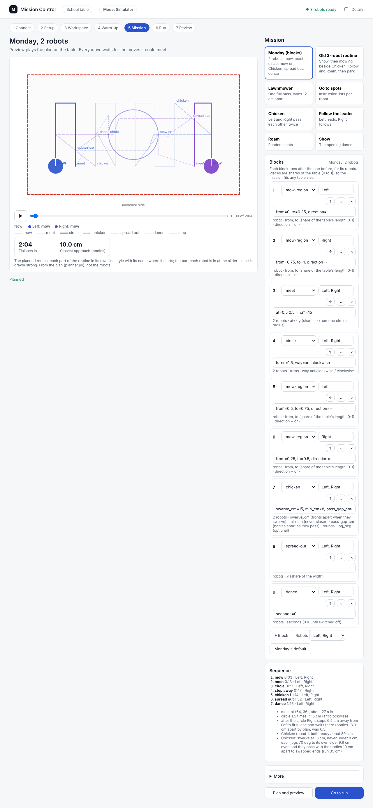
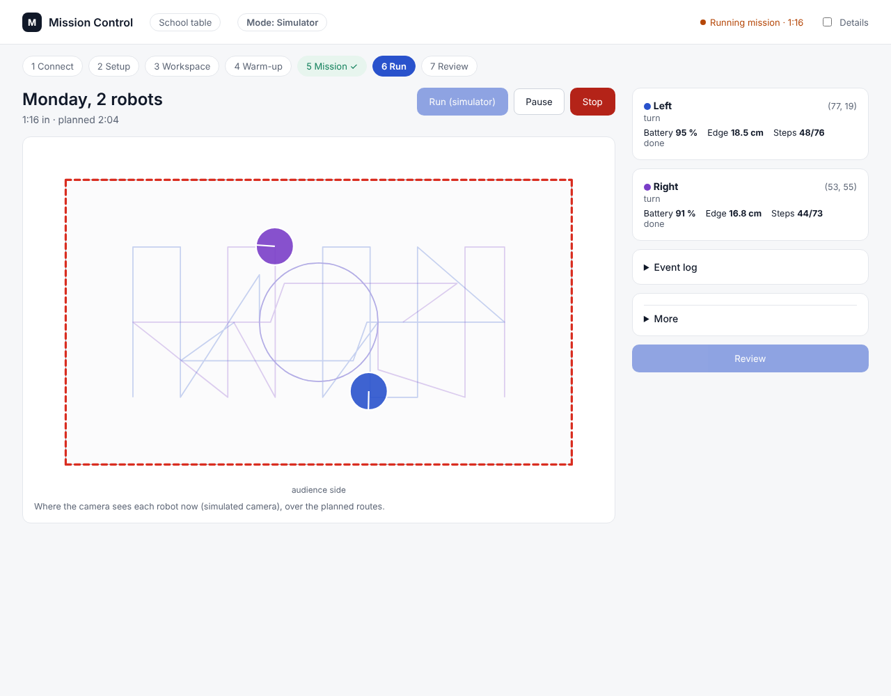
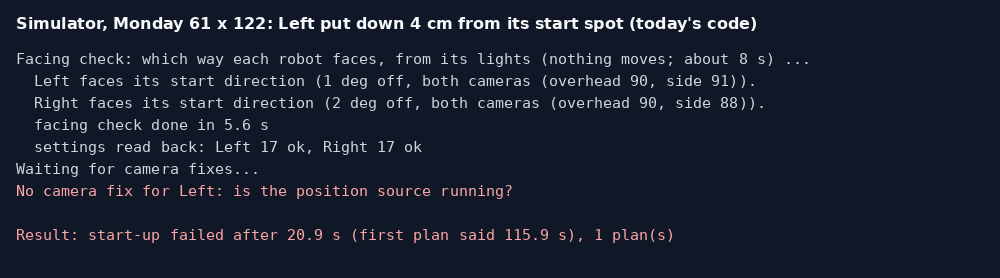

# Monday run sheet: the school demo, 2 Nov 2026

**Premise.** Monday: Left and Right run Monday's default mission in Mission Control on the school table: mow, meet,
circle, mow on, Chicken, spread out, dance. About 2 minutes of driving. Build B (approved). Print copy:
[2026-11-02-monday-run-sheet.html](2026-11-02-monday-run-sheet.html) (letter paper: 3 pages for the school, a 4th with the rehearsal).

**Arrive 45 minutes before you present.** Setup is about 30 minutes. The rest is spare.

| Stage | What | Time |
|---|---|---|
| 1 | Power, network, cameras, code, Mission Control | 12 min |
| 2 | Camera setup (click corners), lighting check, warm-up | 5 min |
| 3 | Place the robots, plan | 3 min |
| 4 | The run | 2-3 min |
| 5 | After: upload, robots off | 3 min |

**The one command that stops everything** (Pi window, any time):

```
./run-fleet-pi.sh stopall
```

At school, the red **Stop** button on Mission Control's Run screen comes first: `stopall`'s direct `stop` goes to the
robots' home addresses, which may not reach them on another network (see "Still unknown"). If a robot still moves:
pick it up and switch it off.

## Being built, and still unknown

**Being built now (Nick, 29 Oct 15:41).** Nothing for you to do for these; this sheet already assumes them.
- **The robots straighten themselves up before the run:** a turn on the spot and a short drive onto their start spot.
- **Left's distance-sensor stop limit goes to 10 cm** (it was stopping for the floor at 12 cm, about once a drive).
- **Only the side camera sees a robot:** a 5 cm start allowance, and robots drive through a camera blind spot on their
  own wheels.

**If they are not in by Monday,** the start is stricter. A robot turned more than 15 deg stops the start with words
saying which way to turn it (the facing check). A robot more than **3 cm** off its start spot (as the camera
sees it) stops the start: nothing moves, and after about 20 s the run says `No camera fix for Left: is the position
source running?` The words blame the camera, but the cause is the spot. **Tested today in the simulator:** Left 4 cm
off and 6 cm off both stopped this way; Left 2 cm off ran the whole mission (108 s). How to avoid it: put each robot
within 2 cm of its cross, straight across; if it happens, nudge the robot onto its cross and press **Run (robots)**
again (nothing moved, nothing to reset). Data: appendix B.

**Still unknown (needs you):**

| Unknown | What it changes at the table |
|---|---|
| The school network's exact name and password (it has "ISE" in it) | You type them into `secrets.h` before the flash (appendix A) and into the Pi (appendix A). Without them the robots and the Pi cannot meet at school |
| Whether the school network lets the robots and the Pi talk (some school networks ask for a username, or block devices from seeing each other) | If it does not, no robot is heard. The backup is your phone's hotspot; that is a decision (question 1) |
| Firmware **2026-10-29a** flashed on Left, Right and Center | Needed for the facing check (which way each robot faces, from its lights). Without it, the check cannot tell front from back after the warm-up. One flash also carries the school network |
| Left's stop limit | Decided (10 cm, being built). Nothing for you to do |
| The side-camera-only start rule | Decided (5 cm, being built). Nothing for you to do |

## 0. What to pack

- [ ] The Pi and its power supply
- [ ] The USB drive (plug it into the Pi **before** switching the Pi on)
- [ ] Both cameras, their mounts and their USB cables
- [ ] The laptop and its charger
- [ ] Left and Right, plus Center (the spare; it also helps in the warm-up). All three charged to 90 % or more
- [ ] The USB-C **data** cable (a charge-only cable cannot flash or talk to a robot)
- [ ] Tape (for the start crosses) and a tape measure (the setup measures the table itself; the tape is for the
      crosses and a check)
- [ ] A power strip or extension lead (Pi, laptop, cameras' chargers if any)
- [ ] This sheet, printed

## 1. Setup at school, in order (12 min)

### 1.1 The network

The robots and the Pi must be on **the same network**; the laptop reaches the Pi over Tailscale.

1. Plug the USB drive and both cameras into the Pi. Plug the Pi into the power strip. Wait 2 minutes.
2. On the laptop, join the school WiFi (or your hotspot, if that was the decision). In the taskbar, click the
   **Tailscale** icon: it should say **Connected**.
3. **Window: PowerShell on the laptop.** Press the **Windows key**, type `powershell`, press **Enter**. Type this and
   press **Enter**:

```
ssh st1maxfini@100.122.222.75
```

Type the Pi's password (nothing shows while you type), press **Enter**. You should see a line ending in `$`. This is
the **Pi window**.
- **No answer after 30 s** (`Connection timed out`): the Pi did not reach the internet. Is the Pi's light blinking
  (it is on)? Give it 2 more minutes, then try again. Still nothing: go to the phone hotspot backup, if it was set up.

4. Switch on **Left**, **Right** and **Center**. Wait 30 s (each tries your home WiFi and the school's in turn). Pi
   window:

```
cd ~/alvik-fleet-capstone
```

```
./run-fleet-pi.sh check
```

You should see `Robots heard: Center, Left, Right`, then one line each: `Left: firmware 2026-10-29a, battery NN%`.
- **`Robots heard: none`:** the robots are not on the Pi's network. Switch one off and on, wait 30 s, try again. Still
  none: the school network blocks them (question 1).
- **Battery under 60 %:** use Center in that robot's place (step 3.1).

### 1.2 The cameras, placed like at home

- **Overhead:** roughly above the middle of the table, high enough that the whole table and a hand's width round it
  are in the picture.
- **Side:** high at one end or side, looking down across the table at an angle, so it also sees the whole table,
  including the far end.
- Neither camera's cable in the picture or across the table.

### 1.3 The code, the start page, Mission Control

1. Pi window:

```
git pull
```

You should see `Already up to date.` (you pulled the night before). If it lists changed files, also type these two:

```
sudo systemctl restart mirlt-launcher
```

```
./run-fleet-pi.sh mc-stop
```

2. **Browser on the laptop:** click the address bar, type `100.122.222.75:8091`, press **Enter**. Click the **Mission
   Control** tab. If it says Mission Control is closed, click **Open Mission Control** and wait a few seconds.
3. **1 Connect:** click the **Robots** card. The pill at the top must say **Mode: Robots**. (If you reload the page,
   click the **Robots** card again: the page forgets your pick.)

### 1.4 The start crosses

Tape three crosses on the table, each line about 15 cm long: all three **17 cm in from the long side nearest the
audience**; Left's **17 cm from the left short end**, Right's **17 cm from the right short end**, Center's at **half
the length** (measure it with the tape, or put it by eye now and move it after step 2.6 tells you the length). The long
side nearest the audience is the **audience side** (y = 0); the corner where it meets the left short end is **0,0**.

## 2. Camera setup, lighting check, warm-up (5 min)

**Changed 29 Oct evening (your decision, 20:20-20:27): you only click corners.** No corner piece, no typing the table's
size, no stopping the recorder. The robots measure the table: their lights flash, each rolls 10 cm out and back.

1. Put **Left, Right and Center on their crosses**, switched on, facing away from the audience (section 3.1 says how).
2. **2 Setup:** under **1. Robots**, all three ticked. Leave **then the warm-up** **ticked** (the table's edges are real:
   the robots feel all four sides, and the mission plans with what they find).
3. Click **Take pictures**. About 10 s (it starts the recorder by itself if it is not running). You should see the
   overhead and the side pictures.
4. In **each** picture click the table's 4 corners **in this order** (a red number appears on each):
   - **1**: where the audience side meets the **left** end (this is 0,0)
   - **2**: the audience side's **other** end (1 to 2 is x, along the audience side)
   - **3**: the corner **opposite 1**
   - **4**: the **left** end's far corner (1 to 4 is y)

   Click on the table's very corner. A wrong click: **Undo**. The same table corner must be 1 in both pictures.
5. Hands off the table. Click **Measure (robots flash and move)**. About 1 minute, then the warm-up about 1 minute:
   each robot flashes its left light, then its right; each rolls 10 cm and back; then they creep into the corners and
   feel the sides, and go back to their crosses.
6. **Read the result line**, e.g. `Your table measures 128 x 72 cm (checks: lights 128.3 x 72.1; roll ...). Cameras:
   overhead 255 cm up, tilted 3 deg, side 170 cm up, tilted 28 deg; they agree on the robots within 0.6 cm.`
   - **Good:** the size within about 2 cm of your tape, the cameras agree within 2 cm.
   - A line starting **WARNING** says which check disagreed and what was left out; go on unless it says the cameras
     are not lined up (then click **New pictures** and the corners again).
   - Below it, one line per side, e.g. `left side: open edge, 3.0 cm further in than marked`, then
     `the warm-up's sides are in the map: the mission plans with them`. Nothing to click.
7. Under **Lighting**, click **Check the lighting**:

| It says | Do this |
|---|---|
| `overhead camera: fine (...)` and `side camera: fine (...)` | Go on |
| `... low (...)`, `it works, with little margin` | Go on; if you can, dim the light over the table |
| `... only 2 of 3 robots found: check every robot is in this camera's picture` | Move that camera so all three robots are in its picture, then step 3 again |
| `overhead camera washed out: ...` | Close the blinds or turn off the lamp above the table; **Check the lighting** again. If it stays washed out: go on (the side camera carries it) |
| `side camera washed out: ...` | Close the blinds, or move the lamp so it does not shine across the table; check again |
| `no picture (is the recorder running?)` | Pi window `./run-fleet-pi.sh rec`, then check again |
| `no picture (no calibration saved)` | The setup did not save: steps 3-5 again |

8. **3 Workspace:** the **Length** and **Width** now show the measured size. Click **More**. Under **Robot start
   spots** type these three rows (x, y, facing), then click **Save workspace**:

| Robot | x | y | facing |
|---|---|---|---|
| Left | 17 | 17 | 90 |
| Center | half the length (e.g. 64 for 128) | 17 | 90 |
| Right | length minus 17 (e.g. 111 for 128) | 17 | 90 |


The Setup screen with the 4 corners clicked in each picture (simulator, 137 x 76).


After **Measure**: the robots' steps, the result line and the warm-up's sides (simulator; the WARNING there is the
simulator's robot body, which always reads small).

**If the measure is known to be wrong** (the tape says otherwise by more than 3 cm): **More** under **Setup**, type
the size into **Table size override**, click **Measure** again. **The old chessboard way** is still there under
**More**, **Setup way** (it stops and restarts the recorder itself).

## 3. Placing the robots, and the run (3 min + the run)

### 3.1 Placing

1. Lift **Center** off the table; leave it switched on, out of the way (the spare).
2. **Left** and **Right** on their crosses: the tape lines stick out evenly on all four sides of the robot.
3. Each robot's **front** (the side with the distance sensor) faces **away from the audience**, straight across the
   table: its sides parallel to the short ends.
4. That's all. **The robots straighten themselves up before the run** (being built): they turn and drive onto their
   crosses themselves.

**Spare:** if Left or Right will not answer or is under 60 %, put Center on its cross and, on **5 Mission**, after
**Monday's default**, set **Robots** to `Left, Center` (Center takes Right's place) or `Center, Right`.

### 3.2 Plan, then run

1. **5 Mission:** click **Monday's default**, then **Plan and preview** (10-30 s). You should see **Finishes in**
   about 2:00 (1:56 on 61 x 122, 2:04 on 128 x 72, 2:16 on 76 x 137) and **Closest approach (bodies)** about 10.0 cm.
   Optional: the **play** button under the table shows the whole routine.
2. Click **Go to run**. Check the pill says **Mode: Robots**.
3. Stand at the table, a hand ready to catch. Click **Run (robots)**.



Monday's default planned on a 128 x 72 table (simulator): 2:04, closest 10.0 cm.

**What the audience sees, in order:**
1. The robots' lights flash, one side at a time, a few seconds (the facing check: which way each robot faces).
2. Each robot straightens up on its cross (being built), then stands a moment.
3. Both mow their own end in short lanes across the table: drive, quarter turn, 12 cm over, back. A short pause after
   each turn (they wait for the cameras to agree).
4. They meet in the middle and circle each other 1.5 times, ending on swapped sides.
5. One steps a few cm aside; then each mows the inner part of the other's side.
6. **Chicken:** they line up facing each other and drive straight at each other; at 15 cm both swerve and pass about
   10 cm apart.
7. They spread out and dance (spins, wiggles, coloured lights) until switched off.

**Stop at once** (red **Stop**, then pick the robot up if it still moves) if a robot heads for an edge less than about
5 cm away without turning, the two come within about 5 cm and are still closing, or one spins without stopping.



The Run screen at 1:16 of 2:04 (simulator): each robot's dot over the planned routes, battery, distance to the edge,
steps done.

## 4. If something goes wrong

| What you see | What to do |
|---|---|
| `Robots heard: none`, or `Not heard from: Left (heard: ...)` | Switch that robot off and on, wait 30 s, `./run-fleet-pi.sh check`. None heard at all: a network problem (question 1) |
| `No camera fix for Left: is the position source running?` | Left is off its cross (more than 3 cm, until the straighten-up is in) or the cameras lost it. Nudge it onto its cross; **Run (robots)** again |
| `Left is facing the wrong way (about 179 deg off): turn it round ...` (until the straighten-up is in) | Turn it round; **Run (robots)** again. Nothing moved |
| `Left is turned about 18 deg to its left (its start allows 15)` (until the straighten-up is in) | Straighten it; **Run (robots)** again |
| `No camera fix with a heading for Left: it was calibrated just now and its roll moved it ...` | Put it back on its cross, facing across; **Run (robots)** again (no calibration this time) |
| `Not calibrated since power-on` | Pi window `./run-fleet-pi.sh calibrate` (about 65 s each; hands clear), robots back on their crosses, **Run (robots)** |
| `Settings not confirmed by the robot ...` or `did not start their follow run` | `./run-fleet-pi.sh stopall`, switch that robot off and on, wait 30 s, **Run (robots)** again |
| `Plan refused ... under 8 cm`, `no plan`, or `no priority order gave a plan` | **5 Mission:** **Monday's default**, **Plan and preview**, robots on their crosses, run again |
| The run ends mid-mission with `no plan` (a robot stopped for nothing) | The same: **Monday's default**, **Plan and preview**, robots on their crosses, run again (Left's 10 cm limit, being built, should end this) |
| `... is driving the robots on this Pi` | Pi window `./run-fleet-pi.sh stopall`, wait 1 minute, try again |
| Setup: `... corners go round the table the other way ... swap 2 and 4` | In that picture, **Clear**, then click 1, 2, 3, 4 again with 2 on the audience side's other end |
| Setup: `The two pictures are numbered differently` | **Clear** the side picture; click its 1 on the same table corner as the overhead's 1 |
| Setup: `No robot's lights were seen` / `no robot answered` | Robots on the table and switched on; `./run-fleet-pi.sh check`; **Measure** again |
| Setup: `no picture from the overhead camera` | Pi window `./run-fleet-pi.sh rec`; **Take pictures** again |
| `Frames go to ... ON THE PI'S CARD (no USB drive found ...)` | The USB drive is not in: plug it in, `./run-fleet-pi.sh rec`, run again |
| A robot goes silent mid-run (WiFi) | The other carries on round it (a silent robot counts as a brick). Let it finish |
| A robot heads for an edge, or the two close in | Red **Stop** (or Pi window `./run-fleet-pi.sh stopall`); pick it up if it still moves |
| The dance doesn't stop | Expected: switch each robot off (or press the **x** button on its top) |



Today's code in the simulator: Left put down 4 cm from its cross; the facing check passes, then no camera fix comes
and the start stops at 20.9 s with nothing moved.

## 5. After

1. **Start the video upload straight away** (it takes a while; it runs while you pack the rest). Pi window:

```
./run-fleet-pi.sh stop
```

It stops the recorder and uploads the day's video. Each run's logs already went up by themselves. Leave the Pi on and
the window open until it says it has finished. If you have to unplug before then, tell me: the upload can be
finished from home.

2. **Turn the robots off:** each robot's power switch (this also ends the dance). Center too.
3. Tell me the time of each run.

## 6. Rehearsal at home, the night before (10 min)

Do it on the full 122 x 122 plywood (all four edges are real). Robots charged; firmware flashed (appendix A).

- [ ] **1 min.** Pi window: `cd ~/alvik-fleet-capstone`, then `git pull`. You should see a list of changed files or
      `Already up to date.`
- [ ] **1 min.** Pi window: `./run-fleet-pi.sh check`. All three say `firmware 2026-10-29a`, battery 90 % or more.
- [ ] **1 min.** Pi window: `nmcli connection show`. A line named `school` (or `hotspot`) is listed (appendix A).
- [ ] **1 min.** Laptop browser `100.122.222.75:8091`, **Mission Control**, **1 Connect**, **Robots**. Pill: **Mode:
      Robots**. **6 Run**, **More**: **upload** says **true** (if not: set it, **Save run settings**).
- [ ] **1 min.** Three crosses on the plywood: 17 cm in from the edge nearest you, 17 cm from each end, one in the
      middle (61 cm).
- [ ] **3 min.** Section 2, steps 1-8, exactly as at school (warm-up ticked). The result line should say about
      `122 x 122`; the start spots are Left `17 17 90`, Center `61 17 90`, Right `105 17 90`.
- [ ] **1 min.** **5 Mission:** **Monday's default**, **Plan and preview**: it plans and shows a finish time.
      Don't run it: 122 x 122 is outside every simulator test. Robots off. Pack (section 0).

Tell me anything that did not match this sheet; it is cheaper to fix on Sunday night than at the school.

---

## Appendix A. Before Monday, at home: the school network and firmware 2026-10-29a

**A1. The school network on the robots (in the flash).** Laptop:
1. Open **File Explorer**, go into the project folder **alvik-fleet-capstone**. Click the **address bar**, type
   `powershell`, press **Enter**. In that window type `git pull`, press **Enter**.
2. In File Explorer open **firmware**, then **home_lab**. Right-click **secrets.h**, **Open with**, **Notepad**.
3. Find the two lines starting `#define WIFI_SSID2` and `#define WIFI_PASSWORD2` (if they are not there, type them at
   the end). Put the school network's exact name and password between the quote marks:

```
#define WIFI_SSID2     "the-exact-school-network-name"
#define WIFI_PASSWORD2 "the-school-password"
```

4. **File, Save.** Close Notepad. (`secrets.h` never goes to GitHub.)

**A2. Flash 2026-10-29a, by USB cable, on Left, Right and Center.**
1. **Arduino IDE:** **File, Open...**, the project folder, **firmware**, **home_lab**, **home_lab.ino**, **Open**. In
   the **home_lab.ino** tab, near line 45: `#define FW_VERSION "2026-10-29a"`. (Anything else: an old copy is open.)
2. **Tools, Board, Arduino ESP32 Boards, Arduino Nano ESP32.**
3. Click the **check mark** (Verify). Good: the Output ends with `Sketch uses ... bytes`. An error: nothing is
   uploaded; copy the Output text to me.
4. For each robot: USB-C data cable into the robot's Nano, robot switched **on**, **Tools, Port**, the port that says
   **Arduino Nano ESP32**, then the **arrow** (Upload), about 1 minute. Good: `Download done.` / `File downloaded
   successfully`. `No DFU capable USB device available`: double-tap the Nano's reset button, pick the port again,
   Upload again.
5. Pi window: `./run-fleet-pi.sh check`. All three: `firmware 2026-10-29a`.

**A3. The school network on the Pi.** Pi window. First:

```
nmcli --version
```

You should see `nmcli tool, version 1.`... (If it says `command not found`, stop and tell me: the Pi then needs a
different way.) Then, with the school network's exact name and password in the quote marks:

```
sudo nmcli connection add type wifi ifname wlan0 con-name school ssid "the-exact-school-network-name" wifi-sec.key-mgmt wpa-psk wifi-sec.psk "the-school-password"
```

You should see `Connection 'school' (...) successfully added.` The Pi keeps your home WiFi and joins the school one by
itself when it is in range. (If the school network also asks for a **username**, don't run this: tell me. Neither the
robots nor this command can join that kind of network.)

## Appendix B. Data: a robot off its start spot, today's code

**Premise.** The facing-check report found "a robot 6 cm off its spot fails Monday's start". What exactly happens,
and where the line is.

**Data** (`mission_run.py --dry`, 61 x 122, both simulated cameras through the camera bridge, placement noise off,
Right on its spot):

| Left placed | Facing check | Then | Result |
|---|---|---|---|
| 2 cm off | passed (1 deg) | `camera puts it 1.9 cm / 0.0 deg from its start spot` | mission done, 108.5 s, closest 9.6 cm |
| 4 cm off | passed | `No camera fix for Left: is the position source running?` | start-up failed at 20.9 s, nothing moved |
| 6 cm off | passed | the same | start-up failed at 20.8 s, nothing moved |

**Why** (tools/fleet/cam_bridge.py, the "moved" rule; tools/fleet/run_plan.py, the start check): the camera bridge
counts a robot as moved once 3 pictures in a row put it more than **3.0 cm** from its start spot. Before the first
fix, a robot's heading comes from its start spot ("as placed"), so a moved robot gets no heading, and its first fix
must carry one: the bridge sends nothing. run_plan waits 10 s for a fix and stops. Its own placement allowance (4 cm)
and its "re-plan from where the camera has them" never come into play, because no fix arrives. The 29 Oct daytime
failures were the same rule: the side camera alone read standing robots 2.95-3.30 cm off.

**Conclusion.** Today the limit is 3 cm, not 6. The straighten-up and the 5 cm side-camera allowance (being built)
replace this; until then, 2 cm on the cross works.

## Sweep 1: new tests that may now be necessary

- Pi, at home: Mission Control's corners-only setup with the warm-up ticked (section 2). Never tried on the Pi or real
  robots; the warm-up has not run on real robots at all. (The recorder clash is fixed: the setup reads the recorder's
  pictures and starts it when it is not running.)
- Simulator: the straighten-up (being built) with each robot 4, 6 and 10 cm off and 20-40 deg turned, on all three
  table sizes; and the warm-up's start with the same offsets (does the straighten-up cover the warm-up too?).
- Pi: `./run-fleet-pi.sh stopall` and the setup's flash check on a network where the robots are not at 192.168.1.250,
  .252, .253 (a phone hotspot at home shows it).
- Pi: the phone hotspot as the network (if chosen): robots heard, Tailscale reaches the Pi, an upload goes through.
- Simulator: Monday's mission with Center in place of Right (`Left, Center`): it plans (116 s, closest 10.0 cm); not
  run.

## Sweep 2: possible inaccuracies in what this sheet relies on

- Every Mission Control screen here is the simulator's; on the Pi the Setup and Run screens show real pictures.
- The corners-only setup was run in the simulator only (and its maths on 28 Oct's real pictures): its size came
  within 0.3 cm of the plywood on real pictures, but the light spacing (7.08 cm) was set from those same pictures
  (docs/build-reports/e02-oct29-corners-only-setup.md).
- The 3 cm limit and the 2 / 4 / 6 cm results come from one simulator seed with perfect placement; real camera wobble
  (0.5-1.5 cm standing, about 3 cm with the side camera alone) eats into the 3 cm.
- Timings (1:56 / 2:04 / 2:16) are the plan's; real runs took 5-10 % longer in earlier dry runs and longer on the
  board.
- Start spots 17 cm in: from today's planner (`mow_inset_cm` 17). The typed warm-up spots for Center (half the length)
  and the default warm-up rule are my choice, not a DOE.
- The Pi's network commands assume Raspberry Pi OS with NetworkManager (`nmcli`); not checked on this Pi.
- "The flash check may say no lights were seen" is inferred: it sends to the robots' home addresses
  (tools/pi/camera_setup.py `ROBOT_IPS`); not run on another network.
- `./run-fleet-pi.sh stop` finishing from home after an unplug: the uploader resumes parts, but after a reboot the
  launcher forgets which drive folder it recorded to (`/tmp/fleet_rec_out`); not tested.

## Chosen numbers on this sheet

| Number | Value | DOE? |
|---|---|---|
| Arrive early | 45 min | No: a margin over the about 30 min setup |
| Battery to start | 60 % (spare below it); charge to 90 % | Could be set from the DOE loops' battery logs (14-15 % an hour of driving); not needed for a 2 min run |
| Placement | within 2 cm of the cross | No: from the 3 cm rule above; goes away with the straighten-up |
| Stop when | within about 5 cm of an edge, or robots within 5 cm and closing | No: a safety call for the person at the table |
| Warm-up start spots | 17 cm in; Center at half the length | No: geometry, so the mission's crosses serve the warm-up |

## Appendix C. Board check: the distance-sensor stop (10 min, at home before Monday)

Added by the false-stops build (29 Oct, `docs/build-reports/e02-oct29-false-stops.md`). It checks three changes on
the real robots: every robot now needs **3 readings in a row** before its distance sensor stops it; at the start each
robot's **floor check** sets its stop limit (Left 10 cm or lower, Right 12 cm or lower, never under 8 cm); and a stop
that only the sensor saw is marked **unconfirmed** and leaves the map after 15 s. Do it on the home plywood, Left and
Right charged, firmware flashed. You need the brick and the tape measure.

1. **1 min. Laptop browser.** Go to `100.122.222.75:8091`, click **Mission Control**, then **1 Connect**, then
   **Robots**. The pill at the top says **Mode: Robots**.
2. **1 min. 3 Workspace.** Type `122` into **Length (cm)** and `61` into **Width (cm)**, click **Save workspace**.
   Click **More**. Under **Robot start spots** type Left `17 17 90` and Right `105 17 90`, click **Save workspace**.
3. **1 min. On the plywood.** Tape two crosses 17 cm in from the edge nearest you: one 17 cm from the left end, one
   17 cm from the right end. Put Left on the left cross and Right on the right cross, both facing away from you.
4. **1 min. 5 Mission.** Click **Monday's default**, then **Plan and preview**, then **Go to run**. Click **Run
   (robots)**. Click **Event log** to open it.
5. **Within 30 s, in the Event log:** two lines start with `floor check:`. Write down each robot's numbers:

   | Robot | "the floor reads ... cm" | "stop limit ... cm" |
   |---|---|---|
   | Left | | |
   | Right | | |

   You should see Left's stop limit **10.0 or lower** and Right's **12.0 or lower**, neither under **8.0**. If a line
   says **the lowest allowed**, click the red **Stop**, look in front of that robot (anything within 30 cm?) and wipe
   its sensor window, then start again from step 4.
6. **2 min. While they mow (no brick yet).** Watch the Event log for a line with `obstacle` and `ahead`. You should
   see **none**. Count them here: ____ . One is acceptable if the run carries on; two or more: note which robot.
7. **1 min. The brick.** When Right turns at the end of its second lane, put the brick flat across its next lane,
   long side across, about **25 cm in front of Right**. Right stops. The Event log says
   `Right: obstacle X cm ahead; zones ...`: write X here: ____ cm. You should see **about 9.5-11 cm** (the simulator:
   10.0, from 9.6 to 10.8). With the tape measure, brick to Right's front while it stands: about **10-11 cm**. For
   Left the same test gives **about 7.5-9.5 cm** on the log line (the simulator: 8.2) and about 8-9 cm by tape.
8. **The next line** says either `no camera sees it: mapped as unconfirmed` or that the camera confirmed it. Leave the
   brick. Right should drive round it. If it stops at the brick again, the log says `stopped again where an earlier
   stop was: the obstacle is confirmed`; that is right too.
9. **1 min.** When both robots dance, click **Stop**, switch them off, take the brick away.

**Pass:** step 5's limits in range, step 6 none (or one, and the run carried on), step 7 between **7 and 12 cm** and
the robot never touched the brick. **Anything else:** tell me the numbers you wrote; the run's logs upload on their own.
